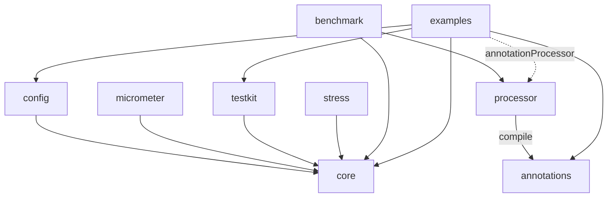

# Architecture

> Synthesis of [02 Annotation mechanisms](research/02-annotation-mechanisms.md), [03 Performance internals](research/03-performance-internals.md) and [05 Project architecture](research/05-project-architecture.md). It describes the design as implemented in 0.5.0; the research documents record how it was chosen.

## Overview


1. The user annotates interfaces or non-final classes.
2. At compile time, `processor` validates the annotations (fallback signatures, durations, conflicting bundles) and **generates plain Java source**: a delegating wrapper for interfaces, a subclass for non-final classes.
3. At startup, the user builds a `ResilienceRegistry` (programmatically and/or from external config) and gets the instance with `Resilient.of(PaymentClient.class, impl, registry)` for an interface, or `Resilient.create(InventoryService.class, registry, constructorArgs...)` (or the generated constructor, `new InventoryService$Resilient(registry, ...)`) for a class.
4. The processor is **mandatory**. If the generated class is missing (the processor was not configured), `Resilient.of` fails at startup with a message that shows the `annotationProcessor` line to add. There is no reflection or proxy fallback.
5. Configuration is resolved **once**, when the instance is created, into immutable policy objects held in `final` fields of the generated class. Calls never look anything up.

## Annotation mechanism

Decision: **compile-time annotation processing (APT) that generates source** ([02 §5](research/02-annotation-mechanisms.md)).

Dispatch cost measured in our own JMH run (JDK 25, Apple M1, trivial guard; a direct call costs 1.2 ns) ([02 §3](research/02-annotation-mechanisms.md)):

| Mechanism | 1 service type | 4 service types | Allocation | First instance |
|---|---:|---:|---:|---:|
| APT, policy protocol inlined | 2.4–2.6 ns | 6.9–7.3 ns | 0 B | 0.37 ms |
| APT through a shared `execute(Supplier)` | 2.5 ns | 14.2 ns | 0 B | — |
| Runtime ByteBuddy | 2.0 ns | ~6.0 ns | 0 B | ~200 ms |
| `Proxy` + `Method.invoke` | 16 ns | 37 ns | 16–64 B | 2.4 ms |

Why APT:

- Per-call cost similar to hand-written code, no reflection, monomorphic call sites.
- Instant startup, works in GraalVM native-image without configuration, readable stack traces.
- Errors such as a wrong fallback signature or an invalid duration become compile errors.
- No user ceremony beyond adding an `annotationProcessor` dependency. No JVM flags, no agent, no special compiler.

Rejected or postponed:

- **Runtime ByteBuddy:** about 200 ms for the first instance, a 9 MB dependency, and extra native-image setup.
- **AspectJ and Java agents:** JVM flags, the JEP 451 dynamic-attach warning, and the weaver lags behind each JDK.
- **Class-File API:** final only since JDK 24, not usable with a Java 21 baseline.
- **`Proxy` fallback:** rejected for now. The processor is mandatory and annotations use `CLASS` retention. If a `dynamic` module is ever added, moving to `RUNTIME` retention is a compatible change.

### Shape of the generated code

The JMH run shows that the **shape** of the generated code matters as much as the mechanism. Calling the policies through a shared lambda doubles the cost once several services exist. So `core` exposes two APIs:

- A **functional API for humans** (`Pipeline`, builders) for code that cannot be annotated.
- A low-level, allocation-free **permit protocol for generated code**, in the package `dev.resilience4cata.generated` (exported, but only for generated code): `acquire()` / `onSuccess(token, started)` / `onFailure(token, started, error)` for the breaker, `start()` / `onFailure(attempts, error, start)` / `pause(delay)` for the retry, `enter()` / `succeeded(scope)` / `failed(scope, error)` for the timeout, and so on.

Each policy is one layer: the public method holds the outermost one, and each inner layer is a private method with the same signature, ending with the call to the implementation. This is what the processor generates for `@Retry` + `@CircuitBreaker` + `@Timeout` on `String track(String)` (from the getting-started guide; the fully qualified names are shortened here):

```java
@Override
public String track(String p0) throws IOException {
    final RetryPolicy r4c$retry = this.retry0;
    final long r4c$start = r4c$retry.start();
    int r4c$attempts = 0;
    while (true) {
        try {
            return this.r4c$circuitBreaker0(p0);
        } catch (Throwable r4c$e) {
            final long r4c$delay = r4c$retry.onFailure(++r4c$attempts, r4c$e, r4c$start);
            if (r4c$delay < 0 || !r4c$retry.pause(r4c$delay)) {
                throw r4c$e;
            }
        }
    }
}

private String r4c$circuitBreaker0(String p0) throws IOException {
    final CircuitBreakerPolicy r4c$cb = this.circuitBreaker0;
    final long r4c$token = r4c$cb.acquire();
    if (r4c$token < 0) {
        throw r4c$cb.rejection();                          // preallocated, stackless
    }
    final long r4c$started = r4c$cb.startTimer();          // reads the clock only if slowCallDuration is set
    try {
        final String r4c$result = this.r4c$timeout0(p0);
        r4c$cb.onSuccess(r4c$token, r4c$started);
        return r4c$result;
    } catch (Throwable r4c$e) {
        r4c$cb.onFailure(r4c$token, r4c$started, r4c$e);
        throw r4c$e;
    }
}

private String r4c$timeout0(String p0) throws IOException {
    final TimeoutPolicy r4c$timeout = this.timeout0;
    final TimeoutPolicy.Scope r4c$scope = r4c$timeout.enter();
    final String r4c$result;
    try {
        r4c$result = this.delegate.track(p0);              // monomorphic call
    } catch (Throwable r4c$e) {
        r4c$timeout.failed(r4c$scope, r4c$e);
        throw r4c$e;
    }
    r4c$timeout.succeeded(r4c$scope);
    return r4c$result;
}
```

Asynchronous methods (returning `CompletionStage` or `CompletableFuture`) are the exception: they are generated as nested `policy.executeAsync(() -> next)` calls, because futures already allocate and go through megamorphic callbacks, so one lambda per layer costs little there.

A `processor`/`core` version mismatch is detected when the instance is created: if the generated class lacks the constructor this `core` expects, `Resilient.of` / `Resilient.create` fail with [`R4C-RT-004`](errors.md#r4c-rt-004). Use the BOM to keep both on the same version.

### Interface vs implementation annotations

| Style | Annotations that count | Precedence, lowest first |
|---|---|---|
| Wrapper: `Resilient.of(PaymentClient.class, impl, registry)` | Interface only. The implementation is not known at compile time; annotating it makes the class use the subclass style instead | declaring interface < wrapped interface < interface method |
| Subclass: `Resilient.create(HttpPaymentClient.class, registry)` | Interface and implementation | interface < interface method < class < class method |

In the subclass style the implementation **wins**, attribute by attribute: a class method that sets only `maxAttempts` keeps the `delay` declared on the interface.

### Self-invocation

Decision: calls from one method to another inside the same object **are intercepted** whenever the mechanism allows it.

| Style | `this.other()` inside the user's code | Why |
|---|---|---|
| Subclass (annotated non-final class, `Resilient.create(InventoryService.class, registry)`) | **Intercepted** | The generated subclass overrides `other()`, so the virtual call goes through it |
| Wrapper (annotated interface, `Resilient.of(PaymentClient.class, impl, registry)`) | Not intercepted | The user's implementation calls itself directly; the wrapper never sees it |

The difference is documented in the [getting-started guide](start/how-it-works.md). Users who need self-invocation in the wrapper style annotate the implementation class instead. A method that calls itself recursively goes through its policies on every call, which is also documented.

## Policy internals

As implemented, starting from the proposals in [03](research/03-performance-internals.md); the lock-free parts are checked with jcstress and every hot-path change with JMH ([benchmarks](benchmarks.md)).

| Policy | Design |
|---|---|
| Circuit breaker | The state is an immutable phase object (closed, open, half-open, forced open, disabled) swapped by CAS through a `VarHandle`, so objects are allocated only on transitions; permits carry the phase's generation and stale outcomes are dropped; count window as a slot array updated with `getAndSet` plus counters, time window as one-second buckets with `LongAdder` counters; while closed with only fast successes, a single `quiet` field is all a call reads |
| Rate limiter | GCRA on one padded `long` (the theoretical arrival time) with a plain CAS; the reject path only reads; a caller that loses the CAS parks for 1 ns before retrying; no background thread |
| Bulkhead | With `maxWait = 0`, a CAS loop on a padded counter (acquire to take a slot, release to give it back); a non-fair `Semaphore` when `maxWait > 0`; async waiters queue without blocking and are handed released slots |
| Retry | Attempt state in locals; nothing allocated on the success path; full, equal or no jitter |
| Timeout | The call stays on the caller's thread; one shared watchdog thread checks per-thread reusable scopes against a coarse clock and interrupts late calls, with a stamped CAS protocol so an interrupt never hits the next call; async timeouts use a separate lock-free timer (striped inboxes) that never fires early |
| Cross-cutting | Typed event records, allocated only when someone listens; snapshots on demand (pull); padding of write-hot fields; preallocated stackless rejections; no clock read unless the feature needs it |

Not available with a Java 21 baseline: `StructuredTaskScope` (still a preview API in JDK 25). `synchronized` pinning was only fixed in JDK 24 (JEP 491), so `synchronized` is banned on hot paths.

## Modules

Single-word directories. Published under the groupId `dev.resilience4cata` (the project owns `resilience4cata.dev`); artifactIds carry a prefix: `resilience4cata-core`, and so on. Root Java package and JPMS module prefix: `dev.resilience4cata` ([05 §1](research/05-project-architecture.md)).

| Module | Published | Responsibility | Depends on |
|---|---|---|---|
| `annotations` | yes | Annotation types, plus `@Experimental` / `@Internal` | — |
| `core` | yes | Every policy, registry, config model, `Pipeline`, the generated-code protocol, events and snapshots | — (JDK only, plus JSpecify) |
| `processor` | yes | Annotation processor: validation and code generation | `annotations` |
| `config` | yes | Loads properties files, classpath resources, environment variables and system properties into the registry builder | `core` |
| `micrometer` | yes | Micrometer metrics: counters from events, gauges from breaker, bulkhead and rate limiter handles ([guide](guides/micrometer.md)) | `core`, `micrometer-core` |
| `opentelemetry` | yes | OpenTelemetry metrics, the same as the Micrometer module's ([guide](guides/opentelemetry.md)) | `core`, `opentelemetry-api` |
| `testkit` | yes | Test helpers for users: `ManualClock` (clock, sleeps and timers), seeded jitter, `elapseWaitInOpen` | `core` |
| `junit` | yes | JUnit Jupiter extension: a fresh `ManualClock` and registry per test ([testing guide](guides/testing.md#junit)) | `testkit`, `junit-jupiter-api` |
| `bom` | yes | Version alignment (`resilience4cata-bom`) | — |
| `benchmark` | no | JMH against Resilience4j | `core`, `processor`, Resilience4j |
| `stress` | no | jcstress for lock-free structures | `core` |
| `examples` | no | Runnable samples, also end-to-end tests of the generated code | `annotations`, `core`, `config`, `testkit`, `junit`, `micrometer`, `opentelemetry`, `processor` |
| `docs` | no | Documentation. Not a Gradle project | — |



Rules, enforced by the module descriptors (`module-info.java`) and the Gradle dependencies (no ArchUnit yet):

- Interfaces that annotations refer to (`FallbackHandler<T>`, `Classifier<T>`) live in `core`, not in `annotations`, so `annotations` can stay `compileOnly`. The annotation attributes are typed `Class<?>`, and the processor checks at compile time that the class implements the right interface.

- `core` and `annotations` have no dependencies, except JSpecify (`api`, annotations only) in `core`.
- `processor` is never a runtime dependency; it only appears on `annotationProcessor`.
- Generated code uses only `core`'s exported API.
- Integrations depend on `core`, never on each other.
- The split is by dependency boundary, never by pattern. Resilience4j's one-artifact-per-pattern split is a common complaint.
- There is no module named `test`: it would clash with Gradle's `test` task, so the module is `testkit`.

What a user declares (details, Maven and JPMS in [getting started](start/installation.md)):

```groovy
dependencies {
    implementation platform('dev.resilience4cata:resilience4cata-bom:0.5.0')
    annotationProcessor platform('dev.resilience4cata:resilience4cata-bom:0.5.0')   // the processor path does not inherit it
    implementation 'dev.resilience4cata:resilience4cata-core'
    compileOnly 'dev.resilience4cata:resilience4cata-annotations'   // CLASS retention: not needed at runtime
    annotationProcessor 'dev.resilience4cata:resilience4cata-processor'
}
```

## Build and tooling

Based on [05 §2–§4](research/05-project-architecture.md), as set up now:

- **No Kotlin anywhere.** Gradle 9 (wrapper 9.6) with the Groovy DSL, kept minimal and declarative (`settings.gradle`, one short `build.gradle` per module). All build logic lives in convention plugins **written in Java**, in the `conventions` included build. Versions are in `gradle/libs.versions.toml`.
- Java toolchain 21 with `--release 21`, `-Xlint:all -Werror`; CI matrix on JDK 21 and 25 (GitHub Actions, not yet run on GitHub). Configuration cache and build cache on.
- `module-info.java` in every published module; internal packages are not exported.
- Testing: JUnit, AssertJ, jcstress and JMH (with an allocation gate). Processor tests compile sources in memory with a small `Compilation` helper on plain `javax.tools`, not the compile-testing library. ArchUnit and jqwik (in maintenance mode) are ideas, not used.
- Static analysis: `javac -Xlint:all -Werror` and JSpecify nullness annotations. Error Prone + NullAway, Spotless and JaCoCo are ideas, not set up.
- Publishing: to the Maven Central Portal (OSSRH closed in June 2025) with Gradle's own `maven-publish` and `signing` plugins and no third-party plugin. The `r4c.publish` convention plugin writes the POMs and signs; `r4c.central`, at the root, builds a checked bundle zip and uploads it through the Publisher API as a deployment that is released by hand in the portal. The `dev.resilience4cata` namespace is verified on the Central Portal through a DNS TXT record on `resilience4cata.dev`. Steps: [Releasing](releasing.md).
- Versioning: SemVer, `0.x` while incubating. Planned: japicmp in CI, failing the build from `1.0`.

## Documentation

- `docs/` is plain Markdown, not a Gradle module, served by Docsify (`docs/index.html`).
- Same file tree in `docs/en` and `docs/es`. English is the source of truth; every change to `docs/en` must update `docs/es`.
- Markdown stays tool-neutral (CommonMark/GFM plus Mermaid), so moving to another site generator later needs no rewrite.
