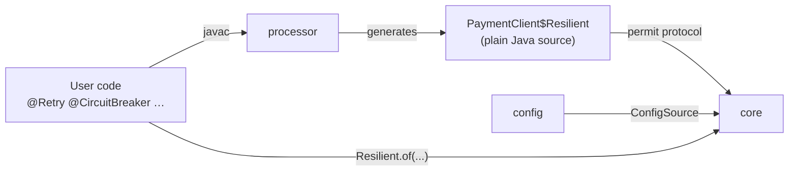
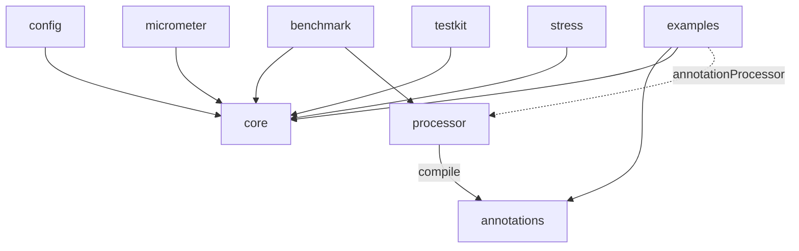

# Architecture

> Synthesis of [02 Annotation mechanisms](research/02-annotation-mechanisms.md), [03 Performance internals](research/03-performance-internals.md) and [05 Project architecture](research/05-project-architecture.md). This is a proposal; nothing is implemented yet.

## Overview



1. The user annotates interfaces or non-final classes.
2. At compile time, `processor` validates the annotations (fallback signatures, durations, conflicting bundles) and **generates plain Java source**: a delegating wrapper for interfaces, a subclass for non-final classes.
3. At startup, the user builds a `ResilienceRegistry` (programmatically and/or from external config) and gets the instance with `Resilient.of(PaymentClient.class, impl, registry)`, or with the generated `PaymentClientResilience.wrap(impl, registry)` factory.
4. The processor is **mandatory**. If the generated class is missing (the processor was not configured), `Resilient.of` fails at startup with a message that shows the `annotationProcessor` line to add. There is no reflection or proxy fallback.
5. Configuration is resolved **once**, when the instance is created, into `final` fields of the generated class. Calls never look anything up.

## Annotation mechanism

Decision: **compile-time annotation processing (APT) that generates source** ([02 §5](research/02-annotation-mechanisms.md)).

Dispatch cost measured in our own JMH run (JDK 25, Apple M1, trivial guard; a direct call costs 1.2 ns) ([02 §3](research/02-annotation-mechanisms.md)):

| Mechanism | 1 service type | 4 service types | Allocation | First instance |
|---|---:|---:|---:|---:|
| APT, policy protocol inlined | 2.4–2.6 ns | 6.9–7.3 ns | 0 B | 0.37 ms |
| APT through a shared `execute(Supplier)` | 2.5 ns | 14.2 ns | 0 B | — |
| Runtime ByteBuddy | 2.0 ns | ~6.0 ns | 0 B | ~200 ms |
| `Proxy` + `Method.invoke` | 16 ns | 37 ns | 16–64 B | 2.4 ms |

Why APT:

- Per-call cost similar to hand-written code, no reflection, monomorphic call sites.
- Instant startup, works in GraalVM native-image without configuration, readable stack traces.
- Errors such as a wrong fallback signature or an invalid duration become compile errors.
- No user ceremony beyond adding an `annotationProcessor` dependency. No JVM flags, no agent, no special compiler.

Rejected or postponed:

- **Runtime ByteBuddy:** about 200 ms for the first instance, a 9 MB dependency, and extra native-image setup.
- **AspectJ and Java agents:** JVM flags, the JEP 451 dynamic-attach warning, and the weaver lags behind each JDK.
- **Class-File API:** final only since JDK 24, not usable with a Java 21 baseline.
- **`Proxy` fallback:** rejected for now. The processor is mandatory and annotations use `CLASS` retention. If a `dynamic` module is ever added, moving to `RUNTIME` retention is a compatible change.

### Shape of the generated code

The JMH run shows that the **shape** of the generated code matters as much as the mechanism. Calling the policies through a shared lambda doubles the cost once several services exist. So `core` exposes two APIs:

- A **functional API for humans** (`Pipeline`, builders) for code that cannot be annotated.
- A low-level, allocation-free **permit protocol for generated code**, in an exported package such as `core.spi.generated`: `long acquire(now)`, `onSuccess(token, nanos)`, `onFailure(token, nanos, error)`, `tryEnter()` / `exit()`, and so on.

```java
// Generated (illustrative)
@Override
public Receipt charge(Order order) {
    int attempt = 0;
    while (true) {
        long t0 = ticker.read();
        long permit = charge$cb.acquire(t0);              // no lambda, no boxing
        if (permit == REJECTED) return fallback.apply(order, charge$cb.rejection());
        try {
            Receipt r = delegate.charge(order);            // monomorphic call
            charge$cb.onSuccess(permit, ticker.read() - t0);
            return r;
        } catch (Throwable e) {
            charge$cb.onFailure(permit, ticker.read() - t0, e);
            if (!charge$retry.shouldRetry(++attempt, e)) return fallback.apply(order, e);
            charge$retry.pause(attempt);                   // fine on virtual threads
        }
    }
}
```

Generated code embeds the processor version, and `core` checks it at class initialisation, so a `processor`/`core` version mismatch fails fast.

### Self-invocation

Decision: calls from one method to another inside the same object **are intercepted** whenever the mechanism allows it.

| Style | `this.other()` inside the user's code | Why |
|---|---|---|
| Subclass (annotated non-final class, `Resilient.create(InventoryService.class, registry)`) | **Intercepted** | The generated subclass overrides `other()`, so the virtual call goes through it |
| Wrapper (annotated interface, `Resilient.of(PaymentClient.class, impl, registry)`) | Not intercepted | The user's implementation calls itself directly; the wrapper never sees it |

The difference is documented in the user guide. Users who need self-invocation in the wrapper style annotate the implementation class instead. A method that calls itself recursively goes through its policies on every call, which is also documented.

## Policy internals

Summary of [03](research/03-performance-internals.md); every item is a hypothesis to validate with JMH and jcstress.

| Policy | Design |
|---|---|
| Circuit breaker | State word in a `VarHandle`; generation-tagged permits for half-open; count window as a slot array updated with `getAndSet` plus counters; time window as epoch-tagged buckets; thresholds evaluated only when a rate can rise |
| Rate limiter | GCRA on one `long` with CAS; the reject path only reads; no background thread |
| Bulkhead | Fail-fast `getAndAdd` counter; semaphore only when `maxWait > 0` |
| Retry | Attempt state in locals; allocation only on failure; decorrelated or full jitter with `ThreadLocalRandom` |
| Timeout | The call stays on the caller's thread; a hashed timer wheel interrupts it, with a CAS protocol so interrupts never leak; async uses the same timer |
| Cross-cutting | Listener callbacks with primitive arguments; pull-based metrics; padding of write-hot fields; one clock-read pair per call |

Not available with a Java 21 baseline: `StructuredTaskScope` (still preview before JDK 28). `synchronized` pinning was only fixed in JDK 24 (JEP 491), so `synchronized` is banned on hot paths.

## Modules

Single-word directories. Published under the groupId `dev.resilience4cata` (the project owns `resilience4cata.dev`); artifactIds carry a prefix: `resilience4cata-core`, and so on. Root Java package and JPMS module prefix: `dev.resilience4cata` ([05 §1](research/05-project-architecture.md)).

| Module | Published | Responsibility | Depends on |
|---|---|---|---|
| `annotations` | yes | Annotation types, plus `@Experimental` / `@Internal` | — |
| `core` | yes | Every policy, registry, config model, the generated-code protocol, events SPI, JFR events | — (JDK only) |
| `processor` | yes | Annotation processor: validation and code generation | `annotations` |
| `config` | yes | Loads properties, environment variables and system properties; `ConfigSource` SPI | `core` |
| `micrometer` | yes | Metrics bridge | `core`, Micrometer |
| `testkit` | yes | Test helpers for users: manual clock, deterministic scheduler, forced states | `core` |
| `bom` | yes | Version alignment | — |
| `benchmark` | no | JMH against Resilience4j | `core`, `processor`, Resilience4j |
| `stress` | no | jcstress for lock-free structures | `core` |
| `examples` | no | Runnable samples, also end-to-end tests of the generated code | `annotations`, `core`, `processor` |
| `docs` | no | Documentation. Not a Gradle project | — |



Rules, enforced with ArchUnit:

- Interfaces that annotations refer to (`Fallback<T>`, `Classifier<T>`) live in `core`, not in `annotations`, so `annotations` can stay `compileOnly`. The annotation attributes are typed `Class<?>`, and the processor checks at compile time that the class implements the right interface.

- `core` and `annotations` have no dependencies, except JSpecify (`api`, annotations only) in `core`.
- `processor` is never a runtime dependency; it only appears on `annotationProcessor`.
- Generated code uses only `core`'s exported API.
- Integrations depend on `core`, never on each other.
- The split is by dependency boundary, never by pattern. Resilience4j's one-artifact-per-pattern split is a common complaint.
- There is no module named `test`: it would clash with Gradle's `test` task, so the module is `testkit`.

What a user declares:

```groovy
dependencies {
    implementation platform('dev.resilience4cata:resilience4cata-bom:0.1.0')
    implementation 'dev.resilience4cata:resilience4cata-core'
    compileOnly 'dev.resilience4cata:resilience4cata-annotations'   // CLASS retention: not needed at runtime
    annotationProcessor 'dev.resilience4cata:resilience4cata-processor'
}
```

## Build and tooling

From [05 §2–§4](research/05-project-architecture.md):

- **No Kotlin anywhere.** Gradle 9 with the Groovy DSL, kept minimal and declarative (`settings.gradle`, one short `build.gradle` per module). All build logic lives in convention plugins **written in Java**, in the `conventions` included build. Versions are in `gradle/libs.versions.toml`.
- Java toolchain 21 with `--release 21`; CI matrix on JDK 21 and 25. Configuration cache and build cache on from day one.
- `module-info.java` in every published module; internal packages are not exported.
- Testing: JUnit, AssertJ, jcstress, ArchUnit, and compile-testing for the processor. jqwik is in maintenance mode, so check its compatibility before adopting it.
- Static analysis: Error Prone + NullAway (JSpecify mode), Spotless, JaCoCo.
- Publishing: vanniktech maven-publish plugin to the Maven Central Portal (OSSRH closed in June 2025), with GPG signing in CI. The `dev.resilience4cata` namespace is verified on the Central Portal through a DNS TXT record on `resilience4cata.dev`.
- Versioning: SemVer, `0.x` while incubating; japicmp in CI, failing the build from `1.0`.

## Documentation

- `docs/` is plain Markdown, not a Gradle module, served by Docsify (`docs/index.html`).
- Same file tree in `docs/en` and `docs/es`. English is the source of truth; every change to `docs/en` must update `docs/es`.
- Markdown stays tool-neutral (CommonMark/GFM plus Mermaid), so moving to another site generator later needs no rewrite.
