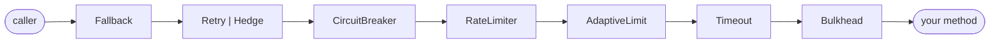

# Policies

resilience4cata has eight policies, one annotation each; put them on a method or a whole interface, alone or stacked, and the processor always nests them in the same order.

| Policy | Annotation | What it does | Thrown when it rejects |
|---|---|---|---|
| [Fallback](fallback.md) | `@Fallback` | Answers with an alternative result when the call fails or is rejected | — |
| [Retry](retry.md) | `@Retry` | Calls again after a failure, with backoff and jitter | — (rethrows the last failure) |
| [Hedge](hedge.md) | `@Hedge` | Starts the same call again while the first is slow, and keeps the first success (async, idempotent calls only) | — (rethrows the last failure) |
| [Circuit breaker](circuit-breaker.md) | `@CircuitBreaker` | Stops calling a dependency that keeps failing, then probes it | `CallNotPermittedException` |
| [Rate limiter](rate-limiter.md) | `@RateLimiter` | Lets through at most N calls per period | `RateLimitExceededException` |
| [Adaptive limit](adaptive-limit.md) | `@AdaptiveLimit` | Limits how many calls run at the same time, with a limit it adjusts from their latency | `LimitExceededException` |
| [Timeout](timeout.md) | `@Timeout` | Interrupts a sync call, or fails an async one, that takes too long | `CallTimeoutException` |
| [Bulkhead](bulkhead.md) | `@Bulkhead` | Limits how many calls run at the same time | `BulkheadFullException` |

Every policy except Hedge works on synchronous methods and on methods that return `CompletionStage<T>` or `CompletableFuture<T>` (see [Async methods](../guides/async.md)); Hedge needs an asynchronous method, and takes Retry's place (the two cannot be combined on one method). The exceptions are in package `dev.resilience4cata`, extend `RuntimeException`, have no stack trace, and carry the policy's `instanceId()`.

## Which policy do I need?

| Problem | Policy | Start with |
|---|---|---|
| Calls fail now and then, and trying again usually works | Retry | `@Retry(maxAttempts = 3, delay = "200ms")` |
| A dependency goes down for minutes, and calls pile up waiting for it | Circuit breaker (inside a retry) | `@CircuitBreaker(name = "…")` |
| A dependency hangs, and your threads hang with it | Timeout | `@Timeout("2s")` |
| An API allows 10 requests per second | Rate limiter | `@RateLimiter(permits = 10, period = "1s")` |
| A slow dependency uses up all your threads or connections | Bulkhead | `@Bulkhead(maxConcurrent = 10)` |
| Same, but you cannot tell how many concurrent calls it can take, or it changes | Adaptive limit | `@AdaptiveLimit` with a `@Timeout` inside |
| p99 is far above p50 on an idempotent read from replicated backends | Hedge | `@Hedge(delay = "50ms")` on a `CompletableFuture` method |
| There is a sensible degraded answer (cache, default, "try later") | Fallback | `@Fallback(method = "…")` |
| The failure is in the result, not an exception (HTTP `503`) | Retry / circuit breaker with a [classifier](../guides/classifiers.md) | `@Retry(classifier = …)` |

A common stack for a remote call is a timeout, a circuit breaker and a retry, plus a fallback where a degraded answer exists.

## The order is fixed

Outermost first:



The order you write the annotations in does not matter, and the order cannot be changed. It is chosen so that each policy sees what it should:

- **Fallback is outermost**, so it sees the final outcome: the last failure once the retries give up, and every rejection from the policies inside.
- **Retry is outside the circuit breaker**, so every attempt is recorded by the breaker, and an open breaker stops the retries (below). **Hedge** sits in the same place, for the same reasons: each hedged attempt goes through the breaker, limiter, timeout and bulkhead on its own.
- **The circuit breaker is outside the rate limiter**, so calls it rejects do not use up permits.
- **The adaptive limit is inside the rate limiter and outside the timeout and the bulkhead**, so a timeout or a full bulkhead inside it is the overload signal that lowers its limit.
- **The timeout is inside the retry**, so it applies per attempt; `@Retry(maxDuration = …)` bounds the whole operation.
- **The bulkhead is innermost**, so a slot is held only while the method actually runs: not during a retry's backoff, not while waiting for a permit.

## Combining them

<!-- compare:start -->
<!-- snippet: policies-stack -->
```java
import dev.resilience4cata.annotation.Bulkhead;
import dev.resilience4cata.annotation.CircuitBreaker;
import dev.resilience4cata.annotation.Fallback;
import dev.resilience4cata.annotation.RateLimiter;
import dev.resilience4cata.annotation.Retry;
import dev.resilience4cata.annotation.Timeout;

public interface CheckoutApi {

    @Bulkhead(maxConcurrent = 20)                       // the order you write them in does not matter:
    @Timeout("2s")                                      // they always nest as
    @RateLimiter(permits = 50, period = "1s")           // Fallback → Retry → CircuitBreaker
    @CircuitBreaker(name = "checkout")                  //   → RateLimiter → Timeout → Bulkhead → method
    @Retry(maxAttempts = 3, delay = "200ms")
    @Fallback(method = "later")
    String placeOrder(String cartId);

    default String later(String cartId, Exception failure) {
        return "queued " + cartId;
    }
}
```
<!-- not-compiled: generated code, abridged -->
```java
public final class CheckoutApi$Resilient implements CheckoutApi {
    // … one final field per policy, created from the registry in the constructor

    @Override
    public java.lang.String placeOrder(java.lang.String p0) {           // Fallback + Retry
        final dev.resilience4cata.generated.RetryPolicy r4c$retry = this.retry0;
        final long r4c$start = r4c$retry.start();
        int r4c$attempts = 0;
        while (true) {
            try {
                return this.r4c$circuitBreaker0(p0);
            } catch (java.lang.Throwable r4c$e) {
                final long r4c$delay = r4c$retry.onFailure(++r4c$attempts, r4c$e, r4c$start);
                if (r4c$delay < 0 || !r4c$retry.pause(r4c$delay)) {
                    if (!this.fallback0.handles(r4c$e)) {
                        throw r4c$e;
                    }
                    if (r4c$e instanceof java.lang.Exception r4c$f0) {
                        return this.delegate.later(p0, r4c$f0);
                    }
                    throw r4c$e;
                }
            }
        }
    }

    private java.lang.String r4c$circuitBreaker0(java.lang.String p0) {
        // … acquire a permit, then:
            final java.lang.String r4c$result = this.r4c$rateLimiter0(p0);
        // …
    }

    private java.lang.String r4c$rateLimiter0(java.lang.String p0) {
        // … take a permit, then:
        return this.r4c$timeout0(p0);
    }

    private java.lang.String r4c$timeout0(java.lang.String p0) {
        // … start timing, then:
            r4c$result = this.r4c$bulkhead0(p0);
        // …
    }

    private java.lang.String r4c$bulkhead0(java.lang.String p0) {
        // … take a slot, then:
            return this.delegate.placeOrder(p0);
        // …
    }
}
```
<!-- compare:end -->

Each policy becomes one layer of straight-line code: the public method holds the outermost layer, and each inner layer is a private method that calls the next one, down to your implementation. Nothing is shared between methods except what you share by `name`.

- Annotations can also go on the interface itself, for every method, and be bundled into your own annotations; see [Bundles](../guides/bundles.md).
- Each policy reads its configuration once, when you wrap the interface, from built-in defaults, `defaults.*`, named configs and the annotation, in that order; see [Configuration](../guides/configuration.md).
- Breakers, rate limiters and bulkheads with the same `name` share one instance, and so do pipelines with that id. Retries and timeouts keep no state between calls, except a retry with a [retry budget](retry.md#retry-budget), which shares its budget the same way.

### An open breaker stops the retries

A retry never retries `CallNotPermittedException`, the exception an open circuit breaker throws, whatever its `abortOn` says. So once the breaker opens, the retry gives up at the next attempt instead of waiting through its backoff, and the fallback answers:

<!-- snippet: policies-open-breaker -->
```java
CheckoutApi checkout = Resilient.of(CheckoutApi.class, cartId -> {
    calls.incrementAndGet();
    return "placed " + cartId;
}, registry);
registry.circuitBreaker("checkout").forceOpen();

assertThat(checkout.placeOrder("cart-1")).isEqualTo("queued cart-1");  // the fallback answered
assertThat(calls).hasValue(0);                  // the breaker rejected the first attempt...
assertThat(clock.elapsed()).isZero();           // ...and the retry did not wait to try again
```

### Rejections are failures to the outer layers

A rejection by an inner policy is an `Exception` like any other to the layers outside it, by default:

- `RateLimitExceededException`, `LimitExceededException`, `CallTimeoutException` and `BulkheadFullException` are **retried** by an outer `@Retry` (after its delay) and **recorded as failures** by an outer `@CircuitBreaker`. Your own rate limiter, adaptive limit or bulkhead can therefore open your breaker. List them in the breaker's `ignoreOn` or the retry's `abortOn` when that is not what you want.
- `Error`s are neither retried nor recorded as breaker failures (`retryOn` and `recordOn` default to `Exception`), but the fallback's default `applyOn = Throwable` does catch them, unless its exception parameter is narrower.

## Programmatic use

Code that cannot be annotated gets the same policies, in the same order, from a [`Pipeline`](../guides/pipeline.md). Each policy page shows its pipeline equivalent.

## What it costs

> [!MEASURED]
> On AWS Graviton3 (`c7g.xlarge`, JDK 21), a successful call through retry, circuit breaker, rate limiter and bulkhead costs 61.6 ns with generated code, against 261 ns and 328 B for Resilience4j 2.4.0; all six policies cost 76.3 ns (Resilience4j has no caller-thread timeout to compare). Generated code allocates nothing on those paths. [Benchmarks: MVP completion](../benchmarks.md#mvp-completion-classifier-pipeline-events-testkit-2026-10-24-aws-graviton3)
