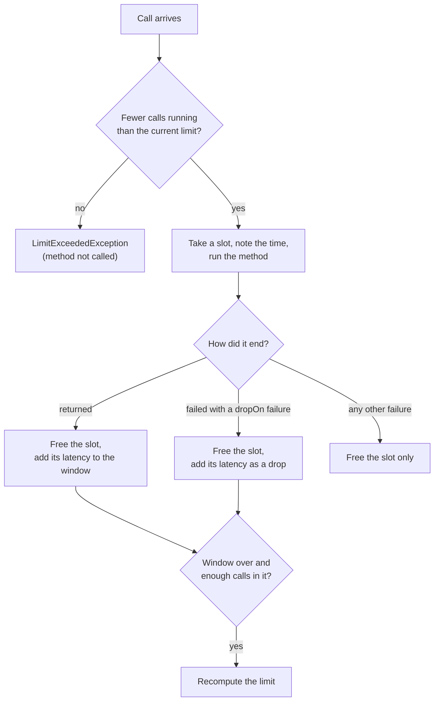

# Adaptive limit

`@AdaptiveLimit` limits how many calls run at the same time, like a bulkhead, but finds the limit by itself: it raises it while the dependency's latency holds and lowers it when latency rises or calls time out.

<div class="r4c-facts">

| Annotation | Position | Return types | Defaults |
|---|---|---|---|
| `@AdaptiveLimit` | 5 of 7, inside RateLimiter | sync and `CompletionStage` | Gradient2, starts at 20, kept between 1 and 200, windows of at least 1 s and 10 calls |

</div>

**Use it when** a dependency's capacity is unknown or changes (it is shared, it autoscales, its load depends on other clients), so that any fixed `@Bulkhead(maxConcurrent = …)` would be either too low on a good day or too high on a bad one. The limit settles near the concurrency the dependency can serve without queueing, and drops when it starts to queue: excess calls are rejected at once instead of piling up behind the slow ones.

**Don't use it when** you know the right number (a connection pool of 10, a licence for 4 sessions): a [bulkhead](bulkhead.md) is simpler and predictable. If what you need is calls per second, use a [rate limiter](rate-limiter.md).

## Minimal example

<!-- compare:start -->
<!-- snippet: adaptive-limit-minimal -->
```java
import dev.resilience4cata.annotation.AdaptiveLimit;

public interface SearchClient {

    @AdaptiveLimit
    String search(String query);
}
```
<!-- not-compiled: generated code, abridged -->
```java
public final class SearchClient$Resilient implements SearchClient {
    // …
    public SearchClient$Resilient(SearchClient delegate, dev.resilience4cata.ResilienceRegistry registry) {
        // …
        this.adaptiveLimit0 = registry.adaptiveLimitPolicy("dev.resilience4cata.examples.docs.adaptivelimit.SearchClient#search(java.lang.String)", "", "", null);
    }

    @Override
    public java.lang.String search(java.lang.String p0) {
        final dev.resilience4cata.generated.AdaptiveLimitPolicy r4c$adaptiveLimit = this.adaptiveLimit0;
        final long r4c$start = r4c$adaptiveLimit.acquire();
        final java.lang.String r4c$result;
        try {
            r4c$result = this.delegate.search(p0);
        } catch (java.lang.Throwable r4c$e) {
            r4c$adaptiveLimit.onFailure(r4c$start, r4c$e);
            throw r4c$e;
        }
        r4c$adaptiveLimit.onSuccess(r4c$start);
        return r4c$result;
    }
}
```
<!-- compare:end -->

Abridged: the real file uses fully qualified names.

## How it behaves



- **Slots.** A call takes a slot before it runs and gives it back when it returns or throws. At most *the current limit* calls hold a slot at the same time. The limit starts at `initialLimit` and always stays between `minLimit` and `maxLimit`.
- **Rejection.** A call that finds every slot taken fails at once with `dev.resilience4cata.LimitExceededException` (a `RuntimeException` with `instanceId()`; one per instance, no stack trace). The method is not called. There is no waiting: a full limit always rejects.
- **Samples.** Each call that returns is a *sample*: its latency, from taking the slot to the end of the call. A failure listed in `dropOn` is a sample too, marked as a *drop*: the dependency is overloaded. Any other failure (a 404, a validation error) frees the slot and says nothing about load, so it is not a sample.
- **Windows.** Samples are grouped in windows of at least `window` (1 s) and at least `minWindowSamples` calls (10). When a call completes after the window is over and the window has enough samples, that call's thread recomputes the limit from the window's average latency, the most calls it saw in flight, and whether any call was dropped. A window that is over with too few calls is extended by one more `window`, and keeps its samples: they count when it ends. So with little traffic the limit moves slowly (and is checked once per window, not on every call), and with none it does not move.
- **Lower limit, calls in flight.** When the limit goes down below the calls already running, nothing is interrupted: new calls are rejected until enough of them end.
- **Disabled** (`enabled = "false"`): every call passes and nothing is measured.

## The algorithms

Both follow Netflix's [concurrency-limits](https://github.com/Netflix/concurrency-limits) library (`Gradient2Limit` and `AIMDLimit`, version 0.5.4), applied once per window.

**`GRADIENT2`** (the default) compares the window's latency with a long-term average of the latency, an exponential average over `longWindow` windows (600). While the window's latency stays within `rttTolerance` times the long-term average (1.5×), the limit grows a little each window, by a fifth (`smoothing`) of `queueSize` (4): about 0.8 per window. When latency rises above that, the limit shrinks in proportion, by at most half at a time. It does not grow while fewer than half of its slots are in use, since latency then says nothing about the limit. After a long overload, the long-term average comes down faster once latency is back to normal, so the limit recovers. It learns a new normal: latency that stays high for many windows becomes the long-term average, and the limit grows again from there.

**`AIMD`** (additive increase, multiplicative decrease) ignores latency. After a window with a drop, the limit is multiplied by `backoffRatio` (0.9); after a window without a drop in which at least half the slots were in use, it grows by one. Use it when latency is too noisy to mean anything, or when your overload signal is a timeout or a full bulkhead downstream.

<!-- snippet: adaptive-limit-aimd -->
```java
@AdaptiveLimit(name = "orders-aimd", algorithm = LimitAlgorithm.AIMD, initialLimit = 10,
        dropOn = {java.net.SocketTimeoutException.class, dev.resilience4cata.CallTimeoutException.class})
String cancel(String order);
```

## Attributes

| Attribute | Type | Default | Config key | Meaning |
|---|---|---|---|---|
| `algorithm` | `LimitAlgorithm` | `GRADIENT2` | `defaults.adaptiveLimit.algorithm` | `GRADIENT2` or `AIMD`, above. `INHERIT` means unset. |
| `initialLimit` | `int` | `20` | `defaults.adaptiveLimit.initialLimit` | The limit before the first window ends. |
| `minLimit` | `int` | `1` | `defaults.adaptiveLimit.minLimit` | The lowest the limit goes. At least 1. |
| `maxLimit` | `int` | `200` | `defaults.adaptiveLimit.maxLimit` | The highest the limit goes. |
| `window` | duration | `1s` | `defaults.adaptiveLimit.window` | How long a window lasts at least, from `10ms` to `1h`. |
| `dropOn` | exception classes | `CallTimeoutException`, `BulkheadFullException`, `TimeoutException` | `defaults.adaptiveLimit.dropOn` | Failures that mean the dependency is overloaded. |
| `ignoreOn` | exception classes | none | `defaults.adaptiveLimit.ignoreOn` | Failures that are never samples; they win over `dropOn`. |
| `name` | `String` | one limit per method | annotation only | Instance id; methods with the same `name` share one limit and its slots. |
| `config` | `String` | `default` | annotation only | Named configuration to start from. |
| `enabled` | `String` | `"true"` | `defaults.adaptiveLimit.enabled` | `""` (inherit), `"true"` or `"false"`. |

<!-- snippet: adaptive-limit-tuned -->
```java
@AdaptiveLimit(name = "orders", initialLimit = 10, maxLimit = 100, window = "500ms")
@Timeout("2s") // inside the limit: a timeout is a drop, and the limit backs off
String place(String order);
```

The algorithms' own tuning has no annotation attribute, to keep the annotation small: `minWindowSamples` (10), Gradient2's `smoothing` (0.2), `rttTolerance` (1.5), `longWindow` (600) and `queueSize` (4), and AIMD's `backoffRatio` (0.9). Set them in a named configuration:

<!-- snippet: adaptive-limit-registry -->
```java
ResilienceRegistry registry = ResilienceRegistry.builder()
        .adaptiveLimit("backend", a -> a.algorithm(AdaptiveLimitConfig.Algorithm.AIMD)
                .backoffRatio(0.8)
                .minWindowSamples(20))
        .build();
```

or in external configuration, with `@AdaptiveLimit(config = "backend")` on the methods:

<!-- snippet: adaptive-limit-properties -->
```properties
defaults.adaptiveLimit.maxLimit=100
configs.backend.adaptiveLimit.algorithm=aimd
configs.backend.adaptiveLimit.backoffRatio=0.8
configs.backend.adaptiveLimit.minWindowSamples=20
instances.orders.adaptiveLimit.rttTolerance=2
```

Every key, with its valid values, is in the [configuration reference](../reference/configuration.md#adaptive-limit).

## On a class

On an annotated class, at type level or on methods, the generated subclass applies the limit ([annotated classes](../guides/annotated-classes.md)):

<!-- snippet: adaptive-limit-class -->
```java
@AdaptiveLimit(maxLimit = 50)
public class InventoryService {

    public int stock(String sku) {
        return 7;
    }
}
```

## Sharing and instance ids

Without `name`, every method has its own limit, with the id `<interface>#<method>(<parameter types>)`. Methods that call the same dependency should usually share one: give them the same `name`. They must resolve to the same configuration, or wrapping fails with [`R4C-REG-008`](../errors.md#r4c-reg-008).

### Handle

`registry.adaptiveLimit(id)` returns an `AdaptiveLimitHandle`:

<!-- snippet: adaptive-limit-handle -->
```java
AdaptiveLimitHandle limit = registry.adaptiveLimit("orders");
int current = limit.limit();                   // how many calls may run at once now
int running = limit.inFlight();                // calls inside right now
AdaptiveLimitSnapshot snapshot = limit.snapshot(); // limit, inFlight, bounds, windows, latencies
```

| Method | What it does |
|---|---|
| `id()` | The `name`, or the derived id |
| `config()` | The resolved `AdaptiveLimitConfig` |
| `limit()` | The current limit |
| `inFlight()` | Calls holding a slot right now |
| `snapshot()` | An `AdaptiveLimitSnapshot(instance, algorithm, limit, inFlight, minLimit, maxLimit, windows, windowLatency, longTermLatency)`, plus `availableSlots()`. `windowLatency` is the last window's average; `longTermLatency` is Gradient2's long-term average (zero with AIMD) |

The limit exists once its interface has been wrapped or its pipeline built; an unknown id throws [`R4C-REG-009`](../errors.md#r4c-reg-009). List them with `registry.snapshot().adaptiveLimits()`.

## With other policies

The adaptive limit is inside the rate limiter and outside the timeout and the bulkhead:

- **A `@Timeout` inside is the overload signal.** A call that times out fails with `CallTimeoutException`, which is in `dropOn` by default: the latency of that call (the timeout) goes into the window, and AIMD backs off. The same goes for a full `@Bulkhead` inside (`BulkheadFullException`).
- **Outer policies see `LimitExceededException`.** It is an `Exception`: by default an outer `@Retry` retries it after its delay (add it to `abortOn` to fail fast) and an outer `@CircuitBreaker` records it as a failure (add it to `ignoreOn` if a full limit should not open the breaker). A `@Hedge` stops starting attempts when one is rejected by the limit, as for an open breaker or a full bulkhead.
- **Each attempt is measured on its own**: a retry's delay is outside the limit, and holds no slot.
- **Rejected calls already took a rate-limiter permit**, since the rate limiter is outside.

## Async

For a method that returns `CompletionStage<T>` or `CompletableFuture<T>`, the call holds its slot until its stage completes, and its latency is measured to that completion:

<!-- snippet: adaptive-limit-async -->
```java
@AdaptiveLimit(name = "orders-async", initialLimit = 2)
CompletableFuture<String> placeAsync(String order);
```

A full limit returns a failed future at once. Cancelling the returned future cancels the stage and frees the slot without a sample: a cancelled call says nothing about the dependency ([cancellation](../guides/async.md#cancellation)). See [Async methods](../guides/async.md).

## Same thing with `Pipeline`

<!-- snippet: adaptive-limit-pipeline -->
```java
Pipeline<String> search = Pipeline.builder(registry, "search", String.class)
        .adaptiveLimit(a -> a.maxLimit(100))
        .timeout(t -> t.timeout(Duration.ofSeconds(2)))
        .build();

String results = search.execute(() -> backend.search("java"));
```

The id `"search"` is the instance id: `registry.adaptiveLimit("search")` returns it. See [Pipeline API](../guides/pipeline.md).

## Events, snapshot and metrics

| Event | When | Fields |
|---|---|---|
| `AdaptiveLimitEvent.Rejected` | A call was rejected: the limit was full | `instance`, `nanoTime`, `limit` |
| `AdaptiveLimitEvent.LimitChanged` | A window ended and the limit moved | `instance`, `nanoTime`, `from`, `to`, `windowLatencyNanos` |

Admitted calls publish nothing, and a window that keeps the limit publishes nothing. The metrics modules report rejections in `r4c.calls.rejected` with `kind = adaptivelimit`, the moves in `r4c.adaptivelimit.limit.changes`, and the gauges `r4c.adaptivelimit.limit` and `r4c.adaptivelimit.concurrent.calls`. See [Observability](../guides/observability.md#metric-names).

## Testing it with `ManualClock`

On a [`ManualClock`](../guides/testing.md), latencies are what the clock says and windows end when the clock passes them, so the limit moves the same way on every run. Pending stages hold their slots, which makes an async limit easy to fill:

<!-- snippet: adaptive-limit-testing -->
```java
ManualClock clock = new ManualClock();
ResilienceRegistry registry = ResilienceTesting.registry(clock)
        .adaptiveLimitDefaults(a -> a.minWindowSamples(1))   // end a window after a single call
        .build();
OrderClient orders = Resilient.of(OrderClient.class, backend, registry);
AdaptiveLimitHandle limit = registry.adaptiveLimit("orders-async");

CompletableFuture<String> a = orders.placeAsync("a");          // pending: holds a slot
CompletableFuture<String> b = orders.placeAsync("b");          // pending: holds the other
assertThat(orders.placeAsync("c")).failsWithin(Duration.ZERO)  // full: rejected at once
        .withThrowableThat().withCauseInstanceOf(LimitExceededException.class);

clock.advance(Duration.ofSeconds(1));                          // the calls took 1 s; the window is over
pending.get("a").complete("placed a");                         // ends the window
pending.get("b").complete("placed b");
assertThat(limit.snapshot().windows()).isEqualTo(1);
assertThat(limit.snapshot().windowLatency()).isEqualTo(Duration.ofSeconds(1));
```

The adaptive limit schedules nothing, so it never leaves tasks pending on the clock.

## Small print

- **Fail-fast only.** A full limit rejects at once; there is no `maxWait` yet. Put a `@Retry` outside if callers should try again a little later.
- **No `VEGAS` yet.** Netflix's third algorithm is not implemented; `LimitAlgorithm` leaves room for it.
- **Two clock reads per call**, when the call takes its slot and when it ends, through the registry's ticker. That is the cost of measuring latency; a `@CircuitBreaker` with `slowCallDuration` reads the clock for its own measurement.
- **Gradient2 does not go much below twice `queueSize`** (8 by default) on latency alone: with its gradient at the floor of one half, each window moves the limit to 0.9 × limit + 0.2 × `queueSize`. For small limits, set a smaller `queueSize` or use `AIMD`.
- **Samples can be lost**, never invented: calls record their latency in per-thread stripes without atomic instructions, so two threads that share a stripe and race can lose a sample. The window then has one sample fewer.
- **Differences from Netflix's library**: `minLimit` defaults to 1 (20 there), so that `AIMD` can go as low as the dependency needs (Gradient2's practical floor comes from `queueSize`, above); a window with too few calls is extended, keeping its samples, instead of being discarded; calls faster than 100 µs are samples too; AIMD has no latency threshold that counts as a drop (use a `@Timeout` inside, whose `CallTimeoutException` is in `dropOn`).
- The limit is per JVM and per registry.
- Related errors: [`R4C-ATR-001`](../errors.md#r4c-atr-001) (duration syntax), [`R4C-ATR-003`](../errors.md#r4c-atr-003) (a bound below 1), [`R4C-ATR-009`](../errors.md#r4c-atr-009) (bounds out of order, `window` out of range), [`R4C-REG-001`](../errors.md#r4c-reg-001) (invalid tuning in code), [`R4C-REG-004`](../errors.md#r4c-reg-004) (unknown `config`), [`R4C-REG-008`](../errors.md#r4c-reg-008) (shared `name`, different config), [`R4C-REG-009`](../errors.md#r4c-reg-009) (unknown id).

## What it costs

> [!MEASURED]
> AWS `c7g.xlarge` (Graviton3): a call costs 86 ns on one thread and 380 ns with four, and allocates nothing; a rejection costs 2.1 ns. Netflix's `SimpleLimiter` with a windowed `Gradient2Limit` costs 118 ns and 1087 ns, and allocates 40–95 B per call. A fixed `@Bulkhead` costs 20.5 ns on one thread: the difference is the two `System.nanoTime()` reads (about 33 ns each on that machine) that timing every call needs. From [Adaptive limit, 0.6.0](../benchmarks.md#adaptive-limit-060-2026-10-26-aws-graviton3).
