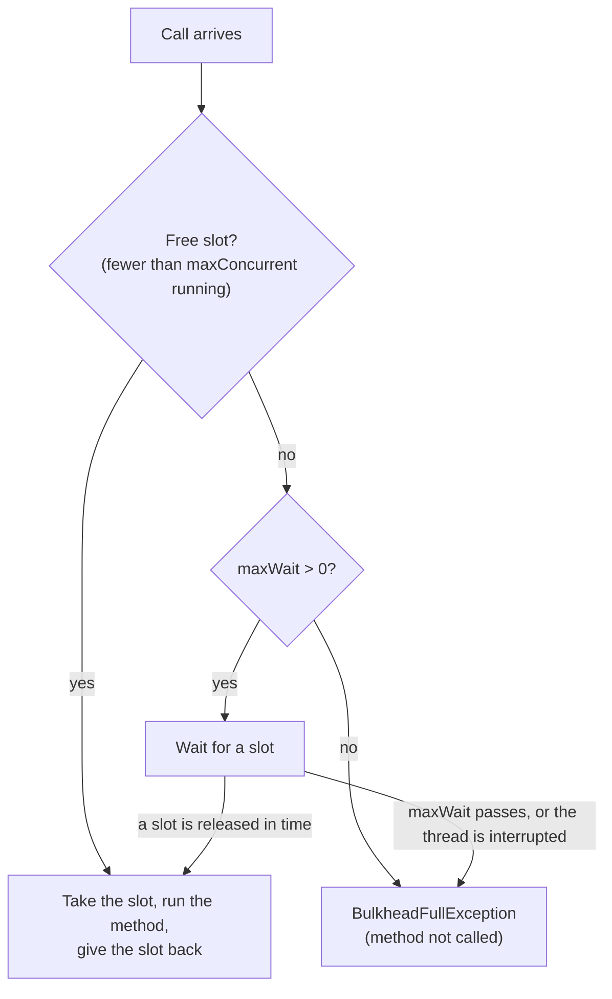

# Bulkhead

`@Bulkhead` limits how many calls run at the same time, so one slow dependency cannot take every thread, connection or slot your service has.

<div class="r4c-facts">

| Annotation | Position | Return types | Defaults |
|---|---|---|---|
| `@Bulkhead` | 7 of 7, innermost, around the method | sync and `CompletionStage` | 25 concurrent calls, no waiting |

</div>

**Use it when** a dependency has limited capacity (a connection pool, a licence, a CPU-heavy renderer), or when you want one dependency's slowness to stay contained instead of using up everything.

**Don't use it when** the limit you need is a *rate* (calls per second): that is a [rate limiter](rate-limiter.md). A bulkhead counts calls in progress, not calls per period.

## Minimal example

<!-- compare:start -->
<!-- snippet: bulkhead-minimal -->
```java
import dev.resilience4cata.annotation.Bulkhead;

public interface ReportRenderer {

    @Bulkhead(maxConcurrent = 10)
    String render(String reportId);
}
```
<!-- not-compiled: generated code, abridged -->
```java
public final class ReportRenderer$Resilient implements ReportRenderer {
    // …
    public ReportRenderer$Resilient(ReportRenderer delegate, dev.resilience4cata.ResilienceRegistry registry) {
        // …
        this.bulkhead0 = dev.resilience4cata.generated.Policies.bulkhead(registry, "dev.resilience4cata.examples.docs.bulkhead.ReportRenderer#render(java.lang.String)", "", "", r4c$b -> {
            r4c$b.maxConcurrent(10);
        }, false);
    }

    @Override
    public java.lang.String render(java.lang.String p0) {
        final dev.resilience4cata.generated.BulkheadPolicy r4c$bulkhead = this.bulkhead0;
        if (!r4c$bulkhead.tryEnter()) {
            throw r4c$bulkhead.rejection();
        }
        try {
            return this.delegate.render(p0);
        } finally {
            r4c$bulkhead.exit();
        }
    }
}
```
<!-- compare:end -->

Abridged: the real file uses fully qualified names.

## How it behaves



- **Slots.** A call takes a slot before it runs and gives it back when it returns or throws. At most `maxConcurrent` calls hold a slot at the same time.
- **Rejection.** With `maxWait = "0"` (the default), a call that finds the bulkhead full fails at once with `dev.resilience4cata.BulkheadFullException` (a `RuntimeException` with `id()`; one per bulkhead, no stack trace). The method is not called.
- **Waiting, sync.** With `maxWait` > 0, the calling thread blocks until a slot is free or `maxWait` passes. On a virtual thread, blocking is cheap and does not pin a carrier. If the waiting thread is interrupted, the call is rejected and the interrupt flag is set again. Waiting is not first-come, first-served: a new caller can take a freed slot ahead of a waiting one.
- **This is a semaphore bulkhead**: the call runs on the caller's thread. There is no thread-pool bulkhead; with virtual threads you rarely need one.
- **Disabled** (`enabled = false`): every call passes.

## Attributes

| Attribute | Type | Default | Config key | Meaning |
|---|---|---|---|---|
| `maxConcurrent` | `int` | `25` | `defaults.bulkhead.maxConcurrent` | Calls allowed to run at the same time. At least 1. |
| `maxWait` | duration | `0` (reject at once) | `defaults.bulkhead.maxWait` | How long a call may wait for a free slot. |
| `name` | `String` | one bulkhead per method | annotation only | Instance id; methods with the same `name` share one bulkhead and its slots. |
| `config` | `String` | `default` | annotation only | Named configuration to start from. |
| `locked` | `boolean` | `false` | annotation only | Keeps the values set in the annotation: `instances.<id>.*` keys cannot change them. See [Locking an instance](../guides/configuration.md#locking-an-instance). |
| `enabled` | `boolean` | `true` | `defaults.bulkhead.enabled` | `false` lets every call through; not set inherits. |

The defaults are Resilience4j's. Keys exist under `configs.<name>.` and `instances.<id>.` too; see [Configuration](../guides/configuration.md).

Callers that may wait a little for a slot:

<!-- snippet: bulkhead-wait -->
```java
@Bulkhead(name = "thumbnails", maxConcurrent = 4, maxWait = "250ms")
byte[] thumbnail(String imageId);
```

## Sharing and instance ids

Without `name`, every method has its own bulkhead, with the id `<interface>#<method>(<parameter types>)`. To protect one resource used by several methods (one connection pool behind a whole client), give them the same `name`: they then share the same `maxConcurrent` slots. They must resolve to the same configuration, or wrapping fails with [`R4C-REG-008`](../errors.md#r4c-reg-008).

### Handle

`registry.bulkhead(id)` returns a `BulkheadHandle`:

<!-- snippet: bulkhead-handle -->
```java
BulkheadHandle bulkhead = registry.bulkhead("thumbnails");
int running = bulkhead.concurrentCalls();        // calls inside right now
int waiting = bulkhead.waitingCalls();           // calls waiting for a slot (0 when maxWait = 0)
BulkheadSnapshot snapshot = bulkhead.snapshot(); // instance, concurrentCalls, waitingCalls, maxConcurrent
```

| Method | What it does |
|---|---|
| `id()` | The `name`, or the derived id |
| `config()` | The resolved `BulkheadConfig` |
| `concurrentCalls()` | Calls holding a slot right now |
| `waitingCalls()` | Calls waiting for a slot right now: async calls queued for a released slot plus sync threads blocked on the bulkhead. Always 0 when `maxWait` is 0. A snapshot for monitoring; it may be stale by the time it is read |
| `snapshot()` | A `BulkheadSnapshot(id, concurrentCalls, waitingCalls, maxConcurrent)`, plus `availableSlots()` |

The bulkhead exists once its interface has been wrapped or its pipeline built; an unknown id throws [`R4C-REG-009`](../errors.md#r4c-reg-009). There is no `registry.bulkheads()`: list them with `registry.snapshot().bulkheads()`.

## With other policies

The bulkhead is the innermost layer, right around your method:

- A slot is held only while the method runs. During a `@Retry` delay, the slot is free for other callers.
- `BulkheadFullException` is an `Exception`: by default an outer `@Retry` retries it after its delay (add it to `abortOn` to fail fast) and an outer `@CircuitBreaker` records it as a failure (add it to `ignoreOn` if a full bulkhead should not open the breaker).
- The time spent waiting for a slot counts towards `@Timeout`, which is outside: a sync wait interrupted by the timeout ends with `CallTimeoutException`.
- Rejected calls already took a rate-limiter permit, since the rate limiter is outside.

## Async

For a method that returns `CompletionStage<T>` or `CompletableFuture<T>`, the call holds its slot until its stage completes, not just until the method returns:

<!-- snippet: bulkhead-async -->
```java
@Bulkhead(name = "thumbnails-async", maxConcurrent = 2, maxWait = "1s")
CompletableFuture<byte[]> thumbnailAsync(String imageId);
```

An async call never blocks a thread while it waits: a full bulkhead with `maxWait` > 0 queues the call, and the oldest waiter gets the next released slot directly, then starts on a new virtual thread. If `maxWait` passes first, its future fails with `BulkheadFullException`. Without `maxWait`, a full bulkhead returns a failed future at once. Sync and async callers of a shared bulkhead use the same slots. Cancelling the returned future cancels the stage and frees the slot at once (when the stage is a `Future`); a call still queued leaves the queue and never starts ([cancellation](../guides/async.md#cancellation)). See [Async methods](../guides/async.md).

## Same thing with `Pipeline`

<!-- snippet: bulkhead-pipeline -->
```java
Pipeline<String> render = Pipeline.builder(registry, "renderer", String.class)
        .bulkhead(b -> b.maxConcurrent(10))
        .build();

String report = render.execute(() -> backend.render("r-1"));
```

The id `"renderer"` is the instance id: `registry.bulkhead("renderer")` returns it. See [Pipeline API](../guides/pipeline.md).

## Events and snapshot

| Event | When | Fields |
|---|---|---|
| `BulkheadEvent.Rejected` | A call was rejected (full with no wait, `maxWait` passed, or an interrupted wait) | `id`, `nanoTime`, `maxConcurrent` |

Admitted calls publish nothing. See [Observability](../guides/observability.md).

## Testing it with `ManualClock`

Pending stages hold their slots, which makes an async bulkhead easy to fill in a test:

<!-- snippet: bulkhead-testing -->
```java
ThumbnailService thumbnails = Resilient.of(ThumbnailService.class, backend, registry);
BulkheadHandle bulkhead = registry.bulkhead("thumbnails-async");

CompletableFuture<byte[]> a = thumbnails.thumbnailAsync("a");   // pending: holds a slot
CompletableFuture<byte[]> b = thumbnails.thumbnailAsync("b");   // pending: holds the other
CompletableFuture<byte[]> c = thumbnails.thumbnailAsync("c");   // full: waits up to 1 s
assertThat(bulkhead.concurrentCalls()).isEqualTo(2);
assertThat(bulkhead.waitingCalls()).isEqualTo(1);

clock.advance(Duration.ofSeconds(1));                          // nothing was released in time
assertThat(c).failsWithin(Duration.ofSeconds(5))
        .withThrowableThat().withCauseInstanceOf(BulkheadFullException.class);
```

On a [`ManualClock`](../guides/testing.md), `maxWait` is measured on the clock, for async and for sync waits: a blocked sync caller gets a slot as soon as one is released and is rejected when the clock passes `maxWait`, however long that takes in real time. It waits for as long as the clock does not move.

## Small print

- The limit is per JVM and per registry.
- `waitingCalls()` is for monitoring only; don't make decisions with it on the call path.
- When sync and async callers wait on the same bulkhead, released slots alternate between the oldest async waiter and the blocked threads, approximately.
- Related errors: [`R4C-ATR-001`](../errors.md#r4c-atr-001) (duration syntax), [`R4C-ATR-003`](../errors.md#r4c-atr-003) (`maxConcurrent` below 1), [`R4C-ATR-006`](../errors.md#r4c-atr-006) (`enabled`), [`R4C-REG-004`](../errors.md#r4c-reg-004) (unknown `config`), [`R4C-REG-008`](../errors.md#r4c-reg-008) (shared `name`, different config), [`R4C-REG-009`](../errors.md#r4c-reg-009) (unknown id).

## What it costs

> [!MEASURED]
> On AWS Graviton3 (`c7g.xlarge`, JDK 21), a call through a bulkhead with a free slot costs 20.5 ns on 1 thread, a tie with Resilience4j 2.4.0 (20.4 ns), and 264 ns on 4 threads sharing it, against 432 ns; neither allocates. A rejected call costs 2.3 ns and 0 B, against 139 ns and 416 B. [Benchmarks: MVP completion](../benchmarks.md#mvp-completion-classifier-pipeline-events-testkit-2026-10-24-aws-graviton3)
