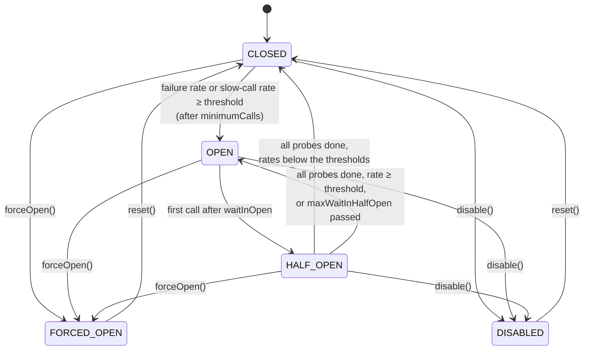

# Circuit breaker

`@CircuitBreaker` stops calling a dependency that keeps failing, and lets a few probe calls through later to see whether it has recovered.

<div class="r4c-facts">

| Annotation | Position | Return types | Defaults |
|---|---|---|---|
| `@CircuitBreaker` | 3 of 6, inside Retry | sync and `CompletionStage` | window of 100 calls, opens at 50% failures after 100 calls, 60 s open, 10 probes, slow-call detection off |

</div>

**Use it when** a dependency can be down or overloaded for a while, and failing fast is better than piling up waiting calls, threads and retries on it.

**Don't use it when** failures are independent of each other (one bad input does not predict the next call), or when there is nothing useful to do while it is open. A breaker on rare calls (a few per hour) never sees enough calls to decide; lower `minimumCalls` or use a [time window](#attributes).

## Minimal example

<!-- compare:start -->
<!-- snippet: circuit-breaker-minimal -->
```java
import dev.resilience4cata.annotation.CircuitBreaker;

public interface PaymentGateway {

    @CircuitBreaker(name = "payments", windowSize = 10, minimumCalls = 10, failureRateThreshold = 50,
            waitInOpen = "30s", halfOpenCalls = 2)
    String charge(String orderId);
}
```
<!-- not-compiled: generated code, abridged -->
```java
public final class PaymentGateway$Resilient implements PaymentGateway {
    // …
    public PaymentGateway$Resilient(PaymentGateway delegate, dev.resilience4cata.ResilienceRegistry registry) {
        // …
        this.circuitBreaker0 = registry.circuitBreakerPolicy("dev.resilience4cata.examples.docs.circuitbreaker.PaymentGateway#charge(java.lang.String)", "payments", "", r4c$b -> {
            r4c$b.windowSize(10);
            r4c$b.minimumCalls(10);
            r4c$b.failureRateThreshold(50.0f);
            r4c$b.waitInOpen(java.time.Duration.ofNanos(30000000000L));
            r4c$b.halfOpenCalls(2);
        });
    }

    @Override
    public java.lang.String charge(java.lang.String p0) {
        final dev.resilience4cata.generated.CircuitBreakerPolicy r4c$cb = this.circuitBreaker0;
        final long r4c$token = r4c$cb.acquire();
        if (r4c$token < 0) {
            throw r4c$cb.rejection();
        }
        final long r4c$started = r4c$cb.startTimer();
        try {
            final java.lang.String r4c$result = this.delegate.charge(p0);
            r4c$cb.onSuccess(r4c$token, r4c$started);
            return r4c$result;
        } catch (java.lang.Throwable r4c$e) {
            r4c$cb.onFailure(r4c$token, r4c$started, r4c$e);
            throw r4c$e;
        }
    }
}
```
<!-- compare:end -->

Abridged: the real file uses fully qualified names.

This breaker looks at the last 10 calls. Once it has seen 10, it opens when 50% or more of them failed, rejects every call for 30 s, then lets 2 probe calls through: if fewer than 50% of them fail it closes, otherwise it opens again.

## How it behaves



- **Closed.** Calls go through and their outcomes go into a sliding window. With `COUNT` (the default) the window holds the last `windowSize` calls; with `TIME` it holds the calls of the last `windowSize` seconds, in one-second buckets.
- **What counts as a failure.** An exception that is an instance of a `recordOn` type (default: `Exception`) and of no `ignoreOn` type. `ignoreOn` wins: those calls count neither way. Any other throwable counts as a **success**, so by default an `Error` does not open the breaker. With slow-call detection on (`slowCallDuration` > 0), a call that takes `slowCallDuration` or longer also counts as slow, whether it succeeded or failed.
- **Opening.** Rates are evaluated once the window holds `minimumCalls` calls (for a count window, `minimumCalls` is capped at `windowSize`). The breaker opens when the failure rate is at or above `failureRateThreshold`, or the slow-call rate at or above `slowCallRateThreshold`.
- **Open.** Every call is rejected at once with `CallNotPermittedException`, without reaching the method. The breaker does not move by itself: the first call that arrives after `waitInOpen` moves it to half-open and becomes a probe.
- **Half-open.** `halfOpenCalls` probe calls are let through; further calls are rejected until the probes finish. When the last probe completes, the same thresholds are applied to the probes: below them the breaker closes with an empty window, otherwise it opens again. If `maxWaitInHalfOpen` is set and the probes have not all finished in that time, the next call opens it again. An ignored probe (an `ignoreOn` exception, or `IGNORE` from a classifier) gives its permit back.
- **Forced open and disabled** are set by hand, through the [handle](#handle): `forceOpen()` rejects everything, `disable()` lets everything through and records nothing, both until `reset()`. `enabled = "false"` starts the breaker in `DISABLED`, and `reset()` then goes back to `DISABLED`.
- A call's outcome is dropped if the breaker changed state while it ran, so a slow call that started while closed cannot decide a half-open probe.

The rejection, `dev.resilience4cata.CallNotPermittedException`, is a `RuntimeException` with `instanceId()`. It is created once per breaker and has no stack trace, so a rejection costs nothing; its message names the breaker.

## Attributes

| Attribute | Type | Default | Config key | Meaning |
|---|---|---|---|---|
| `windowType` | `WindowType` | `COUNT` | `defaults.circuitBreaker.windowType` | `COUNT`: the last `windowSize` calls. `TIME`: the calls of the last `windowSize` seconds. |
| `windowSize` | `int` | `100` | `defaults.circuitBreaker.windowSize` | Calls (`COUNT`) or seconds (`TIME`). At least 1. |
| `minimumCalls` | `int` | `100` | `defaults.circuitBreaker.minimumCalls` | Calls needed before the rates are evaluated. At least 1. |
| `failureRateThreshold` | `float` | `50` | `defaults.circuitBreaker.failureRateThreshold` | Failure rate, in percent (0 < x ≤ 100), that opens the breaker. |
| `slowCallRateThreshold` | `float` | `100` | `defaults.circuitBreaker.slowCallRateThreshold` | Slow-call rate, in percent (0 < x ≤ 100), that opens the breaker. |
| `slowCallDuration` | duration | `0` (off) | `defaults.circuitBreaker.slowCallDuration` | Duration from which a call is slow. `0` turns slow-call detection off: calls are not timed at all. |
| `waitInOpen` | duration | `60s` | `defaults.circuitBreaker.waitInOpen` | How long the breaker stays open before the next call may probe. |
| `halfOpenCalls` | `int` | `10` | `defaults.circuitBreaker.halfOpenCalls` | Probe calls allowed in half-open. At least 1. |
| `maxWaitInHalfOpen` | duration | `0` (no limit) | `defaults.circuitBreaker.maxWaitInHalfOpen` | Longest time in half-open before opening again if the probes have not finished. |
| `recordOn` | `Class<? extends Throwable>[]` | `{Exception.class}` | `defaults.circuitBreaker.recordOn` | Exceptions recorded as failures. Other throwables count as successes. |
| `ignoreOn` | `Class<? extends Throwable>[]` | `{}` | `defaults.circuitBreaker.ignoreOn` | Exceptions that count neither way; wins over `recordOn` and the classifier. |
| `classifier` | `Class<?>` | none | annotation only | A `Classifier<T>` that records results and exceptions as it says. Replaces `recordOn`. See [Classifiers](../guides/classifiers.md). |
| `name` | `String` | one breaker per method | annotation only | Instance id; methods with the same `name` share one breaker. |
| `config` | `String` | `default` | annotation only | Named configuration to start from. |
| `enabled` | `String` | `"true"` | `defaults.circuitBreaker.enabled` | `""` (inherit), `"true"` or `"false"` (starts `DISABLED`). |

The defaults are Resilience4j's, except that slow-call detection is off. Config keys also accept kebab-case (`circuit-breaker.wait-in-open`) and exist under `configs.<name>.` and `instances.<id>.`; see [Configuration](../guides/configuration.md).

A breaker that looks at the last minute, treats calls of 2 s or more as slow, and ignores bad input:

<!-- snippet: circuit-breaker-tuned -->
```java
@CircuitBreaker(windowType = WindowType.TIME, windowSize = 60, minimumCalls = 5,
        slowCallDuration = "2s", slowCallRateThreshold = 80,
        ignoreOn = IllegalArgumentException.class)
long balance(String account);
```

It opens once it has seen 5 calls in the last 60 s and 80% or more of them were slow (or 50% or more failed). An `IllegalArgumentException` is the caller's fault, not the dependency's, so it is not recorded at all.

## Sharing and instance ids

A breaker has state, so sharing matters. Without `name`, each method has its own breaker, with the id `<interface>#<method>(<parameter types>)`. With the same `name` on several methods (or on several interfaces wrapped with the same registry), they share one breaker: failures of one method open it for all. They must resolve to the same configuration, or wrapping fails with [`R4C-REG-008`](../errors.md#r4c-reg-008). A [`Pipeline`](#same-thing-with-pipeline) whose id equals the `name` shares it too.

### Handle

`registry.circuitBreaker(id)` returns a `CircuitBreakerHandle` to inspect the breaker and force its state, for operations and tests:

<!-- snippet: circuit-breaker-handle -->
```java
CircuitBreakerHandle breaker = registry.circuitBreaker("payments");
CircuitBreakerSnapshot snapshot = breaker.snapshot();
System.out.printf("%s is %s, %d calls, failure rate %.0f%%%n",
        snapshot.instance(), snapshot.state(), snapshot.bufferedCalls(), snapshot.failureRate());

breaker.forceOpen();   // maintenance window: every call is rejected
breaker.disable();     // or let every call through, recording nothing
breaker.reset();       // back to CLOSED with an empty window
```

| Method | What it does |
|---|---|
| `id()` | The `name`, or the derived id |
| `state()` | `CLOSED`, `OPEN`, `HALF_OPEN`, `FORCED_OPEN` or `DISABLED` |
| `config()` | The resolved `CircuitBreakerConfig` |
| `snapshot()` | A `CircuitBreakerSnapshot`: state, rates and counts of the current window |
| `forceOpen()` | Rejects every call until `reset()`, whatever the outcomes |
| `disable()` | Lets every call through and records nothing until `reset()` |
| `reset()` | Back to the initial state (`CLOSED`, or `DISABLED` if `enabled = false`) with an empty window |

`registry.circuitBreakers()` lists every breaker created so far, sorted by id. A breaker exists once its interface has been wrapped (`Resilient.of`/`create`) or its pipeline built; an unknown id throws `IllegalArgumentException` [`R4C-REG-009`](../errors.md#r4c-reg-009), with a "did you mean" suggestion.

## With other policies

The breaker is the third layer: inside Retry, around RateLimiter, Timeout and Bulkhead.

- **It stops retries.** Every attempt of a `@Retry` goes through the breaker and is recorded. Once it opens, the next attempt gets `CallNotPermittedException`, which is in the retry's default `abortOn`, so the retry stops without waiting (see the [overview](README.md#an-open-breaker-stops-the-retries)).
- **It records the inner policies' rejections.** `RateLimitExceededException`, `CallTimeoutException` and `BulkheadFullException` are `Exception`s, so by default they count as failures: your own rate limiter or bulkhead can open the breaker. If you don't want that, list them in `ignoreOn`. Timeouts are usually worth recording.
- Rejected calls never reach the rate limiter, so they do not use up its permits.
- A `@Fallback` on the method sees `CallNotPermittedException` like any other failure; a sibling method can take it as its parameter to answer differently while the breaker is open.

## Async

For a method that returns `CompletionStage<T>` or `CompletableFuture<T>`, the breaker asks for a permit before calling, records the outcome when the stage completes, and turns a rejection into a failed future (no exception is thrown from the call):

<!-- snippet: circuit-breaker-async -->
```java
@CircuitBreaker(name = "ledger-async", windowSize = 4, minimumCalls = 4)
CompletableFuture<Long> balanceAsync(String account);
```

Slow calls are timed until the stage completes. See [Async methods](../guides/async.md).

## Same thing with `Pipeline`

<!-- snippet: circuit-breaker-pipeline -->
```java
Pipeline<String> charge = Pipeline.builder(registry, "payments", String.class)
        .circuitBreaker(cb -> cb.windowSize(10).minimumCalls(10).waitInOpen(Duration.ofSeconds(30)))
        .build();

String receipt = charge.execute(() -> backend.charge("order-1"));
```

The id `"payments"` is the breaker's instance id: `registry.circuitBreaker("payments")` returns it, and an annotated method with `name = "payments"` and the same configuration shares it. See [Pipeline API](../guides/pipeline.md).

## Events and snapshot

| Event | When | Fields |
|---|---|---|
| `CircuitBreakerEvent.StateTransition` | Every state change, published once, by the thread that made it | `instance`, `nanoTime`, `from`, `to` |
| `CircuitBreakerEvent.CallNotPermitted` | A call was rejected (open, forced open, or no probes left) | `instance`, `nanoTime`, `state` |

`CircuitBreakerSnapshot(instance, state, failureRate, slowCallRate, bufferedCalls, failedCalls, slowCalls)`: rates are percentages, or `-1` until the window holds `minimumCalls` calls (the slow-call rate is also `-1` while detection is off). In half-open the counts are the probes'. See [Observability](../guides/observability.md).

## Testing it with `ManualClock`

<!-- snippet: circuit-breaker-testing -->
```java
PaymentGateway payments = Resilient.of(PaymentGateway.class, backend, registry);
CircuitBreakerHandle breaker = registry.circuitBreaker("payments");

for (int i = 0; i < 5; i++) {
    payments.charge("ok-" + i);                       // 5 successes
}
down.set(true);
for (int i = 0; i < 5; i++) {
    assertThatThrownBy(() -> payments.charge("ko")).isInstanceOf(IllegalStateException.class);
}
assertThat(breaker.state()).isEqualTo(CircuitBreakerState.OPEN);   // 10 calls, 50% failed

assertThatThrownBy(() -> payments.charge("rejected")).isInstanceOf(CallNotPermittedException.class);

down.set(false);
ResilienceTesting.elapseWaitInOpen(breaker, clock);  // 30 s later, on the test's clock
payments.charge("probe-1");                          // half-open: 2 probes
payments.charge("probe-2");
assertThat(breaker.state()).isEqualTo(CircuitBreakerState.CLOSED);
```

On a [`ManualClock`](../guides/testing.md), `waitInOpen`, slow calls and time windows are measured on the clock. `ResilienceTesting.elapseWaitInOpen(breaker, clock)` advances it by the breaker's `waitInOpen`; the breaker still reports `OPEN` until the next call arrives. To put a breaker in a state directly, use `forceOpen()`, `disable()` and `reset()` on its handle.

## Small print

- `minimumCalls` larger than a count window's `windowSize` is capped at `windowSize`. A time window has no such cap.
- A time window reads the clock on every call. A count window reads it only when slow-call detection is on.
- With the defaults, the breaker needs 100 calls before it can open. For a low-traffic dependency, lower `minimumCalls` (and `windowSize`), or use a time window.
- Thresholds are inclusive: 5 failures out of 10 opens a breaker with `failureRateThreshold = 50`.
- `CallNotPermittedException` has no stack trace by design. Log the message or `instanceId()`.
- Related errors: [`R4C-ATR-001`](../errors.md#r4c-atr-001) (duration syntax), [`R4C-ATR-003`](../errors.md#r4c-atr-003) (`windowSize`, `minimumCalls`, `halfOpenCalls` below 1), [`R4C-ATR-005`](../errors.md#r4c-atr-005) (rates outside (0, 100]), [`R4C-ATR-006`](../errors.md#r4c-atr-006) (`enabled`), [`R4C-CLS-011`](../errors.md#r4c-cls-011) (`classifier` with `recordOn`), [`R4C-REG-004`](../errors.md#r4c-reg-004) (unknown `config`), [`R4C-REG-008`](../errors.md#r4c-reg-008) (shared `name`, different config), [`R4C-REG-009`](../errors.md#r4c-reg-009) (unknown id for `registry.circuitBreaker`).

## What it costs

> [!MEASURED]
> On AWS Graviton3 (`c7g.xlarge`, JDK 21), a successful call through `@CircuitBreaker` costs 1.9 ns and allocates nothing, on 1 thread and on 4; Resilience4j 2.4.0 (count window, default `SYNCHRONIZED` strategy) takes 89.2 ns on 1 thread and 832 ns on 4. With one call in ten failing, on 4 threads: 274 ns against 910 ns. [Benchmarks: MVP completion](../benchmarks.md#mvp-completion-classifier-pipeline-events-testkit-2026-10-24-aws-graviton3)
