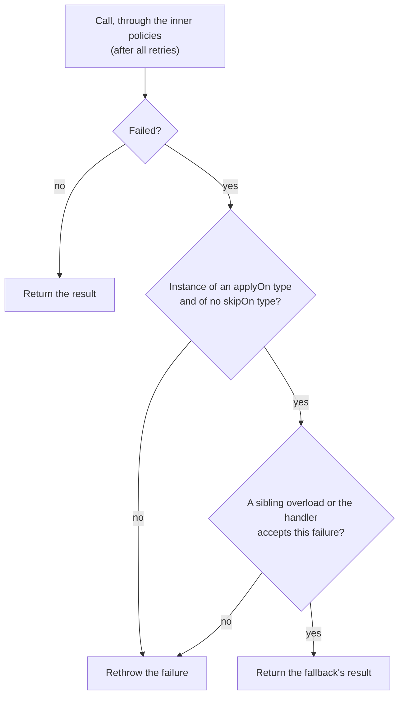

# Fallback

`@Fallback` answers with an alternative result when the call fails or is rejected by another policy.

<div class="r4c-facts">

| Annotation | Position | Return types | Defaults |
|---|---|---|---|
| `@Fallback` | 1 of 6, outermost | sync and `CompletionStage` | applies to every `Throwable` |

</div>

**Use it when** there is a meaningful degraded answer: a cached value, a default, an empty list, "pending" instead of an error.

**Don't use it when** the only "alternative" is to hide the error: a fallback that returns `null` or a fake success makes failures invisible to callers and to your monitoring. If there is nothing better to return, let the exception through.

## Minimal example

<!-- compare:start -->
<!-- snippet: fallback-minimal -->
```java
import dev.resilience4cata.annotation.Fallback;

public interface PriceApi {

    @Fallback(method = "unknownPrice")
    long price(String sku);

    default long unknownPrice(String sku, Exception failure) {
        return -1;
    }
}
```
<!-- not-compiled: generated code, abridged -->
```java
public final class PriceApi$Resilient implements PriceApi {
    // …
    public PriceApi$Resilient(PriceApi delegate, dev.resilience4cata.ResilienceRegistry registry) {
        // …
        this.fallback0 = registry.fallbackPolicy("dev.resilience4cata.examples.docs.fallback.PriceApi#price(java.lang.String)", java.util.List.of(java.lang.Throwable.class), java.util.List.of());
    }

    @Override
    public long price(java.lang.String p0) {
        try {
            return this.delegate.price(p0);
        } catch (java.lang.Throwable r4c$e) {
            if (!this.fallback0.handles(r4c$e)) {
                throw r4c$e;
            }
            if (r4c$e instanceof java.lang.Exception r4c$f0) {
                return this.delegate.unknownPrice(p0, r4c$f0);
            }
            throw r4c$e;
        }
    }
    // …
}
```
<!-- compare:end -->

Abridged: the real file uses fully qualified names.

A fallback is either a **sibling method** (`method = "…"`) in the same interface or class, or a **handler class** (`value = SomeHandler.class`). Set exactly one ([`R4C-FB-001`](../errors.md#r4c-fb-001)). Both are checked when you compile: a wrong name, signature or return type is a compile error, not a runtime surprise.

## How it behaves



- **Which failures.** Those that are an instance of an `applyOn` type (default: `Throwable`, so `Error`s too) and of no `skipOn` type. `skipOn` wins.
- **Rejections included.** The fallback is the outermost layer, so it also sees `CallNotPermittedException`, `RateLimitExceededException`, `CallTimeoutException`, `BulkheadFullException` and, with a classifier, `ResultRejectedException`.
- **After the retries.** With `@Retry` on the same method, the fallback runs once, when the retries give up, never between attempts.
- **What it throws.** If the fallback itself throws, that exception goes to the caller. A checked exception that the annotated method does not declare is wrapped in `java.lang.reflect.UndeclaredThrowableException`.
- The fallback costs nothing while calls succeed: the generated code is a `try`/`catch` around the call.

### Sibling methods

A sibling method takes the annotated method's parameters, optionally followed by one exception parameter, and returns a type assignable to the method's return type. In an interface it is a `default` or `static` method; in an [annotated class](../guides/annotated-classes.md) it must not be `private`.

- **The exception parameter selects the failures it handles.** `unknownPrice(String sku, Exception failure)` handles `Exception`s only: an `Error` does not match and is rethrown, even though `applyOn` is `Throwable`. Take `Throwable` (or no exception parameter at all) to handle everything.
- **Several overloads** with different exception types are allowed; the most specific one that matches is called:

<!-- snippet: fallback-overloads -->
```java
@Fallback(method = "describeFallback")
@CircuitBreaker(name = "catalog")
String describe(String sku) throws IOException;

default String describeFallback(String sku, FileNotFoundException e) {
    return "no such product: " + sku;               // most specific type first
}

default String describeFallback(String sku, IOException e) {
    return "description unavailable";
}

static String describeFallback(String sku, CallNotPermittedException e) {
    return "catalog is resting";                    // the breaker is open
}
```

A `FileNotFoundException` gets the first, any other `IOException` the second, and `CallNotPermittedException` (the breaker is open) the third. A failure that no overload accepts, such as an `IllegalStateException` here, is rethrown.

- Overloads are tried most specific exception type first, whatever order you declare them in. An overload that catches everything (one taking `Throwable`, or one with no exception parameter) ends the list: overloads after it could never be reached, so they are not used.
- A sibling may not throw a checked exception that the annotated method does not declare.
- In the interface style the generated wrapper calls the sibling on your implementation (`delegate.unknownPrice(…)`), so an implementation can override a `default` fallback.
- **Generic methods** are supported. The sibling declares the same type parameters, matched by position, with the same bounds (names may differ), and the generated code calls it with explicit type arguments:

<!-- snippet: fallback-generic -->
```java
@Fallback(method = "nothingFound")
<T> List<T> findAll(Class<T> type, String query);

default <E> List<E> nothingFound(Class<E> type, String query, Exception failure) {
    return List.of();                               // same type parameters, by position
}
```

### Handler classes

A handler implements `dev.resilience4cata.FallbackHandler<T>` and receives a `FallbackContext`:

<!-- snippet: fallback-handler -->
```java
import dev.resilience4cata.FallbackContext;
import dev.resilience4cata.FallbackHandler;
import dev.resilience4cata.annotation.Fallback;
import dev.resilience4cata.annotation.Retry;

public interface QuoteApi {

    @Fallback(ListPrice.class)
    @Retry(maxAttempts = 3, delay = "100ms")
    long quote(String sku, int quantity);

    final class ListPrice implements FallbackHandler<Long> {
        @Override
        public Long apply(FallbackContext context) {
            int quantity = context.argument(1, int.class);   // the call's arguments, by position
            return 100L * quantity;                          // context.failure(), attempts(), instanceId()
        }
    }
}
```

| `FallbackContext` method | Returns |
|---|---|
| `failure()` | The failure that triggered the fallback, rejections included |
| `attempts()` | Attempts made, the first one included (1 without `@Retry`) |
| `argumentCount()` | Number of arguments of the call |
| `argument(int index, Class<A> type)` | One argument, by zero-based position (primitives by their wrapper or primitive class) |
| `instanceId()` | The method's id, `<interface>#<method>(<parameter types>)` |

The handler class must be concrete, non-generic, top-level or `static` nested, accessible from the generated class, with a no-argument constructor; `T` must be assignable to the method's return type. One handler instance is created per method. A handler cannot be used on a generic method whose return type uses the method's type parameters, such as `<T> T load(Class<T> type)`, because one `FallbackHandler<X>` cannot fit every `T` without an unchecked cast ([`R4C-FB-014`](../errors.md#r4c-fb-014)): use a generic sibling method there. A handler is fine on `<T> String describe(T value)`, whose result type does not use `T`.

## Attributes

| Attribute | Type | Default | Config key | Meaning |
|---|---|---|---|---|
| `value` | `Class<?>` | none | annotation only | The handler class, a `FallbackHandler<T>`. |
| `method` | `String` | none | annotation only | The sibling method's name. |
| `applyOn` | `Class<? extends Throwable>[]` | `{Throwable.class}` | annotation only | Failures that trigger the fallback. |
| `skipOn` | `Class<? extends Throwable>[]` | `{}` | annotation only | Failures that never trigger it; wins over `applyOn`. |

`@Fallback` has no `name`, `config` or `enabled`, and no external configuration: a fallback is code, not tuning. There is no handle either.

Filters work with both styles:

<!-- snippet: fallback-filters -->
```java
@Fallback(method = "emptyResults", applyOn = IOException.class, skipOn = FileNotFoundException.class)
String search(String query) throws IOException;

default String emptyResults(String query) {
    return "[]";
}
```

`search` answers `"[]"` for an `IOException`, but a `FileNotFoundException` (a missing index is a bug, not an outage) and anything that is not an `IOException` go to the caller.

## With other policies

The fallback is the outermost layer, so it sees the final outcome of everything inside: the last retry attempt's failure, or a rejection by the breaker, the rate limiter, the timeout or the bulkhead. With `@Retry`, the fallback is fused into the retry's give-up branch, which is how `FallbackContext.attempts()` is exact without any per-call allocation. With a [classifier](../guides/classifiers.md) and the default `onExhaustedResult = RETURN`, a rejected *result* is returned as is and the fallback does not run (nothing was thrown); with `THROW`, the `ResultRejectedException` goes to the fallback like any failure.

## Async

For a method that returns `CompletionStage<T>` or `CompletableFuture<T>`, a failed stage (or an exception thrown before any stage exists) triggers the fallback. A sibling may return `T`, `CompletionStage<T>` or `CompletionStage<? extends T>`; a handler is a `FallbackHandler<CompletionStage<T>>` or `FallbackHandler<T>`:

<!-- snippet: fallback-async -->
```java
@Fallback(method = "cachedDescription")
CompletableFuture<String> describeAsync(String sku);

default CompletionStage<String> cachedDescription(String sku, Throwable failure) {
    return CompletableFuture.completedFuture("cached description of " + sku);
}
```

Failures are unwrapped from `CompletionException` before matching, so a sibling taking `IOException` gets the `IOException`. See [Async methods](../guides/async.md).

## Same thing with `Pipeline`

<!-- snippet: fallback-pipeline -->
```java
Pipeline<Long> quote = Pipeline.builder(registry, "quotes", Long.class)
        .retry(r -> r.maxAttempts(3))
        .fallbackHandler(context -> 100L * context.attempts())
        .build();

long price = quote.execute(() -> backend.quote("sku-1", 3));
```

`fallback(failure -> …)` takes a `Function<Throwable, T>`, `fallbackHandler(context -> …)` a `FallbackHandler<T>` (its context has no arguments: `argumentCount()` is 0). `fallbackApplyOn(List)` and `fallbackSkipOn(List)` are the filters; `fallbackAsync(…)` and `fallbackAsyncHandler(…)` return a stage for `executeAsync`. See [Pipeline API](../guides/pipeline.md).

## Events

| Event | When | Fields |
|---|---|---|
| `FallbackEvent.Applied` | A failure passed `applyOn`/`skipOn` and the fallback is about to run | `instance`, `nanoTime`, `failure` |

See [Observability](../guides/observability.md).

## Testing it with `ManualClock`

<!-- snippet: fallback-testing -->
```java
AtomicInteger calls = new AtomicInteger();
QuoteApi backend = (sku, quantity) -> {
    calls.incrementAndGet();
    throw new IllegalStateException("pricing down");
};
QuoteApi quotes = Resilient.of(QuoteApi.class, backend, registry);

assertThat(quotes.quote("sku-1", 3)).isEqualTo(300L);   // ListPrice, once the retries gave up
assertThat(calls).hasValue(3);
```

On a [`ManualClock`](../guides/testing.md) the retries' delays pass at once, so a test of "retry, then fall back" takes milliseconds.

## Small print

- The default `applyOn = Throwable` includes `Error`s (`OutOfMemoryError`, `StackOverflowError`, `AssertionError`). If your fallback should not hide them, take `Exception` as its parameter, or set `skipOn = Error.class`.
- A `void` method can have a fallback too: the sibling returns `void`, the handler is a `FallbackHandler<Void>` and returns `null`.
- Related errors: [`R4C-FB-001`](../errors.md#r4c-fb-001) to [`R4C-FB-003`](../errors.md#r4c-fb-003) (sibling methods: none or both set, unknown name, no usable candidate), [`R4C-FB-004`](../errors.md#r4c-fb-004) to [`R4C-FB-013`](../errors.md#r4c-fb-013) (handler classes), [`R4C-FB-014`](../errors.md#r4c-fb-014) (handler on a generic method), [`R4C-RT-013`](../errors.md#r4c-rt-013) (pipeline filters without a fallback).

## What it costs

> [!MEASURED]
> `@Fallback` has no benchmark of its own: on success it adds only a `try`/`catch`, and it runs only after a failure. It is part of the "all six policies" stack in the `Pipeline` benchmark, which costs 76.3 ns per successful call on AWS Graviton3 (`c7g.xlarge`, 1 thread) with generated code. [Benchmarks: MVP completion](../benchmarks.md#mvp-completion-classifier-pipeline-events-testkit-2026-10-24-aws-graviton3)
