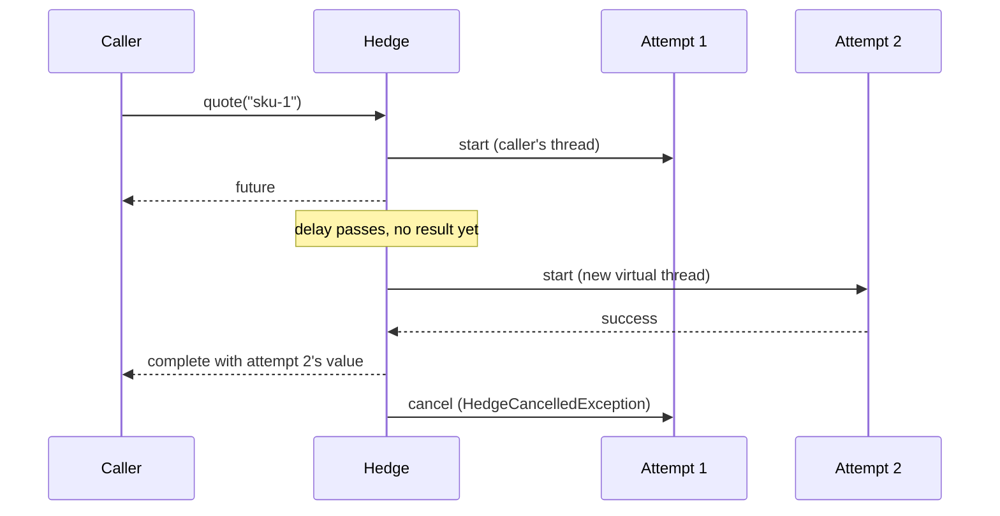

# Hedge

`@Hedge` starts the same call again, next to the first one, when it is slow or fails, and keeps the first success: hedged requests, against tail latency.

<div class="r4c-facts">

| Annotation | Position | Return types | Defaults |
|---|---|---|---|
| `@Hedge` | 2 of 7, in Retry's place (not both on one method) | `CompletionStage` only | 2 attempts, 1 s delay, hedges on `Exception`, budget 10 % + 1/s over 10 s |

</div>

> [!WARNING]
> **Only for idempotent calls.** A hedged method is called several times on purpose, even when nothing fails, with the same arguments, and the attempts that lose may keep running until they notice the cancel. Use it on reads and other operations that are safe to repeat. Never on payments, inserts, sends or anything that must happen once. Putting `@Hedge` on a method *is* the declaration that it is idempotent: there is no extra `idempotent = true` switch.

**Use it when** an idempotent, read-only call to a replicated backend (several replicas, a cache cluster, a search index) is usually fast but its slowest calls (p99, p99.9) are far slower than its median, and a little extra load is a fair price for cutting that tail. *The Tail at Scale* (Dean and Barroso, 2013) cut a p99.9 from 1,800 ms to 74 ms with about 2 % more requests by hedging after 10 ms.

**Don't use it when** the operation is not idempotent, when the dependency is slow because it is saturated (more requests make it slower, for everybody; the [budget](#the-hedge-budget) limits the damage, it does not undo it), when every replica shares the same slow path (a hedge then waits twice), or when the method is synchronous (not supported yet: return a `CompletableFuture`).

## Minimal example

<!-- compare:start -->
<!-- snippet: hedge-minimal -->
```java
import dev.resilience4cata.annotation.Hedge;
import java.util.concurrent.CompletableFuture;

public interface QuoteApi {

    @Hedge(delay = "50ms")
    CompletableFuture<String> quote(String sku);
}
```
<!-- not-compiled: generated code, abridged -->
```java
public final class QuoteApi$Resilient implements QuoteApi {
    // …
    public QuoteApi$Resilient(QuoteApi delegate, dev.resilience4cata.ResilienceRegistry registry) {
        // …
        this.hedge0 = registry.hedgePolicy("dev.resilience4cata.examples.docs.hedge.QuoteApi#quote(java.lang.String)", "", "", r4c$b -> {
            r4c$b.delay(java.time.Duration.ofNanos(50000000L));
        });
    }

    @Override
    public java.util.concurrent.CompletableFuture<java.lang.String> quote(java.lang.String p0) {
        return this.hedge0.executeAsync(() -> this.delegate.quote(p0));
    }
}
```
<!-- compare:end -->

Abridged: the real file uses fully qualified names. The lambda is the *attempt*: the hedge calls it once per attempt, so each attempt goes through the policies inside the hedge on its own.

## How it behaves



- **When attempts start.** Attempt 1 starts at once, on the caller's thread. The next attempt starts when the latest one has run for `delay` with no result anywhere, or **at once** when an attempt fails with a failure listed in `hedgeOn` (default: `Exception`); that attempt starts on a new virtual thread, never on the thread that completed the failed attempt (which may be your HTTP client's I/O thread). `maxAttempts` counts every attempt started, the first one included: the default, 2, is one hedge. `delay = "0"` starts every attempt at once, all on the caller's thread (`maxAttempts` × the load, always).
- **Who wins.** The first **success** completes the call. A failure never wins: it starts the next attempt if one is left, and otherwise the call waits for the attempts still in flight.
- **When it fails.** When every attempt started has failed and no other can start, the call fails with the **last** failure. A failure listed in `abortOn`, or **not** listed in `hedgeOn`, ends the call at once (an `Error`, by default), and the other attempts are cancelled.
- **Rejections.** A rejection by a policy inside the hedge (`CallNotPermittedException` from an open breaker, `BulkheadFullException`, `RateLimitExceededException`) means the dependency has no capacity: no further attempt starts, but the attempts in flight keep running and may still succeed. If nothing else is in flight, the call fails with the rejection.
- **Losers.** Once the call has its outcome, every other attempt's stage is completed with `HedgeCancelledException`, a `CancellationException` (so it reports `isCancelled()`), a new instance for each losing attempt, without a stack trace (`handle`/`whenComplete` on the stage see it as is; from JDK 23 on, `join()` throws a new `CancellationException` with it as the cause). The policies inside the attempt take it as a cancel: a circuit breaker records nothing (a half-open permit is given back), a bulkhead frees the slot, a timeout cancels its deadline, and a `CompletableFuture` returned by your method is cancelled. A late result of a loser is dropped: it completes nothing and publishes nothing.
- **Cancelling** the future you got back cancels every attempt in flight and the pending delay ([cancellation](../guides/async.md#cancellation)).
- **Fast path.** A first attempt whose stage is already complete and successful when your method returns (a cache hit) needs no timer and no hedge.
- **Disabled** (`enabled = "false"`): one attempt, as if there were no annotation (the fallback still runs on failure).

### The hedge budget

Hedges add load exactly when a dependency is slow, which is when it can least take it. The hedge budget caps them for one instance, shared by every caller of that instance: hedges in the last `budgetWindow` may not exceed

> `budgetMinHedgesPerSecond × budgetWindow in seconds + budgetPercent % of the calls in budgetWindow`

It is **on by default** (10 % of the calls plus 1 hedge per second, over 10 s), unlike the [retry budget](retry.md#retry-budget), because hedging adds load on the success path too. `budgetPercent = 0` turns it off. A hedge is charged when it starts. When the budget is spent, no hedge starts, `HedgeEvent.Skipped` is published with reason `BUDGET_EXHAUSTED`, and the call waits for its attempts in flight. It is the same window as the retry budget (counted calls, no clock read on success; see [retry budget](retry.md#retry-budget)). `registry.snapshot().hedges()` shows it as `HedgeSnapshot.Budget(calls, hedges, allowedHedges)`.

## Attributes

| Attribute | Type | Default | Config key | Meaning |
|---|---|---|---|---|
| `maxAttempts` | `int` | `2` | `defaults.hedge.maxAttempts` | Attempts in flight at most, the first one included. From 2 to 10. |
| `delay` | duration | `1s` | `defaults.hedge.delay` | How long the latest attempt runs without a result before the next one starts. Set it near the dependency's p95 latency. `"0"` starts every attempt at once. |
| `hedgeOn` | `Class<? extends Throwable>[]` | `{Exception.class}` | `defaults.hedge.hedgeOn` | Failures after which the next attempt starts at once. A failure not listed ends the call. |
| `abortOn` | `Class<? extends Throwable>[]` | `{}` | `defaults.hedge.abortOn` | Failures that end the call at once and cancel the other attempts; win over `hedgeOn`. |
| `budgetPercent` | `double` | `10` | `defaults.hedge.budgetPercent` | [Hedge budget](#the-hedge-budget): hedges allowed, in percent of the instance's calls in the last `budgetWindow`. Finite, at least 0; 0 turns the budget off. |
| `budgetMinHedgesPerSecond` | `int` | `1` | `defaults.hedge.budgetMinHedgesPerSecond` | Hedge budget: hedges allowed per second of `budgetWindow`, whatever the traffic. At least 0. |
| `budgetWindow` | duration | `10s` | `defaults.hedge.budgetWindow` | Hedge budget: how far back calls and hedges are counted. From `1s` to `1h`. |
| `name` | `String` | one instance per method | annotation only | Instance id; methods with the same `name` share one hedge, and so its budget. |
| `config` | `String` | `default` | annotation only | Named configuration to start from. |
| `locked` | `boolean` | `false` | annotation only | Keeps the values set in the annotation: `instances.<id>.*` keys cannot change them. See [Locking an instance](../guides/configuration.md#locking-an-instance). |
| `enabled` | `String` | `"true"` | `defaults.hedge.enabled` | `""` (inherit), `"true"` or `"false"`. |

Every key also exists under `configs.<name>.hedge.…` and `instances.<id>.hedge.…`; see [Configuration](../guides/configuration.md). There is no classifier and no `maxDuration` yet: the per-attempt `@Timeout` and `maxAttempts × delay` bound a call.

There is **no handle**: `registry` has no `hedge(id)`. `registry.snapshot().hedges()` lists a `HedgeSnapshot(instance, config, budget)` per instance (`budget` is `null` when `budgetPercent = 0`).

## With other policies

Hedge takes Retry's place, the second layer: inside Fallback, around everything else.

<!-- snippet: hedge-combined -->
```java
@Hedge(name = "prices", delay = "30ms", maxAttempts = 3, abortOn = IllegalArgumentException.class)
@CircuitBreaker(name = "prices")
@Timeout("200ms")
@Fallback(method = "cachedPrice")
CompletableFuture<Long> price(String sku);

default CompletableFuture<Long> cachedPrice(String sku, Throwable failure) {
    return CompletableFuture.completedFuture(-1L);
}
```

- **Retry**: `@Hedge` and `@Retry` on one method is a compile error ([`R4C-HDG-002`](../errors.md#r4c-hdg-002)). A hedge already starts a new attempt when one fails.
- **Circuit breaker** (inside): each attempt takes its own permit and is recorded on its own, with its real outcome; a cancelled loser is not recorded. An open breaker rejects the next attempt, which stops further hedges.
- **Rate limiter** (inside): each attempt takes a permit; size the limit with `maxAttempts` and the budget in mind. A rejected attempt stops further hedges.
- **Timeout** (inside): **per attempt**. A timed-out attempt is a failure in `hedgeOn` (`CallTimeoutException` is an `Exception`), so it starts the next attempt at once. With `delay` at or above the timeout, the delay never fires and the hedge becomes a retry on timeout: legal, but almost always a mistake.
- **Bulkhead** (inside): each attempt holds a slot only while it runs; a loser's slot is freed when it is cancelled.
- **Fallback** (outside): runs once, after the call has failed, and `FallbackContext.attempts()` is the number of attempts started.

## Same thing with `Pipeline`

<!-- snippet: hedge-pipeline -->
```java
Pipeline<String> quote = Pipeline.builder(registry, "quotes", String.class)
        .hedge(h -> h.delay(Duration.ofMillis(50)))
        .build();

CompletableFuture<String> price = quote.executeAsync(() -> backend.quote("sku-1"));
```

A pipeline with a hedge only works with `executeAsync`: `execute` throws [`R4C-RT-018`](../errors.md#r4c-rt-018), and a pipeline with both `.retry(…)` and `.hedge(…)` fails to build with [`R4C-RT-019`](../errors.md#r4c-rt-019). The pipeline's id (`"quotes"`) is the instance id. See [Pipeline API](../guides/pipeline.md).

## Events and snapshot

| Event | When | Fields |
|---|---|---|
| `HedgeEvent.Hedged` | Attempt 2 or later started | `instance`, `nanoTime`, `attempt`, `reason` (`DELAY` or `FAILURE`) |
| `HedgeEvent.Won` | Attempt 2 or later succeeded first | `instance`, `nanoTime`, `attempt` |
| `HedgeEvent.Skipped` | A hedge that could have started did not | `instance`, `nanoTime`, `attempt`, `reason` (`BUDGET_EXHAUSTED`, `REJECTED` or `ABORTED`) |
| `HedgeEvent.Failed` | The call failed | `instance`, `nanoTime`, `attempts`, `failure` |

A call whose first attempt wins publishes nothing, and there are no per-call counters: how often hedges start and win is visible through these events only. See [Observability](../guides/observability.md).

## Testing it with `ManualClock`

<!-- snippet: hedge-testing -->
```java
QuoteApi quotes = Resilient.of(QuoteApi.class, backend, registry);   // backend: one pending stage per call

CompletableFuture<String> quote = quotes.quote("sku-1");
clock.advance(Duration.ofMillis(49));
assertThat(attempts).hasSize(1);                  // no hedge before the delay
clock.advance(Duration.ofMillis(1));
assertThat(attempts).hasSize(2);                  // the hedge started, on this thread

attempts.get(1).complete("quote from attempt 2");
assertThat(quote).isCompletedWithValue("quote from attempt 2");
assertThat(attempts.get(0)).isCancelled();        // the loser is cancelled
```

On a [`ManualClock`](../guides/testing.md), the delay is exact (no tick of slack) and a hedge starts on the thread that advances the clock, so tests are deterministic. A hedge started by a failure is scheduled on the clock with no delay: it starts at the next `advance`, `advance(Duration.ZERO)` included. A call that ends before its delay takes the delay off the clock, so `pendingTasks()` stays exact.

## Small print

- **Timer precision.** In production the delays run on the library's lock-free timer for async timeouts: never early, at most about two ticks late, where a tick is a sixteenth of the shortest delay or async timeout in use, between 1 ms and 50 ms (a 10 ms hedge fires between 10 and 12 ms). A short hedge delay therefore shortens the tick for every async timeout too, never below 1 ms.
- **Context is not propagated.** Attempt 1 runs on the caller's thread; hedges start on a new virtual thread, without the caller's `ThreadLocal`s or MDC, as for async retries ([Async methods](../guides/async.md)).
- **Losers may keep running.** Cancelling a stage cannot stop code that ignores it: a delegate that returns a stage it does not tie to its work (or a minimal stage, which cannot be cancelled) keeps working, and its result is dropped.
- **The budget is approximate**, always on the low side (fewer hedges, never more), like the retry budget. With `name`, methods share one budget; give them the same attributes.
- Synchronous methods are not supported yet: `@Hedge` on one is a compile error ([`R4C-HDG-001`](../errors.md#r4c-hdg-001)), also when it comes from the type or a [bundle](../guides/bundles.md).
- Related errors: [`R4C-HDG-001`](../errors.md#r4c-hdg-001) (sync method), [`R4C-HDG-002`](../errors.md#r4c-hdg-002) (with `@Retry`), [`R4C-ATR-001`](../errors.md#r4c-atr-001) (duration syntax), [`R4C-ATR-006`](../errors.md#r4c-atr-006) (`enabled`), [`R4C-ATR-007`](../errors.md#r4c-atr-007) (budget values), [`R4C-ATR-008`](../errors.md#r4c-atr-008) (`maxAttempts` out of 2–10), [`R4C-RT-018`](../errors.md#r4c-rt-018)/[`R4C-RT-019`](../errors.md#r4c-rt-019) (`Pipeline`), [`R4C-REG-004`](../errors.md#r4c-reg-004) (unknown `config`), [`R4C-REG-008`](../errors.md#r4c-reg-008) (shared `name`, different config).

## What it costs

> [!MEASURED]
> AWS `c7g.xlarge` (Graviton3), 1 thread: when the first attempt wins before the delay, a call costs 154 ns and 216 B, against 3601 ns and 1561 B for Resilience4j 2.4.0's `resilience4j-hedge` and 649 ns for a hand-written `CompletableFuture` hedge; a first attempt that is already complete costs 9.4 ns. From [Hedge and async cancellation, 0.4.0](../benchmarks.md#hedge-and-async-cancellation-040-2026-10-25-aws-graviton3).

**Timer precision.** Delays run on the library's shared timer, which works in ticks of a sixteenth of the delay (at least 1 ms): a hedge starts never early and up to about two ticks late, so at most about 12 % after `delay` (a 50 ms delay hedges between 50 and about 56 ms). That makes arming and cancelling the delay, which is what nearly every call does, almost free; with very short delays (a few milliseconds) the relative lateness is larger.

When the first attempt wins before the delay, a call allocates the returned future, one object for the hedge's state, and the callback node and dependent future that the JDK's `whenComplete` creates (four objects besides your own stage and the per-call lambda that every async layer has), schedules its delay with one compare-and-set on a per-thread inbox and cancels it with one more, adds one write to this thread's stripe of the budget, and reads no clock. A hedge that fires adds a virtual thread, the attempt's own layers and, after a failure or with the budget on, one clock read.
