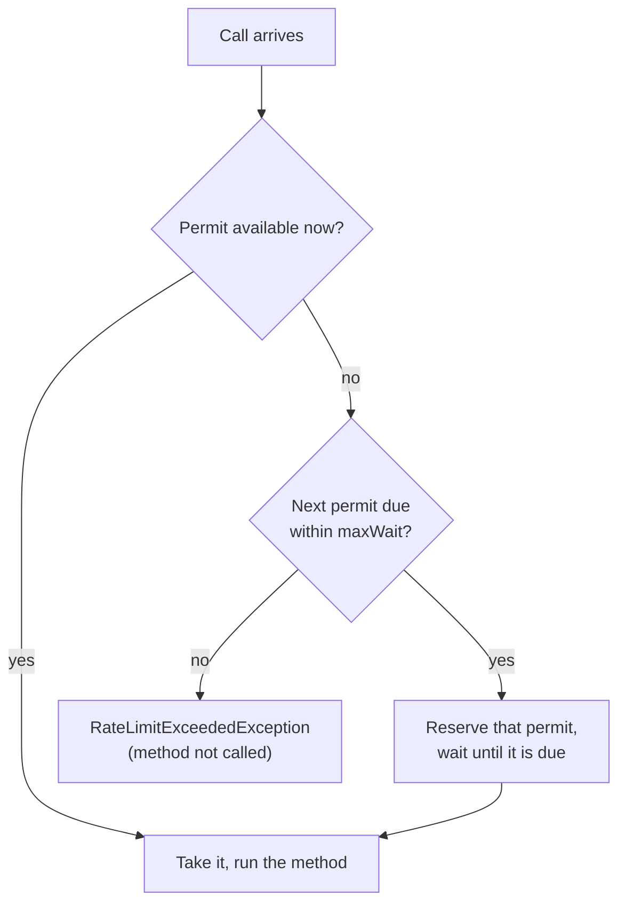

# Rate limiter

`@RateLimiter` lets through at most a given number of calls per period, and rejects (or delays) the rest.

<div class="r4c-facts">

| Annotation | Position | Return types | Defaults |
|---|---|---|---|
| `@RateLimiter` | 4 of 7, inside CircuitBreaker | sync and `CompletionStage` | 50 permits per 1 s, no waiting |

</div>

**Use it when** a dependency has a quota (an API that allows 10 requests per second), or when you want to keep one client from flooding a shared service.

**Don't use it when** what you need to limit is how many calls run *at the same time*, whatever their rate: that is a [bulkhead](bulkhead.md). And a rate limiter in one JVM limits that JVM only: with several instances of your service, each has its own limit.

## Minimal example

<!-- compare:start -->
<!-- snippet: rate-limiter-minimal -->
```java
import dev.resilience4cata.annotation.RateLimiter;

public interface SearchApi {

    @RateLimiter(permits = 10, period = "1s")
    String search(String query);
}
```
<!-- not-compiled: generated code, abridged -->
```java
public final class SearchApi$Resilient implements SearchApi {
    // …
    public SearchApi$Resilient(SearchApi delegate, dev.resilience4cata.ResilienceRegistry registry) {
        // …
        this.rateLimiter0 = registry.rateLimiterPolicy("dev.resilience4cata.examples.docs.ratelimiter.SearchApi#search(java.lang.String)", "", "", r4c$b -> {
            r4c$b.permits(10);
            r4c$b.period(java.time.Duration.ofNanos(1000000000L));
        });
    }

    @Override
    public java.lang.String search(java.lang.String p0) {
        final dev.resilience4cata.generated.RateLimiterPolicy r4c$rateLimiter = this.rateLimiter0;
        if (!r4c$rateLimiter.tryAcquire()) {
            throw r4c$rateLimiter.rejection();
        }
        return this.delegate.search(p0);
    }
}
```
<!-- compare:end -->

Abridged: the real file uses fully qualified names.

## How it behaves

Think of the permits as evenly spaced: with `permits = 10` and `period = "1s"`, one permit becomes available every 100 ms. Permits you don't use are saved, up to `permits` of them, so after a quiet moment a burst of up to 10 calls passes at once; then calls pass at the steady rate, one every 100 ms.



- **Rejection.** With `maxWait = "0"` (the default), a call with no permit available fails at once with `dev.resilience4cata.RateLimitExceededException` (a `RuntimeException` with `instanceId()`; one per limiter, no stack trace). The method is not called.
- **Waiting.** With `maxWait` > 0, a call whose permit comes within `maxWait` reserves it and waits until it is due; a call that would have to wait longer is rejected at once, without waiting at all. Waiters know their slot, so they don't compete when it arrives.
- **Sync waits** sleep on the caller's thread. If the thread is interrupted while waiting, the permit is given back, the interrupt flag is set again and the call is rejected.
- **Bursts.** Because unused permits build up to a full burst, a window of one `period` can see up to twice `permits` calls: a full burst, then the steady rate. This is the same as Resilience4j's fixed cycles.
- There is no background thread refilling permits: each call computes its own from the clock.
- **Disabled** (`enabled = "false"`): every call passes.

Under the hood this is GCRA, the meter form of a token bucket: the whole state is one number, the time at which the next permit is due, moved forward by `period / permits` per call.

## Attributes

| Attribute | Type | Default | Config key | Meaning |
|---|---|---|---|---|
| `permits` | `int` | `50` | `defaults.rateLimiter.permits` | Calls allowed per `period`, and the largest burst. At least 1. |
| `period` | duration | `1s` | `defaults.rateLimiter.period` | Length of the period. Greater than 0, and at least 1 ns per permit. |
| `maxWait` | duration | `0` (reject at once) | `defaults.rateLimiter.maxWait` | How long a call may wait for its permit. |
| `name` | `String` | one limiter per method | annotation only | Instance id; methods with the same `name` share one limiter and its permits. |
| `config` | `String` | `default` | annotation only | Named configuration to start from. |
| `enabled` | `String` | `"true"` | `defaults.rateLimiter.enabled` | `""` (inherit), `"true"` or `"false"`. |

The defaults differ from Resilience4j's (50 permits per 500 ns, 5 s wait): waiting is opt-in here, as in the bulkhead. Keys exist under `configs.<name>.` and `instances.<id>.` too; see [Configuration](../guides/configuration.md).

## Sharing and instance ids

A quota usually covers a whole API, not one method. Give the methods the same `name` and they share one limiter:

<!-- snippet: rate-limiter-wait -->
```java
@RateLimiter(name = "geocoding", permits = 5, period = "1s", maxWait = "500ms")
String geocode(String address);

@RateLimiter(name = "geocoding", permits = 5, period = "1s", maxWait = "500ms")
String reverse(double latitude, double longitude);
```

Here `geocode` and `reverse` share 5 permits per second. When the burst is used up, the next call waits 200 ms for its permit (1 s / 5), within the 500 ms allowed; a call that would have to wait longer than 500 ms is rejected at once. Methods that share a `name` must resolve to the same configuration, or wrapping fails with [`R4C-REG-008`](../errors.md#r4c-reg-008). Without `name`, the id is `<interface>#<method>(<parameter types>)`.

### Handle

`registry.rateLimiter(id)` returns a `RateLimiterHandle`:

<!-- snippet: rate-limiter-handle -->
```java
RateLimiterHandle limiter = registry.rateLimiter("geocoding");
int now = limiter.availablePermits();            // calls that would pass right now without waiting
RateLimiterSnapshot snapshot = limiter.snapshot(); // instance, availablePermits, permits
```

| Method | What it does |
|---|---|
| `id()` | The `name`, or the derived id |
| `config()` | The resolved `RateLimiterConfig` |
| `availablePermits()` | Calls that would pass right now without waiting, between 0 and `permits`; a snapshot that concurrent calls change at once |
| `snapshot()` | A `RateLimiterSnapshot(instance, availablePermits, permits)` |

The limiter exists once its interface has been wrapped or its pipeline built; an unknown id throws [`R4C-REG-009`](../errors.md#r4c-reg-009). There is no `registry.rateLimiters()`: list them with `registry.snapshot().rateLimiters()`.

## With other policies

The rate limiter is the fourth layer: inside CircuitBreaker, around Timeout and Bulkhead.

- Calls rejected by an open breaker never get here, so they don't use up permits.
- Its rejections are `Exception`s, so by default an outer `@CircuitBreaker` records them as failures (your own limiter can open your breaker: add `RateLimitExceededException` to its `ignoreOn` if that is not what you want), and an outer `@Retry` retries them after its backoff delay (add it to `abortOn` to fail fast).
- Each retry attempt takes a permit of its own.
- The time spent waiting for a permit is not part of the `@Timeout`, which is inside.

## Async

For a method that returns `CompletionStage<T>` or `CompletableFuture<T>`, a rejection is a failed future, and a call that waits for its permit is scheduled to start when it is due, without blocking any thread:

<!-- snippet: rate-limiter-async -->
```java
@RateLimiter(name = "geocoding-async", permits = 5, period = "1s", maxWait = "500ms")
CompletableFuture<String> geocodeAsync(String address);
```

Cancelling the future of a call that still waits for its permit gives the permit back, and the call never starts; a call that already started keeps its permit ([cancellation](../guides/async.md#cancellation)). See [Async methods](../guides/async.md).

## Same thing with `Pipeline`

<!-- snippet: rate-limiter-pipeline -->
```java
Pipeline<String> search = Pipeline.builder(registry, "search", String.class)
        .rateLimiter(rl -> rl.permits(10).period(Duration.ofSeconds(1)))
        .build();

String results = search.execute(() -> backend.search("resilience"));
```

The id `"search"` is the instance id: `registry.rateLimiter("search")` returns the limiter. See [Pipeline API](../guides/pipeline.md).

## Events and snapshot

| Event | When | Fields |
|---|---|---|
| `RateLimiterEvent.Rejected` | A call was rejected (no permit within `maxWait`, or an interrupted wait) | `instance`, `nanoTime` |

Admitted calls publish nothing. `registry.snapshot().rateLimiters()` lists a `RateLimiterSnapshot` per limiter. See [Observability](../guides/observability.md).

## Testing it with `ManualClock`

<!-- snippet: rate-limiter-testing -->
```java
SearchApi search = Resilient.of(SearchApi.class, query -> "results for " + query, registry);

for (int i = 0; i < 10; i++) {
    search.search("q" + i);                      // a full burst of 10 is available at once
}
assertThatThrownBy(() -> search.search("one too many"))
        .isInstanceOf(RateLimitExceededException.class);

clock.advance(Duration.ofMillis(100));           // permits come back one every 1s / 10
assertThat(search.search("next")).isEqualTo("results for next");
assertThatThrownBy(() -> search.search("again")).isInstanceOf(RateLimitExceededException.class);
```

On a [`ManualClock`](../guides/testing.md), permits come back only when the clock moves, and a call that waits for its permit advances the clock instead of sleeping.

## Small print

- `period` must be at least 1 ns per permit (`permits = 1_000_000_000` needs `period` ≥ 1 s), else the configuration is invalid ([`R4C-REG-001`](../errors.md#r4c-reg-001)/[`R4C-REG-003`](../errors.md#r4c-reg-003)).
- The limit is per JVM and per registry: two registries, or two instances of your service, each have their own.
- Every call reads `System.nanoTime()` once. On the Apple M1 laptop used for the first benchmarks, that read was most of the limiter's cost ([Rate limiter benchmarks](../benchmarks.md#rate-limiter-1-and-4-threads-2026-10-24)).
- When admitted calls arrive faster than the limiter's one shared value can move between CPU cores, a caller that loses the race parks for the shortest possible time before trying again; on Linux a platform thread's shortest park is about 50 µs. This only happens far above any rate a limiter is normally configured for.
- Related errors: [`R4C-ATR-001`](../errors.md#r4c-atr-001) (duration syntax), [`R4C-ATR-002`](../errors.md#r4c-atr-002) (`period = "0"`), [`R4C-ATR-003`](../errors.md#r4c-atr-003) (`permits` below 1), [`R4C-ATR-006`](../errors.md#r4c-atr-006) (`enabled`), [`R4C-REG-004`](../errors.md#r4c-reg-004) (unknown `config`), [`R4C-REG-008`](../errors.md#r4c-reg-008) (shared `name`, different config), [`R4C-REG-009`](../errors.md#r4c-reg-009) (unknown id).

## What it costs

> [!MEASURED]
> On AWS Graviton3 (`c7g.xlarge`, JDK 21), with 4 threads sharing one limiter, an admitted call costs 187 ns and allocates nothing, against 275 ns and 40 B for Resilience4j 2.4.0; a rejected call costs 34.7 ns, 0 B, against 1599 ns and 505 B. On 1 thread, an admitted call costs 41.8 ns. [Benchmarks: MVP completion](../benchmarks.md#mvp-completion-classifier-pipeline-events-testkit-2026-10-24-aws-graviton3)
