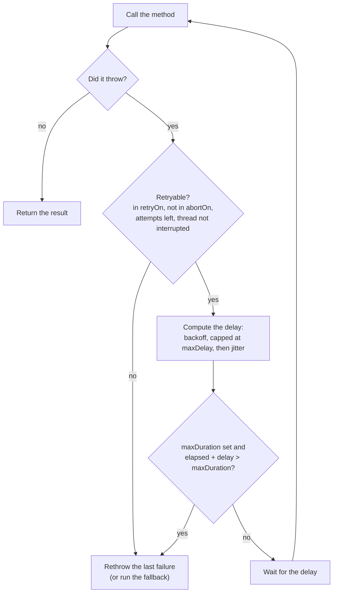

# Retry

`@Retry` calls the method again when it fails, waiting a little longer before each new attempt.

<div class="r4c-facts">

| Annotation | Position | Return types | Defaults |
|---|---|---|---|
| `@Retry` | 2 of 6, inside Fallback | sync and `CompletionStage` | 3 attempts, 200 ms exponential backoff ×2 up to 10 s, full jitter, retries `Exception` |

</div>

**Use it when** failures are transient and the operation is safe to repeat: a dropped connection, a `503`, a lost race for a lock, an idempotent read or write.

**Don't use it when** the operation is not idempotent (charging a card twice is worse than failing once), when the failure is permanent (a validation error, a `404`), or when the caller cannot afford the extra latency. Retrying an overloaded dependency makes it worse: put a [circuit breaker](circuit-breaker.md) inside the retry so that an open breaker stops the retries.

## Minimal example

<!-- compare:start -->
<!-- snippet: retry-minimal -->
```java
import dev.resilience4cata.annotation.Retry;

public interface InventoryApi {

    @Retry(maxAttempts = 3, delay = "100ms")
    int stock(String sku);
}
```
<!-- not-compiled: generated code, abridged -->
```java
public final class InventoryApi$Resilient implements InventoryApi {
    // …
    public InventoryApi$Resilient(InventoryApi delegate, dev.resilience4cata.ResilienceRegistry registry) {
        // …
        this.retry0 = registry.retryPolicy("dev.resilience4cata.examples.docs.retry.InventoryApi#stock(java.lang.String)", "", "", r4c$b -> {
            r4c$b.maxAttempts(3);
            r4c$b.delay(java.time.Duration.ofNanos(100000000L));
        });
    }

    @Override
    public int stock(java.lang.String p0) {
        final dev.resilience4cata.generated.RetryPolicy r4c$retry = this.retry0;
        final long r4c$start = r4c$retry.start();
        int r4c$attempts = 0;
        while (true) {
            try {
                return this.delegate.stock(p0);
            } catch (java.lang.Throwable r4c$e) {
                final long r4c$delay = r4c$retry.onFailure(++r4c$attempts, r4c$e, r4c$start);
                if (r4c$delay < 0 || !r4c$retry.pause(r4c$delay)) {
                    throw r4c$e;
                }
            }
        }
    }
}
```
<!-- compare:end -->

Abridged: the real file uses fully qualified names. Yours is in `build/generated/sources/annotationProcessor/java/main` (Gradle) or `target/generated-sources/annotations` (Maven).

Wrap an implementation once, at startup, and use the wrapper everywhere:

<!-- snippet: retry-wrap -->
```java
ResilienceRegistry registry = ResilienceRegistry.builder().build();
InventoryApi inventory = Resilient.of(InventoryApi.class, backend, registry);

int units = inventory.stock("sku-1");   // up to 3 attempts
```

The generated method is a plain loop around your call. Nothing is allocated and no clock is read while calls succeed; the policy is consulted only after a failure.

## How it behaves



- **What is retried.** An exception that is an instance of a `retryOn` type (default: `Exception`) and of no `abortOn` type (default: `CallNotPermittedException`). `abortOn` wins over `retryOn`. Anything else is rethrown at once, so `Error`s (`OutOfMemoryError`, `AssertionError`, …) are never retried by default. A method that returns normally is never retried, unless a [classifier](../guides/classifiers.md) says its result is a failure.
- **Counting.** `maxAttempts` counts every call, the first one included: `maxAttempts = 3` means at most two retries.
- **Delays.** Before retry *n* (after *n* failed attempts), the base delay is `delay` with `FIXED` backoff, or `delay × multiplier^(n−1)` capped at `maxDelay` with `EXPONENTIAL`. Jitter then randomizes it: `FULL` picks a delay between 0 and the base delay, `EQUAL` picks between half of it and all of it, `NONE` keeps it. With the defaults the base delays are 200 ms, 400 ms, 800 ms… up to 10 s.
- **Time budget.** With `maxDuration`, the retry gives up instead of waiting when the next attempt would start after the budget (time since the first attempt + the next delay > `maxDuration`). It never cuts an attempt short: for that, add [`@Timeout`](timeout.md), which applies per attempt.
- **When it gives up**, the last failure is rethrown as is: checked exceptions keep their type, and the stack trace is the one of the last attempt. With `@Fallback` on the same method, the fallback runs instead, once, with the number of attempts made.
- **Interrupts.** A sync retry sleeps on the caller's thread. If that thread is interrupted, the retry stops at once and rethrows the last failure, with the interrupt flag set again. A failure that is an `InterruptedException` is not retried either.
- **Disabled** (`enabled = "false"`, or `defaults.retry.enabled=false`): one attempt, as if there were no annotation.

## Attributes

| Attribute | Type | Default | Config key | Meaning |
|---|---|---|---|---|
| `maxAttempts` | `int` | `3` | `defaults.retry.maxAttempts` | Total attempts, the first one included. At least 1. |
| `delay` | duration | `200ms` | `defaults.retry.delay` | Base delay before the first retry. `"0"` retries at once. |
| `backoff` | `Backoff` | `EXPONENTIAL` | `defaults.retry.backoff` | `FIXED`: the same delay every time. `EXPONENTIAL`: multiplied by `multiplier` after each attempt. |
| `multiplier` | `double` | `2.0` | `defaults.retry.multiplier` | Growth factor for `EXPONENTIAL`. Finite, at least 1. |
| `maxDelay` | duration | `10s` | `defaults.retry.maxDelay` | Cap on one exponential delay. Must not be shorter than `delay`, also with `FIXED`. |
| `jitter` | `Jitter` | `FULL` | `defaults.retry.jitter` | `NONE`, `FULL` (0 to the delay) or `EQUAL` (half the delay plus a random half). |
| `maxDuration` | duration | `0` (no budget) | `defaults.retry.maxDuration` | Time budget for the whole operation, across attempts and delays. |
| `retryOn` | `Class<? extends Throwable>[]` | `{Exception.class}` | `defaults.retry.retryOn` | Exceptions that are retried, subclasses included. |
| `abortOn` | `Class<? extends Throwable>[]` | `{CallNotPermittedException.class}` | `defaults.retry.abortOn` | Exceptions that stop the retries; wins over `retryOn` and the classifier. |
| `classifier` | `Class<?>` | none | annotation only | A `Classifier<T>` that decides what is retried, results included. Replaces `retryOn`. See [Classifiers](../guides/classifiers.md). |
| `onExhaustedResult` | `ExhaustedResult` | `RETURN` | annotation only | With a classifier: return the last rejected result, or `THROW` a `ResultRejectedException`. |
| `name` | `String` | one instance per method | annotation only | Instance id; methods with the same `name` share one retry policy. |
| `config` | `String` | `default` | annotation only | Named configuration to start from. |
| `enabled` | `String` | `"true"` | `defaults.retry.enabled` | `""` (inherit), `"true"` or `"false"`. |

- Durations are strings: `"250ms"`, `"2s"`, `"1m"`, `"PT2S"`, or `"0"`. They are checked when you compile.
- An attribute you do not set keeps the value of the named config, then of the defaults. Every key also exists under `configs.<name>.retry.…` and `instances.<id>.retry.…`; see [Configuration](../guides/configuration.md).
- In properties files, enums are case-insensitive (`backoff=fixed`) and exception lists are comma-separated class names.

The same retry with exception lists and a time budget:

<!-- snippet: retry-exceptions -->
```java
@Retry(maxAttempts = 5, delay = "500ms", maxDelay = "2s", maxDuration = "4s",
        retryOn = IOException.class, abortOn = FileNotFoundException.class)
byte[] download(String path) throws IOException;
```

With `jitter = NONE`, a `download` that keeps throwing `IOException` is called at 0 s, 0.5 s, 1.5 s and 3.5 s, then gives up: one more attempt after a 2 s delay would start after the 4 s budget. A `FileNotFoundException` is an `IOException` too, but `abortOn` wins, so it fails after one call. An `IllegalStateException` is not in `retryOn`, so it fails after one call as well.

> [!WARNING]
> A list you write in the annotation **replaces** the default list, it does not add to it. The `abortOn` above leaves out `CallNotPermittedException`, so if this method also had a circuit breaker, an open breaker would be retried. Write `abortOn = {FileNotFoundException.class, CallNotPermittedException.class}` to keep both.

## Sharing and instance ids

Without `name`, every method gets its own retry policy, with the id `<interface>#<method>(<parameter types>)`, for example `dev.resilience4cata.examples.docs.retry.InventoryApi#stock(java.lang.String)`. That id is what you use in `instances.<id>.retry.…` overrides and what events and snapshots report.

A retry keeps no state between calls (the attempt count lives in a local variable of the generated method), so sharing one by `name` only shares its configuration. Methods that share a `name` must resolve to the same configuration, or wrapping fails with [`R4C-REG-008`](../errors.md#r4c-reg-008).

There is no handle for a retry: `registry` has no `retry(id)` method. `registry.snapshot().retries()` lists each one as a `RetrySnapshot(instance, config)`, with its resolved configuration.

## With other policies

Retry is the second layer, inside Fallback and around everything else (see the [overview](README.md)):

- Each attempt goes through the circuit breaker, the rate limiter, the timeout and the bulkhead again. Each attempt is recorded by the breaker and has its own timeout.
- An open breaker throws `CallNotPermittedException`, which is in the default `abortOn`: the retry stops at once instead of waiting for nothing.
- Rejections by the inner policies (`RateLimitExceededException`, `CallTimeoutException`, `BulkheadFullException`) are `Exception`s, so they are retried by default, after the backoff delay. Add them to `abortOn` if a rejection should fail fast.
- The bulkhead slot is held only while an attempt runs, not during the delay between attempts.
- With `@Fallback`, the fallback runs once, after the last attempt, and its `FallbackContext.attempts()` tells how many were made.

## Async

A method that returns `CompletionStage<T>` or `CompletableFuture<T>` gets the non-blocking form:

<!-- snippet: retry-async -->
```java
@Retry(maxAttempts = 3, delay = "100ms")
CompletableFuture<Integer> stock(String sku);
```

The first attempt runs on the caller's thread. A failed stage is retried after the delay without blocking any thread: the next attempt starts on a new virtual thread. The returned future completes with the first successful result or fails with the last failure, unwrapped from `CompletionException`. See [Async methods](../guides/async.md).

## Same thing with `Pipeline`

For code you cannot annotate, the [programmatic API](../guides/pipeline.md) builds the same retry from the registry:

<!-- snippet: retry-pipeline -->
```java
Pipeline<Integer> stock = Pipeline.builder(registry, "inventory", Integer.class)
        .retry(r -> r.maxAttempts(3).delay(Duration.ofMillis(100)))
        .build();

int units = stock.execute(() -> backend.stock("sku-1"));
```

The pipeline's id (`"inventory"`) is the instance id. `retry()` uses the defaults, `retry("name")` a named config, and `retry(r -> …)` overrides on top of them.

## Events and snapshot

| Event | When | Fields |
|---|---|---|
| `RetryEvent.Retrying` | A failed attempt will be retried | `instance`, `nanoTime`, `attempt`, `delay`, `failure` (`null` for a rejected result) |
| `RetryEvent.GaveUp` | No more attempts | `instance`, `nanoTime`, `attempts`, `reason`, `failure` |

`GaveUp.reason()` is `MAX_ATTEMPTS`, `MAX_DURATION`, `NOT_RETRYABLE` (not in `retryOn`, or in `abortOn`), `INTERRUPTED` or `CLASSIFIER_FAILED`. Successful calls publish nothing. Listeners are registered on the registry builder; see [Observability](../guides/observability.md).

## Testing it with `ManualClock`

The [testkit](../guides/testing.md) replaces the clock and the sleeps, so a retry with real delays runs at once and deterministically:

<!-- snippet: retry-testing -->
```java
ManualClock clock = new ManualClock();
ResilienceRegistry registry = ResilienceTesting.registry(clock)
        .retryDefaults(r -> r.jitter(RetryConfig.Jitter.NONE))   // exact delays in this test
        .build();
AtomicInteger calls = new AtomicInteger();
InventoryApi backend = sku -> {
    if (calls.incrementAndGet() <= 2) {
        throw new IllegalStateException("inventory down");
    }
    return 7;
};
InventoryApi inventory = Resilient.of(InventoryApi.class, backend, registry);

assertThat(inventory.stock("sku-1")).isEqualTo(7);   // returns at once, in real time
assertThat(calls).hasValue(3);
assertThat(clock.elapsed()).isEqualTo(Duration.ofMillis(300));   // 100 ms, then 200 ms
```

`ResilienceTesting.registry(clock)` also seeds the jitter's random generator, so even with jitter on, delays are the same on every run. Turning jitter off in the test's defaults, as here, makes them exact.

## Small print

- `maxDelay` must not be shorter than `delay`, also with `FIXED` backoff, where it is otherwise unused. `@Retry(delay = "20s", backoff = Backoff.FIXED)` alone fails when you wrap the interface ([`R4C-REG-003`](../errors.md#r4c-reg-003)), because the default `maxDelay` is 10 s: set `maxDelay = "20s"` too.
- `multiplier` is ignored with `FIXED` backoff.
- `maxDuration` decides before each delay; it does not interrupt a running attempt. Combine it with `@Timeout`.
- Only interface annotations count with `Resilient.of`, and calls the implementation makes to itself (`this.stock(…)`) are not retried. With [annotated classes](../guides/annotated-classes.md) they are.
- The sync form blocks the caller's thread during delays (cheap on a virtual thread). Use the async form to free it.
- Related errors: [`R4C-ATR-001`](../errors.md#r4c-atr-001) (duration syntax), [`R4C-ATR-003`](../errors.md#r4c-atr-003) (`maxAttempts` below 1), [`R4C-ATR-004`](../errors.md#r4c-atr-004) (`multiplier`), [`R4C-ATR-006`](../errors.md#r4c-atr-006) (`enabled`), [`R4C-CLS-011`](../errors.md#r4c-cls-011) (`classifier` with `retryOn`), [`R4C-CLS-012`](../errors.md#r4c-cls-012) (`onExhaustedResult` without a classifier), [`R4C-REG-001`](../errors.md#r4c-reg-001)/[`R4C-REG-003`](../errors.md#r4c-reg-003) (invalid combination), [`R4C-REG-004`](../errors.md#r4c-reg-004) (unknown `config`), [`R4C-REG-008`](../errors.md#r4c-reg-008) (shared `name`, different config).

## What it costs

> [!MEASURED]
> On AWS Graviton3 (`c7g.xlarge`, JDK 21), a successful call through `@Retry` costs 1.2 ns and allocates nothing, against 22.9 ns for Resilience4j 2.4.0; a call that fails once and succeeds on the retry costs 6.5 ns, 0 B, against 61.6 ns, 16 B (Resilience4j measured without its unconditional `Thread.sleep(0)`). [Benchmarks: MVP completion](../benchmarks.md#mvp-completion-classifier-pipeline-events-testkit-2026-10-24-aws-graviton3)
