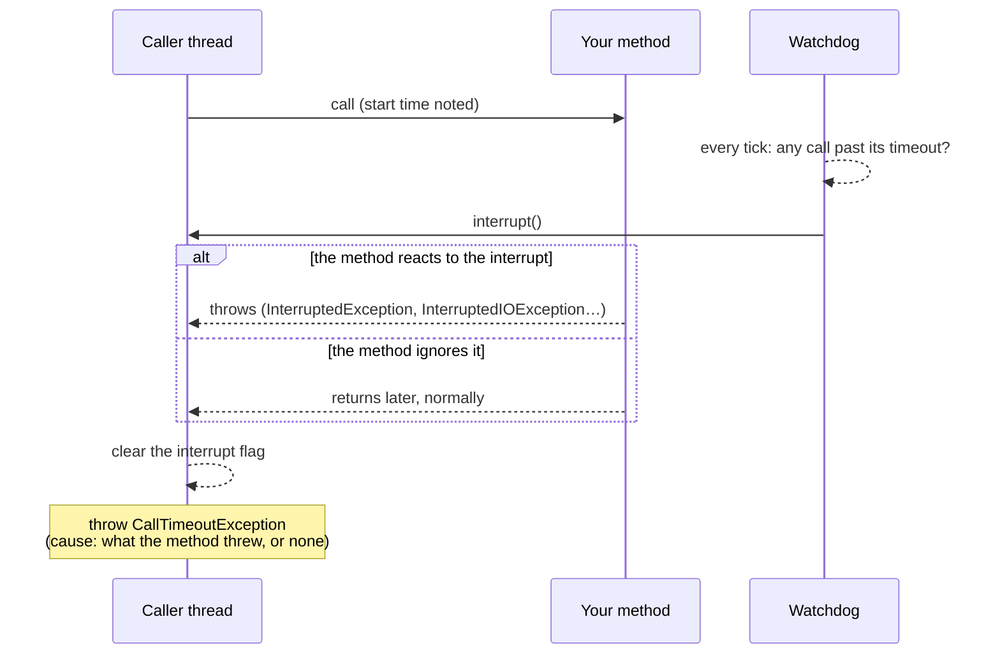

# Timeout

`@Timeout` bounds how long one call may take: a synchronous call is interrupted, an asynchronous one fails its future.

<div class="r4c-facts">

| Annotation | Position | Return types | Defaults |
|---|---|---|---|
| `@Timeout` | 6 of 7, inside AdaptiveLimit | sync and `CompletionStage` | 1 s per attempt |

</div>

**Use it when** a dependency can hang, and a caller waiting forever (holding a thread, a connection, a bulkhead slot) is worse than an error.

**Don't use it when** the code you call cannot be interrupted and you need it stopped: a synchronous timeout *asks* the call to stop by interrupting its thread, it cannot kill it (see [below](#sync-the-call-is-interrupted)). Prefer the client's own timeouts (connect and read timeouts of your HTTP client or JDBC driver) where they exist, and keep `@Timeout` as the upper bound.

## Minimal example

<!-- compare:start -->
<!-- snippet: timeout-minimal -->
```java
import dev.resilience4cata.annotation.Timeout;

public interface ReportApi {

    @Timeout("2s")
    String build(String reportId);
}
```
<!-- not-compiled: generated code, abridged -->
```java
public final class ReportApi$Resilient implements ReportApi {
    // …
    public ReportApi$Resilient(ReportApi delegate, dev.resilience4cata.ResilienceRegistry registry) {
        // …
        this.timeout0 = registry.timeoutPolicy("dev.resilience4cata.examples.docs.timeout.ReportApi#build(java.lang.String)", "", "", r4c$b -> {
            r4c$b.timeout(java.time.Duration.ofNanos(2000000000L));
        });
    }

    @Override
    public java.lang.String build(java.lang.String p0) {
        final dev.resilience4cata.generated.TimeoutPolicy r4c$timeout = this.timeout0;
        final dev.resilience4cata.generated.TimeoutPolicy.Scope r4c$scope = r4c$timeout.enter();
        final java.lang.String r4c$result;
        try {
            r4c$result = this.delegate.build(p0);
        } catch (java.lang.Throwable r4c$e) {
            r4c$timeout.failed(r4c$scope, r4c$e);
            throw r4c$e;
        }
        r4c$timeout.succeeded(r4c$scope);
        return r4c$result;
    }
}
```
<!-- compare:end -->

Abridged: the real file uses fully qualified names.

## How it behaves

### Sync: the call is interrupted

The call runs on the caller's thread, as if there were no timeout; there is no extra thread and no executor. One shared daemon thread, the watchdog, checks the running calls and **interrupts** the caller's thread when its call runs past the timeout.



- What happens next depends on your code. Blocking calls that respond to interrupts (`Thread.sleep`, `Object.wait`, `BlockingQueue.take`, `java.net.http.HttpClient.send`, most I/O on virtual threads, NIO interruptible channels) stop and throw; the timeout then throws `CallTimeoutException` with that exception as its cause.
- **Code that ignores interrupts runs to completion first**: a busy loop, classic blocking `java.net.Socket` I/O on a platform thread, a library that swallows `InterruptedException`. The call keeps going until it returns; only then does the caller get `CallTimeoutException` (with no cause), and the result is discarded.
- The interrupt is cleared before `CallTimeoutException` is thrown, so it never leaks into later work on that thread.
- **Precision.** A call is never interrupted early, and at most about two watchdog ticks late. A tick is a sixteenth of the shortest timeout in use, between 1 ms and 50 ms: with `@Timeout("2s")` alone, about 100 ms late at most.
- A call that finishes in time is untouched. Timed calls read no clock: the watchdog keeps a coarse clock for them.

### Async: the future fails

For a method that returns `CompletionStage<T>` or `CompletableFuture<T>`, nothing is interrupted. If the stage has not completed when the timeout passes, the future you got back fails with `CallTimeoutException`, and the method's stage is cancelled if it is a `Future` (a `CompletableFuture` is). The deadline is kept by a shared, lock-free timer, never early and at most about two ticks late; the timeout is completed on a new virtual thread, never on the timer's. A stage that is already complete when the method returns needs no timer at all.

<!-- snippet: timeout-async -->
```java
@Timeout("2s")
CompletableFuture<String> build(String reportId);
```

The timeout covers the stage, not the method call that returns it: a method that blocks for 5 s *before* returning its stage is not timed out. The cancel goes through the policies inside the timeout, so a bulkhead inside frees its slot at once. Cancelling the future you got back cancels the deadline and the stage, with no `CallTimeoutException` and no event ([cancellation](../guides/async.md#cancellation)). See [Async methods](../guides/async.md).

### The exception

`dev.resilience4cata.CallTimeoutException` is a `RuntimeException` with `instanceId()` and `timeout()` (the `Duration` that was exceeded). It has no stack trace; the message names the instance and the timeout.

## Attributes

| Attribute | Type | Default | Config key | Meaning |
|---|---|---|---|---|
| `value` | duration | `1s` | `defaults.timeout.value` | Longest time one attempt may take. Greater than 0. |
| `config` | `String` | `default` | annotation only | Named configuration to start from. |
| `locked` | `boolean` | `false` | annotation only | Keeps the values set in the annotation: `instances.<id>.*` keys cannot change them. See [Locking an instance](../guides/configuration.md#locking-an-instance). |
| `enabled` | `String` | `"true"` | `defaults.timeout.enabled` | `""` (inherit), `"true"` or `"false"`. |

`@Timeout` has **no `name`**: a timeout keeps no state worth sharing, so every annotated method gets its own policy, with the id `<interface>#<method>(<parameter types>)`. In external configuration the attribute is `value` (`configs.slow.timeout.value=10s`, `instances."com.acme.ReportApi#build(java.lang.String)".timeout.value=5s`); in code the builder method is `TimeoutConfig.Builder.timeout(Duration)`. See [Configuration](../guides/configuration.md).

There is **no handle** either: `registry` has no `timeout(id)`. `registry.snapshot().timeouts()` lists a `TimeoutSnapshot(instance, config)` per method.

## With other policies

The timeout is the fifth layer: inside RateLimiter, around Bulkhead.

- **Per attempt.** Inside `@Retry`, each attempt gets the full timeout. To bound the whole operation, attempts and delays included, set `@Retry(maxDuration = …)`.
- `CallTimeoutException` is an `Exception`: an outer `@Retry` retries it and an outer `@CircuitBreaker` records it as a failure, by default.
- Time spent waiting for a rate-limiter permit is not counted (the limiter is outside); time spent waiting for a bulkhead slot is (the bulkhead is inside). An interrupted bulkhead wait becomes `CallTimeoutException`.
- `@Fallback` sees `CallTimeoutException` like any other failure.

## Same thing with `Pipeline`

<!-- snippet: timeout-pipeline -->
```java
Pipeline<String> build = Pipeline.builder(registry, "reports", String.class)
        .timeout(t -> t.timeout(Duration.ofSeconds(2)))
        .build();

String report = build.execute(() -> backend.build("r-1"));
```

Here the timeout's id is the pipeline's id, `"reports"`. See [Pipeline API](../guides/pipeline.md).

## Events and snapshot

| Event | When | Fields |
|---|---|---|
| `TimeoutEvent.TimedOut` | A call ran past its timeout | `instance`, `nanoTime`, `timeout` |

Calls that finish in time publish nothing. See [Observability](../guides/observability.md).

## Testing it with `ManualClock`

<!-- snippet: timeout-testing -->
```java
ReportApi slow = id -> {
    try {
        clock.sleep(Duration.ofSeconds(5));          // a slow dependency, on the test's clock
    } catch (InterruptedException e) {
        throw new IllegalStateException("interrupted", e);   // how the timeout reaches the call
    }
    return "report " + id;
};
ReportApi reports = Resilient.of(ReportApi.class, slow, registry);

assertThatThrownBy(() -> reports.build("r-1"))
        .isInstanceOf(CallTimeoutException.class)
        .hasCauseInstanceOf(IllegalStateException.class);   // what the call threw once interrupted
assertThat(Thread.currentThread().isInterrupted()).isFalse(); // the interrupt is cleared
```

On a [`ManualClock`](../guides/testing.md), sync timeouts fire exactly when the clock passes the deadline, with no tick of slack, and async timeouts fire on the thread that advances the clock. A stub that simulates a slow dependency with `clock.sleep(…)` is interrupted like real blocking code; a stub that calls `clock.advance(…)` instead behaves like code that ignores the interrupt.

## Small print

- A sync timeout is cooperative: it relies on interrupts. It cannot stop code that ignores them, and it should not be used to bound CPU-bound work that never checks `Thread.interrupted()`.
- If your code catches `InterruptedException` and carries on, the call is not cut short; restore the flag (`Thread.currentThread().interrupt()`) or rethrow.
- A call that ends right at the deadline, while the watchdog is interrupting it, still gets `CallTimeoutException`: the outcome is decided once, and the interrupt is then cleared.
- On a platform thread, a call blocked in classic socket I/O keeps the thread until the socket's own timeout. Virtual threads make most blocking I/O interruptible.
- Related errors: [`R4C-ATR-001`](../errors.md#r4c-atr-001) (duration syntax), [`R4C-ATR-002`](../errors.md#r4c-atr-002) (`@Timeout("0")`), [`R4C-ATR-006`](../errors.md#r4c-atr-006) (`enabled`), [`R4C-REG-004`](../errors.md#r4c-reg-004) (unknown `config`).

## What it costs

> [!MEASURED]
> On AWS Graviton3 (`c7g.xlarge`, JDK 21), a sync call through `@Timeout` that finishes in time costs 22.2 ns on 1 thread and allocates nothing (a later run measured 23.7 ns, an open question); Resilience4j 2.4.0 has no caller-thread timeout, and its `TimeLimiter` with an executor takes 8842 ns and 176 B. An async call whose stage is still pending costs 152 ns and 192 B, against 598 ns and 240 B. [Benchmarks: MVP completion](../benchmarks.md#mvp-completion-classifier-pipeline-events-testkit-2026-10-24-aws-graviton3), [later run](../benchmarks.md#annotated-classes-generics-config-overrides-ticker-bulkhead-2026-10-24-aws-graviton3)
