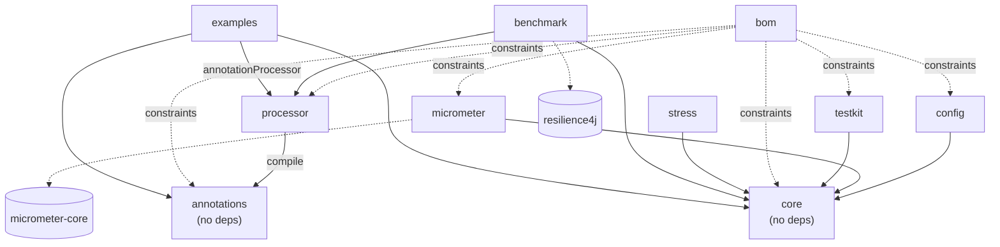

# 05 — Project architecture, build and engineering practices

> Phase 1 research. Status: **proposal**, nothing here is implemented yet.
> Spanish version: [../../es/research/05-project-architecture.md](../../es/research/05-project-architecture.md)

This document covers the *shape* of the repository: which Gradle modules exist and what each one does, how the build is organised, how JPMS fits in, the quality tooling, how the bilingual documentation is produced, and how we version and protect the public API. Topics such as the annotation-processing mechanism, concurrency internals and the annotation API itself are covered by sibling research documents. This document only notes where they affect the module layout.

---

## TL;DR

| Decision | Recommendation |
|---|---|
| Module names | Single word directories: `core`, `annotations`, `processor`, `config`, `micrometer`, `testkit`, `stress`, `benchmark`, `examples`, `bom`. Published artifactIds get a prefix: `resilience4cata-core`, … |
| Granularity | **One** runtime engine (`core`) holding every policy. Do *not* split per pattern like Resilience4j. The user needs at most 3 coordinates (+ the BOM). |
| External dependencies in `core` | **Zero** is feasible on Java 21 (`System.Logger`, `VarHandle`, `InstantSource`, JFR). The one exception worth debating is JSpecify (annotation-only, about 4 KB). |
| Build | Gradle 9.x, Kotlin DSL, `build-logic` included build with precompiled convention plugins, `gradle/libs.versions.toml`, toolchain 21 + `--release 21`, configuration cache and build cache on. |
| Publishing | `com.vanniktech.maven.publish` to the **Central Portal** (OSSRH was shut down on 2025-06-30), in-memory GPG signing from CI, and a `java-platform` BOM. |
| JPMS | A real `module-info.java` in every published module. Internal packages are not exported. The processor `provides javax.annotation.processing.Processor`. |
| Quality | JUnit Jupiter, AssertJ, jqwik (watch: maintenance mode), jcstress, ArchUnit, Error Prone + NullAway (JSpecify mode), Spotless, JaCoCo, GitHub Actions matrix on JDK 21 and 25. |
| Docs | **Not** a Gradle module. Plain Markdown under `docs/en` and `docs/es`, rendered by the Docsify site already in the repo (GitHub Pages). Javadoc is generated by Gradle and linked. |
| API stability | SemVer with `0.x` incubation, our own `@Experimental` / `@Internal` markers, and japicmp in CI from `1.0` onward. |

---

## 1. Module layout

### 1.1 What Resilience4j does, and what users dislike

Resilience4j 2.x publishes one artifact per pattern: `resilience4j-circuitbreaker`, `-ratelimiter`, `-bulkhead`, `-retry`, `-timelimiter`, `-cache`. It also publishes `resilience4j-core`, the aggregator `resilience4j-all` (which holds the `Decorators` builder), a `resilience4j-bom`, and a long tail of integrations (`-micrometer`, `-reactor`, `-rxjava3`, `-kotlin`, `-spring-boot3`, `-spring6`, `-vertx`, `-feign`, `-retrofit`, …) ([README](https://github.com/resilience4j/resilience4j), [BOM on Central](https://central.sonatype.com/artifact/io.github.resilience4j/resilience4j-bom)).

Pain points that matter for our design:

1. **Too many coordinates for a simple use case.** A typical service ends up declaring 4–6 artifacts, or pulls `-all`, which defeats the modularity. Every pattern artifact depends on `resilience4j-core` anyway, so the split saves very little bytecode.
2. **Annotations are tied to Spring AOP.** `@CircuitBreaker`, `@Retry` and the rest live in `resilience4j-annotations`, but they only *do* something through the Spring (or Micronaut) aspect modules. Plain-Java users get no annotation support. This is exactly the gap this project targets.
3. **Composition lives in a different artifact** (`Decorators` in `-all`) from the patterns it composes.
4. **Version alignment across many artifacts** forces users onto the BOM.

Lesson: split by **dependency boundary** (does this code pull a third-party library, or run at a different time, such as compile time vs. runtime?), never by *feature*.

### 1.2 Proposed modules

All directory names are single words. Published artifactIds use the `resilience4cata-` prefix so they stay unambiguous on Maven Central (`resilience4cata-core`). In `settings.gradle.kts` the Gradle project stays `:core`, and the prefix is applied in the publishing convention plugin.

| Module | Published | Responsibility | Dependencies |
|---|---|---|---|
| `annotations` | ✅ | The annotation types only (`@CircuitBreaker`, `@Retry`, `@RateLimiter`, `@Bulkhead`, `@Timeout`, `@Fallback`, repeatable containers for multiple configurations, plus `@Experimental` / `@Internal`). No logic. | none |
| `core` | ✅ | Every policy implementation, the registry, configuration *model* objects, the composition pipeline, the events/metrics SPI, JFR events, and the runtime support that generated code calls into. | none (JDK only) |
| `processor` | ✅ | The annotation processor: it validates annotations at compile time and generates code. Users add it only to `annotationProcessor`. | `annotations` (compile) |
| `config` | ✅ | Loads policy configuration from outside sources: `java.util.Properties`, system properties, environment variables, and a `ConfigSource` SPI for others. Binds it to the `core` config model. | `core` |
| `micrometer` | ✅ | Bridges `core` events/metrics to Micrometer `MeterRegistry`. | `core`, `io.micrometer:micrometer-core` |
| `testkit` | ✅ | Test helpers for **users**: a controllable clock, deterministic schedulers, fault-injection stubs, AssertJ-style assertions on policy state. | `core`; JUnit/AssertJ as `compileOnly` |
| `bom` | ✅ | A `java-platform` BOM aligning every published module. | constraints only |
| `stress` | ❌ | jcstress tests for the lock-free state machines in `core`. | `core`, jcstress |
| `benchmark` | ❌ | JMH benchmarks comparing us with Resilience4j (and a no-op baseline). | `core`, `processor`, Resilience4j, JMH |
| `examples` | ❌ | Small runnable programs, compiled with the processor. They double as end-to-end tests of the generated code. | `annotations`, `core`, `processor` |
| `docs` | ❌ | Documentation sources. **Not a Gradle project** (see §5). | — |

Notes on names:

- **Avoid `test` as a project name.** `gradle test` and `:test` already refer to the `test` *task*, so a project named `test` reads as `:test:test` and makes task selection confusing. `testkit` is unambiguous. JUnit, Micrometer and Gradle itself use the same name for this purpose.
- Name integration modules after **what they integrate** (`micrometer`, later `opentelemetry`), not after a generic concept (`metrics`). That keeps the one-word rule as integrations grow.
- Possible later modules, all single words: `opentelemetry`, `reactor`, `kotlin`, `spring`, `quarkus` (out of scope for now).

### 1.3 Should `annotations` be separate from `core`?

Both options are viable. This is a cheap decision to revisit before `1.0`.

- **Separate (recommended).** `core` stays a pure programmatic library, usable with no annotations at all, the same way Failsafe is used. The processor depends only on the tiny `annotations` jar. If the API-design research settles on `CLASS` retention for codegen-only use, users can put `annotations` on `compileOnly`. The cost is one more coordinate, which the BOM hides.
- **Merged.** The user needs only `core` + `processor`. The cost is that the processor's processor path drags in all of `core`, and the annotation package becomes part of the runtime module's API surface.

Either way, **packages must not be split** between jars (JPMS forbids it). Annotations go in `…​.annotation`, the engine in `…​.core` and sub-packages.

### 1.4 Dependency graph



Rules, enforced by ArchUnit and by the build (see §4):

- `core` and `annotations` have **no** project or external dependencies.
- No module depends on `processor` at runtime. It is only ever on an `annotationProcessor` configuration.
- Code generated by `processor` depends **only on `core`'s exported API**, plus `annotations` when retention is `RUNTIME`. That is the contract between the processor and the runtime. It should live in a dedicated exported package (for example `…​.core.spi.generated`) so it can evolve deliberately.
- Integrations (`config`, `micrometer`, …) depend on `core`, never on each other.

What a user writes:

```kotlin
dependencies {
    implementation(platform("io.github.<ns>:resilience4cata-bom:0.1.0"))
    implementation("io.github.<ns>:resilience4cata-core")
    implementation("io.github.<ns>:resilience4cata-annotations")
    annotationProcessor("io.github.<ns>:resilience4cata-processor")
}
```

### 1.5 Is "zero external dependencies in core" feasible?

Yes. Everything a resilience runtime needs is in the JDK 21 platform:

| Need | JDK 21 answer |
|---|---|
| Logging | `System.Logger` (JEP 264), which routes to SLF4J/Log4j/JUL through their `System.LoggerFinder` bridges. Resilience4j depends on `slf4j-api` for this; we don't need to. |
| Atomics, lock-free state | `java.util.concurrent.atomic`, `VarHandle`, `LongAdder`, `StampedLock` |
| Time | `System.nanoTime()`, `java.time.InstantSource` (Java 17) for testable clocks |
| Scheduling / async | `ScheduledExecutorService`, `CompletableFuture`, virtual threads (JEP 444, final in 21) |
| Observability | `jdk.jfr` custom events, with nearly zero cost when disabled. Use `requires static jdk.jfr` so jlink images without JFR still work. |
| Functional types | `java.util.function` plus our own `CheckedSupplier`-style interfaces. Resilience4j 2.0 dropped Vavr for the same reason. |
| Config parsing | `java.util.Properties`. YAML/HOCON belong in optional modules if ever. |

The **only** dependency worth considering is **JSpecify** (`org.jspecify:jspecify`). It contains annotations only, has no transitive dependencies, is about 4 KB, and is now used by Spring Framework 7 and Guava ([jspecify.dev](https://jspecify.dev/)). Two options:

- `compileOnly` + `requires static org.jspecify`. Strictly zero runtime deps, but Kotlin consumers and IDEs lose nullness information unless they add the jar themselves.
- `api` + `requires transitive org.jspecify`. One tiny jar, full nullness information for consumers.

Recommendation: `api`, documented as "zero dependencies except the JSpecify annotations". This is what the Java ecosystem converged on in 2025. Keep the `processor` dependency-free too: avoid JavaPoet, or shade it. Several popular processors (Dagger, AutoValue) ship different JavaPoet versions on the same processor path, and conflicts there are painful.

---

## 2. Gradle (Kotlin DSL) for a multi-module library, 2025–2026

### 2.1 Repository layout

```
resilience4cata/
├── settings.gradle.kts
├── gradle.properties
├── gradle/
│   ├── libs.versions.toml
│   └── wrapper/
├── build-logic/                 # included build, NOT a subproject
│   ├── settings.gradle.kts
│   ├── build.gradle.kts         # `kotlin-dsl` plugin
│   └── src/main/kotlin/
│       ├── r4c.java-library.gradle.kts
│       ├── r4c.published.gradle.kts
│       ├── r4c.quality.gradle.kts
│       └── r4c.benchmark.gradle.kts
├── annotations/ core/ processor/ config/ micrometer/ testkit/ bom/
├── stress/ benchmark/ examples/
└── docs/                        # not part of the Gradle build
```

`build-logic` is the conventional name for the included build. It is not a subproject and is never published, but it does contain a hyphen. If the one-word rule should apply there as well, `conventions` is a clean alternative. The Gradle docs use `build-logic` in their samples ([sharing build logic](https://docs.gradle.org/current/userguide/sharing_build_logic_between_subprojects.html)).

### 2.2 Settings

```kotlin
// settings.gradle.kts
pluginManagement {
    includeBuild("build-logic")
}
plugins {
    id("org.gradle.toolchains.foojay-resolver-convention") version "<latest>"
}
dependencyResolutionManagement {
    repositoriesMode = RepositoriesMode.FAIL_ON_PROJECT_REPOS
    repositories { mavenCentral() }
}
enableFeaturePreview("TYPESAFE_PROJECT_ACCESSORS")
rootProject.name = "resilience4cata"
include("annotations", "core", "processor", "config", "micrometer",
        "testkit", "bom", "stress", "benchmark", "examples")
```

### 2.3 Convention plugins (no `allprojects {}` / `subprojects {}`)

Gradle discourages cross-project configuration because it breaks project isolation and the configuration cache. Each module applies the conventions it needs instead ([Gradle best practices](https://docs.gradle.org/current/userguide/best_practices.html), [structuring builds](https://docs.gradle.org/current/userguide/multi_project_builds.html)):

```kotlin
// build-logic/src/main/kotlin/r4c.java-library.gradle.kts
plugins { `java-library` }

java {
    toolchain { languageVersion = JavaLanguageVersion.of(21) }
    withSourcesJar(); withJavadocJar()
}
tasks.withType<JavaCompile>().configureEach {
    options.release = 21
    options.compilerArgs.addAll(listOf("-Xlint:all", "-Werror", "-parameters"))
}
tasks.withType<Test>().configureEach { useJUnitPlatform() }
```

```kotlin
// core/build.gradle.kts
plugins {
    id("r4c.java-library")
    id("r4c.published")
    id("r4c.quality")
}
// no dependencies block: that's the point
```

Inside a precompiled script plugin, read the version catalog via `the<VersionCatalogsExtension>().named("libs")`, or use the common workaround that exposes `libs` type-safe accessors to `build-logic`.

### 2.4 Version catalog

`gradle/libs.versions.toml` is the single source of versions for libraries **and** plugins ([docs](https://docs.gradle.org/current/userguide/version_catalogs.html)). Sketch:

```toml
[versions]
junit = "6.0.+"          # pin exact in reality
assertj = "3.27.+"
jmh = "1.37"
errorprone = "2.+"
nullaway = "0.12.+"
jspecify = "1.0.0"
resilience4j = "2.3.0"

[libraries]
jspecify = { module = "org.jspecify:jspecify", version.ref = "jspecify" }
junit-bom = { module = "org.junit:junit-bom", version.ref = "junit" }
assertj = { module = "org.assertj:assertj-core", version.ref = "assertj" }
resilience4j-bom = { module = "io.github.resilience4j:resilience4j-bom", version.ref = "resilience4j" }

[plugins]
jmh = { id = "me.champeau.jmh", version = "0.7.2" }
maven-publish = { id = "com.vanniktech.maven.publish", version = "0.34.0" }
spotless = { id = "com.diffplug.spotless", version = "<latest>" }
errorprone = { id = "net.ltgt.errorprone", version = "<latest>" }
japicmp = { id = "me.champeau.gradle.japicmp", version = "<latest>" }
```

(Versions are illustrative. Pin exact versions when the build is written, and let Renovate or Dependabot keep them fresh.)

### 2.5 Toolchains and multi-JDK testing

- Compile with **toolchain 21** and `options.release = 21`. `release` guarantees we never call an API newer than 21, even if the toolchain is newer. Toolchains auto-provision through the foojay resolver ([toolchains](https://docs.gradle.org/current/userguide/toolchains.html)).
- Test against other JDKs **without recompiling** by overriding the test launcher:

```kotlin
val testJdk = providers.gradleProperty("testJdk").map(String::toInt)
tasks.withType<Test>().configureEach {
    javaLauncher = testJdk.flatMap { v ->
        javaToolchains.launcherFor { languageVersion = JavaLanguageVersion.of(v) }
    }.orElse(javaToolchains.launcherFor(java.toolchain))
}
```

CI then runs `./gradlew check -PtestJdk=25`. This catches real runtime differences, such as JDK 24's virtual-thread pinning change ([JEP 491](https://openjdk.org/jeps/491)) and newer JIT behaviour.

### 2.6 Configuration cache, build cache, parallelism

Gradle 9 made the configuration cache the **preferred** execution mode, and it is planned as the default in Gradle 10 ([9.0 release notes](https://docs.gradle.org/9.0.0/release-notes.html)). Gradle 9.1 added a read-only mode for CI ([9.1 notes](https://docs.gradle.org/9.1.0/release-notes.html)). Start with it on from day 1. Retrofitting it is much harder.

```properties
# gradle.properties
org.gradle.configuration-cache=true
org.gradle.configuration-cache.problems=fail
org.gradle.caching=true
org.gradle.parallel=true
```

All plugins chosen here support the configuration cache. vanniktech added publishing support in 0.34.0.

### 2.7 Testing the annotation processor

Three layers:

1. **Unit-level compile tests.** Use [Google compile-testing](https://github.com/google/compile-testing) (`Compiler.javac().withProcessors(new Processor()).compile(source)`, then `assertThat(compilation).succeeded()` / `.hadErrorContaining(...)` / `.generatedSourceFile(...)`). It is framework-agnostic and works from JUnit Jupiter. Only its `CompilationRule` is JUnit 4-specific. The alternative is a 50-line in-house harness over `javax.tools.JavaCompiler` + an in-memory `JavaFileManager`, which avoids the Guava/Truth dependency (test scope only, so this matters little).
   Test **diagnostics** as carefully as the happy path: invalid configuration must fail at compile time with a precise message on the offending element. That is a selling point over runtime-only validation.
2. **End-to-end.** The `examples` module (and the processor's own `src/integrationTest`) is compiled with the real processor on the processor path. Its tests execute the generated code.
3. **Gradle integration.** The [Gradle TestKit](https://docs.gradle.org/current/userguide/test_kit.html) is meant for testing *Gradle plugins*. We only need it if we ever ship a Gradle plugin. For the processor, use it narrowly to verify **incremental annotation processing**: the processor must declare itself in `META-INF/gradle/incremental.annotation.processors` (`isolating` if each generated file comes from exactly one annotated type, `aggregating` otherwise). Otherwise every user build loses incremental compilation ([docs](https://docs.gradle.org/current/userguide/java_plugin.html#sec:incremental_annotation_processing)). A small TestKit test can assert that touching one source file does not trigger a full recompile.

### 2.8 JMH

Use [`me.champeau.jmh`](https://github.com/melix/jmh-gradle-plugin) (0.7.2 on the Plugin Portal at the time of writing) in `benchmark`. Practices:

- Benchmarks live in `src/jmh/java`. Keep them out of `check` because they are slow. Run them on demand and in a scheduled CI job on a dedicated runner, not on shared GitHub runners, whose noise makes their numbers unreliable.
- Compare like for like: same policy configurations in us and in Resilience4j, plus a no-policy baseline. Report `thrpt` and `avgt` with `-prof gc` (allocation rate per op is a headline metric), at 1, 4 and N threads (`@Threads`, `@Group` for mixed read/write contention).
- Publish raw JSON results (`resultFormat = "JSON"`) and render them in the docs.

### 2.9 Publishing to Maven Central

- Sonatype **shut down OSSRH on 30 June 2025**. New publishing goes through the **Central Portal** (`central.sonatype.com`) ([Sonatype notice](https://central.sonatype.org/news/20250326_ossrh_sunset/)).
- Use [`com.vanniktech.maven.publish`](https://github.com/vanniktech/gradle-maven-publish-plugin) (0.34.0 or later). It targets the Central Portal, generates the POM metadata Central requires (name, description, URL, license, developers, SCM), adds sources/javadoc jars, signs, and supports the configuration cache ([releases](https://github.com/vanniktech/gradle-maven-publish-plugin/releases)).

```kotlin
// build-logic/src/main/kotlin/r4c.published.gradle.kts
plugins { id("com.vanniktech.maven.publish") }
mavenPublishing {
    publishToMavenCentral(automaticRelease = false)
    signAllPublications()
    coordinates("io.github.<ns>", "resilience4cata-${project.name}", version.toString())
    pom { /* name, description, url, licenses, developers, scm */ }
}
```

- **Namespace:** verify `io.github.<github-user>` (instant through GitHub) or a domain you own via DNS TXT record. Choose before the first release, because it is permanent.
- **Signing in CI:** pass `ORG_GRADLE_PROJECT_signingInMemoryKey`, `…KeyPassword`, `ORG_GRADLE_PROJECT_mavenCentralUsername` and `…Password` (a Portal *user token*) as GitHub secrets. No keyring files.
- **BOM:** the `bom` module applies `java-platform` and declares `api(project(":core"))` and the other published modules as constraints. Gradle module metadata (`.module`) is published alongside the POM.
- Release workflow: tag `vX.Y.Z`, then CI publishes, then a manual "Publish" click in the Portal at first (`automaticRelease = false`). Switch to automatic once the pipeline is trusted.

---

## 3. JPMS

### 3.1 One `module-info.java` per published module

```java
// core/src/main/java/module-info.java
module io.github.ns.resilience4cata.core {
    requires static jdk.jfr;
    requires transitive org.jspecify;           // if JSpecify is `api`
    exports io.github.ns.resilience4cata.core;
    exports io.github.ns.resilience4cata.core.spi;
    exports io.github.ns.resilience4cata.core.spi.generated; // contract for generated code
    // ...core.internal is NOT exported
    uses io.github.ns.resilience4cata.core.spi.EventListenerProvider;
}
```

```java
// processor/src/main/java/module-info.java
module io.github.ns.resilience4cata.processor {
    requires java.compiler;
    requires io.github.ns.resilience4cata.annotations;
    provides javax.annotation.processing.Processor
        with io.github.ns.resilience4cata.processor.ResilienceProcessor;
}
```

Also ship `META-INF/services/javax.annotation.processing.Processor` in `processor`. Most builds (Gradle, Maven, IDEs) put processors on a **classpath-style** processor path, where `provides` is ignored and the service file is what counts.

Benefits: real encapsulation of `internal` packages (stronger than naming conventions), jlink compatibility, and an ArchUnit-like guarantee checked by `javac` itself. Gradle infers the module path automatically when a `module-info.java` is present ([Java modules in Gradle](https://docs.gradle.org/current/userguide/java_library_plugin.html#sec:java_library_modular)).

### 3.2 How annotation processors interact with JPMS

- **The processor runs at compile time in the user's compiler**, from the processor path (`-processorpath`) or the processor module path (`--processor-module-path`). It is never on the user's runtime module path. In Gradle it goes on the `annotationProcessor` configuration.
- **Generated code lives in the user's module and packages.** `Filer.createSourceFile` writes into the module being compiled. So the user's `module-info.java` must `requires io.github.ns.resilience4cata.core` (and `…annotations` when retention is `RUNTIME`). Document this, and have the processor emit a clear error when a module is being compiled (`Elements.getModuleOf(...)` is not unnamed) and the required module is missing from its `module-info`.
- **Codegen needs no `opens`.** Generated classes sit in the same package as the annotated class and call it directly, with no deep reflection. Reflection or bytecode-based approaches *do* require the user to `opens` packages or hand over a `MethodHandles.Lookup`. That is another argument for APT, which the mechanism research covers in depth.
- **Split packages are forbidden.** That is why annotations, core and generated code each need distinct packages. Generated code shares a package with *user* code, and that is fine because both are in the user's module.
- **Tests:** whitebox unit tests run patched into the module (Gradle handles `--patch-module`). Blackbox tests can go in a separate source set with their own `module-info.java` to test exactly what consumers see.

---

## 4. Quality tooling

| Tool | Role | Notes |
|---|---|---|
| **JUnit Jupiter** (JUnit 6) | Test engine | JUnit 6.0 went GA on 2025-09-30 with a Java 17 baseline ([InfoQ](https://www.infoq.com/news/2025/10/junit6-java17-kotlin)). Use it through `junit-bom`. |
| **AssertJ** | Assertions | `testkit` can ship custom AssertJ assertions (`assertThat(circuitBreaker).isOpen()`). |
| **jqwik** | Property-based and **stateful/model-based** testing of state machines (circuit breaker transitions, token-bucket invariants) | ⚠️ jqwik is in **pure maintenance mode**: dependency updates and critical fixes only ([jqwik](https://jqwik.net/), [release notes](https://jqwik.net/release-notes.html)). It is still usable as a test-only dependency. Verify JUnit-platform-6 compatibility before adopting, and keep properties simple enough to port to a plain JUnit `@RepeatedTest` + seeded `Random` harness if needed. |
| **jcstress** | Concurrency correctness of lock-free code under the JMM | Lives in the `stress` module. Run it through the `io.github.reyerizo.gradle.jcstress` plugin or a plain `JavaExec`. Run nightly or on demand, because it is slow. This is the tool for proving that state transitions and permit counting have no lost updates ([jcstress](https://github.com/openjdk/jcstress)). |
| **ArchUnit** | Module and package boundaries | Rules: `core` depends only on `java..`/`jdk.jfr..`/`org.jspecify..`. Nothing outside `internal` exposes `internal` types. The `spi.generated` contract is used only by generated code ([ArchUnit](https://www.archunit.org/)). |
| **Error Prone + NullAway** | Static bug finding and null-safety | `net.ltgt.errorprone` plugin. Recent Error Prone needs a recent JDK to *run* javac, which is fine on 21. NullAway in **JSpecify mode** on JDK 21 needs `-XDaddTypeAnnotationsToSymbol=true` (OpenJDK) for full generic/type-use checks, and is fully native on JDK 22+ ([NullAway JSpecify support](https://github.com/uber/NullAway/wiki/JSpecify-Support)). Mark packages `@NullMarked`. |
| **JSpecify** | Nullness annotations | See §1.5. |
| **Spotless** | Formatting | `palantir-java-format` or `google-java-format`, plus license headers and Kotlin DSL formatting (ktlint) for build scripts. `spotlessCheck` runs in `check`. |
| **JaCoCo** | Coverage | Aggregate with the `jacoco-report-aggregation` plugin. Treat coverage as a signal, not a gate. Consider **PIT** mutation testing for `core` later. |
| **GitHub Actions** | CI | See below. |

### CI sketch

```yaml
# .github/workflows/ci.yml (illustrative)
jobs:
  build:
    strategy:
      matrix:
        test-jdk: [21, 25]
        os: [ubuntu-latest]
        include:
          - { test-jdk: 25, os: windows-latest }
          - { test-jdk: 25, os: macos-latest }
    runs-on: ${{ matrix.os }}
    steps:
      - uses: actions/checkout@v4
      - uses: actions/setup-java@v4
        with: { distribution: temurin, java-version: "21\n${{ matrix.test-jdk }}" }
      - uses: gradle/actions/setup-gradle@v4    # caching + wrapper validation
      - run: ./gradlew check -PtestJdk=${{ matrix.test-jdk }}
```

Further jobs: `japicmp` (on PRs, from 1.0 onward), nightly `stress` + `benchmark` (dedicated runner), `release` on tags, and the Gradle dependency-submission action for Dependabot alerts. Also consider JDK early-access builds (26-ea) as `continue-on-error`.

Supported versions: **21 and 25 are both LTS**. 21 is the baseline. 25 is the forward-compatibility target.

---

## 5. Documentation module

### 5.1 Current state

The repo already contains `docs/` with a **Docsify v4** shell (`index.html`, `README.md`, `.nojekyll`). It is ready for GitHub Pages and has no build step. Docsify renders Markdown in the browser at view time.

### 5.2 Options compared

| Option | Pros | Cons |
|---|---|---|
| **Plain Markdown on GitHub** | Zero tooling. Readable in the repo and the IDE. | No search, no language switcher, weak navigation. |
| **Docsify** (current) | No build. Markdown stays plain. Per-language folders with their own `_sidebar.md`, a language switcher via `_navbar.md`, and plugins such as [docsify-namespaced](https://github.com/palkan/docsify-namespaced) ([multi-language with Docsify](https://evilmartians.com/chronicles/easy-multi-language-multi-version-documentation-with-docsify-git-and-github-actions)). | Client-side rendering, so SEO is weaker. v4 is old and v5 has been slow to arrive. No versioned docs out of the box. |
| **MkDocs Material** (i18n plugin) | Excellent output and search. | ⚠️ In **maintenance mode since 2025-11-05**, with critical fixes promised only until about November 2026. The team moved to **Zensical** ([announcement coverage](https://duerrenberger.dev/blog/2025/11/06/material-for-mkdocs-is-no-more-long-live-zensical), [issue](https://github.com/squidfunk/mkdocs-material/issues/8523)). Do not start a new site on it now. |
| **Zensical** | Successor to MkDocs Material. Reads `mkdocs.yml`. | Young, and plugin parity (i18n, blog, …) is still catching up. Python toolchain in a Java repo. |
| **Docusaurus** | First-class i18n (`i18n/es/...`), versioned docs, mature. | Node/React toolchain. Heavier than we need now. |
| **Astro Starlight** | Good i18n, fast static output. | Node toolchain. |

### 5.3 Recommendation

1. **docs is not a Gradle module.** It has no Java sources and nothing for Gradle to compile or publish. Making it a Gradle project would only add configuration time. Keep `docs/` as a plain directory. It is still a "module" in the IntelliJ sense (`docs.iml`), which is fine. The only Gradle touch-points are tasks *in other modules* that feed the site: an aggregated `javadoc` copied into `docs/api/` at release time, and benchmark JSON results.
2. **Source layout:** language first, identical structure under each locale.

```
docs/
├── index.html            # Docsify shell
├── README.md             # landing page / language chooser
├── _navbar.md            # EN | ES switcher
├── en/
│   ├── README.md
│   ├── _sidebar.md
│   ├── guide/ …
│   └── research/05-project-architecture.md
└── es/
    ├── README.md
    ├── _sidebar.md
    ├── guide/ …
    └── research/05-project-architecture.md
```

3. **Keep Docsify for phase 1**, since it already exists and needs no build. Keep the Markdown **tool-neutral**: standard CommonMark/GFM plus Mermaid fences, no Docsify-only syntax. Then a later move to Zensical, Docusaurus or Starlight is a config change, not a rewrite. Re-evaluate at `1.0`, when versioned docs become necessary.
4. **Translation discipline:** English is the source of truth. Every PR touching `docs/en/**` must touch `docs/es/**`, or carry a `translation-pending` label. A tiny CI script can check that both trees contain the same file set. Code and identifiers stay in English in both languages.

---

## 6. Versioning, API stability and compatibility checks

### 6.1 Versioning

- **SemVer.** `0.y.z` while incubating, where breaking changes are allowed on minor bumps and listed in the changelog. `1.0.0` comes once the annotation API and the generated-code contract are stable.
- A single version for all modules (the BOM implies it). Keep it in `gradle.properties` (`version=0.1.0-SNAPSHOT`).
- Write `CHANGELOG.md` in "Keep a Changelog" style. Release notes are bilingual on the docs site; English alone is fine in the changelog.

### 6.2 Stability markers

Define our own markers in `annotations`, so no API Guardian dependency is needed (JUnit uses `@API(status = EXPERIMENTAL)` from apiguardian, which would be an extra dependency):

```java
@Documented
@Retention(RetentionPolicy.CLASS)
@Target({TYPE, METHOD, CONSTRUCTOR, FIELD, PACKAGE, ANNOTATION_TYPE})
public @interface Experimental { String since() default ""; }

@Documented
@Retention(RetentionPolicy.CLASS)
@Target({TYPE, METHOD, CONSTRUCTOR, FIELD, PACKAGE})
public @interface Internal { }
```

- `@Experimental`: public but may change in any minor release, and excluded from compatibility checks.
- `@Internal` + `…internal` packages (not exported by JPMS): never part of the API. They exist only for cross-package needs within our modules.
- The **generated-code contract** (`core.spi.generated`) is special. Code compiled by processor version N must keep working on `core` N. Document the rule "processor and core versions must match" and enforce it: generated code can embed the processor version, and `core` can check it once at class-init and fail fast with a clear message. The BOM makes matching easy.

### 6.3 Compatibility checks

| Tool | Notes |
|---|---|
| **japicmp** ([site](https://siom79.github.io/japicmp/), Gradle plugin `me.champeau.gradle.japicmp`) | Binary and source compatibility diff of the jar against the last released version from Central. Supports excluding by annotation (`@Experimental`, `@Internal`) and package (`*.internal`). Simple, fast, well maintained. **Recommended.** |
| **Revapi** ([site](https://revapi.org/)) | More powerful (semver-aware, rich filtering), but its Gradle support is weaker. The Palantir `gradle-revapi` plugin is no longer actively maintained. Better suited to Maven. |

Plan: wire japicmp in the `r4c.published` convention as part of `check`. Keep it *informational* in `0.x`, and **failing** from `1.0` onward for every published module except `processor`. For the processor, the "API" is the annotations plus the generated code, which `examples` tests cover.

---

## 7. Open questions for the other research tracks

1. Annotation **retention** (`CLASS` vs. `RUNTIME`) determines whether `annotations` can be `compileOnly`, and whether it must be merged with `core` (§1.3).
2. If the mechanism research picks a runtime fallback (proxies or bytecode), it needs a separate module (for example `proxy` or `agent`) so that `core` stays dependency-free and codegen-only users don't pay for it.
3. External config format: will `Properties` + env be enough for `config`, or will users expect YAML? Anything beyond `Properties` means an optional dependency, so a separate module or an SPI.
4. Group id / namespace on Central (`io.github.<user>` vs. a domain) and the root Java package / JPMS module name.

---

## Sources

- Resilience4j repository and README: <https://github.com/resilience4j/resilience4j>
- Resilience4j BOM on Central: <https://central.sonatype.com/artifact/io.github.resilience4j/resilience4j-bom>
- Gradle 9.0 release notes (configuration cache preferred): <https://docs.gradle.org/9.0.0/release-notes.html>
- Gradle 9.1 release notes (read-only configuration cache): <https://docs.gradle.org/9.1.0/release-notes.html>
- Gradle: sharing build logic / convention plugins: <https://docs.gradle.org/current/userguide/sharing_build_logic_between_subprojects.html>
- Gradle best practices: <https://docs.gradle.org/current/userguide/best_practices.html>
- Gradle version catalogs: <https://docs.gradle.org/current/userguide/version_catalogs.html>
- Gradle toolchains: <https://docs.gradle.org/current/userguide/toolchains.html>
- Gradle incremental annotation processing: <https://docs.gradle.org/current/userguide/java_plugin.html#sec:incremental_annotation_processing>
- Gradle Java modules: <https://docs.gradle.org/current/userguide/java_library_plugin.html#sec:java_library_modular>
- Gradle TestKit: <https://docs.gradle.org/current/userguide/test_kit.html>
- Google compile-testing: <https://github.com/google/compile-testing>
- JMH Gradle plugin: <https://github.com/melix/jmh-gradle-plugin>, <https://plugins.gradle.org/plugin/me.champeau.jmh>
- vanniktech gradle-maven-publish-plugin: <https://github.com/vanniktech/gradle-maven-publish-plugin>
- Sonatype OSSRH sunset: <https://central.sonatype.org/news/20250326_ossrh_sunset/>
- JSpecify: <https://jspecify.dev/>
- NullAway JSpecify support: <https://github.com/uber/NullAway/wiki/JSpecify-Support>
- JUnit 6 announcement (InfoQ): <https://www.infoq.com/news/2025/10/junit6-java17-kotlin>
- jqwik and release notes: <https://jqwik.net/>, <https://jqwik.net/release-notes.html>
- jcstress: <https://github.com/openjdk/jcstress>
- ArchUnit: <https://www.archunit.org/>
- JEP 491 (virtual threads without pinning): <https://openjdk.org/jeps/491>
- Material for MkDocs maintenance mode: <https://duerrenberger.dev/blog/2025/11/06/material-for-mkdocs-is-no-more-long-live-zensical>, <https://github.com/squidfunk/mkdocs-material/issues/8523>
- Multi-language docs with Docsify: <https://evilmartians.com/chronicles/easy-multi-language-multi-version-documentation-with-docsify-git-and-github-actions>, <https://github.com/palkan/docsify-namespaced>
- japicmp: <https://siom79.github.io/japicmp/>
- Revapi: <https://revapi.org/>
