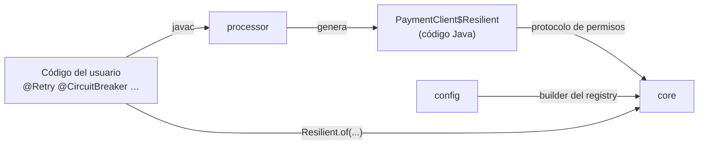
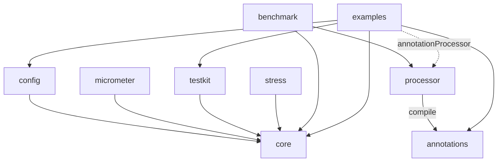

# Arquitectura

> Síntesis de [02 Mecanismos de anotaciones](research/02-annotation-mechanisms.md), [03 Rendimiento interno](research/03-performance-internals.md) y [05 Arquitectura del proyecto](research/05-project-architecture.md). Describe el diseño tal como está implementado en 0.6.0; los documentos de investigación registran cómo se eligió.

## Visión general



1. El usuario anota interfaces o clases no final.
2. Al compilar, `processor` valida las anotaciones (firmas de fallback, duraciones, paquetes en conflicto) y **genera código Java**: un wrapper que delega para las interfaces, una subclase para las clases no final.
3. Al arrancar, el usuario construye un `ResilienceRegistry` (por código y/o desde configuración externa) y obtiene la instancia con `Resilient.of(PaymentClient.class, impl, registry)` para una interfaz, o con `Resilient.create(InventoryService.class, registry, argumentosDelConstructor...)` (o el constructor generado, `new InventoryService$Resilient(registry, ...)`) para una clase.
4. El procesador es **obligatorio**. Si falta la clase generada (no se configuró el procesador), `Resilient.of` falla al arrancar con un mensaje que muestra la línea `annotationProcessor` que hay que agregar. No hay fallback con reflexión ni proxies.
5. La configuración se resuelve **una sola vez**, al crear la instancia, en objetos de política inmutables guardados en campos `final` de la clase generada. Las llamadas nunca buscan nada.

## Mecanismo de anotaciones

Decisión: **procesamiento de anotaciones en compilación (APT) que genera código fuente** ([02 §5](research/02-annotation-mechanisms.md)).

Costo de despacho medido en nuestro propio JMH (JDK 25, Apple M1, guarda trivial; una llamada directa cuesta 1,2 ns) ([02 §3](research/02-annotation-mechanisms.md)):

| Mecanismo | 1 tipo de servicio | 4 tipos de servicio | Memoria | Primera instancia |
|---|---:|---:|---:|---:|
| APT, protocolo de políticas en línea | 2,4–2,6 ns | 6,9–7,3 ns | 0 B | 0,37 ms |
| APT con un `execute(Supplier)` compartido | 2,5 ns | 14,2 ns | 0 B | — |
| ByteBuddy en runtime | 2,0 ns | ~6,0 ns | 0 B | ~200 ms |
| `Proxy` + `Method.invoke` | 16 ns | 37 ns | 16–64 B | 2,4 ms |

Por qué APT:

- Costo por llamada parecido al de código escrito a mano, sin reflexión, con llamadas monomórficas.
- Arranque instantáneo, funciona en GraalVM native-image sin configuración, stack traces legibles.
- Errores como una firma de fallback incorrecta o una duración inválida pasan a ser errores de compilación.
- El usuario solo agrega una dependencia `annotationProcessor`. Sin flags de la JVM, sin agente, sin compilador especial.

Descartados o pospuestos:

- **ByteBuddy en runtime:** unos 200 ms para la primera instancia, una dependencia de 9 MB y configuración extra para native-image.
- **AspectJ y Java agents:** flags de la JVM, la advertencia de JEP 451 al adjuntar agentes, y el weaver queda atrás con cada JDK.
- **Class-File API:** final recién en JDK 24, no se puede usar con Java 21 como base.
- **Fallback con `Proxy`:** descartado por ahora. El procesador es obligatorio y las anotaciones usan retención `CLASS`. Si algún día se agrega un módulo `dynamic`, pasar a retención `RUNTIME` es un cambio compatible.

### Forma del código generado

El JMH muestra que la **forma** del código generado importa tanto como el mecanismo. Llamar a las políticas a través de una lambda compartida duplica el costo cuando hay varios servicios. Por eso `core` expone dos APIs:

- Una **API funcional para personas** (`Pipeline`, builders) para el código que no se puede anotar.
- Un **protocolo de permisos para el código generado**, de bajo nivel y sin asignar memoria, en el paquete `dev.resilience4cata.generated` (exportado, pero solo para el código generado): `acquire()` / `onSuccess(token, started)` / `onFailure(token, started, error)` para el breaker, `start()` / `onFailure(attempts, error, start)` / `pause(delay)` para el retry, `enter()` / `succeeded(scope)` / `failed(scope, error)` para el timeout, etc.

Cada política es una capa: el método público tiene la más externa, y cada capa interna es un método privado con la misma firma, que termina con la llamada a la implementación. Esto es lo que genera el procesador para `@Retry` + `@CircuitBreaker` + `@Timeout` en `String track(String)` (de la guía de primeros pasos; aquí se acortan los nombres completos):

```java
@Override
public String track(String p0) throws IOException {
    final RetryPolicy r4c$retry = this.retry0;
    final long r4c$start = r4c$retry.start();
    int r4c$attempts = 0;
    while (true) {
        try {
            return this.r4c$circuitBreaker0(p0);
        } catch (Throwable r4c$e) {
            final long r4c$delay = r4c$retry.onFailure(++r4c$attempts, r4c$e, r4c$start);
            if (r4c$delay < 0 || !r4c$retry.pause(r4c$delay)) {
                throw r4c$e;
            }
        }
    }
}

private String r4c$circuitBreaker0(String p0) throws IOException {
    final CircuitBreakerPolicy r4c$cb = this.circuitBreaker0;
    final long r4c$token = r4c$cb.acquire();
    if (r4c$token < 0) {
        throw r4c$cb.rejection();                          // preallocated, stackless
    }
    final long r4c$started = r4c$cb.startTimer();          // reads the clock only if slowCallDuration is set
    try {
        final String r4c$result = this.r4c$timeout0(p0);
        r4c$cb.onSuccess(r4c$token, r4c$started);
        return r4c$result;
    } catch (Throwable r4c$e) {
        r4c$cb.onFailure(r4c$token, r4c$started, r4c$e);
        throw r4c$e;
    }
}

private String r4c$timeout0(String p0) throws IOException {
    final TimeoutPolicy r4c$timeout = this.timeout0;
    final TimeoutPolicy.Scope r4c$scope = r4c$timeout.enter();
    final String r4c$result;
    try {
        r4c$result = this.delegate.track(p0);              // monomorphic call
    } catch (Throwable r4c$e) {
        r4c$timeout.failed(r4c$scope, r4c$e);
        throw r4c$e;
    }
    r4c$timeout.succeeded(r4c$scope);
    return r4c$result;
}
```

Los métodos async (que devuelven `CompletionStage` o `CompletableFuture`) son la excepción: se generan como llamadas anidadas `policy.executeAsync(() -> next)`, porque los futures ya asignan memoria y pasan por callbacks megamórficos, así que una lambda por capa cuesta poco ahí.

Una diferencia de versión entre `processor` y `core` se detecta al crear la instancia: si a la clase generada le falta el constructor que espera este `core`, `Resilient.of` / `Resilient.create` fallan con [`R4C-RT-004`](errors.md#r4c-rt-004). El BOM mantiene ambos en la misma versión.

### Anotaciones en la interfaz vs la implementación

| Estilo | Anotaciones que cuentan | Prioridad, de menor a mayor |
|---|---|---|
| Wrapper: `Resilient.of(PaymentClient.class, impl, registry)` | Solo las de la interfaz. La implementación no se conoce al compilar; anotarla hace que la clase use el estilo subclase | interfaz que declara < interfaz envuelta < método de la interfaz |
| Subclase: `Resilient.create(HttpPaymentClient.class, registry)` | Las de la interfaz y las de la implementación | interfaz < método de la interfaz < clase < método de la clase |

En el estilo subclase **gana la implementación**, atributo por atributo: un método de la clase que solo define `maxAttempts` conserva el `delay` declarado en la interfaz.

### Auto-invocación

Decisión: las llamadas de un método a otro dentro del mismo objeto **se interceptan** siempre que el mecanismo lo permita.

| Estilo | `this.otro()` dentro del código del usuario | Por qué |
|---|---|---|
| Subclase (clase no final anotada, `Resilient.create(InventoryService.class, registry)`) | **Se intercepta** | La subclase generada sobrescribe `otro()`, así que la llamada virtual pasa por ella |
| Wrapper (interfaz anotada, `Resilient.of(PaymentClient.class, impl, registry)`) | No se intercepta | La implementación del usuario se llama a sí misma directamente; el wrapper nunca lo ve |

La diferencia queda documentada en la [guía de primeros pasos](start/how-it-works.md). Quien necesite auto-invocación con el estilo wrapper anota la clase de implementación. Un método que se llama a sí mismo de forma recursiva pasa por sus políticas en cada llamada, y eso también queda documentado.

## Funcionamiento interno de las políticas

Tal como está implementado, partiendo de las propuestas de [03](research/03-performance-internals.md); las partes sin locks se verifican con jcstress y cada cambio en el camino caliente con JMH ([benchmarks](benchmarks.md)).

| Política | Diseño |
|---|---|
| Circuit breaker | El estado es un objeto de fase inmutable (closed, open, half-open, forzado abierto, deshabilitado) que se cambia por CAS con un `VarHandle`, así que solo se crean objetos en las transiciones; los permisos llevan la generación de la fase y los resultados viejos se descartan; ventana por cantidad como un arreglo de slots actualizado con `getAndSet` más contadores, ventana por tiempo como buckets de un segundo con contadores `LongAdder`; mientras está cerrado y solo hay éxitos rápidos, una llamada solo lee el campo `quiet` |
| Rate limiter | GCRA sobre un solo `long` con padding (el tiempo teórico de llegada) con un CAS plano; el camino de rechazo solo lee; quien pierde el CAS espera 1 ns antes de reintentar; sin thread de fondo |
| Bulkhead | Con `maxWait = 0`, un loop de CAS sobre un contador con padding (acquire para tomar un slot, release para devolverlo); un `Semaphore` no fair cuando `maxWait > 0`; las esperas async se encolan sin bloquear y reciben los slots que se liberan |
| Adaptive limit | El contador de rechazo inmediato del bulkhead contra un límite leído con acceso opaco; cada llamada terminada suma su latencia a la franja de contadores acumulados de su hilo (escrituras simples con pérdida, franjas de 128 bytes); el hilo que termina una llamada después del plazo de la ventana toma un candado de ventana de un CAS y aplica Gradient2 o AIMD (concurrency-limits de Netflix) a la latencia promedio de la ventana, el máximo de llamadas en vuelo y los descartes; sin hilo de fondo |
| Retry | Estado del intento en variables locales; nada de memoria en el camino de éxito; jitter full, equal o ninguno |
| Timeout | La llamada sigue en el thread del llamador; un único thread watchdog compartido revisa scopes reutilizables por thread contra un reloj grueso e interrumpe las llamadas atrasadas, con un protocolo CAS con sello para que una interrupción nunca le llegue a la llamada siguiente; los timeouts async usan otro timer sin locks (inboxes repartidos) que nunca dispara antes de tiempo |
| Transversal | Eventos como records tipados, que solo se crean si alguien escucha; snapshots a pedido; padding de los campos que se escriben mucho; rechazos preasignados y sin stack trace; ninguna lectura del reloj salvo que la función la necesite |

No disponible con Java 21 como base: `StructuredTaskScope` (sigue siendo una API en preview en JDK 25). El pinning de `synchronized` se arregló recién en JDK 24 (JEP 491), así que `synchronized` está prohibido en el camino caliente.

## Módulos

Carpetas de una sola palabra. Se publican con el groupId `dev.resilience4cata` (el proyecto tiene el dominio `resilience4cata.dev`); los artifactIds llevan prefijo: `resilience4cata-core`, etc. Paquete raíz de Java y prefijo de módulos JPMS: `dev.resilience4cata` ([05 §1](research/05-project-architecture.md)).

| Módulo | Publicado | Responsabilidad | Depende de |
|---|---|---|---|
| `annotations` | sí | Tipos de anotación, más `@Experimental` / `@Internal` | — |
| `core` | sí | Todas las políticas, registry, modelo de configuración, `Pipeline`, protocolo para el código generado, eventos y snapshots | — (solo el JDK, más JSpecify) |
| `processor` | sí | Procesador de anotaciones: validación y generación de código | `annotations` |
| `config` | sí | Carga archivos properties, recursos del classpath, variables de entorno y propiedades del sistema en el builder del registry | `core` |
| `micrometer` | sí | Métricas de Micrometer: counters a partir de eventos, gauges a partir de los handles de breakers, bulkheads, rate limiters y adaptive limits ([guía](guides/micrometer.md)) | `core`, `micrometer-core` |
| `opentelemetry` | sí | Métricas de OpenTelemetry, las mismas que las del módulo de Micrometer ([guía](guides/opentelemetry.md)) | `core`, `opentelemetry-api` |
| `testkit` | sí | Ayudas de test para usuarios: `ManualClock` (reloj, sleeps y timers), jitter con semilla, `elapseWaitInOpen` | `core` |
| `junit` | sí | Extensión de JUnit Jupiter: un `ManualClock` y un registry nuevos por prueba ([guía de pruebas](guides/testing.md#junit)) | `testkit`, `junit-jupiter-api` |
| `bom` | sí | Alinea las versiones (`resilience4cata-bom`) | — |
| `benchmark` | no | JMH contra Resilience4j | `core`, `processor`, Resilience4j |
| `stress` | no | jcstress para las estructuras sin locks | `core` |
| `examples` | no | Ejemplos ejecutables, que también son tests de punta a punta del código generado | `annotations`, `core`, `config`, `testkit`, `junit`, `micrometer`, `opentelemetry`, `processor` |
| `docs` | no | Documentación. No es un proyecto de Gradle | — |



Reglas, que hacen cumplir los descriptores de módulo (`module-info.java`) y las dependencias de Gradle (todavía sin ArchUnit):

- Las interfaces a las que se refieren las anotaciones (`FallbackHandler<T>`, `Classifier<T>`) viven en `core`, no en `annotations`, así `annotations` puede seguir siendo `compileOnly`. Los atributos de las anotaciones son de tipo `Class<?>`, y el procesador valida al compilar que la clase implemente la interfaz correcta.

- `core` y `annotations` no tienen dependencias, salvo JSpecify (`api`, solo anotaciones) en `core`.
- `processor` nunca es dependencia de runtime; solo aparece en `annotationProcessor`.
- El código generado solo usa la API exportada de `core`.
- Las integraciones dependen de `core`, nunca entre ellas.
- La división es por dependencias, nunca por patrón. La división de Resilience4j en un artefacto por patrón es una queja común.
- No hay un módulo llamado `test`: chocaría con la tarea `test` de Gradle, así que el módulo se llama `testkit`.

Lo que declara un usuario (detalles, Maven y JPMS en [primeros pasos](start/installation.md)):

```groovy
dependencies {
    implementation platform('dev.resilience4cata:resilience4cata-bom:0.13.0')
    annotationProcessor platform('dev.resilience4cata:resilience4cata-bom:0.13.0')   // el path del processor no lo hereda
    implementation 'dev.resilience4cata:resilience4cata-core'
    compileOnly 'dev.resilience4cata:resilience4cata-annotations'   // retención CLASS: no hace falta en runtime
    annotationProcessor 'dev.resilience4cata:resilience4cata-processor'
}
```

## Build y herramientas

A partir de [05 §2–§4](research/05-project-architecture.md), tal como está hoy:

- **Nada de Kotlin.** Gradle 9 (wrapper 9.6) con el DSL de Groovy, mínimo y declarativo (`settings.gradle` y un `build.gradle` corto por módulo). Toda la lógica del build vive en convention plugins **escritos en Java**, en el included build `conventions`. Las versiones están en `gradle/libs.versions.toml`.
- Toolchain de Java 21 con `--release 21`, `-Xlint:all -Werror`; CI en JDK 21 y 25 (GitHub Actions, todavía sin correr en GitHub). Configuration cache y build cache activos.
- `module-info.java` en cada módulo publicado; los paquetes internos no se exportan.
- Tests: JUnit, AssertJ, jcstress y JMH (con un control de asignaciones). Los tests del procesador compilan fuentes en memoria con un helper `Compilation` propio sobre `javax.tools`, no con la librería compile-testing. ArchUnit y jqwik (en modo mantenimiento) son ideas, no se usan.
- Análisis estático: `javac -Xlint:all -Werror` y anotaciones de nulidad de JSpecify. Error Prone + NullAway, Spotless y JaCoCo son ideas, no están configurados.
- Publicación: al Maven Central Portal (OSSRH cerró en junio de 2025) con los plugins propios de Gradle `maven-publish` y `signing`, sin plugins de terceros. El plugin de convención `r4c.publish` escribe los POM y firma; `r4c.central`, en la raíz, arma un zip de bundle verificado y lo sube por la Publisher API como un deployment que se publica a mano en el portal. El namespace `dev.resilience4cata` se verifica en el Central Portal con un registro DNS TXT en `resilience4cata.dev`. Pasos: [Publicar una versión](releasing.md).
- Versionado: SemVer, `0.x` mientras se incuba. `apiCompatibility` (japicmp, en `check` y en el CI) compara cada módulo publicado con la última release: un aviso antes de la `1.0`, un fallo del build desde la `1.0` salvo que cambie la versión mayor ([Publicar una versión](releasing.md)).

## Documentación

- `docs/` es Markdown, no un módulo de Gradle, servido con Docsify (`docs/index.html`).
- El mismo árbol de archivos en `docs/en` y `docs/es`. El inglés es la fuente de verdad; cada cambio en `docs/en` debe actualizar `docs/es`.
- El Markdown se mantiene neutral (CommonMark/GFM más Mermaid), así migrar a otro generador de sitios más adelante no exige reescribir nada.
