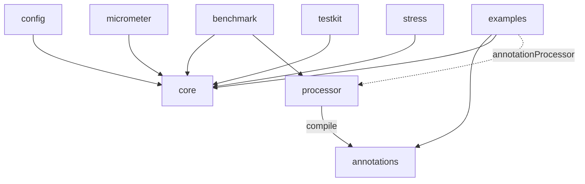

# Arquitectura

> Síntesis de [02 Mecanismos de anotaciones](research/02-annotation-mechanisms.md), [03 Rendimiento interno](research/03-performance-internals.md) y [05 Arquitectura del proyecto](research/05-project-architecture.md). Es una propuesta; todavía no hay nada implementado.

## Visión general


1. El usuario anota interfaces o clases no final.
2. Al compilar, `processor` valida las anotaciones (firmas de fallback, duraciones, paquetes en conflicto) y **genera código Java**: un wrapper que delega para las interfaces, una subclase para las clases no final.
3. Al arrancar, el usuario construye un `ResilienceRegistry` (por código y/o desde configuración externa) y obtiene la instancia con `Resilient.of(PaymentClient.class, impl, registry)`, o con la factory generada `PaymentClientResilience.wrap(impl, registry)`.
4. El procesador es **obligatorio**. Si falta la clase generada (no se configuró el procesador), `Resilient.of` falla al arrancar con un mensaje que muestra la línea `annotationProcessor` que hay que agregar. No hay fallback con reflexión ni proxies.
5. La configuración se resuelve **una sola vez**, al crear la instancia, en campos `final` de la clase generada. Las llamadas nunca buscan nada.

## Mecanismo de anotaciones

Decisión: **procesamiento de anotaciones en compilación (APT) que genera código fuente** ([02 §5](research/02-annotation-mechanisms.md)).

Costo de despacho medido en nuestro propio JMH (JDK 25, Apple M1, guarda trivial; una llamada directa cuesta 1,2 ns) ([02 §3](research/02-annotation-mechanisms.md)):

| Mecanismo | 1 tipo de servicio | 4 tipos de servicio | Memoria | Primera instancia |
|---|---:|---:|---:|---:|
| APT, protocolo de políticas en línea | 2,4–2,6 ns | 6,9–7,3 ns | 0 B | 0,37 ms |
| APT con un `execute(Supplier)` compartido | 2,5 ns | 14,2 ns | 0 B | — |
| ByteBuddy en runtime | 2,0 ns | ~6,0 ns | 0 B | ~200 ms |
| `Proxy` + `Method.invoke` | 16 ns | 37 ns | 16–64 B | 2,4 ms |

Por qué APT:

- Costo por llamada parecido al de código escrito a mano, sin reflexión, con llamadas monomórficas.
- Arranque instantáneo, funciona en GraalVM native-image sin configuración, stack traces legibles.
- Errores como una firma de fallback incorrecta o una duración inválida pasan a ser errores de compilación.
- El usuario solo agrega una dependencia `annotationProcessor`. Sin flags de la JVM, sin agente, sin compilador especial.

Descartados o pospuestos:

- **ByteBuddy en runtime:** unos 200 ms para la primera instancia, una dependencia de 9 MB y configuración extra para native-image.
- **AspectJ y Java agents:** flags de la JVM, la advertencia de JEP 451 al adjuntar agentes, y el weaver queda atrás con cada JDK.
- **Class-File API:** final recién en JDK 24, no se puede usar con Java 21 como base.
- **Fallback con `Proxy`:** descartado por ahora. El procesador es obligatorio y las anotaciones usan retención `CLASS`. Si algún día se agrega un módulo `dynamic`, pasar a retención `RUNTIME` es un cambio compatible.

### Forma del código generado

El JMH muestra que la **forma** del código generado importa tanto como el mecanismo. Llamar a las políticas a través de una lambda compartida duplica el costo cuando hay varios servicios. Por eso `core` expone dos APIs:

- Una **API funcional para personas** (`Pipeline`, builders) para el código que no se puede anotar.
- Un **protocolo de permisos para el código generado**, de bajo nivel y sin asignar memoria, en un paquete exportado como `core.spi.generated`: `long acquire(now)`, `onSuccess(token, nanos)`, `onFailure(token, nanos, error)`, `tryEnter()` / `exit()`, etc.

```java
// Generado (ilustrativo)
@Override
public Receipt charge(Order order) {
    int attempt = 0;
    while (true) {
        long t0 = ticker.read();
        long permit = charge$cb.acquire(t0);              // sin lambda, sin boxing
        if (permit == REJECTED) return fallback.apply(order, charge$cb.rejection());
        try {
            Receipt r = delegate.charge(order);            // llamada monomórfica
            charge$cb.onSuccess(permit, ticker.read() - t0);
            return r;
        } catch (Throwable e) {
            charge$cb.onFailure(permit, ticker.read() - t0, e);
            if (!charge$retry.shouldRetry(++attempt, e)) return fallback.apply(order, e);
            charge$retry.pause(attempt);                   // sin problema en virtual threads
        }
    }
}
```

El código generado incluye la versión del procesador, y `core` la verifica al inicializar la clase, así una diferencia de versión entre `processor` y `core` falla de inmediato.

### Anotaciones en la interfaz vs la implementación

| Estilo | Anotaciones que cuentan | Prioridad, de menor a mayor |
|---|---|---|
| Wrapper: `Resilient.of(PaymentClient.class, impl, registry)` | Solo las de la interfaz. La implementación no se conoce al compilar; anotarla es un error de compilación | interfaz que declara < interfaz envuelta < método de la interfaz |
| Subclase (planeado): `Resilient.create(HttpPaymentClient.class, registry)` | Las de la interfaz y las de la implementación | interfaz < método de la interfaz < clase < método de la clase |

En el estilo subclase **gana la implementación**, atributo por atributo: un método de la clase que solo define `maxAttempts` conserva el `delay` declarado en la interfaz.

### Auto-invocación

Decisión: las llamadas de un método a otro dentro del mismo objeto **se interceptan** siempre que el mecanismo lo permita.

| Estilo | `this.otro()` dentro del código del usuario | Por qué |
|---|---|---|
| Subclase (clase no final anotada, `Resilient.create(InventoryService.class, registry)`) | **Se intercepta** | La subclase generada sobrescribe `otro()`, así que la llamada virtual pasa por ella |
| Wrapper (interfaz anotada, `Resilient.of(PaymentClient.class, impl, registry)`) | No se intercepta | La implementación del usuario se llama a sí misma directamente; el wrapper nunca lo ve |

La diferencia queda documentada en la guía de usuario. Quien necesite auto-invocación con el estilo wrapper anota la clase de implementación. Un método que se llama a sí mismo de forma recursiva pasa por sus políticas en cada llamada, y eso también queda documentado.

## Funcionamiento interno de las políticas

Resumen de [03](research/03-performance-internals.md); cada punto es una hipótesis a validar con JMH y jcstress.

| Política | Diseño |
|---|---|
| Circuit breaker | Palabra de estado en un `VarHandle`; permisos marcados con la generación para half-open; ventana por cantidad como un arreglo de slots actualizado con `getAndSet` más contadores; ventana por tiempo como buckets marcados por época; los umbrales se evalúan solo cuando una tasa puede subir |
| Rate limiter | GCRA sobre un solo `long` con CAS; el camino de rechazo solo lee; sin thread de fondo |
| Bulkhead | Contador con `getAndAdd` que rechaza de inmediato; semáforo solo si `maxWait > 0` |
| Retry | Estado del intento en variables locales; memoria solo si hay fallo; jitter decorrelated o full con `ThreadLocalRandom` |
| Timeout | La llamada sigue en el thread del llamador; un timer wheel la interrumpe, con un protocolo CAS para que las interrupciones nunca se filtren; el async usa el mismo temporizador |
| Transversal | Callbacks de listeners con argumentos primitivos; métricas por consulta; padding de los campos que se escriben mucho; un par de lecturas de reloj por llamada |

No disponible con Java 21 como base: `StructuredTaskScope` (sigue en preview antes de JDK 28). El pinning de `synchronized` se arregló recién en JDK 24 (JEP 491), así que `synchronized` está prohibido en el camino caliente.

## Módulos

Carpetas de una sola palabra. Se publican con el groupId `dev.resilience4cata` (el proyecto tiene el dominio `resilience4cata.dev`); los artifactIds llevan prefijo: `resilience4cata-core`, etc. Paquete raíz de Java y prefijo de módulos JPMS: `dev.resilience4cata` ([05 §1](research/05-project-architecture.md)).

| Módulo | Publicado | Responsabilidad | Depende de |
|---|---|---|---|
| `annotations` | sí | Tipos de anotación, más `@Experimental` / `@Internal` | — |
| `core` | sí | Todas las políticas, registry, modelo de configuración, protocolo para el código generado, SPI de eventos, eventos JFR | — (solo el JDK) |
| `processor` | sí | Procesador de anotaciones: validación y generación de código | `annotations` |
| `config` | sí | Carga properties, variables de entorno y propiedades del sistema; SPI `ConfigSource` | `core` |
| `micrometer` | sí | Puente de métricas | `core`, Micrometer |
| `testkit` | sí | Ayudas de test para usuarios: reloj manual, scheduler determinista, estados forzados | `core` |
| `bom` | sí | Alinea las versiones | — |
| `benchmark` | no | JMH contra Resilience4j | `core`, `processor`, Resilience4j |
| `stress` | no | jcstress para las estructuras sin locks | `core` |
| `examples` | no | Ejemplos ejecutables, que también son tests de punta a punta del código generado | `annotations`, `core`, `processor` |
| `docs` | no | Documentación. No es un proyecto de Gradle | — |



Reglas, verificadas con ArchUnit:

- Las interfaces a las que se refieren las anotaciones (`FallbackHandler<T>`, `Classifier<T>`) viven en `core`, no en `annotations`, así `annotations` puede seguir siendo `compileOnly`. Los atributos de las anotaciones son de tipo `Class<?>`, y el procesador valida al compilar que la clase implemente la interfaz correcta.

- `core` y `annotations` no tienen dependencias, salvo JSpecify (`api`, solo anotaciones) en `core`.
- `processor` nunca es dependencia de runtime; solo aparece en `annotationProcessor`.
- El código generado solo usa la API exportada de `core`.
- Las integraciones dependen de `core`, nunca entre ellas.
- La división es por dependencias, nunca por patrón. La división de Resilience4j en un artefacto por patrón es una queja común.
- No hay un módulo llamado `test`: chocaría con la tarea `test` de Gradle, así que el módulo se llama `testkit`.

Lo que declara un usuario:

```groovy
dependencies {
    implementation platform('dev.resilience4cata:resilience4cata-bom:0.1.0')
    implementation 'dev.resilience4cata:resilience4cata-core'
    compileOnly 'dev.resilience4cata:resilience4cata-annotations'   // retención CLASS: no hace falta en runtime
    annotationProcessor 'dev.resilience4cata:resilience4cata-processor'
}
```

## Build y herramientas

Según [05 §2–§4](research/05-project-architecture.md):

- **Nada de Kotlin.** Gradle 9 con el DSL de Groovy, mínimo y declarativo (`settings.gradle` y un `build.gradle` corto por módulo). Toda la lógica del build vive en convention plugins **escritos en Java**, en el included build `conventions`. Las versiones están en `gradle/libs.versions.toml`.
- Toolchain de Java 21 con `--release 21`; CI en JDK 21 y 25. Configuration cache y build cache activos desde el primer día.
- `module-info.java` en cada módulo publicado; los paquetes internos no se exportan.
- Tests: JUnit, AssertJ, jcstress, ArchUnit y compile-testing para el procesador. jqwik está en modo mantenimiento, así que hay que verificar su compatibilidad antes de adoptarlo.
- Análisis estático: Error Prone + NullAway (modo JSpecify), Spotless, JaCoCo.
- Publicación: plugin vanniktech maven-publish al Maven Central Portal (OSSRH cerró en junio de 2025), con firma GPG en CI. El namespace `dev.resilience4cata` se verifica en el Central Portal con un registro DNS TXT en `resilience4cata.dev`.
- Versionado: SemVer, `0.x` mientras se incuba; japicmp en CI, que hace fallar el build desde `1.0`.

## Documentación

- `docs/` es Markdown, no un módulo de Gradle, servido con Docsify (`docs/index.html`).
- El mismo árbol de archivos en `docs/en` y `docs/es`. El inglés es la fuente de verdad; cada cambio en `docs/en` debe actualizar `docs/es`.
- El Markdown se mantiene neutral (CommonMark/GFM más Mermaid), así migrar a otro generador de sitios más adelante no exige reescribir nada.
