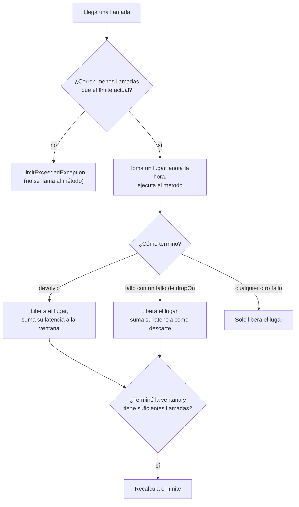

# Adaptive limit

`@AdaptiveLimit` limita cuántas llamadas corren al mismo tiempo, como un bulkhead, pero encuentra el límite por sí mismo: lo sube mientras la latencia de la dependencia se mantiene y lo baja cuando la latencia crece o las llamadas vencen.

<div class="r4c-facts">

| Anotación | Posición | Tipos de retorno | Por defecto |
|---|---|---|---|
| `@AdaptiveLimit` | 5 de 7, dentro de RateLimiter | sync y `CompletionStage` | Gradient2, empieza en 20, entre 1 y 200, ventanas de al menos 1 s y 10 llamadas |

</div>

**Úsalo cuando** la capacidad de una dependencia es desconocida o cambia (es compartida, escala sola, su carga depende de otros clientes), así que cualquier `@Bulkhead(maxConcurrent = …)` fijo quedaría bajo en un buen día o alto en uno malo. El límite se acomoda cerca de la concurrencia que la dependencia atiende sin encolar, y baja cuando empieza a encolar: las llamadas de más se rechazan enseguida en lugar de apilarse detrás de las lentas.

**No lo uses cuando** conoces el número correcto (un pool de 10 conexiones, una licencia para 4 sesiones): un [bulkhead](bulkhead.md) es más simple y predecible. Si lo que necesitas son llamadas por segundo, usa un [rate limiter](rate-limiter.md).

## Ejemplo mínimo

<!-- compare:start -->
<!-- snippet: adaptive-limit-minimal -->
```java
import dev.resilience4cata.annotation.AdaptiveLimit;

public interface SearchClient {

    @AdaptiveLimit
    String search(String query);
}
```
<!-- not-compiled: generated code, abridged -->
```java
public final class SearchClient$Resilient implements SearchClient {
    // …
    public SearchClient$Resilient(SearchClient delegate, dev.resilience4cata.ResilienceRegistry registry) {
        // …
        this.adaptiveLimit0 = registry.adaptiveLimitPolicy("dev.resilience4cata.examples.docs.adaptivelimit.SearchClient#search(java.lang.String)", "", "", null);
    }

    @Override
    public java.lang.String search(java.lang.String p0) {
        final dev.resilience4cata.generated.AdaptiveLimitPolicy r4c$adaptiveLimit = this.adaptiveLimit0;
        final long r4c$start = r4c$adaptiveLimit.acquire();
        final java.lang.String r4c$result;
        try {
            r4c$result = this.delegate.search(p0);
        } catch (java.lang.Throwable r4c$e) {
            r4c$adaptiveLimit.onFailure(r4c$start, r4c$e);
            throw r4c$e;
        }
        r4c$adaptiveLimit.onSuccess(r4c$start);
        return r4c$result;
    }
}
```
<!-- compare:end -->

Abreviado: el archivo real usa nombres totalmente calificados.

## Cómo se comporta



- **Lugares.** Una llamada toma un lugar antes de ejecutarse y lo devuelve cuando retorna o lanza. Como mucho *el límite actual* de llamadas tienen un lugar al mismo tiempo. El límite empieza en `initialLimit` y siempre queda entre `minLimit` y `maxLimit`.
- **Rechazo.** Una llamada que encuentra todos los lugares ocupados falla enseguida con `dev.resilience4cata.LimitExceededException` (una `RuntimeException` con `instanceId()`; una por instancia, sin stack trace). No se llama al método. No hay espera: un límite lleno siempre rechaza.
- **Muestras.** Cada llamada que retorna es una *muestra*: su latencia, desde que toma el lugar hasta que termina. Un fallo de `dropOn` también es una muestra, marcada como *descarte*: la dependencia está sobrecargada. Cualquier otro fallo (un 404, un error de validación) libera el lugar y no dice nada de la carga, así que no es una muestra.
- **Ventanas.** Las muestras se agrupan en ventanas de al menos `window` (1 s) y al menos `minWindowSamples` llamadas (10). Cuando una llamada termina después de que la ventana terminó y la ventana tiene suficientes muestras, el hilo de esa llamada recalcula el límite a partir de la latencia promedio de la ventana, la mayor cantidad de llamadas en vuelo que vio y si hubo algún descarte. Una ventana que terminó con pocas llamadas se extiende una `window` más, y conserva sus muestras: cuentan cuando termine. Así, con poco tráfico el límite se mueve despacio (y se revisa una vez por ventana, no en cada llamada), y sin tráfico no se mueve.
- **Límite más bajo, llamadas en vuelo.** Cuando el límite baja por debajo de las llamadas que ya corren, no se interrumpe nada: las llamadas nuevas se rechazan hasta que terminen suficientes.
- **Desactivado** (`enabled = "false"`): pasan todas las llamadas y no se mide nada.

## Los algoritmos

Los dos siguen la biblioteca [concurrency-limits](https://github.com/Netflix/concurrency-limits) de Netflix (`Gradient2Limit` y `AIMDLimit`, versión 0.5.4), aplicados una vez por ventana.

**`GRADIENT2`** (el valor por defecto) compara la latencia de la ventana con un promedio de largo plazo, un promedio exponencial sobre `longWindow` ventanas (600). Mientras la latencia de la ventana queda dentro de `rttTolerance` veces el promedio de largo plazo (1,5×), el límite crece un poco en cada ventana, un quinto (`smoothing`) de `queueSize` (4): unos 0,8 por ventana. Cuando la latencia supera eso, el límite baja en proporción, como mucho a la mitad de una vez. No crece mientras menos de la mitad de sus lugares están en uso, porque entonces la latencia no dice nada del límite. Tras una sobrecarga larga, el promedio de largo plazo baja más rápido cuando la latencia vuelve a lo normal, así que el límite se recupera. Aprende una nueva normalidad: una latencia que se mantiene alta durante muchas ventanas pasa a ser el promedio de largo plazo, y el límite vuelve a crecer desde ahí.

**`AIMD`** (aumento aditivo, disminución multiplicativa) ignora la latencia. Después de una ventana con un descarte, el límite se multiplica por `backoffRatio` (0,9); después de una ventana sin descartes en la que al menos la mitad de los lugares estuvieron en uso, crece en uno. Úsalo cuando la latencia es demasiado ruidosa para significar algo, o cuando tu señal de sobrecarga es un timeout o un bulkhead lleno más adentro.

<!-- snippet: adaptive-limit-aimd -->
```java
@AdaptiveLimit(name = "orders-aimd", algorithm = LimitAlgorithm.AIMD, initialLimit = 10,
        dropOn = {java.net.SocketTimeoutException.class, dev.resilience4cata.CallTimeoutException.class})
String cancel(String order);
```

## Atributos

| Atributo | Tipo | Por defecto | Clave de configuración | Significado |
|---|---|---|---|---|
| `algorithm` | `LimitAlgorithm` | `GRADIENT2` | `defaults.adaptiveLimit.algorithm` | `GRADIENT2` o `AIMD`, arriba. `INHERIT` significa sin definir. |
| `initialLimit` | `int` | `20` | `defaults.adaptiveLimit.initialLimit` | El límite antes de que termine la primera ventana. |
| `minLimit` | `int` | `1` | `defaults.adaptiveLimit.minLimit` | Lo más bajo que llega el límite. Al menos 1. |
| `maxLimit` | `int` | `200` | `defaults.adaptiveLimit.maxLimit` | Lo más alto que llega el límite. |
| `window` | duración | `1s` | `defaults.adaptiveLimit.window` | Cuánto dura como mínimo una ventana, de `10ms` a `1h`. |
| `dropOn` | clases de excepción | `CallTimeoutException`, `BulkheadFullException`, `TimeoutException` | `defaults.adaptiveLimit.dropOn` | Fallos que indican que la dependencia está sobrecargada. |
| `ignoreOn` | clases de excepción | ninguna | `defaults.adaptiveLimit.ignoreOn` | Fallos que nunca son muestras; ganan sobre `dropOn`. |
| `name` | `String` | un límite por método | solo en la anotación | Id de instancia; los métodos con el mismo `name` comparten un límite y sus lugares. |
| `config` | `String` | `default` | solo en la anotación | Configuración con nombre de la que partir. |
| `locked` | `boolean` | `false` | solo en la anotación | Conserva los valores fijados en la anotación: las claves `instances.<id>.*` no pueden cambiarlos. Ver [Bloquear una instancia](../guides/configuration.md#bloquear-una-instancia). |
| `enabled` | `String` | `"true"` | `defaults.adaptiveLimit.enabled` | `""` (heredar), `"true"` o `"false"`. |

<!-- snippet: adaptive-limit-tuned -->
```java
@AdaptiveLimit(name = "orders", initialLimit = 10, maxLimit = 100, window = "500ms")
@Timeout("2s") // inside the limit: a timeout is a drop, and the limit backs off
String place(String order);
```

El ajuste propio de los algoritmos no tiene atributo en la anotación, para mantenerla pequeña: `minWindowSamples` (10), `smoothing` (0,2), `rttTolerance` (1,5), `longWindow` (600) y `queueSize` (4) de Gradient2, y `backoffRatio` (0,9) de AIMD. Defínelos en una configuración con nombre:

<!-- snippet: adaptive-limit-registry -->
```java
ResilienceRegistry registry = ResilienceRegistry.builder()
        .adaptiveLimit("backend", a -> a.algorithm(AdaptiveLimitConfig.Algorithm.AIMD)
                .backoffRatio(0.8)
                .minWindowSamples(20))
        .build();
```

o en la configuración externa, con `@AdaptiveLimit(config = "backend")` en los métodos:

<!-- snippet: adaptive-limit-properties -->
```properties
defaults.adaptiveLimit.maxLimit=100
configs.backend.adaptiveLimit.algorithm=aimd
configs.backend.adaptiveLimit.backoffRatio=0.8
configs.backend.adaptiveLimit.minWindowSamples=20
instances.orders.adaptiveLimit.rttTolerance=2
```

Todas las claves, con sus valores válidos, están en la [referencia de configuración](../reference/configuration.md#adaptive-limit).

## En una clase

En una clase anotada, a nivel de tipo o en los métodos, la subclase generada aplica el límite ([clases anotadas](../guides/annotated-classes.md)):

<!-- snippet: adaptive-limit-class -->
```java
@AdaptiveLimit(maxLimit = 50)
public class InventoryService {

    public int stock(String sku) {
        return 7;
    }
}
```

## Compartir e ids de instancia

Sin `name`, cada método tiene su propio límite, con el id `<interface>#<method>(<parameter types>)`. Los métodos que llaman a la misma dependencia normalmente deberían compartir uno: dales el mismo `name`. Deben resolverse a la misma configuración, o el envoltorio falla con [`R4C-REG-008`](../errors.md#r4c-reg-008).

### Handle

`registry.adaptiveLimit(id)` devuelve un `AdaptiveLimitHandle`:

<!-- snippet: adaptive-limit-handle -->
```java
AdaptiveLimitHandle limit = registry.adaptiveLimit("orders");
int current = limit.limit();                   // how many calls may run at once now
int running = limit.inFlight();                // calls inside right now
AdaptiveLimitSnapshot snapshot = limit.snapshot(); // limit, inFlight, bounds, windows, latencies
```

| Método | Qué hace |
|---|---|
| `id()` | El `name`, o el id derivado |
| `config()` | La `AdaptiveLimitConfig` resuelta |
| `limit()` | El límite actual |
| `inFlight()` | Llamadas que tienen un lugar ahora mismo |
| `snapshot()` | Un `AdaptiveLimitSnapshot(instance, algorithm, limit, inFlight, minLimit, maxLimit, windows, windowLatency, longTermLatency)`, más `availableSlots()`. `windowLatency` es el promedio de la última ventana; `longTermLatency` es el promedio de largo plazo de Gradient2 (cero con AIMD) |

El límite existe una vez que su interfaz se envolvió o su pipeline se construyó; un id desconocido lanza [`R4C-REG-009`](../errors.md#r4c-reg-009). Lístalos con `registry.snapshot().adaptiveLimits()`.

## Con otras políticas

El adaptive limit está dentro del rate limiter y fuera del timeout y del bulkhead:

- **Un `@Timeout` adentro es la señal de sobrecarga.** Una llamada que vence falla con `CallTimeoutException`, que está en `dropOn` por defecto: la latencia de esa llamada (el timeout) entra en la ventana, y AIMD retrocede. Lo mismo pasa con un `@Bulkhead` lleno adentro (`BulkheadFullException`).
- **Las políticas de afuera ven `LimitExceededException`.** Es una `Exception`: por defecto un `@Retry` de afuera la reintenta después de su espera (agrégala a `abortOn` para fallar rápido) y un `@CircuitBreaker` de afuera la registra como falla (agrégala a `ignoreOn` si un límite lleno no debe abrir el breaker). Un `@Hedge` deja de lanzar intentos cuando el límite rechaza uno, como con un breaker abierto o un bulkhead lleno.
- **Cada intento se mide por separado**: la espera de un retry está afuera del límite y no ocupa lugar.
- **Las llamadas rechazadas ya tomaron un permiso del rate limiter**, porque el rate limiter está afuera.

## Async

Para un método que devuelve `CompletionStage<T>` o `CompletableFuture<T>`, la llamada conserva su lugar hasta que su stage se completa, y su latencia se mide hasta esa finalización:

<!-- snippet: adaptive-limit-async -->
```java
@AdaptiveLimit(name = "orders-async", initialLimit = 2)
CompletableFuture<String> placeAsync(String order);
```

Un límite lleno devuelve enseguida un future fallido. Cancelar el future devuelto cancela el stage y libera el lugar sin muestra: una llamada cancelada no dice nada de la dependencia ([cancelación](../guides/async.md#cancelación)). Ver [Métodos async](../guides/async.md).

## Lo mismo con `Pipeline`

<!-- snippet: adaptive-limit-pipeline -->
```java
Pipeline<String> search = Pipeline.builder(registry, "search", String.class)
        .adaptiveLimit(a -> a.maxLimit(100))
        .timeout(t -> t.timeout(Duration.ofSeconds(2)))
        .build();

String results = search.execute(() -> backend.search("java"));
```

El id `"search"` es el id de instancia: `registry.adaptiveLimit("search")` lo devuelve. Ver [API Pipeline](../guides/pipeline.md).

## Eventos, snapshot y métricas

| Evento | Cuándo | Campos |
|---|---|---|
| `AdaptiveLimitEvent.Rejected` | Se rechazó una llamada: el límite estaba lleno | `instance`, `nanoTime`, `limit` |
| `AdaptiveLimitEvent.LimitChanged` | Terminó una ventana y el límite se movió | `instance`, `nanoTime`, `from`, `to`, `windowLatencyNanos` |

Las llamadas admitidas no publican nada, y una ventana que mantiene el límite no publica nada. Los módulos de métricas reportan los rechazos en `r4c.calls.rejected` con `kind = adaptivelimit`, los movimientos en `r4c.adaptivelimit.limit.changes`, y los gauges `r4c.adaptivelimit.limit` y `r4c.adaptivelimit.concurrent.calls`. Ver [Observabilidad](../guides/observability.md#metric-names).

## Probarlo con `ManualClock`

Con un [`ManualClock`](../guides/testing.md), las latencias son lo que dice el reloj y las ventanas terminan cuando el reloj las pasa, así que el límite se mueve igual en cada ejecución. Los stages pendientes conservan sus lugares, lo que hace fácil llenar un límite async:

<!-- snippet: adaptive-limit-testing -->
```java
ManualClock clock = new ManualClock();
ResilienceRegistry registry = ResilienceTesting.registry(clock)
        .adaptiveLimitDefaults(a -> a.minWindowSamples(1))   // end a window after a single call
        .build();
OrderClient orders = Resilient.of(OrderClient.class, backend, registry);
AdaptiveLimitHandle limit = registry.adaptiveLimit("orders-async");

CompletableFuture<String> a = orders.placeAsync("a");          // pending: holds a slot
CompletableFuture<String> b = orders.placeAsync("b");          // pending: holds the other
assertThat(orders.placeAsync("c")).failsWithin(Duration.ZERO)  // full: rejected at once
        .withThrowableThat().withCauseInstanceOf(LimitExceededException.class);

clock.advance(Duration.ofSeconds(1));                          // the calls took 1 s; the window is over
pending.get("a").complete("placed a");                         // ends the window
pending.get("b").complete("placed b");
assertThat(limit.snapshot().windows()).isEqualTo(1);
assertThat(limit.snapshot().windowLatency()).isEqualTo(Duration.ofSeconds(1));
```

El adaptive limit no programa nada, así que nunca deja tareas pendientes en el reloj.

## Letra chica

- **Solo rechazo inmediato.** Un límite lleno rechaza enseguida; todavía no hay `maxWait`. Pon un `@Retry` afuera si los llamadores deben volver a intentar un poco después.
- **Todavía no hay `VEGAS`.** El tercer algoritmo de Netflix no está implementado; `LimitAlgorithm` le deja lugar.
- **Dos lecturas del reloj por llamada**, cuando la llamada toma su lugar y cuando termina, a través del ticker del registry. Es el costo de medir la latencia; un `@CircuitBreaker` con `slowCallDuration` lee el reloj para su propia medición.
- **Gradient2 no baja mucho de dos veces `queueSize`** (8 por defecto) solo por la latencia: con su gradiente en el piso de un medio, cada ventana lleva el límite a 0,9 × límite + 0,2 × `queueSize`. Para límites chicos, usa un `queueSize` menor o `AIMD`.
- **Se pueden perder muestras**, nunca inventarlas: las llamadas registran su latencia en franjas por hilo sin instrucciones atómicas, así que dos hilos que comparten una franja y compiten pueden perder una muestra. La ventana tiene entonces una muestra menos.
- **Diferencias con la biblioteca de Netflix**: `minLimit` vale 1 por defecto (20 allí), para que `AIMD` pueda bajar tanto como necesite la dependencia (el piso práctico de Gradient2 viene de `queueSize`, arriba); una ventana con pocas llamadas se extiende, conservando sus muestras, en lugar de descartarse; las llamadas de menos de 100 µs también son muestras; AIMD no tiene un umbral de latencia que cuente como descarte (usa un `@Timeout` adentro, cuya `CallTimeoutException` está en `dropOn`).
- El límite es por JVM y por registry.
- Errores relacionados: [`R4C-ATR-001`](../errors.md#r4c-atr-001) (sintaxis de duración), [`R4C-ATR-003`](../errors.md#r4c-atr-003) (un límite menor que 1), [`R4C-ATR-009`](../errors.md#r4c-atr-009) (límites desordenados, `window` fuera de rango), [`R4C-REG-001`](../errors.md#r4c-reg-001) (ajuste inválido en el código), [`R4C-REG-004`](../errors.md#r4c-reg-004) (`config` desconocida), [`R4C-REG-008`](../errors.md#r4c-reg-008) (`name` compartido, configuración distinta), [`R4C-REG-009`](../errors.md#r4c-reg-009) (id desconocido).

## Lo que cuesta

> [!MEASURED]
> AWS `c7g.xlarge` (Graviton3): una llamada cuesta 86 ns con un hilo y 380 ns con cuatro, y no asigna memoria; un rechazo cuesta 2.1 ns. El `SimpleLimiter` de Netflix con un `Gradient2Limit` con ventanas cuesta 118 ns y 1087 ns, y asigna 40–95 B por llamada. Un `@Bulkhead` fijo cuesta 20.5 ns con un hilo: la diferencia son las dos lecturas de `System.nanoTime()` (unos 33 ns cada una en esa máquina) que exige medir cada llamada. De [Adaptive limit, 0.6.0](../benchmarks.md#adaptive-limit-060-2026-10-26-aws-graviton3).
