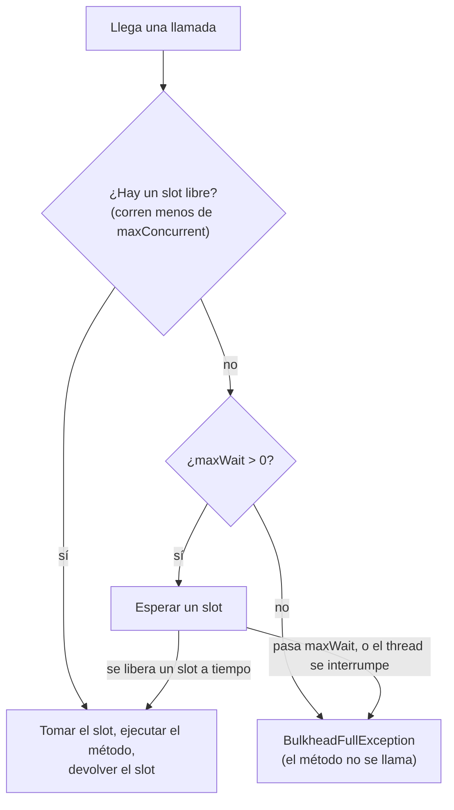

# Bulkhead

`@Bulkhead` limita cuántas llamadas corren al mismo tiempo, para que una dependencia lenta no pueda quedarse con todos los threads, conexiones o slots de tu servicio.

<div class="r4c-facts">

| Anotación | Posición | Tipos de retorno | Valores por defecto |
|---|---|---|---|
| `@Bulkhead` | 7 de 7, la más interna, alrededor del método | sync y `CompletionStage` | 25 llamadas concurrentes, sin espera |

</div>

**Úsalo cuando** una dependencia tiene capacidad limitada (un pool de conexiones, una licencia, un renderizador que usa mucha CPU), o cuando quieres que la lentitud de una dependencia quede contenida en lugar de agotarlo todo.

**No lo uses cuando** el límite que necesitas es un *ritmo* (llamadas por segundo): eso es un [rate limiter](rate-limiter.md). Un bulkhead cuenta llamadas en curso, no llamadas por período.

## Ejemplo mínimo

<!-- compare:start -->
<!-- snippet: bulkhead-minimal -->
```java
import dev.resilience4cata.annotation.Bulkhead;

public interface ReportRenderer {

    @Bulkhead(maxConcurrent = 10)
    String render(String reportId);
}
```
<!-- not-compiled: generated code, abridged -->
```java
public final class ReportRenderer$Resilient implements ReportRenderer {
    // …
    public ReportRenderer$Resilient(ReportRenderer delegate, dev.resilience4cata.ResilienceRegistry registry) {
        // …
        this.bulkhead0 = registry.bulkheadPolicy("dev.resilience4cata.examples.docs.bulkhead.ReportRenderer#render(java.lang.String)", "", "", r4c$b -> {
            r4c$b.maxConcurrent(10);
        });
    }

    @Override
    public java.lang.String render(java.lang.String p0) {
        final dev.resilience4cata.generated.BulkheadPolicy r4c$bulkhead = this.bulkhead0;
        if (!r4c$bulkhead.tryEnter()) {
            throw r4c$bulkhead.rejection();
        }
        try {
            return this.delegate.render(p0);
        } finally {
            r4c$bulkhead.exit();
        }
    }
}
```
<!-- compare:end -->

Abreviado: el archivo real usa nombres totalmente calificados.

## Cómo se comporta



- **Slots.** Una llamada toma un slot antes de correr y lo devuelve cuando retorna o lanza. Como máximo `maxConcurrent` llamadas tienen un slot al mismo tiempo.
- **Rechazo.** Con `maxWait = "0"` (por defecto), una llamada que encuentra el bulkhead lleno falla enseguida con `dev.resilience4cata.BulkheadFullException` (una `RuntimeException` con `instanceId()`; una por bulkhead, sin stack trace). El método no se llama.
- **Espera, sync.** Con `maxWait` > 0, el thread que llama se bloquea hasta que haya un slot libre o pase `maxWait`. En un virtual thread, bloquearse es barato y no fija (pin) un carrier. Si el thread que espera se interrumpe, la llamada se rechaza y el flag de interrupción se activa de nuevo. La espera no es por orden de llegada: una llamada nueva puede tomar un slot liberado antes que una que espera.
- **Es un bulkhead de semáforo**: la llamada corre en el thread de quien llama. No hay bulkhead de pool de threads; con virtual threads rara vez hace falta.
- **Desactivado** (`enabled = "false"`): todas las llamadas pasan.

## Atributos

| Atributo | Tipo | Por defecto | Clave de config | Significado |
|---|---|---|---|---|
| `maxConcurrent` | `int` | `25` | `defaults.bulkhead.maxConcurrent` | Llamadas que pueden correr al mismo tiempo. Al menos 1. |
| `maxWait` | duración | `0` (rechazar enseguida) | `defaults.bulkhead.maxWait` | Cuánto puede esperar una llamada por un slot libre. |
| `name` | `String` | un bulkhead por método | solo anotación | Id de la instancia; los métodos con el mismo `name` comparten un bulkhead y sus slots. |
| `config` | `String` | `default` | solo anotación | Configuración con nombre de la que partir. |
| `enabled` | `String` | `"true"` | `defaults.bulkhead.enabled` | `""` (heredar), `"true"` o `"false"`. |

Los valores por defecto son los de Resilience4j. Las claves también existen bajo `configs.<name>.` e `instances.<id>.`; ver [Configuración](../guides/configuration.md).

Llamadas que pueden esperar un poco por un slot:

<!-- snippet: bulkhead-wait -->
```java
@Bulkhead(name = "thumbnails", maxConcurrent = 4, maxWait = "250ms")
byte[] thumbnail(String imageId);
```

## Compartir e ids de instancia

Sin `name`, cada método tiene su propio bulkhead, con el id `<interfaz>#<método>(<tipos de parámetros>)`. Para proteger un recurso que usan varios métodos (un pool de conexiones detrás de todo un cliente), dales el mismo `name`: entonces comparten los mismos `maxConcurrent` slots. Deben resolver la misma configuración, o envolverlos falla con [`R4C-REG-008`](../errors.md#r4c-reg-008).

### Handle

`registry.bulkhead(id)` devuelve un `BulkheadHandle`:

<!-- snippet: bulkhead-handle -->
```java
BulkheadHandle bulkhead = registry.bulkhead("thumbnails");
int running = bulkhead.concurrentCalls();        // calls inside right now
int waiting = bulkhead.waitingCalls();           // calls waiting for a slot (0 when maxWait = 0)
BulkheadSnapshot snapshot = bulkhead.snapshot(); // instance, concurrentCalls, waitingCalls, maxConcurrent
```

| Método | Qué hace |
|---|---|
| `id()` | El `name`, o el id derivado |
| `config()` | La `BulkheadConfig` resuelta |
| `concurrentCalls()` | Llamadas que tienen un slot ahora mismo |
| `waitingCalls()` | Llamadas esperando un slot ahora mismo: llamadas async en cola por un slot liberado más threads sync bloqueados en el bulkhead. Siempre 0 cuando `maxWait` es 0. Una foto para monitoreo; puede estar desactualizada cuando la lees |
| `snapshot()` | Un `BulkheadSnapshot(instance, concurrentCalls, waitingCalls, maxConcurrent)`, más `availableSlots()` |

El bulkhead existe una vez que su interfaz se envolvió o su pipeline se construyó; un id desconocido lanza [`R4C-REG-009`](../errors.md#r4c-reg-009). No hay `registry.bulkheads()`: lístalos con `registry.snapshot().bulkheads()`.

## Con otras políticas

El bulkhead es la capa más interna, justo alrededor de tu método:

- Un slot se ocupa solo mientras corre el método. Durante la espera de un `@Retry`, el slot queda libre para otras llamadas.
- `BulkheadFullException` es una `Exception`: por defecto un `@Retry` externo la reintenta después de su espera (agrégala a `abortOn` para fallar rápido) y un `@CircuitBreaker` externo la registra como falla (agrégala a `ignoreOn` si un bulkhead lleno no debe abrir el breaker).
- El tiempo esperando un slot cuenta para el `@Timeout`, que está afuera: una espera sync interrumpida por el timeout termina con `CallTimeoutException`.
- Las llamadas rechazadas ya tomaron un permiso del rate limiter, porque el rate limiter está afuera.

## Async

Para un método que devuelve `CompletionStage<T>` o `CompletableFuture<T>`, la llamada ocupa su slot hasta que su stage se completa, no solo hasta que el método retorna:

<!-- snippet: bulkhead-async -->
```java
@Bulkhead(name = "thumbnails-async", maxConcurrent = 2, maxWait = "1s")
CompletableFuture<byte[]> thumbnailAsync(String imageId);
```

Una llamada async nunca bloquea un thread mientras espera: un bulkhead lleno con `maxWait` > 0 pone la llamada en cola, y la que espera desde hace más tiempo recibe directamente el siguiente slot liberado y arranca en un virtual thread nuevo. Si antes pasa `maxWait`, su future falla con `BulkheadFullException`. Sin `maxWait`, un bulkhead lleno devuelve enseguida un future fallido. Las llamadas sync y async a un bulkhead compartido usan los mismos slots. Cancelar el future devuelto cancela el stage y libera el slot de inmediato (cuando el stage es un `Future`); una llamada todavía en cola sale de la cola y nunca arranca ([cancelación](../guides/async.md#cancelación)). Ver [Métodos async](../guides/async.md).

## Lo mismo con `Pipeline`

<!-- snippet: bulkhead-pipeline -->
```java
Pipeline<String> render = Pipeline.builder(registry, "renderer", String.class)
        .bulkhead(b -> b.maxConcurrent(10))
        .build();

String report = render.execute(() -> backend.render("r-1"));
```

El id `"renderer"` es el id de instancia: `registry.bulkhead("renderer")` lo devuelve. Ver [API Pipeline](../guides/pipeline.md).

## Eventos y snapshot

| Evento | Cuándo | Campos |
|---|---|---|
| `BulkheadEvent.Rejected` | Se rechazó una llamada (lleno sin espera, pasó `maxWait`, o una espera interrumpida) | `instance`, `nanoTime`, `maxConcurrent` |

Las llamadas admitidas no publican nada. Ver [Observabilidad](../guides/observability.md).

## Probarlo con `ManualClock`

Los stages pendientes ocupan sus slots, lo que hace fácil llenar un bulkhead async en un test:

<!-- snippet: bulkhead-testing -->
```java
ThumbnailService thumbnails = Resilient.of(ThumbnailService.class, backend, registry);
BulkheadHandle bulkhead = registry.bulkhead("thumbnails-async");

CompletableFuture<byte[]> a = thumbnails.thumbnailAsync("a");   // pending: holds a slot
CompletableFuture<byte[]> b = thumbnails.thumbnailAsync("b");   // pending: holds the other
CompletableFuture<byte[]> c = thumbnails.thumbnailAsync("c");   // full: waits up to 1 s
assertThat(bulkhead.concurrentCalls()).isEqualTo(2);
assertThat(bulkhead.waitingCalls()).isEqualTo(1);

clock.advance(Duration.ofSeconds(1));                          // nothing was released in time
assertThat(c).failsWithin(Duration.ofSeconds(5))
        .withThrowableThat().withCauseInstanceOf(BulkheadFullException.class);
```

Con un [`ManualClock`](../guides/testing.md), `maxWait` se mide en ese reloj, tanto para esperas async como sync: una llamada sync bloqueada obtiene un slot apenas se libera uno y se rechaza cuando el reloj pasa `maxWait`, sin importar cuánto tarde eso en tiempo real. Espera todo lo que el reloj no avance.

## Letra chica

- El límite es por JVM y por registry.
- `waitingCalls()` es solo para monitoreo; no tomes decisiones con él en el camino de la llamada.
- Cuando llamadas sync y async esperan en el mismo bulkhead, los slots liberados se alternan entre la llamada async más antigua y los threads bloqueados, de forma aproximada.
- Errores relacionados: [`R4C-ATR-001`](../errors.md#r4c-atr-001) (sintaxis de duración), [`R4C-ATR-003`](../errors.md#r4c-atr-003) (`maxConcurrent` menor que 1), [`R4C-ATR-006`](../errors.md#r4c-atr-006) (`enabled`), [`R4C-REG-004`](../errors.md#r4c-reg-004) (`config` desconocida), [`R4C-REG-008`](../errors.md#r4c-reg-008) (`name` compartido con otra configuración), [`R4C-REG-009`](../errors.md#r4c-reg-009) (id desconocido).

## Cuánto cuesta

> [!MEASURED]
> En AWS Graviton3 (`c7g.xlarge`, JDK 21), una llamada a través de un bulkhead con un slot libre cuesta 20,5 ns con 1 thread, un empate con Resilience4j 2.4.0 (20,4 ns), y 264 ns con 4 threads compartiéndolo, contra 432 ns; ninguno asigna memoria. Una llamada rechazada cuesta 2,3 ns y 0 B, contra 139 ns y 416 B. [Benchmarks: cierre del MVP](../benchmarks.md#cierre-del-mvp-classifier-pipeline-eventos-testkit-2026-10-24-aws-graviton3)
