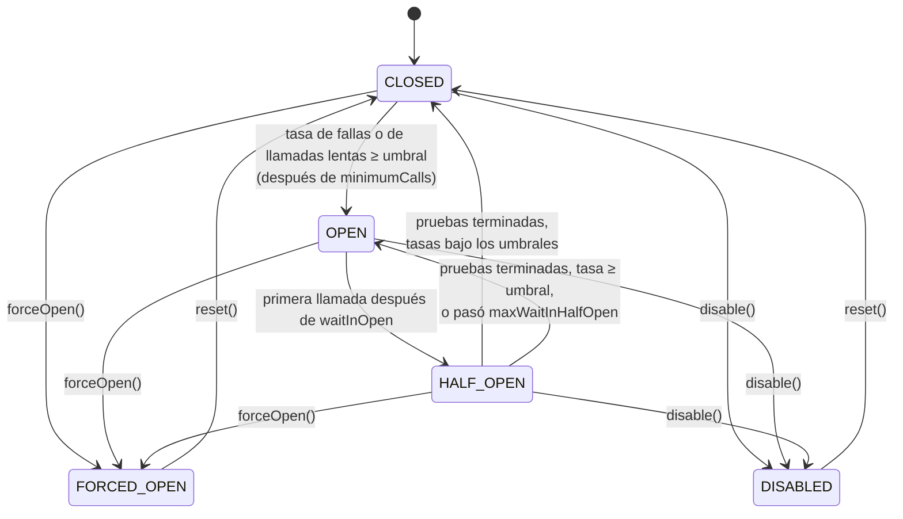

# Circuit breaker

`@CircuitBreaker` deja de llamar a una dependencia que falla una y otra vez, y más tarde deja pasar unas pocas llamadas de prueba para ver si se recuperó.

<div class="r4c-facts">

| Anotación | Posición | Tipos de retorno | Valores por defecto |
|---|---|---|---|
| `@CircuitBreaker` | 3 de 7, dentro de Retry | sync y `CompletionStage` | ventana de 100 llamadas, abre con 50% de fallas tras 100 llamadas, 60 s abierto, 10 pruebas, detección de llamadas lentas desactivada |

</div>

**Úsalo cuando** una dependencia puede estar caída o sobrecargada un buen rato, y fallar rápido es mejor que acumular llamadas, threads y reintentos esperándola.

**No lo uses cuando** las fallas son independientes entre sí (una entrada mala no predice la siguiente llamada), o cuando no hay nada útil que hacer mientras está abierto. Un breaker sobre llamadas poco frecuentes (unas pocas por hora) nunca ve suficientes llamadas para decidir; baja `minimumCalls` o usa una [ventana por tiempo](#atributos).

## Ejemplo mínimo

<!-- compare:start -->
<!-- snippet: circuit-breaker-minimal -->
```java
import dev.resilience4cata.annotation.CircuitBreaker;

public interface PaymentGateway {

    @CircuitBreaker(name = "payments", windowSize = 10, minimumCalls = 10, failureRateThreshold = 50,
            waitInOpen = "30s", halfOpenCalls = 2)
    String charge(String orderId);
}
```
<!-- not-compiled: generated code, abridged -->
```java
public final class PaymentGateway$Resilient implements PaymentGateway {
    // …
    public PaymentGateway$Resilient(PaymentGateway delegate, dev.resilience4cata.ResilienceRegistry registry) {
        // …
        this.circuitBreaker0 = registry.circuitBreakerPolicy("dev.resilience4cata.examples.docs.circuitbreaker.PaymentGateway#charge(java.lang.String)", "payments", "", r4c$b -> {
            r4c$b.windowSize(10);
            r4c$b.minimumCalls(10);
            r4c$b.failureRateThreshold(50.0f);
            r4c$b.waitInOpen(java.time.Duration.ofNanos(30000000000L));
            r4c$b.halfOpenCalls(2);
        });
    }

    @Override
    public java.lang.String charge(java.lang.String p0) {
        final dev.resilience4cata.generated.CircuitBreakerPolicy r4c$cb = this.circuitBreaker0;
        final long r4c$token = r4c$cb.acquire();
        if (r4c$token < 0) {
            throw r4c$cb.rejection();
        }
        final long r4c$started = r4c$cb.startTimer();
        try {
            final java.lang.String r4c$result = this.delegate.charge(p0);
            r4c$cb.onSuccess(r4c$token, r4c$started);
            return r4c$result;
        } catch (java.lang.Throwable r4c$e) {
            r4c$cb.onFailure(r4c$token, r4c$started, r4c$e);
            throw r4c$e;
        }
    }
}
```
<!-- compare:end -->

Abreviado: el archivo real usa nombres totalmente calificados.

Este breaker mira las últimas 10 llamadas. Una vez que vio 10, abre cuando el 50% o más de ellas fallaron, rechaza todas las llamadas durante 30 s y luego deja pasar 2 llamadas de prueba: si falla menos del 50% de ellas se cierra; si no, vuelve a abrir.

## Cómo se comporta



- **Cerrado.** Las llamadas pasan y sus resultados entran en una ventana deslizante. Con `COUNT` (por defecto) la ventana guarda las últimas `windowSize` llamadas; con `TIME` guarda las llamadas de los últimos `windowSize` segundos, en buckets de un segundo.
- **Qué cuenta como falla.** Una excepción que es instancia de un tipo de `recordOn` (por defecto: `Exception`) y de ningún tipo de `ignoreOn`. `ignoreOn` gana: esas llamadas no cuentan para ningún lado. Cualquier otro throwable cuenta como **éxito**, así que por defecto un `Error` no abre el breaker. Con la detección de llamadas lentas activa (`slowCallDuration` > 0), una llamada que tarda `slowCallDuration` o más también cuenta como lenta, haya tenido éxito o no.
- **Apertura.** Las tasas se evalúan una vez que la ventana tiene `minimumCalls` llamadas (en una ventana por conteo, `minimumCalls` tiene tope en `windowSize`). El breaker abre cuando la tasa de fallas llega a `failureRateThreshold` o la supera, o la tasa de llamadas lentas llega a `slowCallRateThreshold` o la supera.
- **Abierto.** Toda llamada se rechaza enseguida con `CallNotPermittedException`, sin llegar al método. El breaker no se mueve solo: la primera llamada que llega después de `waitInOpen` lo pasa a half-open y se convierte en prueba.
- **Half-open.** Se dejan pasar `halfOpenCalls` llamadas de prueba; las demás se rechazan hasta que las pruebas terminan. Cuando termina la última prueba, se aplican los mismos umbrales a las pruebas: por debajo, el breaker se cierra con una ventana vacía; si no, vuelve a abrir. Si `maxWaitInHalfOpen` está definido y las pruebas no terminaron todas en ese tiempo, la siguiente llamada lo vuelve a abrir. Una prueba ignorada (una excepción de `ignoreOn`, o `IGNORE` de un classifier) devuelve su permiso.
- **Forzado abierto y desactivado** se ponen a mano, con el [handle](#handle): `forceOpen()` rechaza todo, `disable()` deja pasar todo y no registra nada, ambos hasta `reset()`. `enabled = "false"` arranca el breaker en `DISABLED`, y `reset()` entonces vuelve a `DISABLED`.
- El resultado de una llamada se descarta si el breaker cambió de estado mientras corría, así que una llamada lenta que empezó con el breaker cerrado no puede decidir una prueba de half-open.

El rechazo, `dev.resilience4cata.CallNotPermittedException`, es una `RuntimeException` con `instanceId()`. Se crea una vez por breaker y no tiene stack trace, así que un rechazo no cuesta nada; su mensaje nombra al breaker.

## Atributos

| Atributo | Tipo | Por defecto | Clave de config | Significado |
|---|---|---|---|---|
| `windowType` | `WindowType` | `COUNT` | `defaults.circuitBreaker.windowType` | `COUNT`: las últimas `windowSize` llamadas. `TIME`: las llamadas de los últimos `windowSize` segundos. |
| `windowSize` | `int` | `100` | `defaults.circuitBreaker.windowSize` | Llamadas (`COUNT`) o segundos (`TIME`). Al menos 1. |
| `minimumCalls` | `int` | `100` | `defaults.circuitBreaker.minimumCalls` | Llamadas necesarias antes de evaluar las tasas. Al menos 1. |
| `failureRateThreshold` | `float` | `50` | `defaults.circuitBreaker.failureRateThreshold` | Tasa de fallas, en porcentaje (0 < x ≤ 100), que abre el breaker. |
| `slowCallRateThreshold` | `float` | `100` | `defaults.circuitBreaker.slowCallRateThreshold` | Tasa de llamadas lentas, en porcentaje (0 < x ≤ 100), que abre el breaker. |
| `slowCallDuration` | duración | `0` (desactivado) | `defaults.circuitBreaker.slowCallDuration` | Duración a partir de la cual una llamada es lenta. `0` desactiva la detección: las llamadas no se cronometran. |
| `waitInOpen` | duración | `60s` | `defaults.circuitBreaker.waitInOpen` | Cuánto tiempo queda abierto antes de que la siguiente llamada pueda probar. |
| `halfOpenCalls` | `int` | `10` | `defaults.circuitBreaker.halfOpenCalls` | Llamadas de prueba permitidas en half-open. Al menos 1. |
| `maxWaitInHalfOpen` | duración | `0` (sin límite) | `defaults.circuitBreaker.maxWaitInHalfOpen` | Tiempo máximo en half-open antes de volver a abrir si las pruebas no terminaron. |
| `recordOn` | `Class<? extends Throwable>[]` | `{Exception.class}` | `defaults.circuitBreaker.recordOn` | Excepciones registradas como fallas. Los demás throwables cuentan como éxitos. |
| `ignoreOn` | `Class<? extends Throwable>[]` | `{}` | `defaults.circuitBreaker.ignoreOn` | Excepciones que no cuentan para ningún lado; gana sobre `recordOn` y sobre el classifier. |
| `classifier` | `Class<?>` | ninguno | solo anotación | Un `Classifier<T>` que registra resultados y excepciones según diga. Reemplaza a `recordOn`. Ver [Classifiers](../guides/classifiers.md). |
| `name` | `String` | un breaker por método | solo anotación | Id de la instancia; los métodos con el mismo `name` comparten un breaker. |
| `config` | `String` | `default` | solo anotación | Configuración con nombre de la que partir. |
| `enabled` | `String` | `"true"` | `defaults.circuitBreaker.enabled` | `""` (heredar), `"true"` o `"false"` (arranca en `DISABLED`). |

Los valores por defecto son los de Resilience4j, salvo que la detección de llamadas lentas está desactivada. Las claves de config también aceptan kebab-case (`circuit-breaker.wait-in-open`) y existen bajo `configs.<name>.` e `instances.<id>.`; ver [Configuración](../guides/configuration.md).

Un breaker que mira el último minuto, trata como lentas las llamadas de 2 s o más e ignora las entradas inválidas:

<!-- snippet: circuit-breaker-tuned -->
```java
@CircuitBreaker(windowType = WindowType.TIME, windowSize = 60, minimumCalls = 5,
        slowCallDuration = "2s", slowCallRateThreshold = 80,
        ignoreOn = IllegalArgumentException.class)
long balance(String account);
```

Abre una vez que vio 5 llamadas en los últimos 60 s y el 80% o más fueron lentas (o el 50% o más fallaron). Una `IllegalArgumentException` es culpa de quien llama, no de la dependencia, así que no se registra en absoluto.

## Compartir e ids de instancia

Un breaker tiene estado, así que compartirlo importa. Sin `name`, cada método tiene su propio breaker, con el id `<interfaz>#<método>(<tipos de parámetros>)`. Con el mismo `name` en varios métodos (o en varias interfaces envueltas con el mismo registry), comparten un breaker: las fallas de un método lo abren para todos. Deben resolver la misma configuración, o envolverlos falla con [`R4C-REG-008`](../errors.md#r4c-reg-008). Un [`Pipeline`](#lo-mismo-con-pipeline) cuyo id es igual al `name` también lo comparte.

### Handle

`registry.circuitBreaker(id)` devuelve un `CircuitBreakerHandle` para inspeccionar el breaker y forzar su estado, en operación y en tests:

<!-- snippet: circuit-breaker-handle -->
```java
CircuitBreakerHandle breaker = registry.circuitBreaker("payments");
CircuitBreakerSnapshot snapshot = breaker.snapshot();
System.out.printf("%s is %s, %d calls, failure rate %.0f%%%n",
        snapshot.instance(), snapshot.state(), snapshot.bufferedCalls(), snapshot.failureRate());

breaker.forceOpen();   // maintenance window: every call is rejected
breaker.disable();     // or let every call through, recording nothing
breaker.reset();       // back to CLOSED with an empty window
```

| Método | Qué hace |
|---|---|
| `id()` | El `name`, o el id derivado |
| `state()` | `CLOSED`, `OPEN`, `HALF_OPEN`, `FORCED_OPEN` o `DISABLED` |
| `config()` | La `CircuitBreakerConfig` resuelta |
| `snapshot()` | Un `CircuitBreakerSnapshot`: estado, tasas y conteos de la ventana actual |
| `forceOpen()` | Rechaza toda llamada hasta `reset()`, sean cuales sean los resultados |
| `disable()` | Deja pasar toda llamada y no registra nada hasta `reset()` |
| `reset()` | Vuelve al estado inicial (`CLOSED`, o `DISABLED` si `enabled = false`) con una ventana vacía |

`registry.circuitBreakers()` lista todos los breakers creados hasta ahora, ordenados por id. Un breaker existe una vez que su interfaz se envolvió (`Resilient.of`/`create`) o su pipeline se construyó; un id desconocido lanza `IllegalArgumentException` [`R4C-REG-009`](../errors.md#r4c-reg-009), con una sugerencia "did you mean".

## Con otras políticas

El breaker es la tercera capa: dentro de Retry, alrededor de RateLimiter, Timeout y Bulkhead.

- **Detiene los reintentos.** Cada intento de un `@Retry` pasa por el breaker y queda registrado. Una vez que abre, el siguiente intento recibe `CallNotPermittedException`, que un retry nunca reintenta, digan lo que digan su `abortOn`, su `retryOn` o su classifier, así que el retry se detiene sin esperar (ver [Retry](retry.md#atributos) y el [resumen](README.md#un-breaker-abierto-detiene-los-reintentos)).
- **Registra los rechazos de las políticas internas.** `RateLimitExceededException`, `CallTimeoutException` y `BulkheadFullException` son `Exception`, así que por defecto cuentan como fallas: tu propio rate limiter o bulkhead puede abrir el breaker. Si no quieres eso, ponlas en `ignoreOn`. Los timeouts normalmente sí vale la pena registrarlos.
- Las llamadas rechazadas nunca llegan al rate limiter, así que no gastan sus permisos.
- Un `@Fallback` en el método ve `CallNotPermittedException` como cualquier otra falla; un método hermano puede recibirla como parámetro para responder distinto mientras el breaker está abierto.

## Async

Para un método que devuelve `CompletionStage<T>` o `CompletableFuture<T>`, el breaker pide un permiso antes de llamar, registra el resultado cuando el stage se completa y convierte un rechazo en un future fallido (la llamada no lanza ninguna excepción):

<!-- snippet: circuit-breaker-async -->
```java
@CircuitBreaker(name = "ledger-async", windowSize = 4, minimumCalls = 4)
CompletableFuture<Long> balanceAsync(String account);
```

Las llamadas lentas se cronometran hasta que el stage se completa. Una llamada cuyo future cancela quien llama no se registra, como una llamada ignorada: un permiso de half-open se devuelve ([cancelación](../guides/async.md#cancelación)). Ver [Métodos async](../guides/async.md).

## Lo mismo con `Pipeline`

<!-- snippet: circuit-breaker-pipeline -->
```java
Pipeline<String> charge = Pipeline.builder(registry, "payments", String.class)
        .circuitBreaker(cb -> cb.windowSize(10).minimumCalls(10).waitInOpen(Duration.ofSeconds(30)))
        .build();

String receipt = charge.execute(() -> backend.charge("order-1"));
```

El id `"payments"` es el id de instancia del breaker: `registry.circuitBreaker("payments")` lo devuelve, y un método anotado con `name = "payments"` y la misma configuración lo comparte. Ver [API Pipeline](../guides/pipeline.md).

## Eventos y snapshot

| Evento | Cuándo | Campos |
|---|---|---|
| `CircuitBreakerEvent.StateTransition` | Cada cambio de estado, publicado una vez, por el thread que lo hizo | `instance`, `nanoTime`, `from`, `to` |
| `CircuitBreakerEvent.CallNotPermitted` | Se rechazó una llamada (abierto, forzado abierto o sin pruebas disponibles) | `instance`, `nanoTime`, `state` |

`CircuitBreakerSnapshot(instance, state, failureRate, slowCallRate, bufferedCalls, failedCalls, slowCalls)`: las tasas son porcentajes, o `-1` hasta que la ventana tiene `minimumCalls` llamadas (la tasa de llamadas lentas también es `-1` mientras la detección está desactivada). En half-open, los conteos son los de las pruebas. Ver [Observabilidad](../guides/observability.md).

## Probarlo con `ManualClock`

<!-- snippet: circuit-breaker-testing -->
```java
PaymentGateway payments = Resilient.of(PaymentGateway.class, backend, registry);
CircuitBreakerHandle breaker = registry.circuitBreaker("payments");

for (int i = 0; i < 5; i++) {
    payments.charge("ok-" + i);                       // 5 successes
}
down.set(true);
for (int i = 0; i < 5; i++) {
    assertThatThrownBy(() -> payments.charge("ko")).isInstanceOf(IllegalStateException.class);
}
assertThat(breaker.state()).isEqualTo(CircuitBreakerState.OPEN);   // 10 calls, 50% failed

assertThatThrownBy(() -> payments.charge("rejected")).isInstanceOf(CallNotPermittedException.class);

down.set(false);
ResilienceTesting.elapseWaitInOpen(breaker, clock);  // 30 s later, on the test's clock
payments.charge("probe-1");                          // half-open: 2 probes
payments.charge("probe-2");
assertThat(breaker.state()).isEqualTo(CircuitBreakerState.CLOSED);
```

Con un [`ManualClock`](../guides/testing.md), `waitInOpen`, las llamadas lentas y las ventanas por tiempo se miden en ese reloj. `ResilienceTesting.elapseWaitInOpen(breaker, clock)` lo avanza el `waitInOpen` del breaker; el breaker sigue reportando `OPEN` hasta que llega la siguiente llamada. Para poner un breaker directamente en un estado, usa `forceOpen()`, `disable()` y `reset()` en su handle.

## Letra chica

- Un `minimumCalls` mayor que el `windowSize` de una ventana por conteo queda con tope en `windowSize`. Una ventana por tiempo no tiene ese tope.
- Una ventana por tiempo lee el reloj en cada llamada. Una ventana por conteo solo lo lee si la detección de llamadas lentas está activa.
- Con los valores por defecto, el breaker necesita 100 llamadas antes de poder abrir. Para una dependencia de poco tráfico, baja `minimumCalls` (y `windowSize`), o usa una ventana por tiempo.
- Los umbrales son inclusivos: 5 fallas de 10 abren un breaker con `failureRateThreshold = 50`.
- `CallNotPermittedException` no tiene stack trace, a propósito. Registra en el log el mensaje o `instanceId()`.
- Errores relacionados: [`R4C-ATR-001`](../errors.md#r4c-atr-001) (sintaxis de duración), [`R4C-ATR-003`](../errors.md#r4c-atr-003) (`windowSize`, `minimumCalls`, `halfOpenCalls` menores que 1), [`R4C-ATR-005`](../errors.md#r4c-atr-005) (tasas fuera de (0, 100]), [`R4C-ATR-006`](../errors.md#r4c-atr-006) (`enabled`), [`R4C-CLS-011`](../errors.md#r4c-cls-011) (`classifier` junto con `recordOn`), [`R4C-REG-004`](../errors.md#r4c-reg-004) (`config` desconocida), [`R4C-REG-008`](../errors.md#r4c-reg-008) (`name` compartido con otra configuración), [`R4C-REG-009`](../errors.md#r4c-reg-009) (id desconocido en `registry.circuitBreaker`).

## Cuánto cuesta

> [!MEASURED]
> En AWS Graviton3 (`c7g.xlarge`, JDK 21), una llamada exitosa a través de `@CircuitBreaker` cuesta 1,9 ns y no asigna memoria, con 1 thread y con 4; Resilience4j 2.4.0 (ventana por conteo, estrategia `SYNCHRONIZED` por defecto) tarda 89,2 ns con 1 thread y 832 ns con 4. Con una de cada diez llamadas fallando, con 4 threads: 274 ns contra 910 ns. [Benchmarks: cierre del MVP](../benchmarks.md#cierre-del-mvp-classifier-pipeline-eventos-testkit-2026-10-24-aws-graviton3)
