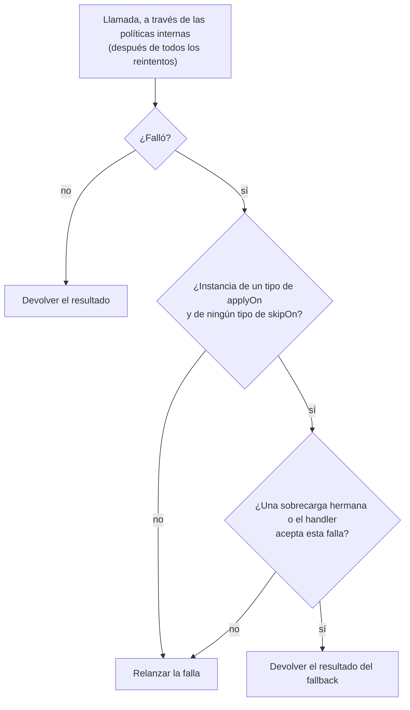

# Fallback

`@Fallback` responde con un resultado alternativo cuando la llamada falla o la rechaza otra política.

<div class="r4c-facts">

| Anotación | Posición | Tipos de retorno | Valores por defecto |
|---|---|---|---|
| `@Fallback` | 1 de 7, la más externa | sync y `CompletionStage` | se aplica a todo `Throwable` |

</div>

**Úsalo cuando** existe una respuesta degradada con sentido: un valor en caché, un valor por defecto, una lista vacía, "pendiente" en lugar de un error.

**No lo uses cuando** la única "alternativa" es esconder el error: un fallback que devuelve `null` o un éxito falso vuelve invisibles las fallas para quien llama y para tu monitoreo. Si no hay nada mejor que devolver, deja pasar la excepción.

## Ejemplo mínimo

<!-- compare:start -->
<!-- snippet: fallback-minimal -->
```java
import dev.resilience4cata.annotation.Fallback;

public interface PriceApi {

    @Fallback(method = "unknownPrice")
    long price(String sku);

    default long unknownPrice(String sku, Exception failure) {
        return -1;
    }
}
```
<!-- not-compiled: generated code, abridged -->
```java
public final class PriceApi$Resilient implements PriceApi {
    // …
    public PriceApi$Resilient(PriceApi delegate, dev.resilience4cata.ResilienceRegistry registry) {
        // …
        this.fallback0 = registry.fallbackPolicy("dev.resilience4cata.examples.docs.fallback.PriceApi#price(java.lang.String)", java.util.List.of(java.lang.Throwable.class), java.util.List.of());
    }

    @Override
    public long price(java.lang.String p0) {
        try {
            return this.delegate.price(p0);
        } catch (java.lang.Throwable r4c$e) {
            if (!this.fallback0.handles(r4c$e)) {
                throw r4c$e;
            }
            if (r4c$e instanceof java.lang.Exception r4c$f0) {
                return this.delegate.unknownPrice(p0, r4c$f0);
            }
            throw r4c$e;
        }
    }
    // …
}
```
<!-- compare:end -->

Abreviado: el archivo real usa nombres totalmente calificados.

Un fallback es un **método hermano** (`method = "…"`) en la misma interfaz o clase, o una **clase handler** (`value = SomeHandler.class`). Define exactamente uno ([`R4C-FB-001`](../errors.md#r4c-fb-001)). Ambos se validan al compilar: un nombre, una firma o un tipo de retorno incorrectos son un error de compilación, no una sorpresa en runtime.

## Cómo se comporta



- **Qué fallas.** Las que son instancia de un tipo de `applyOn` (por defecto: `Throwable`, así que también los `Error`) y de ningún tipo de `skipOn`. `skipOn` gana.
- **Rechazos incluidos.** El fallback es la capa más externa, así que también ve `CallNotPermittedException`, `RateLimitExceededException`, `CallTimeoutException`, `BulkheadFullException` y, con un classifier, `ResultRejectedException`.
- **Después de los reintentos.** Con `@Retry` en el mismo método, el fallback se ejecuta una vez, cuando el retry se rinde, nunca entre intentos.
- **Qué lanza.** Si el propio fallback lanza una excepción, esa excepción le llega a quien llama. Una excepción checked que el método anotado no declara se envuelve en `java.lang.reflect.UndeclaredThrowableException`.
- El fallback no cuesta nada mientras las llamadas tienen éxito: el código generado es un `try`/`catch` alrededor de la llamada.

### Métodos hermanos

Un método hermano recibe los parámetros del método anotado, opcionalmente seguidos de un parámetro de excepción, y devuelve un tipo asignable al tipo de retorno del método. En una interfaz es un método `default` o `static`; en una [clase anotada](../guides/annotated-classes.md) no puede ser `private`.

- **El parámetro de excepción elige las fallas que maneja.** `unknownPrice(String sku, Exception failure)` solo maneja `Exception`: un `Error` no coincide y se relanza, aunque `applyOn` sea `Throwable`, y no se publica `FallbackEvent.Applied` para él. Recibe `Throwable` (o ningún parámetro de excepción) para manejar todo.
- **Se permiten varias sobrecargas** con distintos tipos de excepción; se llama la más específica que coincida:

<!-- snippet: fallback-overloads -->
```java
@Fallback(method = "describeFallback")
@CircuitBreaker(name = "catalog")
String describe(String sku) throws IOException;

default String describeFallback(String sku, FileNotFoundException e) {
    return "no such product: " + sku;               // most specific type first
}

default String describeFallback(String sku, IOException e) {
    return "description unavailable";
}

static String describeFallback(String sku, CallNotPermittedException e) {
    return "catalog is resting";                    // the breaker is open
}
```

Una `FileNotFoundException` va a la primera, cualquier otra `IOException` a la segunda, y `CallNotPermittedException` (el breaker está abierto) a la tercera. Una falla que ninguna sobrecarga acepta, como una `IllegalStateException` aquí, se relanza, sin `FallbackEvent.Applied`.

- Las sobrecargas se prueban empezando por el tipo de excepción más específico, sin importar el orden en que las declares. Una sobrecarga que lo atrapa todo (una que recibe `Throwable`, o una sin parámetro de excepción) cierra la lista: las sobrecargas posteriores nunca se alcanzarían, así que no se usan.
- Un hermano no puede lanzar una excepción checked que el método anotado no declara.
- En el estilo de interfaz, el envoltorio generado llama al hermano sobre tu implementación (`delegate.unknownPrice(…)`), así que una implementación puede sobrescribir un fallback `default`.
- **Los métodos genéricos** están soportados. El hermano declara los mismos parámetros de tipo, emparejados por posición, con los mismos bounds (los nombres pueden cambiar), y el código generado lo llama con argumentos de tipo explícitos:

<!-- snippet: fallback-generic -->
```java
@Fallback(method = "nothingFound")
<T> List<T> findAll(Class<T> type, String query);

default <E> List<E> nothingFound(Class<E> type, String query, Exception failure) {
    return List.of();                               // same type parameters, by position
}
```

### Clases handler

Un handler implementa `dev.resilience4cata.FallbackHandler<T>` y recibe un `FallbackContext`:

<!-- snippet: fallback-handler -->
```java
import dev.resilience4cata.FallbackContext;
import dev.resilience4cata.FallbackHandler;
import dev.resilience4cata.annotation.Fallback;
import dev.resilience4cata.annotation.Retry;

public interface QuoteApi {

    @Fallback(ListPrice.class)
    @Retry(maxAttempts = 3, delay = "100ms")
    long quote(String sku, int quantity);

    final class ListPrice implements FallbackHandler<Long> {
        @Override
        public Long apply(FallbackContext context) {
            int quantity = context.argument(1, int.class);   // the call's arguments, by position
            return 100L * quantity;                          // context.failure(), attempts(), instanceId()
        }
    }
}
```

| Método de `FallbackContext` | Devuelve |
|---|---|
| `failure()` | La falla que disparó el fallback, rechazos incluidos |
| `attempts()` | Intentos hechos, incluido el primero (1 sin `@Retry`) |
| `argumentCount()` | Cantidad de argumentos de la llamada |
| `argument(int index, Class<A> type)` | Un argumento, por posición empezando en cero (los primitivos, por su wrapper o su clase primitiva) |
| `instanceId()` | El id del método, `<interfaz>#<método>(<tipos de parámetros>)` |

La clase handler debe ser concreta, no genérica, de nivel superior o anidada `static`, accesible desde la clase generada, con un constructor sin argumentos; `T` debe ser asignable al tipo de retorno del método. Se crea una instancia del handler por método. Un handler no se puede usar en un método genérico cuyo tipo de retorno usa los parámetros de tipo del método, como `<T> T load(Class<T> type)`, porque un `FallbackHandler<X>` no puede servir para todo `T` sin un cast unchecked ([`R4C-FB-014`](../errors.md#r4c-fb-014)): usa ahí un método hermano genérico. Un handler sí sirve en `<T> String describe(T value)`, cuyo tipo de retorno no usa `T`.

## Atributos

| Atributo | Tipo | Por defecto | Clave de config | Significado |
|---|---|---|---|---|
| `value` | `Class<?>` | ninguno | solo anotación | La clase handler, un `FallbackHandler<T>`. |
| `method` | `String` | ninguno | solo anotación | El nombre del método hermano. |
| `applyOn` | `Class<? extends Throwable>[]` | `{Throwable.class}` | solo anotación | Fallas que disparan el fallback. |
| `skipOn` | `Class<? extends Throwable>[]` | `{}` | solo anotación | Fallas que nunca lo disparan; gana sobre `applyOn`. |

`@Fallback` no tiene `name`, `config` ni `enabled`, ni configuración externa: un fallback es código, no un ajuste. Tampoco tiene handle.

Los filtros funcionan con los dos estilos:

<!-- snippet: fallback-filters -->
```java
@Fallback(method = "emptyResults", applyOn = IOException.class, skipOn = FileNotFoundException.class)
String search(String query) throws IOException;

default String emptyResults(String query) {
    return "[]";
}
```

`search` responde `"[]"` ante una `IOException`, pero una `FileNotFoundException` (un índice que falta es un bug, no una caída) y todo lo que no es `IOException` le llegan a quien llama.

## Con otras políticas

El fallback es la capa más externa, así que ve el resultado final de todo lo que hay adentro: la falla del último intento del retry, o un rechazo del breaker, del rate limiter, del timeout o del bulkhead. Con `@Retry`, el fallback se fusiona con la rama en que el retry se rinde, y así `FallbackContext.attempts()` es exacto sin ninguna asignación por llamada. Con un [classifier](../guides/classifiers.md) y el `onExhaustedResult = RETURN` por defecto, un *resultado* rechazado se devuelve tal cual y el fallback no se ejecuta (no se lanzó nada); con `THROW`, la `ResultRejectedException` va al fallback como cualquier falla.

## Async

Para un método que devuelve `CompletionStage<T>` o `CompletableFuture<T>`, un stage fallido (o una excepción lanzada antes de que exista un stage) dispara el fallback. Un hermano puede devolver `T`, `CompletionStage<T>` o `CompletionStage<? extends T>`; un handler es un `FallbackHandler<CompletionStage<T>>` o un `FallbackHandler<T>`:

<!-- snippet: fallback-async -->
```java
@Fallback(method = "cachedDescription")
CompletableFuture<String> describeAsync(String sku);

default CompletionStage<String> cachedDescription(String sku, Throwable failure) {
    return CompletableFuture.completedFuture("cached description of " + sku);
}
```

Las fallas se desenvuelven de `CompletionException` antes de compararlas, así que un hermano que recibe `IOException` obtiene la `IOException`. Una llamada cuyo future cancela quien llama no recibe fallback, y cancelar mientras corre el stage del propio fallback cancela ese stage ([cancelación](../guides/async.md#cancelación)). Ver [Métodos async](../guides/async.md).

## Lo mismo con `Pipeline`

<!-- snippet: fallback-pipeline -->
```java
Pipeline<Long> quote = Pipeline.builder(registry, "quotes", Long.class)
        .retry(r -> r.maxAttempts(3))
        .fallbackHandler(context -> 100L * context.attempts())
        .build();

long price = quote.execute(() -> backend.quote("sku-1", 3));
```

`fallback(failure -> …)` recibe una `Function<Throwable, T>`, `fallbackHandler(context -> …)` un `FallbackHandler<T>` (su contexto no tiene argumentos: `argumentCount()` es 0). `fallbackApplyOn(List)` y `fallbackSkipOn(List)` son los filtros; `fallbackAsync(…)` y `fallbackAsyncHandler(…)` devuelven un stage para `executeAsync`. Ver [API Pipeline](../guides/pipeline.md).

## Eventos

| Evento | Cuándo | Campos |
|---|---|---|
| `FallbackEvent.Applied` | Un fallback está por ejecutarse: la falla pasó `applyOn`/`skipOn` y, con métodos hermanos, uno de ellos la recibe. Se publica una vez por llamada, también cuando el fallback luego lanza; nunca para una falla que se relanza | `instance`, `nanoTime`, `failure` |

Ver [Observabilidad](../guides/observability.md).

## Probarlo con `ManualClock`

<!-- snippet: fallback-testing -->
```java
AtomicInteger calls = new AtomicInteger();
QuoteApi backend = (sku, quantity) -> {
    calls.incrementAndGet();
    throw new IllegalStateException("pricing down");
};
QuoteApi quotes = Resilient.of(QuoteApi.class, backend, registry);

assertThat(quotes.quote("sku-1", 3)).isEqualTo(300L);   // ListPrice, once the retries gave up
assertThat(calls).hasValue(3);
```

Con un [`ManualClock`](../guides/testing.md), las esperas de los reintentos pasan al instante, así que un test de "reintentar y luego usar el fallback" tarda milisegundos.

## Letra chica

- El `applyOn = Throwable` por defecto incluye los `Error` (`OutOfMemoryError`, `StackOverflowError`, `AssertionError`). Si tu fallback no debe esconderlos, recibe `Exception` como parámetro, o define `skipOn = Error.class`.
- Un método `void` también puede tener fallback: el hermano devuelve `void`, el handler es un `FallbackHandler<Void>` y devuelve `null`.
- Errores relacionados: [`R4C-FB-001`](../errors.md#r4c-fb-001) a [`R4C-FB-003`](../errors.md#r4c-fb-003) (métodos hermanos: ninguno o ambos definidos, nombre desconocido, ningún candidato usable), [`R4C-FB-004`](../errors.md#r4c-fb-004) a [`R4C-FB-013`](../errors.md#r4c-fb-013) (clases handler), [`R4C-FB-014`](../errors.md#r4c-fb-014) (handler en un método genérico), [`R4C-RT-013`](../errors.md#r4c-rt-013) (filtros de pipeline sin fallback).

## Cuánto cuesta

> [!MEASURED]
> `@Fallback` no tiene un benchmark propio: en el éxito solo agrega un `try`/`catch`, y solo se ejecuta después de una falla. Forma parte del stack de "las seis políticas" del benchmark de `Pipeline`, que cuesta 76,3 ns por llamada exitosa en AWS Graviton3 (`c7g.xlarge`, 1 thread) con código generado. [Benchmarks: cierre del MVP](../benchmarks.md#cierre-del-mvp-classifier-pipeline-eventos-testkit-2026-10-24-aws-graviton3)
