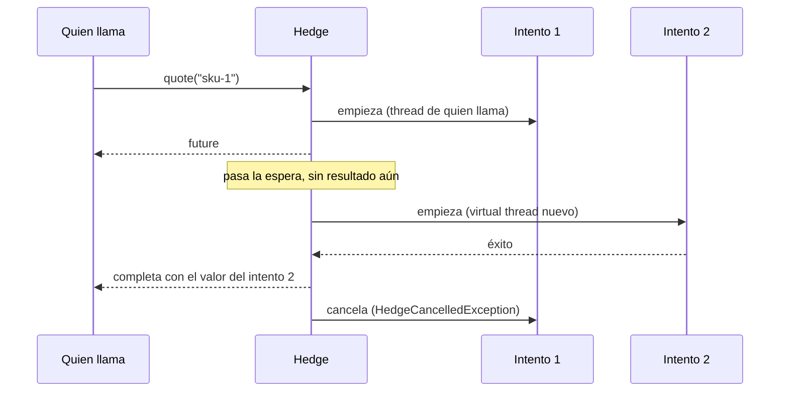

# Hedge

`@Hedge` vuelve a lanzar la misma llamada, junto a la primera, cuando va lenta o falla, y se queda con el primer éxito: peticiones de cobertura (*hedged requests*), contra la latencia de cola.

<div class="r4c-facts">

| Anotación | Posición | Tipos de retorno | Valores por defecto |
|---|---|---|---|
| `@Hedge` | 2 de 7, en el lugar de Retry (no ambos en un método) | solo `CompletionStage` | 2 intentos, espera de 1 s, cubre `Exception`, presupuesto 10 % + 1/s en 10 s |

</div>

> [!WARNING]
> **Solo para llamadas idempotentes.** Un método con hedge se llama varias veces a propósito, aunque nada falle, con los mismos argumentos, y los intentos que pierden pueden seguir ejecutándose hasta que notan la cancelación. Úsalo en lecturas y otras operaciones que se pueden repetir sin peligro. Nunca en pagos, inserciones, envíos ni nada que deba ocurrir una sola vez. Poner `@Hedge` en un método *es* declarar que es idempotente: no hay un interruptor extra `idempotent = true`.

**Úsalo cuando** una llamada idempotente, de solo lectura, a un backend replicado (varias réplicas, un clúster de caché, un índice de búsqueda) suele ser rápida pero sus llamadas más lentas (p99, p99.9) son mucho más lentas que la mediana, y un poco más de carga es un precio razonable por recortar esa cola. *The Tail at Scale* (Dean y Barroso, 2013) bajó un p99.9 de 1.800 ms a 74 ms con cerca de un 2 % más de peticiones, cubriendo a los 10 ms.

**No lo uses cuando** la operación no es idempotente, cuando la dependencia está lenta porque está saturada (más peticiones la hacen más lenta, para todos; el [presupuesto](#el-presupuesto-de-hedge) limita el daño, no lo deshace), cuando todas las réplicas comparten el mismo camino lento (el hedge entonces espera dos veces), o cuando el método es sincrónico (todavía no soportado: devuelve un `CompletableFuture`).

## Ejemplo mínimo

<!-- compare:start -->
<!-- snippet: hedge-minimal -->
```java
import dev.resilience4cata.annotation.Hedge;
import java.util.concurrent.CompletableFuture;

public interface QuoteApi {

    @Hedge(delay = "50ms")
    CompletableFuture<String> quote(String sku);
}
```
<!-- not-compiled: generated code, abridged -->
```java
public final class QuoteApi$Resilient implements QuoteApi {
    // …
    public QuoteApi$Resilient(QuoteApi delegate, dev.resilience4cata.ResilienceRegistry registry) {
        // …
        this.hedge0 = dev.resilience4cata.generated.Policies.hedge(registry, "dev.resilience4cata.examples.docs.hedge.QuoteApi#quote(java.lang.String)", "", "", r4c$b -> {
            r4c$b.delay(java.time.Duration.ofNanos(50000000L));
        }, false);
    }

    @Override
    public java.util.concurrent.CompletableFuture<java.lang.String> quote(java.lang.String p0) {
        return this.hedge0.executeAsync(() -> this.delegate.quote(p0));
    }
}
```
<!-- compare:end -->

Abreviado: el archivo real usa nombres totalmente calificados. La lambda es el *intento*: el hedge la llama una vez por intento, así que cada intento pasa por su cuenta por las políticas que hay dentro del hedge.

## Cómo se comporta



- **Cuándo empiezan los intentos.** El intento 1 empieza enseguida, en el thread de quien llama. El siguiente empieza cuando el último lleva `delay` sin resultado en ninguna parte, o **enseguida** cuando un intento falla con una falla listada en `hedgeOn` (por defecto: `Exception`); ese intento empieza en un virtual thread nuevo, nunca en el thread que completó el intento fallido (que puede ser el thread de I/O de tu cliente HTTP). `maxAttempts` cuenta todos los intentos lanzados, incluido el primero: el valor por defecto, 2, es un hedge. `delay = "0"` lanza todos los intentos a la vez, todos en el thread de quien llama (`maxAttempts` × la carga, siempre).
- **Quién gana.** El primer **éxito** completa la llamada. Una falla nunca gana: lanza el siguiente intento si queda alguno y, si no, la llamada espera a los intentos que siguen en vuelo.
- **Cuándo falla.** Cuando todos los intentos lanzados han fallado y no puede empezar otro, la llamada falla con la **última** falla. Una falla listada en `abortOn`, o **no** listada en `hedgeOn`, termina la llamada enseguida (un `Error`, por defecto), y los demás intentos se cancelan.
- **Rechazos.** Un rechazo de una política dentro del hedge (`CallNotPermittedException` de un breaker abierto, `BulkheadFullException`, `RateLimitExceededException`) significa que la dependencia no tiene capacidad: no empieza ningún intento más, pero los que están en vuelo siguen y aún pueden tener éxito. Si no queda nada en vuelo, la llamada falla con el rechazo.
- **Perdedores.** Cuando la llamada tiene su resultado, el stage de cada otro intento se completa con `HedgeCancelledException`, una `CancellationException` (así que informa `isCancelled()`), una instancia nueva por cada intento perdedor, sin stack trace (`handle`/`whenComplete` sobre el stage la ven tal cual; desde JDK 23, `join()` lanza una `CancellationException` nueva con ella como causa). Las políticas dentro del intento la toman como una cancelación: un circuit breaker no registra nada (devuelve un permiso half-open), un bulkhead libera el slot, un timeout cancela su plazo, y un `CompletableFuture` devuelto por tu método queda cancelado. Un resultado tardío de un perdedor se descarta: no completa nada ni publica nada.
- **Cancelar** el future que recibiste cancela todos los intentos en vuelo y la espera pendiente ([cancelación](../guides/async.md#cancelación)).
- **Camino rápido.** Un primer intento cuyo stage ya está completo con éxito cuando tu método retorna (un acierto de caché) no necesita timer ni hedge.
- **Desactivado** (`enabled = "false"`): un intento, como si no hubiera anotación (el fallback se ejecuta igual si falla).

### El presupuesto de hedge

Los hedges añaden carga justo cuando una dependencia está lenta, que es cuando menos la soporta. El presupuesto de hedge los limita para una instancia, compartido por todos los que llaman a esa instancia: los hedges de la última `budgetWindow` no pueden superar

> `budgetMinHedgesPerSecond × budgetWindow en segundos + budgetPercent % de las llamadas en budgetWindow`

Está **activo por defecto** (10 % de las llamadas más 1 hedge por segundo, en 10 s), a diferencia del [presupuesto de reintentos](retry.md#presupuesto-de-reintentos), porque el hedge también añade carga en el camino de éxito. `budgetPercent = 0` lo apaga. Un hedge se cobra cuando empieza. Cuando el presupuesto se agota, no empieza ningún hedge, se publica `HedgeEvent.Skipped` con la razón `BUDGET_EXHAUSTED`, y la llamada espera a sus intentos en vuelo. Es la misma ventana que la del presupuesto de reintentos (llamadas contadas, sin leer el reloj en un éxito; ver [presupuesto de reintentos](retry.md#presupuesto-de-reintentos)). `registry.snapshot().hedges()` la muestra como `HedgeSnapshot.Budget(calls, hedges, allowedHedges)`.

## Atributos

| Atributo | Tipo | Por defecto | Clave de config | Significado |
|---|---|---|---|---|
| `maxAttempts` | `int` | `2` | `defaults.hedge.maxAttempts` | Intentos en vuelo como máximo, incluido el primero. De 2 a 10. |
| `delay` | duración | `1s` | `defaults.hedge.delay` | Cuánto tiempo lleva el último intento sin resultado antes de que empiece el siguiente. Ponlo cerca del p95 de la latencia de la dependencia. `"0"` lanza todos los intentos a la vez. |
| `hedgeOn` | `Class<? extends Throwable>[]` | `{Exception.class}` | `defaults.hedge.hedgeOn` | Fallas tras las que el siguiente intento empieza enseguida. Una falla no listada termina la llamada. |
| `abortOn` | `Class<? extends Throwable>[]` | `{}` | `defaults.hedge.abortOn` | Fallas que terminan la llamada enseguida y cancelan los demás intentos; ganan sobre `hedgeOn`. |
| `budgetPercent` | `double` | `10` | `defaults.hedge.budgetPercent` | [Presupuesto de hedge](#el-presupuesto-de-hedge): hedges permitidos, en porcentaje de las llamadas de la instancia en la última `budgetWindow`. Finito, al menos 0; 0 apaga el presupuesto. |
| `budgetMinHedgesPerSecond` | `int` | `1` | `defaults.hedge.budgetMinHedgesPerSecond` | Presupuesto de hedge: hedges permitidos por segundo de `budgetWindow`, sea cual sea el tráfico. Al menos 0. |
| `budgetWindow` | duración | `10s` | `defaults.hedge.budgetWindow` | Presupuesto de hedge: hasta cuándo atrás se cuentan llamadas y hedges. De `1s` a `1h`. |
| `name` | `String` | una instancia por método | solo en la anotación | Id de instancia; los métodos con el mismo `name` comparten un hedge, y con él su presupuesto. |
| `config` | `String` | `default` | solo en la anotación | Configuración con nombre de la que partir. |
| `locked` | `boolean` | `false` | solo en la anotación | Conserva los valores fijados en la anotación: las claves `instances.<id>.*` no pueden cambiarlos. Ver [Bloquear una instancia](../guides/configuration.md#bloquear-una-instancia). |
| `enabled` | `String` | `"true"` | `defaults.hedge.enabled` | `""` (heredar), `"true"` o `"false"`. |

Cada clave existe también bajo `configs.<name>.hedge.…` e `instances.<id>.hedge.…`; ver [Configuración](../guides/configuration.md). Todavía no hay clasificador ni `maxDuration`: el `@Timeout` por intento y `maxAttempts × delay` acotan una llamada.

**No hay handle**: `registry` no tiene `hedge(id)`. `registry.snapshot().hedges()` lista un `HedgeSnapshot(instance, config, budget)` por instancia (`budget` es `null` con `budgetPercent = 0`).

## Con otras políticas

Hedge ocupa el lugar de Retry, la segunda capa: dentro de Fallback, alrededor de todo lo demás.

<!-- snippet: hedge-combined -->
```java
@Hedge(name = "prices", delay = "30ms", maxAttempts = 3, abortOn = IllegalArgumentException.class)
@CircuitBreaker(name = "prices")
@Timeout("200ms")
@Fallback(method = "cachedPrice")
CompletableFuture<Long> price(String sku);

default CompletableFuture<Long> cachedPrice(String sku, Throwable failure) {
    return CompletableFuture.completedFuture(-1L);
}
```

- **Retry**: `@Hedge` y `@Retry` en un mismo método es un error de compilación ([`R4C-HDG-002`](../errors.md#r4c-hdg-002)). Un hedge ya lanza un intento nuevo cuando uno falla.
- **Circuit breaker** (dentro): cada intento toma su propio permiso y se registra por su cuenta, con su resultado real; un perdedor cancelado no se registra. Un breaker abierto rechaza el siguiente intento, lo que detiene los hedges siguientes.
- **Rate limiter** (dentro): cada intento toma un permiso; dimensiona el límite teniendo en cuenta `maxAttempts` y el presupuesto. Un intento rechazado detiene los hedges siguientes.
- **Timeout** (dentro): **por intento**. Un intento que agota su timeout es una falla de `hedgeOn` (`CallTimeoutException` es una `Exception`), así que lanza el siguiente intento enseguida. Con `delay` igual o mayor que el timeout, la espera nunca vence y el hedge se convierte en un reintento por timeout: es válido, pero casi siempre es un error.
- **Bulkhead** (dentro): cada intento ocupa un slot solo mientras se ejecuta; el slot de un perdedor se libera cuando se cancela.
- **Fallback** (fuera): se ejecuta una vez, después de que la llamada ha fallado, y `FallbackContext.attempts()` es el número de intentos lanzados.

## Lo mismo con `Pipeline`

<!-- snippet: hedge-pipeline -->
```java
Pipeline<String> quote = Pipeline.builder(registry, "quotes", String.class)
        .hedge(h -> h.delay(Duration.ofMillis(50)))
        .build();

CompletableFuture<String> price = quote.executeAsync(() -> backend.quote("sku-1"));
```

Un pipeline con hedge solo funciona con `executeAsync`: `execute` lanza [`R4C-RT-018`](../errors.md#r4c-rt-018), y un pipeline con `.retry(…)` y `.hedge(…)` a la vez no se construye, con [`R4C-RT-019`](../errors.md#r4c-rt-019). El id del pipeline (`"quotes"`) es el id de la instancia. Ver [API Pipeline](../guides/pipeline.md).

## Eventos y snapshot

| Evento | Cuándo | Campos |
|---|---|---|
| `HedgeEvent.Hedged` | Empezó el intento 2 o posterior | `instance`, `nanoTime`, `attempt`, `reason` (`DELAY` o `FAILURE`) |
| `HedgeEvent.Won` | El intento 2 o posterior tuvo éxito primero | `instance`, `nanoTime`, `attempt` |
| `HedgeEvent.Skipped` | Un hedge que podía empezar no empezó | `instance`, `nanoTime`, `attempt`, `reason` (`BUDGET_EXHAUSTED`, `REJECTED` o `ABORTED`) |
| `HedgeEvent.Failed` | La llamada falló | `instance`, `nanoTime`, `attempts`, `failure` |

Una llamada cuyo primer intento gana no publica nada, y no hay contadores por llamada: cuántas veces empiezan y ganan los hedges solo se ve a través de estos eventos. Ver [Observabilidad](../guides/observability.md).

## Probarlo con `ManualClock`

<!-- snippet: hedge-testing -->
```java
QuoteApi quotes = Resilient.of(QuoteApi.class, backend, registry);   // backend: one pending stage per call

CompletableFuture<String> quote = quotes.quote("sku-1");
clock.advance(Duration.ofMillis(49));
assertThat(attempts).hasSize(1);                  // no hedge before the delay
clock.advance(Duration.ofMillis(1));
assertThat(attempts).hasSize(2);                  // the hedge started, on this thread

attempts.get(1).complete("quote from attempt 2");
assertThat(quote).isCompletedWithValue("quote from attempt 2");
assertThat(attempts.get(0)).isCancelled();        // the loser is cancelled
```

Sobre un [`ManualClock`](../guides/testing.md), la espera es exacta (sin un tick de holgura) y un hedge empieza en el thread que avanza el reloj, así que las pruebas son deterministas. Un hedge lanzado por una falla se programa en el reloj sin espera: empieza en el siguiente `advance`, incluido `advance(Duration.ZERO)`. Una llamada que termina antes de su espera la quita del reloj, así que `pendingTasks()` sigue siendo exacto.

## Letra chica

- **Precisión del timer.** En producción las esperas van en el timer sin locks de la librería para timeouts async: nunca antes, como mucho unos dos ticks tarde, donde un tick es un dieciseisavo de la espera o el timeout async más corto en uso, entre 1 ms y 50 ms (un hedge de 10 ms salta entre 10 y 12 ms). Una espera de hedge corta acorta por tanto el tick de todos los timeouts async también, nunca por debajo de 1 ms.
- **El contexto no se propaga.** El intento 1 se ejecuta en el thread de quien llama; los hedges empiezan en un virtual thread nuevo, sin los `ThreadLocal` ni el MDC de quien llama, igual que los reintentos async ([Métodos async](../guides/async.md)).
- **Los perdedores pueden seguir ejecutándose.** Cancelar un stage no puede detener código que lo ignora: un delegado que devuelve un stage no ligado a su trabajo (o un stage mínimo, que no se puede cancelar) sigue trabajando, y su resultado se descarta.
- **El presupuesto es aproximado**, siempre a la baja (menos hedges, nunca más), como el presupuesto de reintentos. Con `name`, los métodos comparten un presupuesto; dales los mismos atributos.
- Los métodos sincrónicos todavía no están soportados: `@Hedge` en uno es un error de compilación ([`R4C-HDG-001`](../errors.md#r4c-hdg-001)), también cuando viene del tipo o de un [bundle](../guides/bundles.md).
- Errores relacionados: [`R4C-HDG-001`](../errors.md#r4c-hdg-001) (método sincrónico), [`R4C-HDG-002`](../errors.md#r4c-hdg-002) (con `@Retry`), [`R4C-ATR-001`](../errors.md#r4c-atr-001) (sintaxis de duración), [`R4C-ATR-006`](../errors.md#r4c-atr-006) (`enabled`), [`R4C-ATR-007`](../errors.md#r4c-atr-007) (valores del presupuesto), [`R4C-ATR-008`](../errors.md#r4c-atr-008) (`maxAttempts` fuera de 2–10), [`R4C-RT-018`](../errors.md#r4c-rt-018)/[`R4C-RT-019`](../errors.md#r4c-rt-019) (`Pipeline`), [`R4C-REG-004`](../errors.md#r4c-reg-004) (`config` desconocida), [`R4C-REG-008`](../errors.md#r4c-reg-008) (`name` compartido, config distinta).

## Cuánto cuesta

> [!MEASURED]
> AWS `c7g.xlarge` (Graviton3), 1 thread: cuando el primer intento gana antes de la espera, una llamada cuesta 154 ns y 216 B, contra 3601 ns y 1561 B de `resilience4j-hedge` de Resilience4j 2.4.0 y 649 ns de un hedge escrito a mano con `CompletableFuture`; un primer intento que ya terminó cuesta 9,4 ns. De [Hedge y cancelación async, 0.4.0](../benchmarks.md#hedge-y-cancelación-async-040-2026-10-25-aws-graviton3).

**Precisión del timer.** Las esperas corren en el timer compartido de la librería, que trabaja en ticks de un dieciseisavo de la espera (al menos 1 ms): un hedge nunca sale antes y sale hasta unos dos ticks tarde, o sea como mucho un 12 % después de `delay` (con una espera de 50 ms, el hedge sale entre 50 y unos 56 ms). Eso hace casi gratis armar y cancelar la espera, que es lo que hace casi toda llamada; con esperas muy cortas (pocos milisegundos) el retraso relativo es mayor.

Cuando el primer intento gana antes de la espera, una llamada asigna el future devuelto, un objeto para el estado del hedge, y el nodo de callback y el future dependiente que crea `whenComplete` del JDK (cuatro objetos además de su propio stage y de la lambda por llamada que tiene toda capa async), programa su espera con un compare-and-set en una bandeja por thread y la cancela con otro, añade una escritura en la franja de este thread del presupuesto, y no lee el reloj. Un hedge que salta añade un virtual thread, las capas propias del intento y, tras una falla o con el presupuesto activo, una lectura del reloj.
