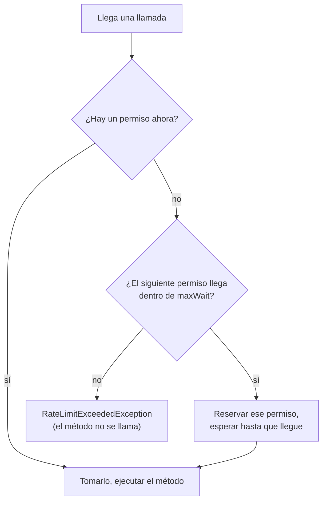

# Rate limiter

`@RateLimiter` deja pasar como máximo una cantidad dada de llamadas por período, y rechaza (o demora) el resto.

<div class="r4c-facts">

| Anotación | Posición | Tipos de retorno | Valores por defecto |
|---|---|---|---|
| `@RateLimiter` | 4 de 7, dentro de CircuitBreaker | sync y `CompletionStage` | 50 permisos por 1 s, sin espera |

</div>

**Úsalo cuando** una dependencia tiene una cuota (una API que permite 10 requests por segundo), o cuando quieres evitar que un cliente inunde un servicio compartido.

**No lo uses cuando** lo que necesitas limitar es cuántas llamadas corren *al mismo tiempo*, sea cual sea su ritmo: eso es un [bulkhead](bulkhead.md). Y un rate limiter en una JVM limita solo esa JVM: con varias instancias de tu servicio, cada una tiene su propio límite.

## Ejemplo mínimo

<!-- compare:start -->
<!-- snippet: rate-limiter-minimal -->
```java
import dev.resilience4cata.annotation.RateLimiter;

public interface SearchApi {

    @RateLimiter(permits = 10, period = "1s")
    String search(String query);
}
```
<!-- not-compiled: generated code, abridged -->
```java
public final class SearchApi$Resilient implements SearchApi {
    // …
    public SearchApi$Resilient(SearchApi delegate, dev.resilience4cata.ResilienceRegistry registry) {
        // …
        this.rateLimiter0 = dev.resilience4cata.generated.Policies.rateLimiter(registry, "dev.resilience4cata.examples.docs.ratelimiter.SearchApi#search(java.lang.String)", "", "", r4c$b -> {
            r4c$b.permits(10);
            r4c$b.period(java.time.Duration.ofNanos(1000000000L));
        }, false);
    }

    @Override
    public java.lang.String search(java.lang.String p0) {
        final dev.resilience4cata.generated.RateLimiterPolicy r4c$rateLimiter = this.rateLimiter0;
        if (!r4c$rateLimiter.tryAcquire()) {
            throw r4c$rateLimiter.rejection();
        }
        return this.delegate.search(p0);
    }
}
```
<!-- compare:end -->

Abreviado: el archivo real usa nombres totalmente calificados.

## Cómo se comporta

Piensa en los permisos como espaciados de forma pareja: con `permits = 10` y `period = "1s"`, un permiso queda disponible cada 100 ms. Los permisos que no usas se acumulan, hasta `permits` de ellos, así que después de un momento tranquilo pasa de una vez una ráfaga de hasta 10 llamadas; luego las llamadas pasan al ritmo constante, una cada 100 ms.



- **Rechazo.** Con `maxWait = "0"` (por defecto), una llamada sin permiso disponible falla enseguida con `dev.resilience4cata.RateLimitExceededException` (una `RuntimeException` con `instanceId()`; una por limiter, sin stack trace). El método no se llama.
- **Espera.** Con `maxWait` > 0, una llamada cuyo permiso llega dentro de `maxWait` lo reserva y espera hasta que llegue su turno; una llamada que tendría que esperar más se rechaza enseguida, sin esperar nada. Cada llamada en espera conoce su turno, así que no compiten cuando llega.
- **Las esperas sync** duermen en el thread de quien llama. Si el thread se interrumpe mientras espera, el permiso se devuelve, el flag de interrupción se activa de nuevo y la llamada se rechaza.
- **Ráfagas.** Como los permisos sin usar se acumulan hasta una ráfaga completa, una ventana de un `period` puede ver hasta el doble de `permits` llamadas: una ráfaga completa y luego el ritmo constante. Es lo mismo que con los ciclos fijos de Resilience4j.
- No hay ningún thread en segundo plano reponiendo permisos: cada llamada calcula el suyo a partir del reloj.
- **Desactivado** (`enabled = "false"`): todas las llamadas pasan.

Por dentro es GCRA, la forma "medidor" de un token bucket: todo el estado es un solo número, el instante en que llega el siguiente permiso, que cada llamada adelanta en `period / permits`.

## Atributos

| Atributo | Tipo | Por defecto | Clave de config | Significado |
|---|---|---|---|---|
| `permits` | `int` | `50` | `defaults.rateLimiter.permits` | Llamadas permitidas por `period`, y la ráfaga más grande. Al menos 1. |
| `period` | duración | `1s` | `defaults.rateLimiter.period` | Duración del período. Mayor que 0, y al menos 1 ns por permiso. |
| `maxWait` | duración | `0` (rechazar enseguida) | `defaults.rateLimiter.maxWait` | Cuánto puede esperar una llamada por su permiso. |
| `name` | `String` | un limiter por método | solo anotación | Id de la instancia; los métodos con el mismo `name` comparten un limiter y sus permisos. |
| `config` | `String` | `default` | solo anotación | Configuración con nombre de la que partir. |
| `locked` | `boolean` | `false` | solo anotación | Conserva los valores fijados en la anotación: las claves `instances.<id>.*` no pueden cambiarlos. Ver [Bloquear una instancia](../guides/configuration.md#bloquear-una-instancia). |
| `enabled` | `String` | `"true"` | `defaults.rateLimiter.enabled` | `""` (heredar), `"true"` o `"false"`. |

Los valores por defecto difieren de los de Resilience4j (50 permisos cada 500 ns, 5 s de espera): aquí esperar es opcional, como en el bulkhead. Las claves también existen bajo `configs.<name>.` e `instances.<id>.`; ver [Configuración](../guides/configuration.md).

## Compartir e ids de instancia

Una cuota normalmente cubre toda una API, no un método. Dales a los métodos el mismo `name` y comparten un limiter:

<!-- snippet: rate-limiter-wait -->
```java
@RateLimiter(name = "geocoding", permits = 5, period = "1s", maxWait = "500ms")
String geocode(String address);

@RateLimiter(name = "geocoding", permits = 5, period = "1s", maxWait = "500ms")
String reverse(double latitude, double longitude);
```

Aquí `geocode` y `reverse` comparten 5 permisos por segundo. Cuando la ráfaga se agota, la siguiente llamada espera 200 ms por su permiso (1 s / 5), dentro de los 500 ms permitidos; una llamada que tendría que esperar más de 500 ms se rechaza enseguida. Los métodos que comparten un `name` deben resolver la misma configuración, o envolverlos falla con [`R4C-REG-008`](../errors.md#r4c-reg-008). Sin `name`, el id es `<interfaz>#<método>(<tipos de parámetros>)`.

### Handle

`registry.rateLimiter(id)` devuelve un `RateLimiterHandle`:

<!-- snippet: rate-limiter-handle -->
```java
RateLimiterHandle limiter = registry.rateLimiter("geocoding");
int now = limiter.availablePermits();            // calls that would pass right now without waiting
RateLimiterSnapshot snapshot = limiter.snapshot(); // instance, availablePermits, permits
```

| Método | Qué hace |
|---|---|
| `id()` | El `name`, o el id derivado |
| `config()` | La `RateLimiterConfig` resuelta |
| `availablePermits()` | Llamadas que pasarían ahora mismo sin esperar, entre 0 y `permits`; una foto que las llamadas concurrentes cambian al instante |
| `snapshot()` | Un `RateLimiterSnapshot(instance, availablePermits, permits)` |

El limiter existe una vez que su interfaz se envolvió o su pipeline se construyó; un id desconocido lanza [`R4C-REG-009`](../errors.md#r4c-reg-009). No hay `registry.rateLimiters()`: lístalos con `registry.snapshot().rateLimiters()`.

## Con otras políticas

El rate limiter es la cuarta capa: dentro de CircuitBreaker, alrededor de Timeout y Bulkhead.

- Las llamadas que rechaza un breaker abierto nunca llegan aquí, así que no gastan permisos.
- Sus rechazos son `Exception`, así que por defecto un `@CircuitBreaker` externo los registra como fallas (tu propio limiter puede abrir tu breaker: agrega `RateLimitExceededException` a su `ignoreOn` si no es lo que quieres) y un `@Retry` externo los reintenta después de su espera (agrégala a `abortOn` para fallar rápido).
- Cada intento de un retry toma su propio permiso.
- El tiempo de espera por un permiso no cuenta para el `@Timeout`, que está adentro.

## Async

Para un método que devuelve `CompletionStage<T>` o `CompletableFuture<T>`, un rechazo es un future fallido, y una llamada que espera su permiso se programa para arrancar cuando le toque, sin bloquear ningún thread:

<!-- snippet: rate-limiter-async -->
```java
@RateLimiter(name = "geocoding-async", permits = 5, period = "1s", maxWait = "500ms")
CompletableFuture<String> geocodeAsync(String address);
```

Cancelar el future de una llamada que todavía espera su permiso devuelve el permiso, y la llamada nunca arranca; una llamada que ya arrancó conserva su permiso ([cancelación](../guides/async.md#cancelación)). Ver [Métodos async](../guides/async.md).

## Lo mismo con `Pipeline`

<!-- snippet: rate-limiter-pipeline -->
```java
Pipeline<String> search = Pipeline.builder(registry, "search", String.class)
        .rateLimiter(rl -> rl.permits(10).period(Duration.ofSeconds(1)))
        .build();

String results = search.execute(() -> backend.search("resilience"));
```

El id `"search"` es el id de instancia: `registry.rateLimiter("search")` devuelve el limiter. Ver [API Pipeline](../guides/pipeline.md).

## Eventos y snapshot

| Evento | Cuándo | Campos |
|---|---|---|
| `RateLimiterEvent.Rejected` | Se rechazó una llamada (sin permiso dentro de `maxWait`, o una espera interrumpida) | `instance`, `nanoTime` |

Las llamadas admitidas no publican nada. `registry.snapshot().rateLimiters()` lista un `RateLimiterSnapshot` por limiter. Ver [Observabilidad](../guides/observability.md).

## Probarlo con `ManualClock`

<!-- snippet: rate-limiter-testing -->
```java
SearchApi search = Resilient.of(SearchApi.class, query -> "results for " + query, registry);

for (int i = 0; i < 10; i++) {
    search.search("q" + i);                      // a full burst of 10 is available at once
}
assertThatThrownBy(() -> search.search("one too many"))
        .isInstanceOf(RateLimitExceededException.class);

clock.advance(Duration.ofMillis(100));           // permits come back one every 1s / 10
assertThat(search.search("next")).isEqualTo("results for next");
assertThatThrownBy(() -> search.search("again")).isInstanceOf(RateLimitExceededException.class);
```

Con un [`ManualClock`](../guides/testing.md), los permisos vuelven solo cuando el reloj avanza, y una llamada que espera su permiso avanza el reloj en lugar de dormir.

## Letra chica

- `period` debe ser de al menos 1 ns por permiso (`permits = 1_000_000_000` necesita `period` ≥ 1 s); si no, la configuración es inválida ([`R4C-REG-001`](../errors.md#r4c-reg-001)/[`R4C-REG-003`](../errors.md#r4c-reg-003)).
- El límite es por JVM y por registry: dos registries, o dos instancias de tu servicio, tienen cada uno el suyo.
- Cada llamada lee `System.nanoTime()` una vez. En la laptop Apple M1 de los primeros benchmarks, esa lectura era la mayor parte del costo del limiter ([benchmarks del rate limiter](../benchmarks.md#rate-limiter-1-y-4-threads-2026-10-24)).
- Cuando las llamadas admitidas llegan más rápido de lo que el único valor compartido del limiter puede moverse entre núcleos de CPU, una llamada que pierde la carrera hace un park lo más corto posible antes de reintentar; en Linux, el park más corto de un platform thread es de unos 50 µs. Esto solo pasa muy por encima de cualquier ritmo para el que normalmente se configura un limiter.
- Errores relacionados: [`R4C-ATR-001`](../errors.md#r4c-atr-001) (sintaxis de duración), [`R4C-ATR-002`](../errors.md#r4c-atr-002) (`period = "0"`), [`R4C-ATR-003`](../errors.md#r4c-atr-003) (`permits` menor que 1), [`R4C-ATR-006`](../errors.md#r4c-atr-006) (`enabled`), [`R4C-REG-004`](../errors.md#r4c-reg-004) (`config` desconocida), [`R4C-REG-008`](../errors.md#r4c-reg-008) (`name` compartido con otra configuración), [`R4C-REG-009`](../errors.md#r4c-reg-009) (id desconocido).

## Cuánto cuesta

> [!MEASURED]
> En AWS Graviton3 (`c7g.xlarge`, JDK 21), con 4 threads compartiendo un limiter, una llamada admitida cuesta 187 ns y no asigna memoria, contra 275 ns y 40 B de Resilience4j 2.4.0; una llamada rechazada cuesta 34,7 ns, 0 B, contra 1599 ns y 505 B. Con 1 thread, una llamada admitida cuesta 41,8 ns. [Benchmarks: cierre del MVP](../benchmarks.md#cierre-del-mvp-classifier-pipeline-eventos-testkit-2026-10-24-aws-graviton3)
