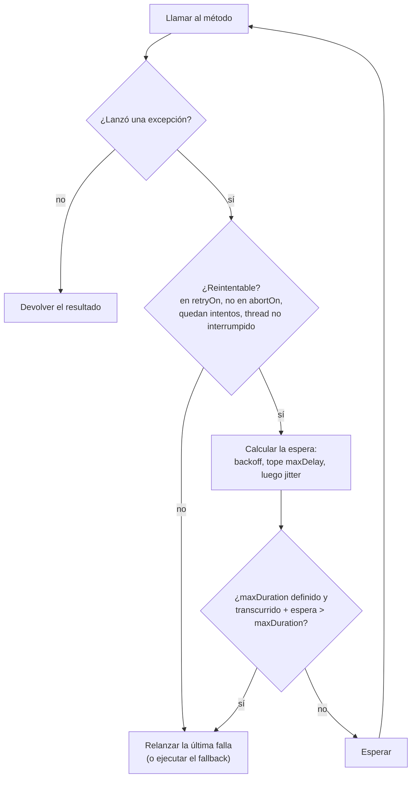

# Retry

`@Retry` vuelve a llamar al método cuando falla, y espera un poco más antes de cada nuevo intento.

<div class="r4c-facts">

| Anotación | Posición | Tipos de retorno | Valores por defecto |
|---|---|---|---|
| `@Retry` | 2 de 6, dentro de Fallback | sync y `CompletionStage` | 3 intentos, backoff exponencial de 200 ms ×2 hasta 10 s, jitter completo, reintenta `Exception` |

</div>

**Úsalo cuando** las fallas son transitorias y repetir la operación es seguro: una conexión caída, un `503`, una carrera perdida por un lock, una lectura o escritura idempotente.

**No lo uses cuando** la operación no es idempotente (cobrar dos veces una tarjeta es peor que fallar una vez), cuando la falla es permanente (un error de validación, un `404`) o cuando quien llama no puede permitirse la latencia extra. Reintentar contra una dependencia sobrecargada la empeora: pon un [circuit breaker](circuit-breaker.md) dentro del retry, para que un breaker abierto detenga los reintentos.

## Ejemplo mínimo

<!-- compare:start -->
<!-- snippet: retry-minimal -->
```java
import dev.resilience4cata.annotation.Retry;

public interface InventoryApi {

    @Retry(maxAttempts = 3, delay = "100ms")
    int stock(String sku);
}
```
<!-- not-compiled: generated code, abridged -->
```java
public final class InventoryApi$Resilient implements InventoryApi {
    // …
    public InventoryApi$Resilient(InventoryApi delegate, dev.resilience4cata.ResilienceRegistry registry) {
        // …
        this.retry0 = registry.retryPolicy("dev.resilience4cata.examples.docs.retry.InventoryApi#stock(java.lang.String)", "", "", r4c$b -> {
            r4c$b.maxAttempts(3);
            r4c$b.delay(java.time.Duration.ofNanos(100000000L));
        });
    }

    @Override
    public int stock(java.lang.String p0) {
        final dev.resilience4cata.generated.RetryPolicy r4c$retry = this.retry0;
        final long r4c$start = r4c$retry.start();
        int r4c$attempts = 0;
        while (true) {
            try {
                return this.delegate.stock(p0);
            } catch (java.lang.Throwable r4c$e) {
                final long r4c$delay = r4c$retry.onFailure(++r4c$attempts, r4c$e, r4c$start);
                if (r4c$delay < 0 || !r4c$retry.pause(r4c$delay)) {
                    throw r4c$e;
                }
            }
        }
    }
}
```
<!-- compare:end -->

Abreviado: el archivo real usa nombres totalmente calificados. El tuyo está en `build/generated/sources/annotationProcessor/java/main` (Gradle) o `target/generated-sources/annotations` (Maven).

Envuelve una implementación una sola vez, al arrancar, y usa el envoltorio en todas partes:

<!-- snippet: retry-wrap -->
```java
ResilienceRegistry registry = ResilienceRegistry.builder().build();
InventoryApi inventory = Resilient.of(InventoryApi.class, backend, registry);

int units = inventory.stock("sku-1");   // up to 3 attempts
```

El método generado es un bucle simple alrededor de tu llamada. Mientras las llamadas tienen éxito no se asigna memoria ni se lee el reloj; la política solo se consulta después de una falla.

## Cómo se comporta



- **Qué se reintenta.** Una excepción que es instancia de un tipo de `retryOn` (por defecto: `Exception`) y de ningún tipo de `abortOn` (por defecto: `CallNotPermittedException`). `abortOn` gana sobre `retryOn`. Todo lo demás se relanza enseguida, así que por defecto los `Error` (`OutOfMemoryError`, `AssertionError`, …) nunca se reintentan. Un método que termina normalmente nunca se reintenta, salvo que un [classifier](../guides/classifiers.md) diga que su resultado es una falla.
- **Conteo.** `maxAttempts` cuenta cada llamada, incluida la primera: `maxAttempts = 3` significa como máximo dos reintentos.
- **Esperas.** Antes del reintento *n* (después de *n* intentos fallidos), la espera base es `delay` con backoff `FIXED`, o `delay × multiplier^(n−1)` con tope en `maxDelay` con `EXPONENTIAL`. Luego el jitter la vuelve aleatoria: `FULL` elige una espera entre 0 y la espera base, `EQUAL` entre la mitad y el total, `NONE` la deja igual. Con los valores por defecto, las esperas base son 200 ms, 400 ms, 800 ms… hasta 10 s.
- **Presupuesto de tiempo.** Con `maxDuration`, el retry se rinde en lugar de esperar cuando el siguiente intento empezaría después del presupuesto (tiempo desde el primer intento + la siguiente espera > `maxDuration`). Nunca corta un intento en curso: para eso agrega [`@Timeout`](timeout.md), que se aplica por intento.
- **Cuando se rinde**, la última falla se relanza tal cual: las excepciones checked conservan su tipo y el stack trace es el del último intento. Con `@Fallback` en el mismo método, se ejecuta el fallback, una sola vez, con la cantidad de intentos hechos.
- **Interrupciones.** Un retry sync espera en el thread de quien llama. Si ese thread se interrumpe, el retry se detiene enseguida y relanza la última falla, con el flag de interrupción activado de nuevo. Una falla que es una `InterruptedException` tampoco se reintenta.
- **Desactivado** (`enabled = "false"`, o `defaults.retry.enabled=false`): un solo intento, como si no hubiera anotación.

## Atributos

| Atributo | Tipo | Por defecto | Clave de config | Significado |
|---|---|---|---|---|
| `maxAttempts` | `int` | `3` | `defaults.retry.maxAttempts` | Intentos en total, incluido el primero. Al menos 1. |
| `delay` | duración | `200ms` | `defaults.retry.delay` | Espera base antes del primer reintento. `"0"` reintenta enseguida. |
| `backoff` | `Backoff` | `EXPONENTIAL` | `defaults.retry.backoff` | `FIXED`: la misma espera cada vez. `EXPONENTIAL`: se multiplica por `multiplier` después de cada intento. |
| `multiplier` | `double` | `2.0` | `defaults.retry.multiplier` | Factor de crecimiento para `EXPONENTIAL`. Finito, al menos 1. |
| `maxDelay` | duración | `10s` | `defaults.retry.maxDelay` | Tope de una espera exponencial. No puede ser menor que `delay`, tampoco con `FIXED`. |
| `jitter` | `Jitter` | `FULL` | `defaults.retry.jitter` | `NONE`, `FULL` (de 0 a la espera) o `EQUAL` (la mitad de la espera más una mitad aleatoria). |
| `maxDuration` | duración | `0` (sin presupuesto) | `defaults.retry.maxDuration` | Presupuesto de tiempo para toda la operación, con intentos y esperas. |
| `retryOn` | `Class<? extends Throwable>[]` | `{Exception.class}` | `defaults.retry.retryOn` | Excepciones que se reintentan, subclases incluidas. |
| `abortOn` | `Class<? extends Throwable>[]` | `{CallNotPermittedException.class}` | `defaults.retry.abortOn` | Excepciones que detienen los reintentos; gana sobre `retryOn` y sobre el classifier. |
| `classifier` | `Class<?>` | ninguno | solo anotación | Un `Classifier<T>` que decide qué se reintenta, resultados incluidos. Reemplaza a `retryOn`. Ver [Classifiers](../guides/classifiers.md). |
| `onExhaustedResult` | `ExhaustedResult` | `RETURN` | solo anotación | Con un classifier: devolver el último resultado rechazado, o `THROW` para lanzar una `ResultRejectedException`. |
| `name` | `String` | una instancia por método | solo anotación | Id de la instancia; los métodos con el mismo `name` comparten una política de retry. |
| `config` | `String` | `default` | solo anotación | Configuración con nombre de la que partir. |
| `enabled` | `String` | `"true"` | `defaults.retry.enabled` | `""` (heredar), `"true"` o `"false"`. |

- Las duraciones son strings: `"250ms"`, `"2s"`, `"1m"`, `"PT2S"` o `"0"`. Se validan al compilar.
- Un atributo que no defines conserva el valor de la configuración con nombre y, si no, el de los valores por defecto. Cada clave existe también como `configs.<name>.retry.…` e `instances.<id>.retry.…`; ver [Configuración](../guides/configuration.md).
- En archivos properties, los enums no distinguen mayúsculas (`backoff=fixed`) y las listas de excepciones son nombres de clase separados por comas.

El mismo retry con listas de excepciones y presupuesto de tiempo:

<!-- snippet: retry-exceptions -->
```java
@Retry(maxAttempts = 5, delay = "500ms", maxDelay = "2s", maxDuration = "4s",
        retryOn = IOException.class, abortOn = FileNotFoundException.class)
byte[] download(String path) throws IOException;
```

Con `jitter = NONE`, un `download` que lanza `IOException` una y otra vez se llama a los 0 s, 0,5 s, 1,5 s y 3,5 s, y luego se rinde: un intento más tras una espera de 2 s empezaría después del presupuesto de 4 s. Una `FileNotFoundException` también es una `IOException`, pero `abortOn` gana, así que falla después de una llamada. Una `IllegalStateException` no está en `retryOn`, así que también falla después de una llamada.

> [!WARNING]
> Una lista que escribes en la anotación **reemplaza** a la lista por defecto, no se suma a ella. El `abortOn` de arriba deja fuera a `CallNotPermittedException`, así que si este método también tuviera un circuit breaker, un breaker abierto se reintentaría. Escribe `abortOn = {FileNotFoundException.class, CallNotPermittedException.class}` para conservar ambas.

## Compartir e ids de instancia

Sin `name`, cada método tiene su propia política de retry, con el id `<interfaz>#<método>(<tipos de parámetros>)`, por ejemplo `dev.resilience4cata.examples.docs.retry.InventoryApi#stock(java.lang.String)`. Ese id es el que usas en los overrides `instances.<id>.retry.…` y el que reportan los eventos y los snapshots.

Un retry no guarda estado entre llamadas (el conteo de intentos vive en una variable local del método generado), así que compartirlo por `name` solo comparte su configuración. Los métodos que comparten un `name` deben resolver la misma configuración, o envolverlos falla con [`R4C-REG-008`](../errors.md#r4c-reg-008).

No hay handle para un retry: `registry` no tiene un método `retry(id)`. `registry.snapshot().retries()` lista cada uno como un `RetrySnapshot(instance, config)`, con su configuración resuelta.

## Con otras políticas

Retry es la segunda capa, dentro de Fallback y alrededor de todo lo demás (ver el [resumen](README.md)):

- Cada intento pasa de nuevo por el circuit breaker, el rate limiter, el timeout y el bulkhead. Cada intento lo registra el breaker y tiene su propio timeout.
- Un breaker abierto lanza `CallNotPermittedException`, que está en el `abortOn` por defecto: el retry se detiene enseguida en lugar de esperar para nada.
- Los rechazos de las políticas internas (`RateLimitExceededException`, `CallTimeoutException`, `BulkheadFullException`) son `Exception`, así que por defecto se reintentan, después de la espera del backoff. Agrégalos a `abortOn` si un rechazo debe fallar rápido.
- El slot del bulkhead solo se ocupa mientras corre un intento, no durante la espera entre intentos.
- Con `@Fallback`, el fallback se ejecuta una vez, después del último intento, y su `FallbackContext.attempts()` dice cuántos se hicieron.

## Async

Un método que devuelve `CompletionStage<T>` o `CompletableFuture<T>` obtiene la forma no bloqueante:

<!-- snippet: retry-async -->
```java
@Retry(maxAttempts = 3, delay = "100ms")
CompletableFuture<Integer> stock(String sku);
```

El primer intento corre en el thread de quien llama. Un stage fallido se reintenta después de la espera sin bloquear ningún thread: el siguiente intento arranca en un virtual thread nuevo. El future devuelto se completa con el primer resultado exitoso o falla con la última falla, desenvuelta de `CompletionException`. Ver [Métodos async](../guides/async.md).

## Lo mismo con `Pipeline`

Para código que no puedes anotar, la [API programática](../guides/pipeline.md) construye el mismo retry desde el registry:

<!-- snippet: retry-pipeline -->
```java
Pipeline<Integer> stock = Pipeline.builder(registry, "inventory", Integer.class)
        .retry(r -> r.maxAttempts(3).delay(Duration.ofMillis(100)))
        .build();

int units = stock.execute(() -> backend.stock("sku-1"));
```

El id del pipeline (`"inventory"`) es el id de la instancia. `retry()` usa los valores por defecto, `retry("name")` una configuración con nombre y `retry(r -> …)` overrides encima de ellos.

## Eventos y snapshot

| Evento | Cuándo | Campos |
|---|---|---|
| `RetryEvent.Retrying` | Un intento fallido se va a reintentar | `instance`, `nanoTime`, `attempt`, `delay`, `failure` (`null` para un resultado rechazado) |
| `RetryEvent.GaveUp` | No quedan intentos | `instance`, `nanoTime`, `attempts`, `reason`, `failure` |

`GaveUp.reason()` es `MAX_ATTEMPTS`, `MAX_DURATION`, `NOT_RETRYABLE` (no está en `retryOn`, o está en `abortOn`), `INTERRUPTED` o `CLASSIFIER_FAILED`. Las llamadas exitosas no publican nada. Los listeners se registran en el builder del registry; ver [Observabilidad](../guides/observability.md).

## Probarlo con `ManualClock`

El [testkit](../guides/testing.md) reemplaza el reloj y las esperas, así que un retry con esperas reales corre al instante y de forma determinista:

<!-- snippet: retry-testing -->
```java
ManualClock clock = new ManualClock();
ResilienceRegistry registry = ResilienceTesting.registry(clock)
        .retryDefaults(r -> r.jitter(RetryConfig.Jitter.NONE))   // exact delays in this test
        .build();
AtomicInteger calls = new AtomicInteger();
InventoryApi backend = sku -> {
    if (calls.incrementAndGet() <= 2) {
        throw new IllegalStateException("inventory down");
    }
    return 7;
};
InventoryApi inventory = Resilient.of(InventoryApi.class, backend, registry);

assertThat(inventory.stock("sku-1")).isEqualTo(7);   // returns at once, in real time
assertThat(calls).hasValue(3);
assertThat(clock.elapsed()).isEqualTo(Duration.ofMillis(300));   // 100 ms, then 200 ms
```

`ResilienceTesting.registry(clock)` también fija la semilla del generador aleatorio del jitter, así que incluso con jitter las esperas son las mismas en cada ejecución. Desactivar el jitter en los valores por defecto del test, como aquí, las vuelve exactas.

## Letra chica

- `maxDelay` no puede ser menor que `delay`, tampoco con backoff `FIXED`, donde por lo demás no se usa. `@Retry(delay = "20s", backoff = Backoff.FIXED)`, sin más, falla al envolver la interfaz ([`R4C-REG-003`](../errors.md#r4c-reg-003)), porque el `maxDelay` por defecto es 10 s: define también `maxDelay = "20s"`.
- `multiplier` se ignora con backoff `FIXED`.
- `maxDuration` decide antes de cada espera; no interrumpe un intento en curso. Combínalo con `@Timeout`.
- Con `Resilient.of` solo cuentan las anotaciones de la interfaz, y las llamadas que la implementación se hace a sí misma (`this.stock(…)`) no se reintentan. Con [clases anotadas](../guides/annotated-classes.md) sí.
- La forma sync bloquea el thread de quien llama durante las esperas (barato en un virtual thread). Usa la forma async para liberarlo.
- Errores relacionados: [`R4C-ATR-001`](../errors.md#r4c-atr-001) (sintaxis de duración), [`R4C-ATR-003`](../errors.md#r4c-atr-003) (`maxAttempts` menor que 1), [`R4C-ATR-004`](../errors.md#r4c-atr-004) (`multiplier`), [`R4C-ATR-006`](../errors.md#r4c-atr-006) (`enabled`), [`R4C-CLS-011`](../errors.md#r4c-cls-011) (`classifier` junto con `retryOn`), [`R4C-CLS-012`](../errors.md#r4c-cls-012) (`onExhaustedResult` sin classifier), [`R4C-REG-001`](../errors.md#r4c-reg-001)/[`R4C-REG-003`](../errors.md#r4c-reg-003) (combinación inválida), [`R4C-REG-004`](../errors.md#r4c-reg-004) (`config` desconocida), [`R4C-REG-008`](../errors.md#r4c-reg-008) (`name` compartido con otra configuración).

## Cuánto cuesta

> [!MEASURED]
> En AWS Graviton3 (`c7g.xlarge`, JDK 21), una llamada exitosa a través de `@Retry` cuesta 1,2 ns y no asigna memoria, contra 22,9 ns de Resilience4j 2.4.0; una llamada que falla una vez y tiene éxito en el reintento cuesta 6,5 ns, 0 B, contra 61,6 ns, 16 B (Resilience4j medido sin su `Thread.sleep(0)` incondicional). [Benchmarks: cierre del MVP](../benchmarks.md#cierre-del-mvp-classifier-pipeline-eventos-testkit-2026-10-24-aws-graviton3)
