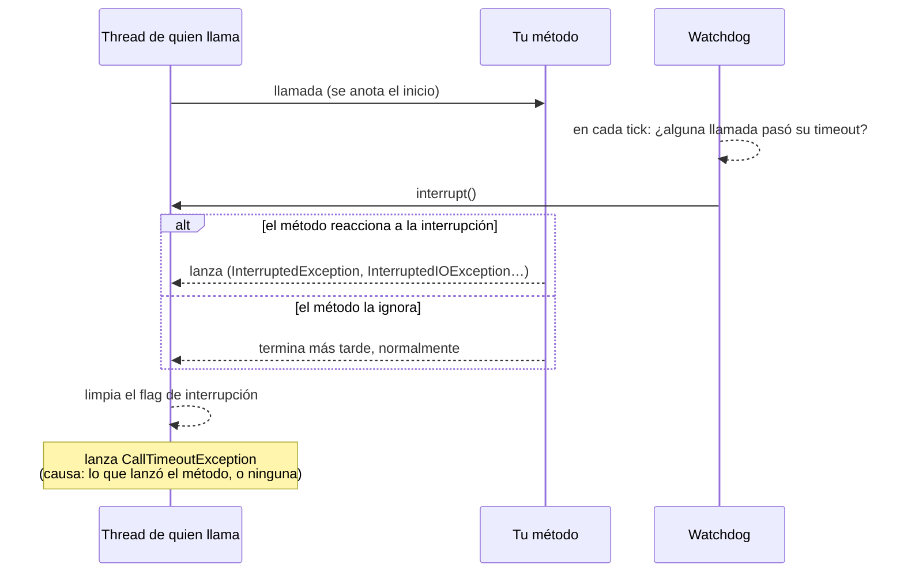

# Timeout

`@Timeout` acota cuánto puede tardar una llamada: una llamada sincrónica se interrumpe, una asincrónica hace fallar su future.

<div class="r4c-facts">

| Anotación | Posición | Tipos de retorno | Valores por defecto |
|---|---|---|---|
| `@Timeout` | 6 de 7, dentro de AdaptiveLimit | sync y `CompletionStage` | 1 s por intento |

</div>

**Úsalo cuando** una dependencia puede colgarse, y que quien llama espere para siempre (ocupando un thread, una conexión, un slot de bulkhead) es peor que un error.

**No lo uses cuando** el código que llamas no se puede interrumpir y necesitas detenerlo: un timeout sincrónico *le pide* a la llamada que se detenga interrumpiendo su thread, no puede matarla (ver [más abajo](#sync-la-llamada-se-interrumpe)). Prefiere los timeouts propios del cliente (timeouts de conexión y de lectura de tu cliente HTTP o de tu driver JDBC) donde existan, y deja `@Timeout` como cota superior.

## Ejemplo mínimo

<!-- compare:start -->
<!-- snippet: timeout-minimal -->
```java
import dev.resilience4cata.annotation.Timeout;

public interface ReportApi {

    @Timeout("2s")
    String build(String reportId);
}
```
<!-- not-compiled: generated code, abridged -->
```java
public final class ReportApi$Resilient implements ReportApi {
    // …
    public ReportApi$Resilient(ReportApi delegate, dev.resilience4cata.ResilienceRegistry registry) {
        // …
        this.timeout0 = dev.resilience4cata.generated.Policies.timeout(registry, "dev.resilience4cata.examples.docs.timeout.ReportApi#build(java.lang.String)", "", "", r4c$b -> {
            r4c$b.timeout(java.time.Duration.ofNanos(2000000000L));
        }, false);
    }

    @Override
    public java.lang.String build(java.lang.String p0) {
        final dev.resilience4cata.generated.TimeoutPolicy r4c$timeout = this.timeout0;
        final dev.resilience4cata.generated.TimeoutPolicy.Scope r4c$scope = r4c$timeout.enter();
        final java.lang.String r4c$result;
        try {
            r4c$result = this.delegate.build(p0);
        } catch (java.lang.Throwable r4c$e) {
            r4c$timeout.failed(r4c$scope, r4c$e);
            throw r4c$e;
        }
        r4c$timeout.succeeded(r4c$scope);
        return r4c$result;
    }
}
```
<!-- compare:end -->

Abreviado: el archivo real usa nombres totalmente calificados.

## Cómo se comporta

### Sync: la llamada se interrumpe

La llamada corre en el thread de quien llama, como si no hubiera timeout; no hay thread extra ni executor. Un único thread daemon compartido, el watchdog, revisa las llamadas en curso e **interrumpe** el thread de quien llama cuando su llamada pasa del timeout.



- Lo que pasa después depende de tu código. Las llamadas bloqueantes que responden a interrupciones (`Thread.sleep`, `Object.wait`, `BlockingQueue.take`, `java.net.http.HttpClient.send`, la mayoría de la E/S en virtual threads, los canales interrumpibles de NIO) se detienen y lanzan una excepción; el timeout entonces lanza `CallTimeoutException` con esa excepción como causa.
- **El código que ignora las interrupciones primero corre hasta el final**: un bucle ocupado, la E/S bloqueante clásica de `java.net.Socket` en un platform thread, una librería que se traga la `InterruptedException`. La llamada sigue hasta que termina; recién entonces quien llama recibe `CallTimeoutException` (sin causa), y el resultado se descarta.
- El flag de interrupción se limpia antes de lanzar `CallTimeoutException`, así que nunca se filtra a trabajo posterior en ese thread.
- **Precisión.** Una llamada nunca se interrumpe antes de tiempo, y como mucho unos dos ticks del watchdog tarde. Un tick es un dieciseisavo del timeout más corto en uso, entre 1 ms y 50 ms: con solo `@Timeout("2s")`, como mucho unos 100 ms tarde.
- Una llamada que termina a tiempo no se toca. Las llamadas con timeout no leen ningún reloj: el watchdog mantiene un reloj aproximado para ellas.

### Async: el future falla

Para un método que devuelve `CompletionStage<T>` o `CompletableFuture<T>`, no se interrumpe nada. Si el stage no se completó cuando pasa el timeout, el future que recibiste falla con `CallTimeoutException`, y el stage del método se cancela si es un `Future` (un `CompletableFuture` lo es). El plazo lo lleva un timer compartido y sin locks, nunca antes de tiempo y como mucho unos dos ticks tarde; el timeout se completa en un virtual thread nuevo, nunca en el del timer. Un stage que ya está completo cuando el método retorna no necesita timer.

<!-- snippet: timeout-async -->
```java
@Timeout("2s")
CompletableFuture<String> build(String reportId);
```

El timeout cubre el stage, no la llamada al método que lo devuelve: un método que se bloquea 5 s *antes* de devolver su stage no recibe timeout. La cancelación pasa por las políticas que están dentro del timeout, así que un bulkhead interno libera su slot de inmediato. Cancelar el future que recibiste cancela el plazo y el stage, sin `CallTimeoutException` ni evento ([cancelación](../guides/async.md#cancelación)). Ver [Métodos async](../guides/async.md).

### La excepción

`dev.resilience4cata.CallTimeoutException` es una `RuntimeException` con `id()` y `timeout()` (la `Duration` que se superó). No tiene stack trace; el mensaje nombra la instancia y el timeout.

## Atributos

| Atributo | Tipo | Por defecto | Clave de config | Significado |
|---|---|---|---|---|
| `value` | duración | `1s` | `defaults.timeout.value` | Tiempo máximo que puede tardar un intento. Mayor que 0. |
| `config` | `String` | `default` | solo anotación | Configuración con nombre de la que partir. |
| `locked` | `boolean` | `false` | solo anotación | Conserva los valores fijados en la anotación: las claves `instances.<id>.*` no pueden cambiarlos. Ver [Bloquear una instancia](../guides/configuration.md#bloquear-una-instancia). |
| `enabled` | `boolean` | `true` | `defaults.timeout.enabled` | `false` deja pasar todas las llamadas; sin escribirlo, se hereda. |

`@Timeout` **no tiene `name`**: un timeout no guarda estado que valga la pena compartir, así que cada método anotado tiene su propia política, con el id `<interfaz>#<método>(<tipos de parámetros>)`. En la configuración externa el atributo es `value` (`configs.slow.timeout.value=10s`, `instances."com.acme.ReportApi#build(java.lang.String)".timeout.value=5s`); en código el método del builder es `TimeoutConfig.Builder.timeout(Duration)`. Ver [Configuración](../guides/configuration.md).

Tampoco hay **handle**: `registry` no tiene `timeout(id)`. `registry.snapshot().timeouts()` lista un `TimeoutSnapshot(id, config)` por método.

## Con otras políticas

El timeout es la quinta capa: dentro de RateLimiter, alrededor de Bulkhead.

- **Por intento.** Dentro de `@Retry`, cada intento tiene el timeout completo. Para acotar toda la operación, intentos y esperas incluidos, define `@Retry(maxDuration = …)`.
- `CallTimeoutException` es una `Exception`: por defecto, un `@Retry` externo la reintenta y un `@CircuitBreaker` externo la registra como falla.
- El tiempo esperando un permiso del rate limiter no cuenta (el limiter está afuera); el tiempo esperando un slot del bulkhead sí (el bulkhead está adentro). Una espera del bulkhead interrumpida termina como `CallTimeoutException`.
- `@Fallback` ve `CallTimeoutException` como cualquier otra falla.

## Lo mismo con `Pipeline`

<!-- snippet: timeout-pipeline -->
```java
Pipeline<String> build = Pipeline.builder(registry, "reports", String.class)
        .timeout(t -> t.timeout(Duration.ofSeconds(2)))
        .build();

String report = build.execute(() -> backend.build("r-1"));
```

Aquí el id del timeout es el id del pipeline, `"reports"`. Ver [API Pipeline](../guides/pipeline.md).

## Eventos y snapshot

| Evento | Cuándo | Campos |
|---|---|---|
| `TimeoutEvent.TimedOut` | Una llamada pasó su timeout | `id`, `nanoTime`, `timeout` |

Las llamadas que terminan a tiempo no publican nada. Ver [Observabilidad](../guides/observability.md).

## Probarlo con `ManualClock`

<!-- snippet: timeout-testing -->
```java
ReportApi slow = id -> {
    try {
        clock.sleep(Duration.ofSeconds(5));          // a slow dependency, on the test's clock
    } catch (InterruptedException e) {
        throw new IllegalStateException("interrupted", e);   // how the timeout reaches the call
    }
    return "report " + id;
};
ReportApi reports = Resilient.of(ReportApi.class, slow, registry);

assertThatThrownBy(() -> reports.build("r-1"))
        .isInstanceOf(CallTimeoutException.class)
        .hasCauseInstanceOf(IllegalStateException.class);   // what the call threw once interrupted
assertThat(Thread.currentThread().isInterrupted()).isFalse(); // the interrupt is cleared
```

Con un [`ManualClock`](../guides/testing.md), los timeouts sync saltan exactamente cuando el reloj pasa el plazo, sin tick de holgura, y los timeouts async saltan en el thread que avanza el reloj. Un stub que simula una dependencia lenta con `clock.sleep(…)` se interrumpe como el código bloqueante real; un stub que llama a `clock.advance(…)` en su lugar se comporta como código que ignora la interrupción.

## Letra chica

- Un timeout sync es cooperativo: depende de las interrupciones. No puede detener código que las ignora, y no conviene usarlo para acotar trabajo de CPU que nunca revisa `Thread.interrupted()`.
- Si tu código captura `InterruptedException` y sigue como si nada, la llamada no se corta; restaura el flag (`Thread.currentThread().interrupt()`) o relanza.
- Una llamada que termina justo en el plazo, mientras el watchdog la está interrumpiendo, igual recibe `CallTimeoutException`: el resultado se decide una sola vez, y luego se limpia la interrupción.
- En un platform thread, una llamada bloqueada en E/S de socket clásica retiene el thread hasta el timeout propio del socket. Los virtual threads vuelven interrumpible la mayor parte de la E/S bloqueante.
- Errores relacionados: [`R4C-ATR-001`](../errors.md#r4c-atr-001) (sintaxis de duración), [`R4C-ATR-002`](../errors.md#r4c-atr-002) (`@Timeout("0")`), [`R4C-ATR-006`](../errors.md#r4c-atr-006) (`enabled`), [`R4C-REG-004`](../errors.md#r4c-reg-004) (`config` desconocida).

## Cuánto cuesta

> [!MEASURED]
> En AWS Graviton3 (`c7g.xlarge`, JDK 21), una llamada sync a través de `@Timeout` que termina a tiempo cuesta 22,2 ns con 1 thread y no asigna memoria (una corrida posterior midió 23,7 ns, una pregunta abierta); Resilience4j 2.4.0 no tiene timeout en el thread de quien llama, y su `TimeLimiter` con un executor tarda 8842 ns y 176 B. Una llamada async cuyo stage sigue pendiente cuesta 152 ns y 192 B, contra 598 ns y 240 B. [Benchmarks: cierre del MVP](../benchmarks.md#cierre-del-mvp-classifier-pipeline-eventos-testkit-2026-10-24-aws-graviton3), [corrida posterior](../benchmarks.md#clases-anotadas-genéricos-overrides-de-config-bulkhead-con-ticker-2026-10-24-aws-graviton3)
