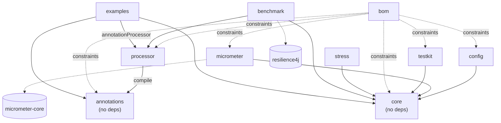

# 05 — Arquitectura del proyecto, build y prácticas de ingeniería

> **Histórico.** Esta investigación es anterior a la implementación y se conserva tal como se escribió; para lo que hace realmente 0.1.0, ver [features](../features.md), [arquitectura](../architecture.md) y [benchmarks](../benchmarks.md).

> Investigación de la fase 1. Estado: **propuesta**, todavía no se ha implementado nada de esto.
> Versión en inglés: [../../en/research/05-project-architecture.md](../../en/research/05-project-architecture.md)

Este documento cubre la *forma* del repositorio: qué módulos Gradle existen y qué hace cada uno, cómo se organiza el build, cómo encaja JPMS, el tooling de calidad, cómo se genera la documentación bilingüe y cómo versionamos y protegemos la API pública. Otros documentos de investigación cubren el mecanismo de procesamiento de anotaciones, los internos de concurrencia y la API de anotaciones en sí. Aquí solo se indica dónde esos temas afectan la estructura de módulos.

---

## Resumen

| Decisión | Recomendación |
|---|---|
| Nombres de módulos | Directorios de una sola palabra: `core`, `annotations`, `processor`, `config`, `micrometer`, `testkit`, `stress`, `benchmark`, `examples`, `bom`. Los artifactIds publicados llevan prefijo: `resilience4cata-core`, … |
| Granularidad | **Un** único motor de runtime (`core`) con todas las políticas. *No* dividir por patrón como Resilience4j. El usuario necesita como máximo 3 coordenadas (+ el BOM). |
| Dependencias externas en `core` | **Cero** es viable en Java 21 (`System.Logger`, `VarHandle`, `InstantSource`, JFR). La única excepción que vale la pena discutir es JSpecify (solo anotaciones, unos 4 KB). |
| Build | Gradle 9.x, Kotlin DSL, included build `build-logic` con convention plugins precompilados, `gradle/libs.versions.toml`, toolchain 21 + `--release 21`, configuration cache y build cache activados. |
| Publicación | `com.vanniktech.maven.publish` hacia el **Central Portal** (OSSRH se cerró el 2025-06-30), firma GPG en memoria desde CI y un BOM `java-platform`. |
| JPMS | Un `module-info.java` real en cada módulo publicado. Los paquetes internos no se exportan. El procesador hace `provides javax.annotation.processing.Processor`. |
| Calidad | JUnit Jupiter, AssertJ, jqwik (atención: modo mantenimiento), jcstress, ArchUnit, Error Prone + NullAway (modo JSpecify), Spotless, JaCoCo, matriz de GitHub Actions con JDK 21 y 25. |
| Docs | **No** es un módulo Gradle. Markdown plano en `docs/en` y `docs/es`, renderizado por el sitio Docsify que ya existe en el repo (GitHub Pages). Gradle genera el Javadoc y se enlaza desde el sitio. |
| Estabilidad de la API | SemVer con incubación `0.x`, marcadores propios `@Experimental` / `@Internal`, y japicmp en CI a partir de `1.0`. |

---

## 1. Estructura de módulos

### 1.1 Qué hace Resilience4j y qué no les gusta a los usuarios

Resilience4j 2.x publica un artefacto por patrón: `resilience4j-circuitbreaker`, `-ratelimiter`, `-bulkhead`, `-retry`, `-timelimiter`, `-cache`. También publica `resilience4j-core`, el agregador `resilience4j-all` (que contiene el builder `Decorators`), un `resilience4j-bom` y una larga lista de integraciones (`-micrometer`, `-reactor`, `-rxjava3`, `-kotlin`, `-spring-boot3`, `-spring6`, `-vertx`, `-feign`, `-retrofit`, …) ([README](https://github.com/resilience4j/resilience4j), [BOM en Central](https://central.sonatype.com/artifact/io.github.resilience4j/resilience4j-bom)).

Puntos de dolor relevantes para nuestro diseño:

1. **Demasiadas coordenadas para un caso simple.** Un servicio típico termina declarando 4–6 artefactos, o usa `-all`, lo que anula la modularidad. Además, cada artefacto de patrón depende de `resilience4j-core`, así que la división ahorra muy poco bytecode.
2. **Las anotaciones están atadas a Spring AOP.** `@CircuitBreaker`, `@Retry` y las demás viven en `resilience4j-annotations`, pero solo *hacen* algo a través de los módulos de aspectos de Spring (o Micronaut). Quien usa Java plano no tiene soporte de anotaciones. Ese es justamente el hueco que ataca este proyecto.
3. **La composición vive en otro artefacto** (`Decorators` en `-all`), separada de los patrones que compone.
4. **Alinear versiones de muchos artefactos** obliga al usuario a depender del BOM.

Lección: dividir por **frontera de dependencias** (¿este código arrastra una librería de terceros o se ejecuta en otro momento, como compilación vs. runtime?), nunca por *funcionalidad*.

### 1.2 Módulos propuestos

Todos los nombres de directorio son de una sola palabra. Los artifactIds publicados usan el prefijo `resilience4cata-` para no ser ambiguos en Maven Central (`resilience4cata-core`). En `settings.gradle.kts` el proyecto Gradle sigue siendo `:core`, y el prefijo se aplica en el convention plugin de publicación.

| Módulo | Publicado | Responsabilidad | Dependencias |
|---|---|---|---|
| `annotations` | ✅ | Solo los tipos de anotación (`@CircuitBreaker`, `@Retry`, `@RateLimiter`, `@Bulkhead`, `@Timeout`, `@Fallback`, contenedores repetibles para múltiples configuraciones, y `@Experimental` / `@Internal`). Sin lógica. | ninguna |
| `core` | ✅ | Todas las implementaciones de políticas, el registro, los objetos del *modelo* de configuración, el pipeline de composición, la SPI de eventos/métricas, los eventos JFR y el soporte de runtime que invoca el código generado. | ninguna (solo JDK) |
| `processor` | ✅ | El procesador de anotaciones: valida las anotaciones en compilación y genera código. El usuario solo lo agrega a `annotationProcessor`. | `annotations` (compile) |
| `config` | ✅ | Carga la configuración de políticas desde fuentes externas: `java.util.Properties`, propiedades de sistema, variables de entorno y una SPI `ConfigSource` para otras. La vincula al modelo de configuración de `core`. | `core` |
| `micrometer` | ✅ | Puente de los eventos/métricas de `core` hacia `MeterRegistry` de Micrometer. | `core`, `io.micrometer:micrometer-core` |
| `testkit` | ✅ | Utilidades de test para **usuarios**: reloj controlable, schedulers deterministas, stubs de inyección de fallos, aserciones estilo AssertJ sobre el estado de las políticas. | `core`; JUnit/AssertJ como `compileOnly` |
| `bom` | ✅ | BOM `java-platform` que alinea todos los módulos publicados. | solo constraints |
| `stress` | ❌ | Tests jcstress para las máquinas de estado lock-free de `core`. | `core`, jcstress |
| `benchmark` | ❌ | Benchmarks JMH que nos comparan con Resilience4j (y con un baseline no-op). | `core`, `processor`, Resilience4j, JMH |
| `examples` | ❌ | Programas pequeños ejecutables, compilados con el procesador. También sirven como tests end-to-end del código generado. | `annotations`, `core`, `processor` |
| `docs` | ❌ | Fuentes de la documentación. **No es un proyecto Gradle** (ver §5). | — |

Notas sobre los nombres:

- **Evitar `test` como nombre de proyecto.** `gradle test` y `:test` ya se refieren a la *tarea* `test`, así que un proyecto llamado `test` se lee como `:test:test` y vuelve confusa la selección de tareas. `testkit` no es ambiguo. JUnit, Micrometer y el propio Gradle usan ese nombre para este fin.
- Nombrar los módulos de integración por **lo que integran** (`micrometer`, más adelante `opentelemetry`), no por un concepto genérico (`metrics`). Así la regla de una sola palabra se mantiene a medida que crecen las integraciones.
- Posibles módulos futuros, todos de una palabra: `opentelemetry`, `reactor`, `kotlin`, `spring`, `quarkus` (fuera de alcance por ahora).

### 1.3 ¿Debe `annotations` estar separado de `core`?

Ambas opciones son viables. Es una decisión barata de revisar antes de `1.0`.

- **Separado (recomendado).** `core` queda como una librería puramente programática, usable sin anotaciones, igual que se usa Failsafe. El procesador depende solo del pequeño jar `annotations`. Si la investigación de diseño de API se decide por retención `CLASS` para uso solo con codegen, el usuario puede poner `annotations` en `compileOnly`. El costo es una coordenada más, que el BOM oculta.
- **Fusionado.** El usuario solo necesita `core` + `processor`. El costo es que el processor path del procesador arrastra todo `core`, y el paquete de anotaciones pasa a ser parte de la superficie de API del módulo de runtime.

En cualquier caso, **no se pueden dividir paquetes** entre jars (JPMS lo prohíbe). Las anotaciones van en `…​.annotation`, el motor en `…​.core` y sus subpaquetes.

### 1.4 Grafo de dependencias



Reglas, verificadas con ArchUnit y por el propio build (ver §4):

- `core` y `annotations` **no** tienen dependencias de proyecto ni externas.
- Ningún módulo depende de `processor` en runtime. Solo aparece en una configuración `annotationProcessor`.
- El código generado por `processor` depende **solo de la API exportada de `core`**, más `annotations` cuando la retención es `RUNTIME`. Ese es el contrato entre el procesador y el runtime. Debe vivir en un paquete exportado dedicado (por ejemplo `…​.core.spi.generated`) para que evolucione de forma deliberada.
- Las integraciones (`config`, `micrometer`, …) dependen de `core`, nunca entre sí.

Lo que escribe un usuario:

```kotlin
dependencies {
    implementation(platform("io.github.<ns>:resilience4cata-bom:0.1.0"))
    implementation("io.github.<ns>:resilience4cata-core")
    implementation("io.github.<ns>:resilience4cata-annotations")
    annotationProcessor("io.github.<ns>:resilience4cata-processor")
}
```

### 1.5 ¿Es viable "cero dependencias externas en core"?

Sí. Todo lo que necesita un runtime de resiliencia está en la plataforma JDK 21:

| Necesidad | Respuesta en JDK 21 |
|---|---|
| Logging | `System.Logger` (JEP 264), que se enruta a SLF4J/Log4j/JUL mediante sus puentes `System.LoggerFinder`. Resilience4j depende de `slf4j-api` para esto; nosotros no lo necesitamos. |
| Atómicos, estado lock-free | `java.util.concurrent.atomic`, `VarHandle`, `LongAdder`, `StampedLock` |
| Tiempo | `System.nanoTime()`, `java.time.InstantSource` (Java 17) para relojes testeables |
| Planificación / async | `ScheduledExecutorService`, `CompletableFuture`, virtual threads (JEP 444, finales en 21) |
| Observabilidad | Eventos `jdk.jfr` propios, con costo casi nulo cuando están desactivados. Usar `requires static jdk.jfr` para que las imágenes jlink sin JFR sigan funcionando. |
| Tipos funcionales | `java.util.function` más interfaces propias tipo `CheckedSupplier`. Resilience4j 2.0 eliminó Vavr por el mismo motivo. |
| Parseo de config | `java.util.Properties`. YAML/HOCON irían en módulos opcionales, si alguna vez hacen falta. |

La **única** dependencia que vale la pena considerar es **JSpecify** (`org.jspecify:jspecify`). Solo contiene anotaciones, no tiene dependencias transitivas, pesa unos 4 KB, y ya la usan Spring Framework 7 y Guava ([jspecify.dev](https://jspecify.dev/)). Dos opciones:

- `compileOnly` + `requires static org.jspecify`. Estrictamente cero dependencias de runtime, pero los consumidores Kotlin y los IDEs pierden la información de nulabilidad salvo que agreguen el jar por su cuenta.
- `api` + `requires transitive org.jspecify`. Un jar diminuto, con información de nulabilidad completa para los consumidores.

Recomendación: `api`, documentado como "cero dependencias salvo las anotaciones de JSpecify". Es lo que adoptó el ecosistema Java en 2025. Mantener también `processor` sin dependencias: evitar JavaPoet, o hacerle shading. Varios procesadores populares (Dagger, AutoValue) traen versiones distintas de JavaPoet en el mismo processor path, y los conflictos ahí son dolorosos.

---

## 2. Gradle (Kotlin DSL) para una librería multi-módulo, 2025–2026

### 2.1 Estructura del repositorio

```
resilience4cata/
├── settings.gradle.kts
├── gradle.properties
├── gradle/
│   ├── libs.versions.toml
│   └── wrapper/
├── build-logic/                 # included build, NOT a subproject
│   ├── settings.gradle.kts
│   ├── build.gradle.kts         # `kotlin-dsl` plugin
│   └── src/main/kotlin/
│       ├── r4c.java-library.gradle.kts
│       ├── r4c.published.gradle.kts
│       ├── r4c.quality.gradle.kts
│       └── r4c.benchmark.gradle.kts
├── annotations/ core/ processor/ config/ micrometer/ testkit/ bom/
├── stress/ benchmark/ examples/
└── docs/                        # not part of the Gradle build
```

`build-logic` es el nombre convencional para el included build. No es un subproyecto y nunca se publica, pero sí contiene un guion. Si la regla de una sola palabra debe aplicarse también ahí, `conventions` es una alternativa limpia. La documentación de Gradle usa `build-logic` en sus ejemplos ([sharing build logic](https://docs.gradle.org/current/userguide/sharing_build_logic_between_subprojects.html)).

### 2.2 Settings

```kotlin
// settings.gradle.kts
pluginManagement {
    includeBuild("build-logic")
}
plugins {
    id("org.gradle.toolchains.foojay-resolver-convention") version "<latest>"
}
dependencyResolutionManagement {
    repositoriesMode = RepositoriesMode.FAIL_ON_PROJECT_REPOS
    repositories { mavenCentral() }
}
enableFeaturePreview("TYPESAFE_PROJECT_ACCESSORS")
rootProject.name = "resilience4cata"
include("annotations", "core", "processor", "config", "micrometer",
        "testkit", "bom", "stress", "benchmark", "examples")
```

### 2.3 Convention plugins (sin `allprojects {}` / `subprojects {}`)

Gradle desaconseja la configuración entre proyectos porque rompe el aislamiento de proyectos y la configuration cache. En su lugar, cada módulo aplica las convenciones que necesita ([buenas prácticas de Gradle](https://docs.gradle.org/current/userguide/best_practices.html), [estructurar builds](https://docs.gradle.org/current/userguide/multi_project_builds.html)):

```kotlin
// build-logic/src/main/kotlin/r4c.java-library.gradle.kts
plugins { `java-library` }

java {
    toolchain { languageVersion = JavaLanguageVersion.of(21) }
    withSourcesJar(); withJavadocJar()
}
tasks.withType<JavaCompile>().configureEach {
    options.release = 21
    options.compilerArgs.addAll(listOf("-Xlint:all", "-Werror", "-parameters"))
}
tasks.withType<Test>().configureEach { useJUnitPlatform() }
```

```kotlin
// core/build.gradle.kts
plugins {
    id("r4c.java-library")
    id("r4c.published")
    id("r4c.quality")
}
// no dependencies block: that's the point
```

Dentro de un precompiled script plugin, el version catalog se lee con `the<VersionCatalogsExtension>().named("libs")`, o con el workaround habitual que expone los accessors type-safe de `libs` a `build-logic`.

### 2.4 Version catalog

`gradle/libs.versions.toml` es la fuente única de versiones de librerías **y** plugins ([docs](https://docs.gradle.org/current/userguide/version_catalogs.html)). Esbozo:

```toml
[versions]
junit = "6.0.+"          # pin exact in reality
assertj = "3.27.+"
jmh = "1.37"
errorprone = "2.+"
nullaway = "0.12.+"
jspecify = "1.0.0"
resilience4j = "2.3.0"

[libraries]
jspecify = { module = "org.jspecify:jspecify", version.ref = "jspecify" }
junit-bom = { module = "org.junit:junit-bom", version.ref = "junit" }
assertj = { module = "org.assertj:assertj-core", version.ref = "assertj" }
resilience4j-bom = { module = "io.github.resilience4j:resilience4j-bom", version.ref = "resilience4j" }

[plugins]
jmh = { id = "me.champeau.jmh", version = "0.7.2" }
maven-publish = { id = "com.vanniktech.maven.publish", version = "0.34.0" }
spotless = { id = "com.diffplug.spotless", version = "<latest>" }
errorprone = { id = "net.ltgt.errorprone", version = "<latest>" }
japicmp = { id = "me.champeau.gradle.japicmp", version = "<latest>" }
```

(Las versiones son ilustrativas. Hay que fijar versiones exactas al escribir el build y dejar que Renovate o Dependabot las mantengan al día.)

### 2.5 Toolchains y testing con varios JDK

- Compilar con **toolchain 21** y `options.release = 21`. `release` garantiza que nunca usemos una API más nueva que la 21, aunque el toolchain sea más reciente. Los toolchains se aprovisionan automáticamente con el resolver de foojay ([toolchains](https://docs.gradle.org/current/userguide/toolchains.html)).
- Probar contra otros JDK **sin recompilar**, sobrescribiendo el launcher de los tests:

```kotlin
val testJdk = providers.gradleProperty("testJdk").map(String::toInt)
tasks.withType<Test>().configureEach {
    javaLauncher = testJdk.flatMap { v ->
        javaToolchains.launcherFor { languageVersion = JavaLanguageVersion.of(v) }
    }.orElse(javaToolchains.launcherFor(java.toolchain))
}
```

En CI se ejecuta `./gradlew check -PtestJdk=25`. Así se detectan diferencias reales de runtime, como el cambio de pinning de virtual threads en JDK 24 ([JEP 491](https://openjdk.org/jeps/491)) y el comportamiento de JIT más nuevo.

### 2.6 Configuration cache, build cache, paralelismo

Gradle 9 convirtió la configuration cache en el modo de ejecución **preferido**, y está previsto que sea el modo por defecto en Gradle 10 ([notas de 9.0](https://docs.gradle.org/9.0.0/release-notes.html)). Gradle 9.1 añadió un modo de solo lectura para CI ([notas de 9.1](https://docs.gradle.org/9.1.0/release-notes.html)). Conviene activarla desde el primer día: incorporarla después es mucho más difícil.

```properties
# gradle.properties
org.gradle.configuration-cache=true
org.gradle.configuration-cache.problems=fail
org.gradle.caching=true
org.gradle.parallel=true
```

Todos los plugins elegidos aquí son compatibles con la configuration cache. vanniktech añadió soporte para la publicación en 0.34.0.

### 2.7 Testear el procesador de anotaciones

Tres capas:

1. **Tests de compilación a nivel unitario.** Usar [Google compile-testing](https://github.com/google/compile-testing) (`Compiler.javac().withProcessors(new Processor()).compile(source)`, luego `assertThat(compilation).succeeded()` / `.hadErrorContaining(...)` / `.generatedSourceFile(...)`). No depende de ningún framework y funciona desde JUnit Jupiter. Solo su `CompilationRule` es específica de JUnit 4. La alternativa es un harness propio de unas 50 líneas sobre `javax.tools.JavaCompiler` + un `JavaFileManager` en memoria, que evita la dependencia de Guava/Truth (solo en test, así que importa poco).
   Hay que testear los **diagnósticos** con el mismo cuidado que el camino feliz: una configuración inválida debe fallar en compilación con un mensaje preciso sobre el elemento problemático. Es un argumento de venta frente a la validación solo en runtime.
2. **End-to-end.** El módulo `examples` (y el `src/integrationTest` del propio procesador) se compila con el procesador real en el processor path. Sus tests ejecutan el código generado.
3. **Integración con Gradle.** El [Gradle TestKit](https://docs.gradle.org/current/userguide/test_kit.html) está pensado para testear *plugins de Gradle*. Solo lo necesitaríamos si algún día publicamos un plugin de Gradle. Para el procesador, se usa de forma acotada para verificar el **procesamiento incremental de anotaciones**: el procesador debe declararse en `META-INF/gradle/incremental.annotation.processors` (`isolating` si cada archivo generado proviene de exactamente un tipo anotado, `aggregating` en otro caso). Si no, todos los builds de los usuarios pierden la compilación incremental ([docs](https://docs.gradle.org/current/userguide/java_plugin.html#sec:incremental_annotation_processing)). Un test pequeño con TestKit puede comprobar que tocar un archivo fuente no provoca una recompilación completa.

### 2.8 JMH

Usar [`me.champeau.jmh`](https://github.com/melix/jmh-gradle-plugin) (0.7.2 en el Plugin Portal al momento de escribir esto) en `benchmark`. Prácticas:

- Los benchmarks viven en `src/jmh/java`. Mantenerlos fuera de `check` porque son lentos. Ejecutarlos bajo demanda y en un job programado de CI en un runner dedicado, no en los runners compartidos de GitHub, cuyo ruido hace que sus números no sean fiables.
- Comparar en igualdad de condiciones: mismas configuraciones de políticas en nuestra librería y en Resilience4j, más un baseline sin políticas. Reportar `thrpt` y `avgt` con `-prof gc` (la tasa de asignación por operación es una métrica clave), con 1, 4 y N hilos (`@Threads`, `@Group` para contención mixta de lectura/escritura).
- Publicar los resultados crudos en JSON (`resultFormat = "JSON"`) y renderizarlos en la documentación.

### 2.9 Publicación en Maven Central

- Sonatype **cerró OSSRH el 30 de junio de 2025**. Las publicaciones nuevas pasan por el **Central Portal** (`central.sonatype.com`) ([aviso de Sonatype](https://central.sonatype.org/news/20250326_ossrh_sunset/)).
- Usar [`com.vanniktech.maven.publish`](https://github.com/vanniktech/gradle-maven-publish-plugin) (0.34.0 o posterior). Apunta al Central Portal, genera los metadatos de POM que exige Central (nombre, descripción, URL, licencia, desarrolladores, SCM), añade los jars de sources/javadoc, firma y es compatible con la configuration cache ([releases](https://github.com/vanniktech/gradle-maven-publish-plugin/releases)).

```kotlin
// build-logic/src/main/kotlin/r4c.published.gradle.kts
plugins { id("com.vanniktech.maven.publish") }
mavenPublishing {
    publishToMavenCentral(automaticRelease = false)
    signAllPublications()
    coordinates("io.github.<ns>", "resilience4cata-${project.name}", version.toString())
    pom { /* name, description, url, licenses, developers, scm */ }
}
```

- **Namespace:** verificar `io.github.<usuario-github>` (inmediato vía GitHub) o un dominio propio mediante un registro DNS TXT. Hay que decidirlo antes del primer release, porque es permanente.
- **Firma en CI:** pasar `ORG_GRADLE_PROJECT_signingInMemoryKey`, `…KeyPassword`, `ORG_GRADLE_PROJECT_mavenCentralUsername` y `…Password` (un *user token* del Portal) como secrets de GitHub. Sin archivos de keyring.
- **BOM:** el módulo `bom` aplica `java-platform` y declara `api(project(":core"))` y los demás módulos publicados como constraints. El Gradle module metadata (`.module`) se publica junto al POM.
- Flujo de release: tag `vX.Y.Z`, CI publica, y al principio un clic manual en "Publish" en el Portal (`automaticRelease = false`). Pasar a automático cuando el pipeline sea de confianza.

---

## 3. JPMS

### 3.1 Un `module-info.java` por módulo publicado

```java
// core/src/main/java/module-info.java
module io.github.ns.resilience4cata.core {
    requires static jdk.jfr;
    requires transitive org.jspecify;           // if JSpecify is `api`
    exports io.github.ns.resilience4cata.core;
    exports io.github.ns.resilience4cata.core.spi;
    exports io.github.ns.resilience4cata.core.spi.generated; // contract for generated code
    // ...core.internal is NOT exported
    uses io.github.ns.resilience4cata.core.spi.EventListenerProvider;
}
```

```java
// processor/src/main/java/module-info.java
module io.github.ns.resilience4cata.processor {
    requires java.compiler;
    requires io.github.ns.resilience4cata.annotations;
    provides javax.annotation.processing.Processor
        with io.github.ns.resilience4cata.processor.ResilienceProcessor;
}
```

Incluir también `META-INF/services/javax.annotation.processing.Processor` en `processor`. La mayoría de los builds (Gradle, Maven, IDEs) ponen los procesadores en un processor path **estilo classpath**, donde `provides` se ignora y lo que cuenta es el archivo de servicio.

Beneficios: encapsulación real de los paquetes `internal` (más fuerte que una convención de nombres), compatibilidad con jlink, y una garantía tipo ArchUnit verificada por el propio `javac`. Gradle infiere el module path automáticamente cuando hay un `module-info.java` ([módulos Java en Gradle](https://docs.gradle.org/current/userguide/java_library_plugin.html#sec:java_library_modular)).

### 3.2 Cómo interactúan los procesadores de anotaciones con JPMS

- **El procesador se ejecuta en compilación, dentro del compilador del usuario**, desde el processor path (`-processorpath`) o el processor module path (`--processor-module-path`). Nunca está en el module path de runtime del usuario. En Gradle va en la configuración `annotationProcessor`.
- **El código generado vive en el módulo y los paquetes del usuario.** `Filer.createSourceFile` escribe en el módulo que se está compilando. Por eso el `module-info.java` del usuario debe hacer `requires io.github.ns.resilience4cata.core` (y `…annotations` cuando la retención es `RUNTIME`). Hay que documentarlo, y el procesador debe emitir un error claro cuando se compila un módulo (`Elements.getModuleOf(...)` no es el módulo sin nombre) y falta el módulo requerido en su `module-info`.
- **El codegen no necesita `opens`.** Las clases generadas están en el mismo paquete que la clase anotada y la llaman directamente, sin reflexión profunda. Los enfoques basados en reflexión o bytecode *sí* exigen que el usuario haga `opens` de sus paquetes o entregue un `MethodHandles.Lookup`. Es otro argumento a favor de APT, que la investigación sobre mecanismos trata en profundidad.
- **Los split packages están prohibidos.** Por eso las anotaciones, core y el código generado necesitan paquetes distintos. El código generado comparte paquete con el código *del usuario*, y eso está bien porque ambos están en el módulo del usuario.
- **Tests:** los tests unitarios de caja blanca se ejecutan parcheados dentro del módulo (Gradle gestiona `--patch-module`). Los tests de caja negra pueden ir en un source set aparte con su propio `module-info.java`, para probar exactamente lo que ve el consumidor.

---

## 4. Tooling de calidad

| Herramienta | Rol | Notas |
|---|---|---|
| **JUnit Jupiter** (JUnit 6) | Motor de tests | JUnit 6.0 salió en GA el 2025-09-30 con Java 17 como mínimo ([InfoQ](https://www.infoq.com/news/2025/10/junit6-java17-kotlin)). Usarlo a través de `junit-bom`. |
| **AssertJ** | Aserciones | `testkit` puede incluir aserciones AssertJ propias (`assertThat(circuitBreaker).isOpen()`). |
| **jqwik** | Testing basado en propiedades y **con estado/basado en modelos** de máquinas de estado (transiciones del circuit breaker, invariantes del token bucket) | ⚠️ jqwik está en **modo de mantenimiento puro**: solo actualizaciones de dependencias y correcciones críticas ([jqwik](https://jqwik.net/), [release notes](https://jqwik.net/release-notes.html)). Sigue siendo usable como dependencia solo de test. Hay que verificar la compatibilidad con JUnit Platform 6 antes de adoptarlo, y mantener las propiedades lo bastante simples como para portarlas a un harness con `@RepeatedTest` de JUnit + `Random` con semilla si hiciera falta. |
| **jcstress** | Corrección de concurrencia del código lock-free bajo el JMM | Vive en el módulo `stress`. Se ejecuta con el plugin `io.github.reyerizo.gradle.jcstress` o con un `JavaExec` simple. Ejecutarlo de noche o bajo demanda, porque es lento. Es la herramienta para demostrar que las transiciones de estado y el conteo de permisos no pierden actualizaciones ([jcstress](https://github.com/openjdk/jcstress)). |
| **ArchUnit** | Fronteras entre módulos y paquetes | Reglas: `core` solo depende de `java..`/`jdk.jfr..`/`org.jspecify..`. Nada fuera de `internal` expone tipos `internal`. El contrato `spi.generated` solo lo usa el código generado ([ArchUnit](https://www.archunit.org/)). |
| **Error Prone + NullAway** | Búsqueda estática de bugs y null-safety | Plugin `net.ltgt.errorprone`. Las versiones recientes de Error Prone necesitan un JDK reciente para *ejecutar* javac, lo cual no es problema en 21. NullAway en **modo JSpecify** sobre JDK 21 requiere `-XDaddTypeAnnotationsToSymbol=true` (OpenJDK) para los chequeos completos de genéricos/type-use, y es totalmente nativo desde JDK 22+ ([soporte JSpecify de NullAway](https://github.com/uber/NullAway/wiki/JSpecify-Support)). Marcar los paquetes con `@NullMarked`. |
| **JSpecify** | Anotaciones de nulabilidad | Ver §1.5. |
| **Spotless** | Formato | `palantir-java-format` o `google-java-format`, más cabeceras de licencia y formato Kotlin DSL (ktlint) para los scripts de build. `spotlessCheck` se ejecuta en `check`. |
| **JaCoCo** | Cobertura | Agregar con el plugin `jacoco-report-aggregation`. Tratar la cobertura como señal, no como barrera. Más adelante, considerar mutation testing con **PIT** para `core`. |
| **GitHub Actions** | CI | Ver abajo. |

### Esbozo de CI

```yaml
# .github/workflows/ci.yml (illustrative)
jobs:
  build:
    strategy:
      matrix:
        test-jdk: [21, 25]
        os: [ubuntu-latest]
        include:
          - { test-jdk: 25, os: windows-latest }
          - { test-jdk: 25, os: macos-latest }
    runs-on: ${{ matrix.os }}
    steps:
      - uses: actions/checkout@v4
      - uses: actions/setup-java@v4
        with: { distribution: temurin, java-version: "21\n${{ matrix.test-jdk }}" }
      - uses: gradle/actions/setup-gradle@v4    # caching + wrapper validation
      - run: ./gradlew check -PtestJdk=${{ matrix.test-jdk }}
```

Jobs adicionales: `japicmp` (en los PRs, a partir de 1.0), `stress` + `benchmark` nocturnos (runner dedicado), `release` en los tags, y la action de dependency submission de Gradle para las alertas de Dependabot. También vale la pena probar builds early-access del JDK (26-ea) con `continue-on-error`.

Versiones soportadas: **21 y 25 son ambas LTS**. 21 es la base. 25 es el objetivo de compatibilidad hacia adelante.

---

## 5. Módulo de documentación

### 5.1 Estado actual

El repo ya contiene `docs/` con un esqueleto de **Docsify v4** (`index.html`, `README.md`, `.nojekyll`). Está listo para GitHub Pages y no requiere paso de build. Docsify renderiza el Markdown en el navegador al visualizarlo.

### 5.2 Opciones comparadas

| Opción | Ventajas | Desventajas |
|---|---|---|
| **Markdown plano en GitHub** | Cero tooling. Legible en el repo y en el IDE. | Sin búsqueda, sin selector de idioma, navegación pobre. |
| **Docsify** (actual) | Sin build. El Markdown queda plano. Carpetas por idioma con su propio `_sidebar.md`, selector de idioma vía `_navbar.md`, y plugins como [docsify-namespaced](https://github.com/palkan/docsify-namespaced) ([multi-idioma con Docsify](https://evilmartians.com/chronicles/easy-multi-language-multi-version-documentation-with-docsify-git-and-github-actions)). | Renderizado en el cliente, así que el SEO es más débil. v4 es antigua y v5 ha tardado en llegar. Sin docs versionadas de serie. |
| **MkDocs Material** (plugin i18n) | Resultado y búsqueda excelentes. | ⚠️ En **modo mantenimiento desde 2025-11-05**, con correcciones críticas prometidas solo hasta aproximadamente noviembre de 2026. El equipo pasó a **Zensical** ([cobertura del anuncio](https://duerrenberger.dev/blog/2025/11/06/material-for-mkdocs-is-no-more-long-live-zensical), [issue](https://github.com/squidfunk/mkdocs-material/issues/8523)). No conviene empezar un sitio nuevo con esta herramienta ahora. |
| **Zensical** | Sucesor de MkDocs Material. Lee `mkdocs.yml`. | Joven, y la paridad de plugins (i18n, blog, …) aún se está poniendo al día. Toolchain Python en un repo Java. |
| **Docusaurus** | i18n de primera clase (`i18n/es/...`), docs versionadas, maduro. | Toolchain Node/React. Más pesado de lo que necesitamos ahora. |
| **Astro Starlight** | Buen i18n, salida estática rápida. | Toolchain Node. |

### 5.3 Recomendación

1. **docs no es un módulo Gradle.** No tiene fuentes Java ni nada que Gradle tenga que compilar o publicar. Convertirlo en proyecto Gradle solo añadiría tiempo de configuración. Mantener `docs/` como un directorio simple. Sigue siendo un "módulo" en el sentido de IntelliJ (`docs.iml`), y eso está bien. Los únicos puntos de contacto con Gradle son tareas *de otros módulos* que alimentan el sitio: el `javadoc` agregado, copiado a `docs/api/` en cada release, y los resultados JSON de los benchmarks.
2. **Estructura de fuentes:** primero el idioma, con estructura idéntica en cada locale.

```
docs/
├── index.html            # Docsify shell
├── README.md             # landing page / language chooser
├── _navbar.md            # EN | ES switcher
├── en/
│   ├── README.md
│   ├── _sidebar.md
│   ├── guide/ …
│   └── research/05-project-architecture.md
└── es/
    ├── README.md
    ├── _sidebar.md
    ├── guide/ …
    └── research/05-project-architecture.md
```

3. **Mantener Docsify en la fase 1**, porque ya existe y no requiere build. Mantener el Markdown **neutral respecto a la herramienta**: CommonMark/GFM estándar más bloques Mermaid, sin sintaxis exclusiva de Docsify. Así, una migración posterior a Zensical, Docusaurus o Starlight es un cambio de configuración, no una reescritura. Reevaluar en `1.0`, cuando las docs versionadas se vuelvan necesarias.
4. **Disciplina de traducción:** el inglés es la fuente de verdad. Todo PR que toque `docs/en/**` debe tocar `docs/es/**`, o llevar la etiqueta `translation-pending`. Un script mínimo de CI puede comprobar que ambos árboles tienen el mismo conjunto de archivos. El código y los identificadores quedan en inglés en ambos idiomas.

---

## 6. Versionado, estabilidad de la API y chequeos de compatibilidad

### 6.1 Versionado

- **SemVer.** `0.y.z` durante la incubación, donde se permiten cambios incompatibles en los saltos menores, siempre listados en el changelog. `1.0.0` llega cuando la API de anotaciones y el contrato del código generado estén estables.
- Una sola versión para todos los módulos (el BOM lo implica). Guardarla en `gradle.properties` (`version=0.1.0-SNAPSHOT`).
- Escribir `CHANGELOG.md` en estilo "Keep a Changelog". Las notas de release son bilingües en el sitio de docs; en el changelog basta con inglés.

### 6.2 Marcadores de estabilidad

Definir marcadores propios en `annotations`, para no depender de API Guardian (JUnit usa `@API(status = EXPERIMENTAL)` de apiguardian, que sería una dependencia extra):

```java
@Documented
@Retention(RetentionPolicy.CLASS)
@Target({TYPE, METHOD, CONSTRUCTOR, FIELD, PACKAGE, ANNOTATION_TYPE})
public @interface Experimental { String since() default ""; }

@Documented
@Retention(RetentionPolicy.CLASS)
@Target({TYPE, METHOD, CONSTRUCTOR, FIELD, PACKAGE})
public @interface Internal { }
```

- `@Experimental`: público, pero puede cambiar en cualquier versión menor, y queda excluido de los chequeos de compatibilidad.
- `@Internal` + paquetes `…internal` (no exportados por JPMS): nunca forman parte de la API. Existen solo para necesidades entre paquetes dentro de nuestros módulos.
- El **contrato del código generado** (`core.spi.generated`) es especial. El código compilado con la versión N del procesador debe seguir funcionando sobre `core` N. Documentar la regla "las versiones de processor y core deben coincidir" y hacerla cumplir: el código generado puede incrustar la versión del procesador, y `core` puede verificarla una vez en el class-init y fallar rápido con un mensaje claro. El BOM hace que coincidan fácilmente.

### 6.3 Chequeos de compatibilidad

| Herramienta | Notas |
|---|---|
| **japicmp** ([sitio](https://siom79.github.io/japicmp/), plugin Gradle `me.champeau.gradle.japicmp`) | Diff de compatibilidad binaria y de código fuente del jar contra la última versión publicada en Central. Permite excluir por anotación (`@Experimental`, `@Internal`) y por paquete (`*.internal`). Simple, rápido y bien mantenido. **Recomendado.** |
| **Revapi** ([sitio](https://revapi.org/)) | Más potente (consciente de semver, filtrado avanzado), pero su soporte para Gradle es más débil. El plugin `gradle-revapi` de Palantir ya no se mantiene activamente. Encaja mejor con Maven. |

Plan: integrar japicmp en la convención `r4c.published` como parte de `check`. Dejarlo *informativo* en `0.x`, y que **falle** a partir de `1.0` en todos los módulos publicados excepto `processor`. Para el procesador, la "API" son las anotaciones más el código generado, que cubren los tests de `examples`.

---

## 7. Preguntas abiertas para las otras líneas de investigación

1. La **retención** de las anotaciones (`CLASS` vs. `RUNTIME`) determina si `annotations` puede ser `compileOnly`, y si debe fusionarse con `core` (§1.3).
2. Si la investigación de mecanismos elige un fallback en runtime (proxies o bytecode), este necesita un módulo aparte (por ejemplo `proxy` o `agent`), para que `core` siga sin dependencias y quien use solo codegen no pague por él.
3. Formato de configuración externa: ¿bastarán `Properties` + variables de entorno para `config`, o los usuarios esperarán YAML? Cualquier cosa más allá de `Properties` implica una dependencia opcional, así que un módulo aparte o una SPI.
4. Group id / namespace en Central (`io.github.<usuario>` vs. un dominio) y el paquete Java raíz / nombre del módulo JPMS.

---

## Fuentes

- Repositorio y README de Resilience4j: <https://github.com/resilience4j/resilience4j>
- BOM de Resilience4j en Central: <https://central.sonatype.com/artifact/io.github.resilience4j/resilience4j-bom>
- Notas de Gradle 9.0 (configuration cache preferida): <https://docs.gradle.org/9.0.0/release-notes.html>
- Notas de Gradle 9.1 (configuration cache de solo lectura): <https://docs.gradle.org/9.1.0/release-notes.html>
- Gradle: compartir lógica de build / convention plugins: <https://docs.gradle.org/current/userguide/sharing_build_logic_between_subprojects.html>
- Buenas prácticas de Gradle: <https://docs.gradle.org/current/userguide/best_practices.html>
- Version catalogs de Gradle: <https://docs.gradle.org/current/userguide/version_catalogs.html>
- Toolchains de Gradle: <https://docs.gradle.org/current/userguide/toolchains.html>
- Procesamiento incremental de anotaciones en Gradle: <https://docs.gradle.org/current/userguide/java_plugin.html#sec:incremental_annotation_processing>
- Módulos Java en Gradle: <https://docs.gradle.org/current/userguide/java_library_plugin.html#sec:java_library_modular>
- Gradle TestKit: <https://docs.gradle.org/current/userguide/test_kit.html>
- Google compile-testing: <https://github.com/google/compile-testing>
- Plugin JMH para Gradle: <https://github.com/melix/jmh-gradle-plugin>, <https://plugins.gradle.org/plugin/me.champeau.jmh>
- vanniktech gradle-maven-publish-plugin: <https://github.com/vanniktech/gradle-maven-publish-plugin>
- Cierre de OSSRH de Sonatype: <https://central.sonatype.org/news/20250326_ossrh_sunset/>
- JSpecify: <https://jspecify.dev/>
- Soporte JSpecify de NullAway: <https://github.com/uber/NullAway/wiki/JSpecify-Support>
- Anuncio de JUnit 6 (InfoQ): <https://www.infoq.com/news/2025/10/junit6-java17-kotlin>
- jqwik y sus release notes: <https://jqwik.net/>, <https://jqwik.net/release-notes.html>
- jcstress: <https://github.com/openjdk/jcstress>
- ArchUnit: <https://www.archunit.org/>
- JEP 491 (virtual threads sin pinning): <https://openjdk.org/jeps/491>
- Modo mantenimiento de Material for MkDocs: <https://duerrenberger.dev/blog/2025/11/06/material-for-mkdocs-is-no-more-long-live-zensical>, <https://github.com/squidfunk/mkdocs-material/issues/8523>
- Docs multi-idioma con Docsify: <https://evilmartians.com/chronicles/easy-multi-language-multi-version-documentation-with-docsify-git-and-github-actions>, <https://github.com/palkan/docsify-namespaced>
- japicmp: <https://siom79.github.io/japicmp/>
- Revapi: <https://revapi.org/>
