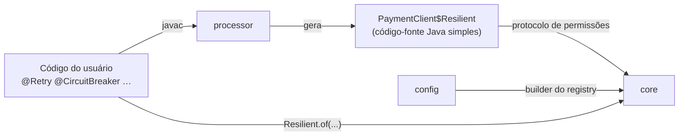
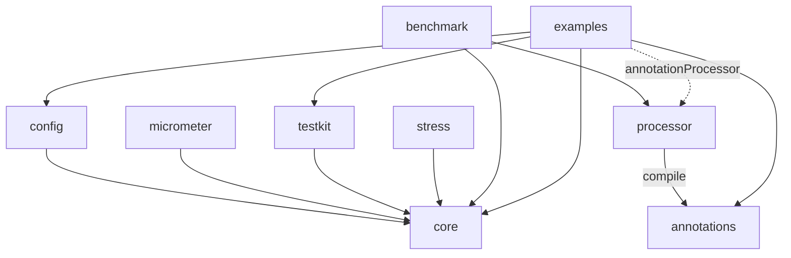

# Arquitetura

> Síntese de [02 Mecanismos de anotação](research/02-annotation-mechanisms.md), [03 Detalhes internos de desempenho](research/03-performance-internals.md) e [05 Arquitetura do projeto](research/05-project-architecture.md). Descreve o design tal como implementado na 0.6.0; os documentos de pesquisa registram como ele foi escolhido.

## Visão geral :id=overview



1. O usuário anota interfaces ou classes não finais.
2. Em tempo de compilação, o `processor` valida as anotações (assinaturas de fallback, durações, bundles conflitantes) e **gera código-fonte Java simples**: um wrapper que delega, para interfaces, e uma subclasse, para classes não finais.
3. Na inicialização, o usuário constrói um `ResilienceRegistry` (programaticamente e/ou a partir de configuração externa) e obtém a instância com `Resilient.of(PaymentClient.class, impl, registry)` para uma interface, ou `Resilient.create(InventoryService.class, registry, constructorArgs...)` (ou o construtor gerado, `new InventoryService$Resilient(registry, ...)`) para uma classe.
4. O processor é **obrigatório**. Se a classe gerada estiver faltando (o processor não foi configurado), `Resilient.of` falha na inicialização com uma mensagem que mostra a linha `annotationProcessor` a adicionar. Não há alternativa por reflexão nem por proxy.
5. A configuração é resolvida **uma vez**, quando a instância é criada, em objetos de policy imutáveis guardados em campos `final` da classe gerada. As chamadas nunca consultam nada.

## Mecanismo de anotação :id=annotation-mechanism

Decisão: **processamento de anotações em tempo de compilação (APT) que gera código-fonte** ([02 §5](research/02-annotation-mechanisms.md)).

Custo de despacho medido no nosso próprio benchmark JMH (JDK 25, Apple M1, guarda trivial; uma chamada direta custa 1.2 ns) ([02 §3](research/02-annotation-mechanisms.md)):

| Mecanismo | 1 tipo de serviço | 4 tipos de serviço | Alocação | Primeira instância |
|---|---:|---:|---:|---:|
| APT, protocolo da policy inline | 2.4–2.6 ns | 6.9–7.3 ns | 0 B | 0.37 ms |
| APT por meio de um `execute(Supplier)` compartilhado | 2.5 ns | 14.2 ns | 0 B | — |
| ByteBuddy em tempo de execução | 2.0 ns | ~6.0 ns | 0 B | ~200 ms |
| `Proxy` + `Method.invoke` | 16 ns | 37 ns | 16–64 B | 2.4 ms |

Por que APT:

- Custo por chamada parecido com o de código escrito à mão, sem reflexão, com pontos de chamada monomórficos.
- Inicialização instantânea, funciona no GraalVM native-image sem configuração, stack traces legíveis.
- Erros como uma assinatura de fallback errada ou uma duração inválida viram erros de compilação.
- Nenhuma cerimônia para o usuário além de adicionar uma dependência `annotationProcessor`. Sem flags da JVM, sem agente, sem compilador especial.

Rejeitados ou adiados:

- **ByteBuddy em tempo de execução:** cerca de 200 ms para a primeira instância, uma dependência de 9 MB e configuração extra para native-image.
- **AspectJ e agentes Java:** flags da JVM, o aviso de dynamic attach da JEP 451, e o weaver fica atrás de cada JDK.
- **Class-File API:** final apenas desde o JDK 24, não utilizável com uma base Java 21.
- **Alternativa com `Proxy`:** rejeitada por enquanto. O processor é obrigatório e as anotações usam retenção `CLASS`. Se algum dia for adicionado um módulo `dynamic`, passar para retenção `RUNTIME` é uma mudança compatível.

### Forma do código gerado :id=shape-of-the-generated-code

O benchmark JMH mostra que a **forma** do código gerado importa tanto quanto o mecanismo. Chamar as policies por meio de um lambda compartilhado dobra o custo assim que existem vários serviços. Por isso o `core` expõe duas APIs:

- Uma **API funcional para humanos** (`Pipeline`, builders) para código que não pode ser anotado.
- Um **protocolo de permissões para código gerado**, de baixo nível e sem alocação, no pacote `dev.resilience4cata.generated` (exportado, mas apenas para código gerado): `acquire()` / `onSuccess(token, started)` / `onFailure(token, started, error)` para o breaker, `start()` / `onFailure(attempts, error, start)` / `pause(delay)` para o retry, `enter()` / `succeeded(scope)` / `failed(scope, error)` para o timeout, e assim por diante.

Cada policy é uma camada: o método público contém a mais externa, e cada camada interna é um método privado com a mesma assinatura, terminando com a chamada à implementação. Isto é o que o processor gera para `@Retry` + `@CircuitBreaker` + `@Timeout` em `String track(String)` (do guia de primeiros passos; os nomes totalmente qualificados foram encurtados aqui):

```java
@Override
public String track(String p0) throws IOException {
    final RetryPolicy r4c$retry = this.retry0;
    final long r4c$start = r4c$retry.start();
    int r4c$attempts = 0;
    while (true) {
        try {
            return this.r4c$circuitBreaker0(p0);
        } catch (Throwable r4c$e) {
            final long r4c$delay = r4c$retry.onFailure(++r4c$attempts, r4c$e, r4c$start);
            if (r4c$delay < 0 || !r4c$retry.pause(r4c$delay)) {
                throw r4c$e;
            }
        }
    }
}

private String r4c$circuitBreaker0(String p0) throws IOException {
    final CircuitBreakerPolicy r4c$cb = this.circuitBreaker0;
    final long r4c$token = r4c$cb.acquire();
    if (r4c$token < 0) {
        throw r4c$cb.rejection();                          // preallocated, stackless
    }
    final long r4c$started = r4c$cb.startTimer();          // reads the clock only if slowCallDuration is set
    try {
        final String r4c$result = this.r4c$timeout0(p0);
        r4c$cb.onSuccess(r4c$token, r4c$started);
        return r4c$result;
    } catch (Throwable r4c$e) {
        r4c$cb.onFailure(r4c$token, r4c$started, r4c$e);
        throw r4c$e;
    }
}

private String r4c$timeout0(String p0) throws IOException {
    final TimeoutPolicy r4c$timeout = this.timeout0;
    final TimeoutPolicy.Scope r4c$scope = r4c$timeout.enter();
    final String r4c$result;
    try {
        r4c$result = this.delegate.track(p0);              // monomorphic call
    } catch (Throwable r4c$e) {
        r4c$timeout.failed(r4c$scope, r4c$e);
        throw r4c$e;
    }
    r4c$timeout.succeeded(r4c$scope);
    return r4c$result;
}
```

Os métodos assíncronos (que retornam `CompletionStage` ou `CompletableFuture`) são a exceção: eles são gerados como chamadas aninhadas `policy.executeAsync(() -> next)`, porque os futures já alocam e passam por callbacks megamórficos, então um lambda por camada custa pouco ali.

Uma incompatibilidade de versão entre `processor` e `core` é detectada quando a instância é criada: se a classe gerada não tiver o construtor que este `core` espera, `Resilient.of` / `Resilient.create` falham com [`R4C-RT-004`](errors.md#r4c-rt-004). Use o BOM para manter os dois na mesma versão.

### Anotações na interface vs na implementação :id=interface-vs-implementation-annotations

| Estilo | Anotações que contam | Precedência, da menor para a maior |
|---|---|---|
| Wrapper: `Resilient.of(PaymentClient.class, impl, registry)` | Apenas da interface. A implementação não é conhecida em tempo de compilação; anotá-la faz a classe usar o estilo de subclasse | interface declarante < interface envolvida < método da interface |
| Subclasse: `Resilient.create(HttpPaymentClient.class, registry)` | Interface e implementação | interface < método da interface < classe < método da classe |

No estilo de subclasse a implementação **vence**, atributo por atributo: um método da classe que define apenas `maxAttempts` mantém o `delay` declarado na interface.

### Autoinvocação :id=self-invocation

Decisão: chamadas de um método para outro dentro do mesmo objeto **são interceptadas** sempre que o mecanismo permite.

| Estilo | `this.other()` dentro do código do usuário | Por quê |
|---|---|---|
| Subclasse (classe não final anotada, `Resilient.create(InventoryService.class, registry)`) | **Interceptada** | A subclasse gerada sobrescreve `other()`, então a chamada virtual passa por ela |
| Wrapper (interface anotada, `Resilient.of(PaymentClient.class, impl, registry)`) | Não interceptada | A implementação do usuário chama a si mesma diretamente; o wrapper nunca vê a chamada |

A diferença está documentada no [guia de primeiros passos](start/how-it-works.md). Quem precisa de autoinvocação no estilo wrapper anota a classe de implementação. Um método que chama a si mesmo recursivamente passa pelas suas policies a cada chamada, o que também está documentado.

## Detalhes internos das policies :id=policy-internals

Como implementado, partindo das propostas em [03](research/03-performance-internals.md); as partes lock-free são verificadas com jcstress e cada mudança no hot path com JMH ([benchmarks](benchmarks.md)).

| Policy | Design |
|---|---|
| Circuit breaker | O estado é um objeto de fase imutável (fechado, aberto, meio aberto, aberto à força, desativado) trocado por CAS através de um `VarHandle`, então só se alocam objetos nas transições; as permissões carregam a geração da fase e resultados obsoletos são descartados; janela por contagem como um array de slots atualizado com `getAndSet` mais contadores, janela por tempo como buckets de um segundo com contadores `LongAdder`; enquanto fechado e apenas com sucessos rápidos, um único campo `quiet` é tudo o que uma chamada lê; a janela por contagem é aproximada sob contenção (um sucesso que corre contra a falha que encerra o estado quiet pode não ser registrado; duas chamadas separadas por uma janela inteira disputando um slot deixam a escrita posterior) |
| Rate limiter | GCRA sobre um `long` com padding (o tempo teórico de chegada) com um CAS simples; o caminho de rejeição só lê; quem perde o CAS estaciona por 1 ns antes de tentar de novo; sem thread em segundo plano |
| Bulkhead | Com `maxWait = 0`, um laço de CAS sobre um contador com padding (um compare-and-set com acquire para pegar um slot, uma soma volatile para devolvê-lo); quando `maxWait > 0`, um semáforo próprio não justo (`BulkheadSemaphore`: o mesmo contador e as mesmas operações atômicas para um slot livre, uma fila `AbstractQueuedSynchronizer` só para as threads que esperam); as esperas assíncronas entram na fila sem bloquear e recebem os slots liberados |
| Adaptive limit | O contador fail-fast do bulkhead contra um limite lido com acesso opaque; cada chamada concluída soma sua latência à faixa (stripe) de contadores cumulativos da sua thread (escritas simples com perda, faixas de 128 bytes); a thread que conclui uma chamada depois do prazo da janela pega uma trava de janela de um único CAS e executa Gradient2 ou AIMD (Netflix concurrency-limits) sobre a latência média da janela, o máximo de chamadas em andamento e os descartes; sem thread em segundo plano |
| Retry | Estado da tentativa em variáveis locais; nada é alocado no caminho de sucesso; jitter full, equal ou nenhum. O retry budget conta as chamadas com uma leitura e escrita com perda na faixa da sua thread: uma thread pausada entre a leitura e a escrita grava de volta uma contagem mais antiga e apaga o que outras threads somaram a essa faixa nesse meio-tempo. Essa perda não tem tamanho fixo, mas só reduz o budget (menos retries, nunca mais), e as faixas só são compartilhadas quando mais threads chamam do que há faixas (2 × CPUs, no máximo 64) |
| Timeout | A chamada fica na thread de quem chama; uma thread watchdog compartilhada verifica escopos reutilizáveis por thread contra um relógio grosseiro e interrompe as chamadas atrasadas, com um protocolo de CAS com carimbo para que uma interrupção nunca atinja a chamada seguinte; os timeouts assíncronos usam um timer lock-free separado (caixas de entrada em faixas) que nunca dispara cedo |
| Transversal | Eventos como records tipados, alocados só quando alguém escuta; snapshots sob demanda (pull); padding dos campos muito escritos; rejeições pré-alocadas sem stack trace; nenhuma leitura de relógio a menos que o recurso precise |

Não disponível com uma base Java 21: `StructuredTaskScope` (ainda uma API em preview no JDK 25). O pinning de `synchronized` só foi corrigido no JDK 24 (JEP 491), por isso `synchronized` é proibido nos hot paths.

## Módulos :id=modules

Diretórios com nomes de uma palavra. Publicados sob o groupId `dev.resilience4cata` (o projeto é dono de `resilience4cata.dev`); os artifactIds levam um prefixo: `resilience4cata-core`, e assim por diante. Pacote Java raiz e prefixo de módulo JPMS: `dev.resilience4cata` ([05 §1](research/05-project-architecture.md)).

| Módulo | Publicado | Responsabilidade | Depende de |
|---|---|---|---|
| `annotations` | sim | Tipos de anotação, mais `@Experimental` / `@Internal` | — |
| `core` | sim | Todas as policies, o registry, o modelo de configuração, `Pipeline`, o protocolo do código gerado, eventos e snapshots | — (só o JDK, mais JSpecify) |
| `processor` | sim | Annotation processor: validação e geração de código | `annotations` |
| `config` | sim | Carrega arquivos properties, recursos do classpath, variáveis de ambiente e propriedades de sistema no builder do registry | `core` |
| `micrometer` | sim | Métricas Micrometer: contadores a partir de eventos, gauges a partir dos handles de breaker, bulkhead, rate limiter e adaptive limit ([guia](guides/micrometer.md)) | `core`, `micrometer-core` |
| `opentelemetry` | sim | Métricas OpenTelemetry, as mesmas do módulo Micrometer ([guia](guides/opentelemetry.md)) | `core`, `opentelemetry-api` |
| `testkit` | sim | Utilitários de teste para usuários: `ManualClock` (relógio, sleeps e timers), jitter com semente, `elapseWaitInOpen` | `core` |
| `junit` | sim | Extensão JUnit Jupiter: um `ManualClock` e um registry novos por teste ([guia de testes](guides/testing.md#junit)) | `testkit`, `junit-jupiter-api` |
| `bom` | sim | Alinhamento de versões (`resilience4cata-bom`) | — |
| `benchmark` | não | JMH contra Resilience4j | `core`, `processor`, Resilience4j |
| `stress` | não | jcstress para estruturas lock-free | `core` |
| `mutation` | não | Testes de mutação PIT do `core` contra seus testes unitários, semanais | `core` |
| `examples` | não | Exemplos executáveis, também testes end-to-end do código gerado | `annotations`, `core`, `config`, `testkit`, `junit`, `micrometer`, `opentelemetry`, `processor` |
| `docs` | não | Documentação. Não é um projeto Gradle | — |



Regras, garantidas pelos descritores de módulo (`module-info.java`) e pelas dependências do Gradle (ainda sem ArchUnit):

- As interfaces a que as anotações se referem (`FallbackHandler<T>`, `Classifier<T>`) ficam no `core`, não em `annotations`, para que `annotations` possa continuar `compileOnly`. Os atributos das anotações têm tipo `Class<?>`, e o processor verifica em tempo de compilação que a classe implementa a interface certa.

- `core` e `annotations` não têm dependências, exceto JSpecify (`api`, só anotações) no `core`.
- `processor` nunca é uma dependência de tempo de execução; só aparece em `annotationProcessor`.
- O código gerado usa apenas a API exportada do `core`.
- As integrações dependem do `core`, nunca umas das outras.
- A divisão é por fronteira de dependência, nunca por padrão. A divisão do Resilience4j em um artefato por padrão é uma reclamação comum.
- Não existe módulo chamado `test`: ele colidiria com a task `test` do Gradle, então o módulo é `testkit`.

O que um usuário declara (detalhes, Maven e JPMS em [primeiros passos](start/installation.md)):

```groovy
dependencies {
    implementation platform('dev.resilience4cata:resilience4cata-bom:1.1.0')
    annotationProcessor platform('dev.resilience4cata:resilience4cata-bom:1.1.0')   // the processor path does not inherit it
    implementation 'dev.resilience4cata:resilience4cata-core'
    compileOnly 'dev.resilience4cata:resilience4cata-annotations'   // CLASS retention: not needed at runtime
    annotationProcessor 'dev.resilience4cata:resilience4cata-processor'
}
```

## Build e ferramentas :id=build-and-tooling

Com base em [05 §2–§4](research/05-project-architecture.md), como está configurado agora:

- **Nada de Kotlin.** Gradle 9 (wrapper 9.6) com a Groovy DSL, mantida mínima e declarativa (`settings.gradle`, um `build.gradle` curto por módulo). Toda a lógica de build fica em convention plugins **escritos em Java**, no included build `conventions`. As versões estão em `gradle/libs.versions.toml`.
- Toolchain Java 21 com `--release 21`, `-Xlint:all -Werror`; matriz de CI com JDK 21 e 25 (GitHub Actions, ainda não executado no GitHub). Configuration cache e build cache ativados.
- `module-info.java` em todos os módulos publicados; pacotes internos não são exportados.
- Testes: JUnit, AssertJ, jcstress, JMH (com um gate de alocação) e PIT (testes de mutação do `core`, um relatório semanal). Os testes do processor compilam fontes em memória com um pequeno helper `Compilation` sobre `javax.tools` puro, e não com a biblioteca compile-testing. ArchUnit e jqwik (em modo de manutenção) são ideias, não estão em uso.
- Análise estática: `javac -Xlint:all -Werror` e anotações de nulidade JSpecify. Error Prone + NullAway, Spotless e JaCoCo são ideias, não estão configurados.
- Publicação: no Maven Central Portal (o OSSRH fechou em junho de 2025) com os plugins próprios do Gradle `maven-publish` e `signing`, sem plugin de terceiros. O convention plugin `r4c.publish` escreve os POMs e assina; `r4c.central`, na raiz, constrói um zip de bundle verificado e o envia pela Publisher API como um deployment que é liberado à mão no portal. O namespace `dev.resilience4cata` é verificado no Central Portal por meio de um registro DNS TXT em `resilience4cata.dev`. Passos: [Releasing](releasing.md).
- Versionamento: SemVer, `0.x` durante a incubação. `apiCompatibility` (japicmp, no `check` e na CI) compara cada módulo publicado com a última release: um aviso antes da `1.0`, uma falha de build a partir da `1.0` a menos que a versão major mude ([Releasing](releasing.md)). O que uma versão major mantém compatível, para os usuários: [Compatibilidade](reference/compatibility.md).

## Documentação :id=documentation

- `docs/` é Markdown puro, não um módulo Gradle, servido pelo Docsify (`docs/index.html`).
- A mesma árvore de arquivos em `docs/en` e `docs/es`. O inglês é a fonte da verdade; toda mudança em `docs/en` deve atualizar `docs/es`.
- O Markdown continua neutro em relação a ferramentas (CommonMark/GFM mais Mermaid), então migrar para outro gerador de site no futuro não exige reescrita.
