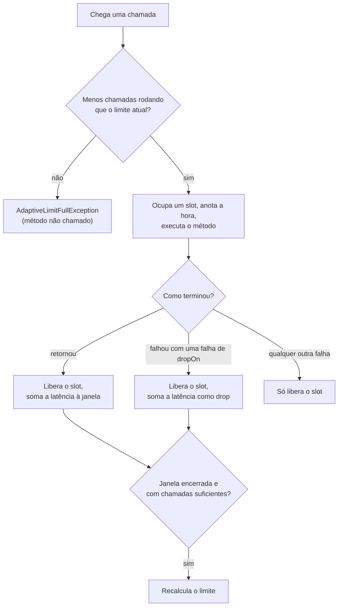

# Adaptive limit

`@AdaptiveLimit` limita quantas chamadas rodam ao mesmo tempo, como um bulkhead, mas encontra o limite sozinho: aumenta-o enquanto a latência da dependência se mantém e o reduz quando a latência sobe ou as chamadas dão timeout.

<div class="r4c-facts">

| Anotação | Posição | Tipos de retorno | Padrões |
|---|---|---|---|
| `@AdaptiveLimit` | camada 5 de 7, dentro do RateLimiter | sync, `CompletionStage`, `Mono`, `Flux` | Gradient2, começa em 20, mantido entre 1 e 200, janelas de pelo menos 1 s e 10 chamadas |

</div>

**Use quando** a capacidade de uma dependência é desconhecida ou muda (ela é compartilhada, escala sozinha, a carga dela depende de outros clientes), de modo que qualquer `@Bulkhead(maxConcurrent = …)` fixo seria baixo demais num dia bom ou alto demais num dia ruim. O limite se acomoda perto da concorrência que a dependência consegue atender sem enfileirar, e cai quando ela começa a enfileirar: as chamadas em excesso são rejeitadas na hora em vez de se acumularem atrás das lentas.

**Não use quando** você sabe o número certo (um pool de 10 conexões, uma licença para 4 sessões): um [bulkhead](bulkhead.md) é mais simples e previsível. Se o que você precisa é de chamadas por segundo, use um [rate limiter](rate-limiter.md).

## Exemplo mínimo :id=minimal-example

<!-- compare:start -->
<!-- snippet: adaptive-limit-minimal -->
```java
import dev.resilience4cata.annotation.AdaptiveLimit;

public interface SearchClient {

    @AdaptiveLimit
    String search(String query);
}
```
<!-- not-compiled: código gerado, resumido -->
```java
public final class SearchClient$Resilient implements SearchClient {
    // …
    public SearchClient$Resilient(SearchClient delegate, dev.resilience4cata.ResilienceRegistry registry) {
        // …
        this.adaptiveLimit0 = dev.resilience4cata.generated.Policies.adaptiveLimit(registry, "dev.resilience4cata.examples.docs.adaptivelimit.SearchClient#search(java.lang.String)", "", "", null, false);
    }

    @Override
    public java.lang.String search(java.lang.String p0) {
        final dev.resilience4cata.generated.AdaptiveLimitPolicy r4c$adaptiveLimit = this.adaptiveLimit0;
        final long r4c$start = r4c$adaptiveLimit.acquire();
        final java.lang.String r4c$result;
        try {
            r4c$result = this.delegate.search(p0);
        } catch (java.lang.Throwable r4c$e) {
            r4c$adaptiveLimit.onFailure(r4c$start, r4c$e);
            throw r4c$e;
        }
        r4c$adaptiveLimit.onSuccess(r4c$start);
        return r4c$result;
    }
}
```
<!-- compare:end -->

Resumido: o arquivo real usa nomes totalmente qualificados.

## Como se comporta :id=how-it-behaves



- **Slots.** Uma chamada ocupa um slot antes de rodar e o devolve quando retorna ou lança. No máximo *o limite atual* de chamadas ocupa um slot ao mesmo tempo. O limite começa em `initialLimit` e fica sempre entre `minLimit` e `maxLimit`.
- **Rejeição.** Uma chamada que encontra todos os slots ocupados falha na hora com `dev.resilience4cata.AdaptiveLimitFullException` (uma `RuntimeException` com `id()`; uma por instância, sem stack trace). O método não é chamado. Não há espera: um limite cheio sempre rejeita.
- **Amostras.** Cada chamada que retorna é uma *amostra*: a sua latência, de quando ocupou o slot até o fim da chamada. Uma falha listada em `dropOn` também é amostra, marcada como *drop*: a dependência está sobrecarregada. Qualquer outra falha (um 404, um erro de validação) libera o slot e não diz nada sobre a carga, então não é amostra.
- **Janelas.** As amostras são agrupadas em janelas de pelo menos `window` (1 s) e pelo menos `minWindowSamples` chamadas (10). Quando uma chamada termina depois que a janela acabou e a janela tem amostras suficientes, a thread dessa chamada recalcula o limite a partir da latência média da janela, do máximo de chamadas em voo que ela viu e de se alguma chamada teve drop. Uma janela que acabou com poucas chamadas é estendida por mais um `window` e mantém as amostras: elas contam quando ela terminar. Assim, com pouco tráfego o limite se move devagar (e é verificado uma vez por janela, não a cada chamada), e sem tráfego ele não se move.
- **Limite menor, chamadas em voo.** Quando o limite cai abaixo das chamadas que já estão rodando, nada é interrompido: novas chamadas são rejeitadas até que terminem chamadas suficientes.
- **Desativado** (`enabled = false`): toda chamada passa e nada é medido.

## Os algoritmos :id=the-algorithms

Os dois seguem a biblioteca [concurrency-limits](https://github.com/Netflix/concurrency-limits) da Netflix (`Gradient2Limit` e `AIMDLimit`, versão 0.5.4), aplicados uma vez por janela.

**`GRADIENT2`** (o padrão) compara a latência da janela com uma média de longo prazo da latência, uma média exponencial sobre `longWindow` janelas (600). Enquanto a latência da janela fica dentro de `rttTolerance` vezes a média de longo prazo (1.5×), o limite cresce um pouco a cada janela, um quinto (`smoothing`) de `queueSize` (4): cerca de 0.8 por janela. Quando a latência sobe além disso, o limite encolhe na mesma proporção, no máximo pela metade de cada vez. Ele não cresce enquanto menos da metade dos seus slots está em uso, já que nesse caso a latência não diz nada sobre o limite. Depois de uma sobrecarga longa, a média de longo prazo desce mais rápido quando a latência volta ao normal, e o limite se recupera. Ele aprende um novo normal: uma latência que fica alta por muitas janelas vira a média de longo prazo, e o limite volta a crescer a partir daí.

**`AIMD`** (aumento aditivo, redução multiplicativa) ignora a latência. Depois de uma janela com drop, o limite é multiplicado por `backoffRatio` (0.9); depois de uma janela sem drop em que pelo menos metade dos slots estava em uso, ele cresce em um. Use-o quando a latência é ruidosa demais para significar algo, ou quando o seu sinal de sobrecarga é um timeout ou um bulkhead cheio mais abaixo.

<!-- snippet: adaptive-limit-aimd -->
```java
@AdaptiveLimit(name = "orders-aimd", algorithm = LimitAlgorithm.AIMD, initialLimit = 10,
        dropOn = {java.net.SocketTimeoutException.class, dev.resilience4cata.CallTimeoutException.class})
String cancel(String order);
```

## Atributos :id=attributes

| Atributo | Tipo | Padrão | Chave de config | Significado |
|---|---|---|---|---|
| `algorithm` | `LimitAlgorithm` | `GRADIENT2` | `defaults.adaptiveLimit.algorithm` | `GRADIENT2` ou `AIMD`, acima. `INHERIT` significa não definido. |
| `initialLimit` | `int` | `20` | `defaults.adaptiveLimit.initialLimit` | O limite antes de a primeira janela terminar. |
| `minLimit` | `int` | `1` | `defaults.adaptiveLimit.minLimit` | O menor valor que o limite atinge. Pelo menos 1. |
| `maxLimit` | `int` | `200` | `defaults.adaptiveLimit.maxLimit` | O maior valor que o limite atinge. |
| `window` | duração | `1s` | `defaults.adaptiveLimit.window` | Quanto dura uma janela no mínimo, de `10ms` a `1h`. |
| `dropOn` | classes de exceção | `CallTimeoutException`, `BulkheadFullException`, `TimeoutException` | `defaults.adaptiveLimit.dropOn` | Falhas que indicam que a dependência está sobrecarregada. |
| `ignoreOn` | classes de exceção | nenhuma | `defaults.adaptiveLimit.ignoreOn` | Falhas que nunca são amostras; vencem `dropOn`. |
| `name` | `String` | um limite por método | só na anotação | Id da instância; métodos com o mesmo `name` compartilham um limite e os seus slots. |
| `config` | `String` | `default` | só na anotação | Configuração nomeada da qual partir. |
| `locked` | `boolean` | `false` | só na anotação | Mantém os valores definidos na anotação: as chaves `instances.<id>.*` não podem mudá-los. Veja [Travando uma instância](../guides/configuration.md#locking-an-instance). |
| `enabled` | `boolean` | `true` | `defaults.adaptiveLimit.enabled` | `false` deixa toda chamada passar; não definido herda. |

<!-- snippet: adaptive-limit-tuned -->
```java
@AdaptiveLimit(name = "orders", initialLimit = 10, maxLimit = 100, window = "500ms")
@Timeout("2s") // inside the limit: a timeout is a drop, and the limit backs off
String place(String order);
```

O ajuste fino dos algoritmos não tem atributo na anotação, para mantê-la pequena: `minWindowSamples` (10), `smoothing` (0.2), `rttTolerance` (1.5), `longWindow` (600) e `queueSize` (4) do Gradient2, e `backoffRatio` (0.9) do AIMD. Defina-os em uma configuração nomeada:

<!-- snippet: adaptive-limit-registry -->
```java
ResilienceRegistry registry = ResilienceRegistry.builder()
        .adaptiveLimit("backend", a -> a.algorithm(AdaptiveLimitConfig.Algorithm.AIMD)
                .backoffRatio(0.8)
                .minWindowSamples(20))
        .build();
```

ou em configuração externa, com `@AdaptiveLimit(config = "backend")` nos métodos:

<!-- snippet: adaptive-limit-properties -->
```properties
defaults.adaptiveLimit.maxLimit=100
configs.backend.adaptiveLimit.algorithm=aimd
configs.backend.adaptiveLimit.backoffRatio=0.8
configs.backend.adaptiveLimit.minWindowSamples=20
instances.orders.adaptiveLimit.rttTolerance=2
```

Todas as chaves, com os seus valores válidos, estão na [referência de configuração](../reference/configuration.md#adaptive-limit).

## Em uma classe :id=on-a-class

Em uma classe anotada, no nível do tipo ou nos métodos, a subclasse gerada aplica o limite ([classes anotadas](../guides/annotated-classes.md)):

<!-- snippet: adaptive-limit-class -->
```java
@AdaptiveLimit(maxLimit = 50)
public class InventoryService {

    public int stock(String sku) {
        return 7;
    }
}
```

## Compartilhamento e ids de instância :id=sharing-and-instance-ids

Sem `name`, cada método tem o próprio limite, com o id `<type>#<method>(<parameter types>)`. Métodos que chamam a mesma dependência normalmente devem compartilhar um: dê a eles o mesmo `name`. Eles precisam resolver para a mesma configuração, ou o wrapping falha com [`R4C-REG-008`](../errors.md#r4c-reg-008).

### Handle

`registry.adaptiveLimit(id)` retorna um `AdaptiveLimitHandle`:

<!-- snippet: adaptive-limit-handle -->
```java
AdaptiveLimitHandle limit = registry.adaptiveLimit("orders");
int current = limit.limit();                   // how many calls may run at once now
int running = limit.concurrentCalls();                // calls inside right now
AdaptiveLimitSnapshot snapshot = limit.snapshot(); // limit, concurrentCalls, bounds, windows, latencies
```

| Método | O que faz |
|---|---|
| `id()` | O `name`, ou o id derivado |
| `config()` | O `AdaptiveLimitConfig` resolvido |
| `limit()` | O limite atual |
| `concurrentCalls()` | Chamadas ocupando um slot neste momento |
| `snapshot()` | Um `AdaptiveLimitSnapshot(id, algorithm, limit, concurrentCalls, minLimit, maxLimit, windows, windowLatency, longTermLatency)`, mais `availableSlots()`. `windowLatency` é a média da última janela; `longTermLatency` é a média de longo prazo do Gradient2 (zero com AIMD) |

O limite existe assim que a sua interface foi envolvida ou o seu pipeline construído; um id desconhecido lança [`R4C-REG-009`](../errors.md#r4c-reg-009). Liste-os com `registry.snapshot().adaptiveLimits()`.

## Com outras políticas :id=with-other-policies

O adaptive limit fica dentro do rate limiter e fora do timeout e do bulkhead:

- **Um `@Timeout` dentro é o sinal de sobrecarga.** Uma chamada que dá timeout falha com `CallTimeoutException`, que está em `dropOn` por padrão: a latência dessa chamada (o timeout) entra na janela, e o AIMD recua. O mesmo vale para um `@Bulkhead` cheio dentro (`BulkheadFullException`).
- **As políticas externas veem `AdaptiveLimitFullException`.** É uma `Exception`: por padrão, um `@Retry` externo a repete após o seu delay (adicione-a a `abortOn` para falhar rápido), mas um `@CircuitBreaker` externo nunca a registra: um limite cheio não pode abrir o breaker. Um `@Hedge` para de iniciar tentativas quando uma é rejeitada pelo limite, como acontece com um breaker aberto ou um bulkhead cheio.
- **Cada tentativa é medida por si só**: o delay de um retry fica fora do limite e não ocupa slot.
- **Chamadas rejeitadas já gastaram uma permissão do rate limiter**, já que o rate limiter fica fora.

## Async

Para um método que retorna `CompletionStage<T>` ou `CompletableFuture<T>`, a chamada ocupa o slot até o seu stage completar, e a latência é medida até essa conclusão:

<!-- snippet: adaptive-limit-async -->
```java
@AdaptiveLimit(name = "orders-async", initialLimit = 2)
CompletableFuture<String> placeAsync(String order);
```

Um limite cheio retorna na hora um future com falha. Cancelar o future retornado cancela o stage e libera o slot sem amostra: uma chamada cancelada não diz nada sobre a dependência ([cancelamento](../guides/async.md#cancellation)). Veja [Métodos async](../guides/async.md).

## O mesmo com `Pipeline` :id=same-thing-with-pipeline

<!-- snippet: adaptive-limit-pipeline -->
```java
Pipeline<String> search = Pipeline.builder(registry, "search", String.class)
        .adaptiveLimit(a -> a.maxLimit(100))
        .timeout(t -> t.timeout(Duration.ofSeconds(2)))
        .build();

String results = search.execute(() -> backend.search("java"));
```

O id `"search"` é o id da instância: `registry.adaptiveLimit("search")` o retorna. Veja [API Pipeline](../guides/pipeline.md).

## Eventos, snapshot e métricas :id=events-snapshot-and-metrics

| Evento | Quando | Campos |
|---|---|---|
| `AdaptiveLimitEvent.Rejected` | Uma chamada foi rejeitada: o limite estava cheio | `id`, `nanoTime`, `limit` |
| `AdaptiveLimitEvent.LimitChanged` | Uma janela terminou e o limite mudou | `id`, `nanoTime`, `from`, `to`, `windowLatency` |

Chamadas admitidas não publicam nada, e uma janela que mantém o limite não publica nada. Os módulos de métricas reportam as rejeições em `r4c.calls.rejected` com `kind = adaptivelimit`, as mudanças em `r4c.adaptivelimit.limit.changes`, e os gauges `r4c.adaptivelimit.limit` e `r4c.adaptivelimit.concurrent.calls`. Veja [Observabilidade](../guides/observability.md#metric-names).

## Testando com `ManualClock` :id=testing-it-with-manualclock

Em um [`ManualClock`](../guides/testing.md), as latências são o que o relógio diz e as janelas terminam quando o relógio passa por elas, então o limite se move do mesmo jeito em toda execução. Stages pendentes seguram os seus slots, o que torna fácil encher um limite async:

<!-- snippet: adaptive-limit-testing -->
```java
ManualClock clock = new ManualClock();
ResilienceRegistry registry = ResilienceTesting.registry(clock)
        .adaptiveLimitDefaults(a -> a.minWindowSamples(1))   // end a window after a single call
        .build();
OrderClient orders = Resilient.of(OrderClient.class, backend, registry);
AdaptiveLimitHandle limit = registry.adaptiveLimit("orders-async");

CompletableFuture<String> a = orders.placeAsync("a");          // pending: holds a slot
CompletableFuture<String> b = orders.placeAsync("b");          // pending: holds the other
assertThat(orders.placeAsync("c")).failsWithin(Duration.ZERO)  // full: rejected at once
        .withThrowableThat().withCauseInstanceOf(AdaptiveLimitFullException.class);

clock.advance(Duration.ofSeconds(1));                          // the calls took 1 s; the window is over
pending.get("a").complete("placed a");                         // ends the window
pending.get("b").complete("placed b");
assertThat(limit.snapshot().windows()).isEqualTo(1);
assertThat(limit.snapshot().windowLatency()).isEqualTo(Duration.ofSeconds(1));
```

O adaptive limit não agenda nada, então nunca deixa tarefas pendentes no relógio.

## Letras miúdas :id=small-print

- **Só fail-fast.** Um limite cheio rejeita na hora; ainda não há `maxWait`. Coloque um `@Retry` por fora se quem chama deve tentar de novo um pouco depois.
- **A latência média da janela é aproximada sob contenção.** As amostras vão para stripes por thread com escritas com perda, então uma corrida pode descartar a latência de uma chamada mas manter a contagem dela (ou o contrário) e distorcer um pouco a média dessa janela; a suavização do limite amortece isso. Um stripe que uma corrida faz voltar abaixo do que já foi usado faz a janela ser descartada, não lida como 1 ns.
- **Ainda sem `VEGAS`.** O terceiro algoritmo da Netflix não está implementado; `LimitAlgorithm` deixa espaço para ele.
- **Duas leituras do relógio por chamada**, quando a chamada ocupa o slot e quando termina, pelo ticker do registry. Esse é o custo de medir a latência; um `@CircuitBreaker` com `slowCallDuration` lê o relógio para a própria medição.
- **O Gradient2 não desce muito abaixo de duas vezes `queueSize`** (8 por padrão) só pela latência: com o gradiente no piso de metade, cada janela leva o limite a 0.9 × limite + 0.2 × `queueSize`. Para limites pequenos, defina um `queueSize` menor ou use `AIMD`.
- **Amostras podem se perder**, nunca ser inventadas: as chamadas registram a latência em stripes por thread sem instruções atômicas, então duas threads que compartilham um stripe e disputam podem perder uma amostra. A janela fica então com uma amostra a menos.
- **Diferenças em relação à biblioteca da Netflix**: `minLimit` tem 1 como padrão (lá é 20), para que o `AIMD` possa descer tanto quanto a dependência precisar (o piso prático do Gradient2 vem de `queueSize`, acima); uma janela com poucas chamadas é estendida, mantendo as amostras, em vez de ser descartada; chamadas mais rápidas que 100 µs também são amostras; o AIMD não tem um limiar de latência que conte como drop (use um `@Timeout` dentro, cuja `CallTimeoutException` está em `dropOn`).
- O limite é por JVM e por registry.
- Erros relacionados: [`R4C-ATR-001`](../errors.md#r4c-atr-001) (sintaxe de duração), [`R4C-ATR-003`](../errors.md#r4c-atr-003) (um limite abaixo de 1), [`R4C-ATR-009`](../errors.md#r4c-atr-009) (limites fora de ordem, `window` fora do intervalo), [`R4C-REG-001`](../errors.md#r4c-reg-001) (ajuste inválido no código), [`R4C-REG-004`](../errors.md#r4c-reg-004) (`config` desconhecida), [`R4C-REG-008`](../errors.md#r4c-reg-008) (`name` compartilhado, config diferente), [`R4C-REG-009`](../errors.md#r4c-reg-009) (id desconhecido).

## Quanto custa :id=what-it-costs

> [!MEASURED]
> AWS `c7g.xlarge` (Graviton3): uma chamada custa 86 ns em uma thread e 380 ns com quatro, e não aloca nada; uma rejeição custa 2.1 ns. O `SimpleLimiter` da Netflix com um `Gradient2Limit` em janelas custa 118 ns e 1087 ns, e aloca 40–95 B por chamada. Um `@Bulkhead` fixo custa 20.5 ns em uma thread: a diferença são as duas leituras de `System.nanoTime()` (cerca de 33 ns cada nessa máquina) que medir toda chamada exige. De [Adaptive limit, 0.6.0](../benchmarks.md#adaptive-limit-060-2026-10-26-aws-graviton3).
