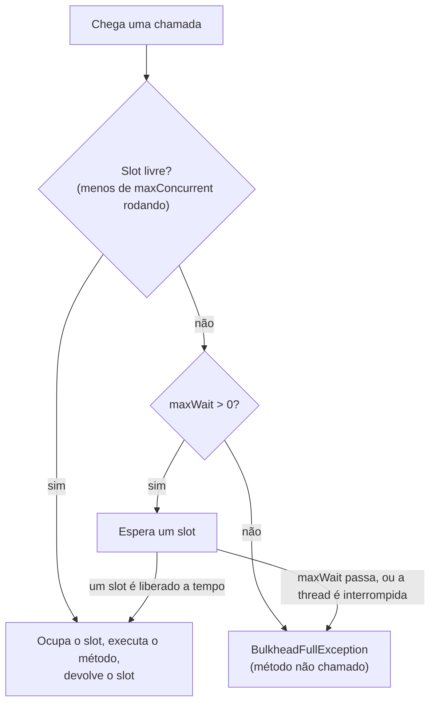

# Bulkhead

`@Bulkhead` limita quantas chamadas rodam ao mesmo tempo, para que uma dependência lenta não tome todas as threads, conexões ou slots que o seu serviço tem.

<div class="r4c-facts">

| Anotação | Posição | Tipos de retorno | Padrões |
|---|---|---|---|
| `@Bulkhead` | camada 7 de 7, a mais interna, em volta do método | sync, `CompletionStage`, `Mono`, `Flux` | 25 chamadas concorrentes, sem espera |

</div>

**Use quando** uma dependência tem capacidade limitada (um pool de conexões, uma licença, um renderizador que consome muita CPU), ou quando você quer que a lentidão de uma dependência fique contida em vez de consumir tudo.

**Não use quando** o limite de que você precisa é uma *taxa* (chamadas por segundo): isso é um [rate limiter](rate-limiter.md). Um bulkhead conta chamadas em andamento, não chamadas por período.

## Exemplo mínimo :id=minimal-example

<!-- compare:start -->
<!-- snippet: bulkhead-minimal -->
```java
import dev.resilience4cata.annotation.Bulkhead;

public interface ReportRenderer {

    @Bulkhead(maxConcurrent = 10)
    String render(String reportId);
}
```
<!-- not-compiled: código gerado, resumido -->
```java
public final class ReportRenderer$Resilient implements ReportRenderer {
    // …
    public ReportRenderer$Resilient(ReportRenderer delegate, dev.resilience4cata.ResilienceRegistry registry) {
        // …
        this.bulkhead0 = dev.resilience4cata.generated.Policies.bulkhead(registry, "dev.resilience4cata.examples.docs.bulkhead.ReportRenderer#render(java.lang.String)", "", "", r4c$b -> {
            r4c$b.maxConcurrent(10);
        }, false);
    }

    @Override
    public java.lang.String render(java.lang.String p0) {
        final dev.resilience4cata.generated.BulkheadPolicy r4c$bulkhead = this.bulkhead0;
        if (!r4c$bulkhead.tryEnter()) {
            throw r4c$bulkhead.rejection();
        }
        try {
            return this.delegate.render(p0);
        } finally {
            r4c$bulkhead.exit();
        }
    }
}
```
<!-- compare:end -->

Resumido: o arquivo real usa nomes totalmente qualificados.

## Como se comporta :id=how-it-behaves



- **Slots.** Uma chamada ocupa um slot antes de rodar e o devolve quando retorna ou lança. No máximo `maxConcurrent` chamadas ocupam um slot ao mesmo tempo.
- **Rejeição.** Com `maxWait = "0"` (o padrão), uma chamada que encontra o bulkhead cheio falha na hora com `dev.resilience4cata.BulkheadFullException` (uma `RuntimeException` com `id()`; uma por bulkhead, sem stack trace). O método não é chamado.
- **Espera, sync.** Com `maxWait` > 0, a thread que chama bloqueia até um slot ficar livre ou `maxWait` passar. Em uma virtual thread, bloquear é barato e não prende uma carrier. Se a thread que espera for interrompida, a chamada é rejeitada e a flag de interrupção é marcada de novo. A espera não é por ordem de chegada: um chamador novo pode pegar um slot liberado antes de um que está esperando.
- **Este é um bulkhead de semáforo**: a chamada roda na thread de quem chama. Não há bulkhead de thread pool; com virtual threads você raramente precisa de um.
- **Desativado** (`enabled = false`): toda chamada passa.

## Atributos :id=attributes

| Atributo | Tipo | Padrão | Chave de config | Significado |
|---|---|---|---|---|
| `maxConcurrent` | `int` | `25` | `defaults.bulkhead.maxConcurrent` | Chamadas que podem rodar ao mesmo tempo. Pelo menos 1. |
| `maxWait` | duração | `0` (rejeita na hora) | `defaults.bulkhead.maxWait` | Quanto tempo uma chamada pode esperar por um slot livre. |
| `name` | `String` | um bulkhead por método | só na anotação | Id da instância; métodos com o mesmo `name` compartilham um bulkhead e os seus slots. |
| `config` | `String` | `default` | só na anotação | Configuração nomeada da qual partir. |
| `locked` | `boolean` | `false` | só na anotação | Mantém os valores definidos na anotação: as chaves `instances.<id>.*` não podem mudá-los. Veja [Travando uma instância](../guides/configuration.md#locking-an-instance). |
| `enabled` | `boolean` | `true` | `defaults.bulkhead.enabled` | `false` deixa toda chamada passar; não definido herda. |

Os padrões são os do Resilience4j. As chaves também existem em `configs.<name>.` e `instances.<id>.`; veja [Configuração](../guides/configuration.md).

Chamadores que podem esperar um pouco por um slot:

<!-- snippet: bulkhead-wait -->
```java
@Bulkhead(name = "thumbnails", maxConcurrent = 4, maxWait = "250ms")
byte[] thumbnail(String imageId);
```

## Compartilhamento e ids de instância :id=sharing-and-instance-ids

Sem `name`, cada método tem o próprio bulkhead, com o id `<type>#<method>(<parameter types>)`. Para proteger um recurso usado por vários métodos (um pool de conexões por trás de um cliente inteiro), dê a eles o mesmo `name`: eles passam a compartilhar os mesmos `maxConcurrent` slots. Eles precisam resolver para a mesma configuração, ou o wrapping falha com [`R4C-REG-008`](../errors.md#r4c-reg-008).

### Handle

`registry.bulkhead(id)` retorna um `BulkheadHandle`:

<!-- snippet: bulkhead-handle -->
```java
BulkheadHandle bulkhead = registry.bulkhead("thumbnails");
int running = bulkhead.concurrentCalls();        // calls inside right now
int waiting = bulkhead.waitingCalls();           // calls waiting for a slot (0 when maxWait = 0)
BulkheadSnapshot snapshot = bulkhead.snapshot(); // instance, concurrentCalls, waitingCalls, maxConcurrent
```

| Método | O que faz |
|---|---|
| `id()` | O `name`, ou o id derivado |
| `config()` | O `BulkheadConfig` resolvido |
| `concurrentCalls()` | Chamadas ocupando um slot neste momento |
| `waitingCalls()` | Chamadas esperando um slot neste momento: chamadas async na fila por um slot liberado mais threads sync bloqueadas no bulkhead. Sempre 0 quando `maxWait` é 0. Uma foto para monitoramento; pode estar desatualizada quando for lida |
| `snapshot()` | Um `BulkheadSnapshot(id, concurrentCalls, waitingCalls, maxConcurrent)`, mais `availableSlots()` |

O bulkhead existe assim que a sua interface foi envolvida ou o seu pipeline construído; um id desconhecido lança [`R4C-REG-009`](../errors.md#r4c-reg-009). Não existe `registry.bulkheads()`: liste-os com `registry.snapshot().bulkheads()`.

## Com outras políticas :id=with-other-policies

O bulkhead é a camada mais interna, logo em volta do seu método:

- Um slot fica ocupado só enquanto o método roda. Durante o delay de um `@Retry`, o slot fica livre para outros chamadores.
- `BulkheadFullException` é uma `Exception`: por padrão, um `@Retry` externo a repete após o seu delay (adicione-a a `abortOn` para falhar rápido), mas um `@CircuitBreaker` externo nunca a registra: um bulkhead cheio é a carga da própria aplicação, não uma falha da dependência, então não pode abrir o breaker.
- O tempo gasto esperando um slot conta para o `@Timeout`, que fica fora: uma espera sync interrompida pelo timeout termina com `CallTimeoutException`.
- Chamadas rejeitadas já gastaram uma permissão do rate limiter, já que o rate limiter fica fora.

## Async

Para um método que retorna `CompletionStage<T>` ou `CompletableFuture<T>`, a chamada ocupa o slot até o seu stage completar, não só até o método retornar:

<!-- snippet: bulkhead-async -->
```java
@Bulkhead(name = "thumbnails-async", maxConcurrent = 2, maxWait = "1s")
CompletableFuture<byte[]> thumbnailAsync(String imageId);
```

Uma chamada async nunca bloqueia uma thread enquanto espera: um bulkhead cheio com `maxWait` > 0 enfileira a chamada, e o waiter mais antigo recebe diretamente o próximo slot liberado e então começa em uma nova virtual thread. Se `maxWait` passar antes, o seu future falha com `BulkheadFullException`. Sem `maxWait`, um bulkhead cheio retorna na hora um future com falha. Chamadores sync e async de um bulkhead compartilhado usam os mesmos slots. Cancelar o future retornado cancela o stage e libera o slot na hora (quando o stage é um `Future`); uma chamada ainda na fila sai da fila e nunca começa ([cancelamento](../guides/async.md#cancellation)). Veja [Métodos async](../guides/async.md).

## O mesmo com `Pipeline` :id=same-thing-with-pipeline

<!-- snippet: bulkhead-pipeline -->
```java
Pipeline<String> render = Pipeline.builder(registry, "renderer", String.class)
        .bulkhead(b -> b.maxConcurrent(10))
        .build();

String report = render.execute(() -> backend.render("r-1"));
```

O id `"renderer"` é o id da instância: `registry.bulkhead("renderer")` o retorna. Veja [API Pipeline](../guides/pipeline.md).

## Eventos e snapshot :id=events-and-snapshot

| Evento | Quando | Campos |
|---|---|---|
| `BulkheadEvent.Rejected` | Uma chamada foi rejeitada (cheio sem espera, `maxWait` passou, ou uma espera interrompida) | `id`, `nanoTime`, `maxConcurrent` |

Chamadas admitidas não publicam nada. Veja [Observabilidade](../guides/observability.md).

## Testando com `ManualClock` :id=testing-it-with-manualclock

Stages pendentes seguram os seus slots, o que torna fácil encher um bulkhead async em um teste:

<!-- snippet: bulkhead-testing -->
```java
ThumbnailService thumbnails = Resilient.of(ThumbnailService.class, backend, registry);
BulkheadHandle bulkhead = registry.bulkhead("thumbnails-async");

CompletableFuture<byte[]> a = thumbnails.thumbnailAsync("a");   // pending: holds a slot
CompletableFuture<byte[]> b = thumbnails.thumbnailAsync("b");   // pending: holds the other
CompletableFuture<byte[]> c = thumbnails.thumbnailAsync("c");   // full: waits up to 1 s
assertThat(bulkhead.concurrentCalls()).isEqualTo(2);
assertThat(bulkhead.waitingCalls()).isEqualTo(1);

clock.advance(Duration.ofSeconds(1));                          // nothing was released in time
assertThat(c).failsWithin(Duration.ofSeconds(5))
        .withThrowableThat().withCauseInstanceOf(BulkheadFullException.class);
```

Em um [`ManualClock`](../guides/testing.md), `maxWait` é medido no relógio, para esperas async e sync: um chamador sync bloqueado recebe um slot assim que um é liberado e é rejeitado quando o relógio passa de `maxWait`, não importa quanto isso leve em tempo real. Ele espera enquanto o relógio não se mover.

## Letras miúdas :id=small-print

- O limite é por JVM e por registry.
- `waitingCalls()` serve só para monitoramento; não tome decisões com ele no caminho da chamada.
- Quando chamadores sync e async esperam no mesmo bulkhead, os slots liberados se alternam, aproximadamente, entre o waiter async mais antigo e as threads bloqueadas.
- Erros relacionados: [`R4C-ATR-001`](../errors.md#r4c-atr-001) (sintaxe de duração), [`R4C-ATR-003`](../errors.md#r4c-atr-003) (`maxConcurrent` abaixo de 1), [`R4C-ATR-006`](../errors.md#r4c-atr-006) (`enabled`), [`R4C-REG-004`](../errors.md#r4c-reg-004) (`config` desconhecida), [`R4C-REG-008`](../errors.md#r4c-reg-008) (`name` compartilhado, config diferente), [`R4C-REG-009`](../errors.md#r4c-reg-009) (id desconhecido).

## Quanto custa :id=what-it-costs

> [!MEASURED]
> No AWS Graviton3 (`c7g.xlarge`, JDK 21), uma chamada por um bulkhead com slot livre custa 20.5 ns em 1 thread, empate com o Resilience4j 2.4.0 (20.4 ns), e 264 ns com 4 threads compartilhando-o, contra 432 ns; nenhum dos dois aloca. Uma chamada rejeitada custa 2.3 ns e 0 B, contra 139 ns e 416 B. [Benchmarks: conclusão do MVP](../benchmarks.md#mvp-completion-classifier-pipeline-events-testkit-2026-10-24-aws-graviton3)
