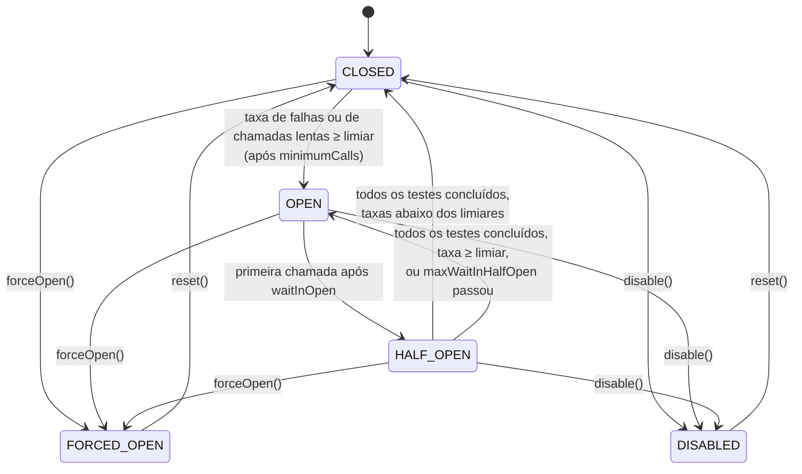

# Circuit breaker

`@CircuitBreaker` para de chamar uma dependência que continua falhando e, mais tarde, deixa passar algumas chamadas de teste para ver se ela se recuperou.

<div class="r4c-facts">

| Anotação | Posição | Tipos de retorno | Padrões |
|---|---|---|---|
| `@CircuitBreaker` | camada 3 de 7, dentro do Retry | sync, `CompletionStage`, `Mono`, `Flux` | janela de 100 chamadas, abre com 50% de falhas após 100 chamadas, 60 s aberto, 10 testes, detecção de chamadas lentas desligada |

</div>

**Use quando** uma dependência pode ficar fora do ar ou sobrecarregada por um tempo, e falhar rápido é melhor do que acumular chamadas, threads e retries esperando por ela.

**Não use quando** as falhas são independentes umas das outras (uma entrada ruim não prevê a próxima chamada), ou quando não há nada útil a fazer enquanto ele está aberto. Um breaker em chamadas raras (algumas por hora) nunca vê chamadas suficientes para decidir; reduza `minimumCalls` ou use uma [janela de tempo](#attributes).

## Exemplo mínimo :id=minimal-example

<!-- compare:start -->
<!-- snippet: circuit-breaker-minimal -->
```java
import dev.resilience4cata.annotation.CircuitBreaker;

public interface PaymentGateway {

    @CircuitBreaker(name = "payments", windowSize = 10, minimumCalls = 10, failureRateThreshold = 50,
            waitInOpen = "30s", halfOpenCalls = 2)
    String charge(String orderId);
}
```
<!-- not-compiled: código gerado, resumido -->
```java
public final class PaymentGateway$Resilient implements PaymentGateway {
    // …
    public PaymentGateway$Resilient(PaymentGateway delegate, dev.resilience4cata.ResilienceRegistry registry) {
        // …
        this.circuitBreaker0 = dev.resilience4cata.generated.Policies.circuitBreaker(registry, "dev.resilience4cata.examples.docs.circuitbreaker.PaymentGateway#charge(java.lang.String)", "payments", "", r4c$b -> {
            r4c$b.windowSize(10);
            r4c$b.minimumCalls(10);
            r4c$b.failureRateThreshold(50.0);
            r4c$b.waitInOpen(java.time.Duration.ofNanos(30000000000L));
            r4c$b.halfOpenCalls(2);
        }, false);
    }

    @Override
    public java.lang.String charge(java.lang.String p0) {
        final dev.resilience4cata.generated.CircuitBreakerPolicy r4c$cb = this.circuitBreaker0;
        final long r4c$token = r4c$cb.acquire();
        if (r4c$token < 0) {
            throw r4c$cb.rejection();
        }
        final long r4c$started = r4c$cb.startTimer();
        try {
            final java.lang.String r4c$result = this.delegate.charge(p0);
            r4c$cb.onSuccess(r4c$token, r4c$started);
            return r4c$result;
        } catch (java.lang.Throwable r4c$e) {
            r4c$cb.onFailure(r4c$token, r4c$started, r4c$e);
            throw r4c$e;
        }
    }
}
```
<!-- compare:end -->

Resumido: o arquivo real usa nomes totalmente qualificados.

Este breaker olha para as últimas 10 chamadas. Depois de ter visto 10, ele abre quando 50% ou mais delas falharam, rejeita toda chamada por 30 s e então deixa passar 2 chamadas de teste: se menos de 50% delas falharem ele fecha, senão abre de novo.

## Como se comporta :id=how-it-behaves



- **Fechado.** As chamadas passam e seus resultados entram em uma janela deslizante. Com `COUNT` (o padrão) a janela guarda as últimas `windowSize` chamadas; com `TIME` guarda as chamadas do último `windowDuration`, em buckets de um segundo.
- **O que conta como falha.** Um throwable que é instância de um tipo de `recordOn` (padrão: `Throwable`, então `Error`s incluídos, como no Resilience4j) e de nenhum tipo de `ignoreOn`. `ignoreOn` vence: essas chamadas não contam para nenhum lado. Qualquer outro throwable conta como **sucesso**: com `recordOn = IOException.class`, uma `IllegalArgumentException` não abre o breaker. Uma rejeição de um limite local (`BulkheadFullException`, `RateLimitExceededException`, `AdaptiveLimitFullException`) nunca é registrada, digam o que disserem `recordOn`, `ignoreOn` ou um classifier (veja [Com outras políticas](#with-other-policies)). Com a detecção de chamadas lentas ligada (`slowCallDuration` > 0), uma chamada que leva `slowCallDuration` ou mais também conta como lenta, tenha ela tido sucesso ou falhado.
- **Abertura.** As taxas são avaliadas assim que a janela tem `minimumCalls` chamadas (numa janela por contagem, `minimumCalls` é limitado a `windowSize`). O breaker abre quando a taxa de falhas está em `failureRateThreshold` ou acima, ou a taxa de chamadas lentas em `slowCallRateThreshold` ou acima.
- **Aberto.** Toda chamada é rejeitada na hora com `CallNotPermittedException`, sem chegar ao método. O breaker não muda de estado sozinho: a primeira chamada que chega após `waitInOpen` o leva a semiaberto e vira um teste.
- **Semiaberto.** `halfOpenCalls` chamadas de teste passam; as demais são rejeitadas até os testes terminarem. Quando o último teste termina, os mesmos limiares são aplicados aos testes: abaixo deles o breaker fecha com uma janela vazia, senão abre de novo. Se `maxWaitInHalfOpen` está definido e os testes não terminaram todos nesse tempo, a próxima chamada o abre de novo. Um teste ignorado (uma exceção de `ignoreOn`, ou `IGNORE` de um classifier) devolve a sua permissão.
- **Forçado aberto e desativado** são definidos à mão, pelo [handle](#handle): `forceOpen()` rejeita tudo, `disable()` deixa tudo passar e não registra nada, ambos até `reset()`. `enabled = false` inicia o breaker em `DISABLED`, e `reset()` então volta para `DISABLED`.
- O resultado de uma chamada é descartado se o breaker mudou de estado enquanto ela rodava, então uma chamada lenta que começou com ele fechado não pode decidir um teste em semiaberto.

A rejeição, `dev.resilience4cata.CallNotPermittedException`, é uma `RuntimeException` com `id()`. Ela é criada uma vez por breaker e não tem stack trace, então uma rejeição não custa nada; a mensagem dela dá o nome do breaker.

## Atributos :id=attributes

| Atributo | Tipo | Padrão | Chave de config | Significado |
|---|---|---|---|---|
| `windowType` | `WindowType` | `COUNT` | `defaults.circuitBreaker.windowType` | `COUNT`: as últimas `windowSize` chamadas. `TIME`: as chamadas do último `windowDuration`. |
| `windowSize` | `int` | `100` | `defaults.circuitBreaker.windowSize` | Chamadas em uma janela `COUNT`. Pelo menos 1. |
| `windowDuration` | duração | `60s` | `defaults.circuitBreaker.windowDuration` | Comprimento de uma janela `TIME`, um número inteiro de segundos (pelo menos `1s`). |
| `minimumCalls` | `int` | `100` | `defaults.circuitBreaker.minimumCalls` | Chamadas necessárias antes de as taxas serem avaliadas. Pelo menos 1. |
| `failureRateThreshold` | `double` | `50` | `defaults.circuitBreaker.failureRateThreshold` | Taxa de falhas, em porcentagem (0 < x ≤ 100), que abre o breaker. |
| `slowCallRateThreshold` | `double` | `100` | `defaults.circuitBreaker.slowCallRateThreshold` | Taxa de chamadas lentas, em porcentagem (0 < x ≤ 100), que abre o breaker. |
| `slowCallDuration` | duração | `0` (desligado) | `defaults.circuitBreaker.slowCallDuration` | Duração a partir da qual uma chamada é lenta. `0` desliga a detecção de chamadas lentas: as chamadas nem são cronometradas. |
| `waitInOpen` | duração | `60s` | `defaults.circuitBreaker.waitInOpen` | Quanto tempo o breaker fica aberto antes que a próxima chamada possa testar. |
| `halfOpenCalls` | `int` | `10` | `defaults.circuitBreaker.halfOpenCalls` | Chamadas de teste permitidas em semiaberto. Pelo menos 1. |
| `maxWaitInHalfOpen` | duração | `0` (sem limite) | `defaults.circuitBreaker.maxWaitInHalfOpen` | Tempo máximo em semiaberto antes de abrir de novo se os testes não terminaram. |
| `recordOn` | `Class<? extends Throwable>[]` | `{Throwable.class}` | `defaults.circuitBreaker.recordOn` | Exceções registradas como falhas. Outros throwables contam como sucessos. Rejeições locais nunca são registradas. |
| `ignoreOn` | `Class<? extends Throwable>[]` | `{}` | `defaults.circuitBreaker.ignoreOn` | Exceções que não contam para nenhum lado; vencem `recordOn` e o classifier. |
| `classifier` | `Class<?>` | nenhum | só na anotação | Um `Classifier<T>` que registra resultados e exceções como ele disser. Substitui `recordOn`. Veja [Classifiers](../guides/classifiers.md). |
| `name` | `String` | um breaker por método | só na anotação | Id da instância; métodos com o mesmo `name` compartilham um breaker. |
| `config` | `String` | `default` | só na anotação | Configuração nomeada da qual partir. |
| `locked` | `boolean` | `false` | só na anotação | Mantém os valores definidos na anotação: as chaves `instances.<id>.*` não podem mudá-los. Veja [Travando uma instância](../guides/configuration.md#locking-an-instance). |
| `enabled` | `boolean` | `true` | `defaults.circuitBreaker.enabled` | `false` deixa toda chamada passar (começa em `DISABLED`); não definido herda. |

Os padrões são os do Resilience4j, exceto que a detecção de chamadas lentas fica desligada. As chaves de config também aceitam kebab-case (`circuit-breaker.wait-in-open`) e existem em `configs.<name>.` e `instances.<id>.`; veja [Configuração](../guides/configuration.md).

Um breaker que olha para o último minuto, trata chamadas de 2 s ou mais como lentas e ignora entradas inválidas:

<!-- snippet: circuit-breaker-tuned -->
```java
@CircuitBreaker(windowType = WindowType.TIME, windowDuration = "60s", minimumCalls = 5,
        slowCallDuration = "2s", slowCallRateThreshold = 80,
        ignoreOn = IllegalArgumentException.class)
long balance(String account);
```

Ele abre assim que viu 5 chamadas nos últimos 60 s e 80% ou mais delas foram lentas (ou 50% ou mais falharam). Uma `IllegalArgumentException` é culpa de quem chama, não da dependência, então não é registrada de forma alguma.

## Compartilhamento e ids de instância :id=sharing-and-instance-ids

Um breaker tem estado, então o compartilhamento importa. Sem `name`, cada método tem o próprio breaker, com o id `<type>#<method>(<parameter types>)`. Com o mesmo `name` em vários métodos (ou em várias interfaces envolvidas com o mesmo registry), eles compartilham um breaker: as falhas de um método o abrem para todos. Eles precisam resolver para a mesma configuração, ou o wrapping falha com [`R4C-REG-008`](../errors.md#r4c-reg-008). Um [`Pipeline`](#same-thing-with-pipeline) cujo id é igual ao `name` também o compartilha.

### Handle

`registry.circuitBreaker(id)` retorna um `CircuitBreakerHandle` para inspecionar o breaker e forçar o seu estado, para operação e testes:

<!-- snippet: circuit-breaker-handle -->
```java
CircuitBreakerHandle breaker = registry.circuitBreaker("payments");
CircuitBreakerSnapshot snapshot = breaker.snapshot();
System.out.printf("%s is %s, %d calls, failure rate %.0f%%%n",
        snapshot.id(), snapshot.state(), snapshot.bufferedCalls(), snapshot.failureRate());

breaker.forceOpen();   // maintenance window: every call is rejected
breaker.disable();     // or let every call through, recording nothing
breaker.reset();       // back to CLOSED with an empty window
```

| Método | O que faz |
|---|---|
| `id()` | O `name`, ou o id derivado |
| `state()` | `CLOSED`, `OPEN`, `HALF_OPEN`, `FORCED_OPEN` ou `DISABLED` |
| `config()` | O `CircuitBreakerConfig` resolvido |
| `snapshot()` | Um `CircuitBreakerSnapshot`: estado, taxas e contagens da janela atual |
| `forceOpen()` | Rejeita toda chamada até `reset()`, sejam quais forem os resultados |
| `disable()` | Deixa toda chamada passar e não registra nada até `reset()` |
| `reset()` | Volta ao estado inicial (`CLOSED`, ou `DISABLED` se `enabled = false`) com uma janela vazia |

`registry.circuitBreakers()` lista todos os breakers criados até agora, ordenados por id. Um breaker existe assim que a sua interface foi envolvida (`Resilient.of`/`create`) ou o seu pipeline construído; um id desconhecido lança `IllegalArgumentException` [`R4C-REG-009`](../errors.md#r4c-reg-009), com uma sugestão "did you mean".

## Com outras políticas :id=with-other-policies

O breaker é a terceira camada: dentro do Retry, em volta do RateLimiter, do Timeout e do Bulkhead.

- **Ele interrompe os retries.** Cada tentativa de um `@Retry` passa pelo breaker e é registrada. Assim que ele abre, a próxima tentativa recebe `CallNotPermittedException`, que um retry nunca repete, digam o que disserem o seu `abortOn`, `retryOn` ou classifier, então o retry para sem esperar (veja [Retry](retry.md#attributes) e a [visão geral](README.md#an-open-breaker-stops-the-retries)).
- **Ele nunca registra a rejeição de um limite local.** `BulkheadFullException`, `RateLimitExceededException` e `AdaptiveLimitFullException` dizem que esta aplicação está ocupada, não que a dependência está falhando, então o breaker não as conta para nenhum lado (um teste em semiaberto recebe a permissão de volta), digam o que disserem `recordOn`, `ignoreOn` ou um classifier. Sem essa regra, um pico que enche o seu próprio bulkhead, sem nenhuma falha da dependência, abriria o breaker e mandaria toda chamada para o fallback. Uma dependência lenta continua abrindo-o: pelos seus timeouts e chamadas lentas.
- **Ele registra timeouts.** `CallTimeoutException` é uma falha da dependência e conta como tal por padrão; liste-a em `ignoreOn` se não deve contar. O mesmo vale para `CallNotPermittedException` vinda de outro breaker mais para dentro. Um timeout não distingue uma dependência lenta de um processo lento: quando o próprio serviço não tem CPU, tipicamente um cold start sob um limite de CPU apertado no container enquanto o JIT compila, as chamadas dão timeout de verdade e podem abrir o breaker até `waitInOpen` passar. Dê ao serviço folga de CPU na inicialização, ou aqueça-o antes de ele receber tráfego ([Solução de problemas](../guides/troubleshooting.md#breaker-opens-at-startup)).
- Chamadas rejeitadas nunca chegam ao rate limiter, então não gastam as permissões dele.
- Um `@Fallback` no método vê `CallNotPermittedException` como qualquer outra falha; um método irmão pode recebê-la como parâmetro para responder de outro jeito enquanto o breaker está aberto.

## Async

Para um método que retorna `CompletionStage<T>` ou `CompletableFuture<T>`, o breaker pede uma permissão antes de chamar, registra o resultado quando o stage completa e transforma uma rejeição em um future com falha (nenhuma exceção é lançada pela chamada):

<!-- snippet: circuit-breaker-async -->
```java
@CircuitBreaker(name = "ledger-async", windowSize = 4, minimumCalls = 4)
CompletableFuture<Long> balanceAsync(String account);
```

Chamadas lentas são cronometradas até o stage completar. Uma chamada cujo future quem chama cancela não é registrada, como uma chamada ignorada: uma permissão de semiaberto é devolvida ([cancelamento](../guides/async.md#cancellation)). Veja [Métodos async](../guides/async.md).

## O mesmo com `Pipeline` :id=same-thing-with-pipeline

<!-- snippet: circuit-breaker-pipeline -->
```java
Pipeline<String> charge = Pipeline.builder(registry, "payments", String.class)
        .circuitBreaker(cb -> cb.windowSize(10).minimumCalls(10).waitInOpen(Duration.ofSeconds(30)))
        .build();

String receipt = charge.execute(() -> backend.charge("order-1"));
```

O id `"payments"` é o id da instância do breaker: `registry.circuitBreaker("payments")` o retorna, e um método anotado com `name = "payments"` e a mesma configuração o compartilha. Veja [API Pipeline](../guides/pipeline.md).

## Eventos e snapshot :id=events-and-snapshot

| Evento | Quando | Campos |
|---|---|---|
| `CircuitBreakerEvent.StateTransition` | Toda mudança de estado, publicada uma vez, pela thread que a fez | `id`, `nanoTime`, `from`, `to` |
| `CircuitBreakerEvent.Rejected` | Uma chamada foi rejeitada (aberto, forçado aberto, ou sem testes restantes) | `id`, `nanoTime`, `state` |

`CircuitBreakerSnapshot(id, state, failureRate, slowCallRate, bufferedCalls, failedCalls, slowCalls)`: as taxas são porcentagens, ou `-1` até a janela ter `minimumCalls` chamadas (a taxa de chamadas lentas também é `-1` enquanto a detecção está desligada). Em semiaberto as contagens são as dos testes. Veja [Observabilidade](../guides/observability.md).

## Testando com `ManualClock` :id=testing-it-with-manualclock

<!-- snippet: circuit-breaker-testing -->
```java
PaymentGateway payments = Resilient.of(PaymentGateway.class, backend, registry);
CircuitBreakerHandle breaker = registry.circuitBreaker("payments");

for (int i = 0; i < 5; i++) {
    payments.charge("ok-" + i);                       // 5 successes
}
down.set(true);
for (int i = 0; i < 5; i++) {
    assertThatThrownBy(() -> payments.charge("ko")).isInstanceOf(IllegalStateException.class);
}
assertThat(breaker.state()).isEqualTo(CircuitBreakerState.OPEN);   // 10 calls, 50% failed

assertThatThrownBy(() -> payments.charge("rejected")).isInstanceOf(CallNotPermittedException.class);

down.set(false);
ResilienceTesting.elapseWaitInOpen(breaker, clock);  // 30 s later, on the test's clock
payments.charge("probe-1");                          // half-open: 2 probes
payments.charge("probe-2");
assertThat(breaker.state()).isEqualTo(CircuitBreakerState.CLOSED);
```

Em um [`ManualClock`](../guides/testing.md), `waitInOpen`, chamadas lentas e janelas de tempo são medidos no relógio. `ResilienceTesting.elapseWaitInOpen(breaker, clock)` o avança pelo `waitInOpen` do breaker; o breaker continua informando `OPEN` até a próxima chamada chegar. Para colocar um breaker em um estado diretamente, use `forceOpen()`, `disable()` e `reset()` no seu handle.

## Letras miúdas :id=small-print

- Um `minimumCalls` maior que o `windowSize` de uma janela por contagem é limitado a `windowSize`. Uma janela de tempo não tem esse limite.
- `windowSize` é para uma janela por contagem e `windowDuration` para uma janela de tempo; cada janela ignora o outro, então padrões e configs nomeadas podem definir os dois. Em uma única anotação, que decide por um método, um tamanho com `windowType = TIME`, uma duração com `windowType = COUNT`, ou os dois juntos é um erro de compilação ([`R4C-ATR-010`](../errors.md#r4c-atr-010)).
- Uma janela de tempo lê o relógio a cada chamada. Uma janela por contagem só o lê quando a detecção de chamadas lentas está ligada.
- Com os padrões, o breaker precisa de 100 chamadas antes de poder abrir. Para uma dependência com pouco tráfego, reduza `minimumCalls` (e `windowSize`), ou use uma janela de tempo.
- Os limiares são inclusivos: 5 falhas em 10 abrem um breaker com `failureRateThreshold = 50`.
- Sob concorrência, a janela por contagem é quase exata, não exata, em troca de não ter lock: um sucesso que termina bem quando a falha de outra thread é contada pode ficar sem registro, e quando duas chamadas separadas por uma janela inteira disputam o mesmo slot, o slot fica com a que chegar por último. Qualquer um dos dois move a taxa em no máximo uma chamada por disputa.
- `CallNotPermittedException` não tem stack trace por design. Registre no log a mensagem ou o `id()`.
- Erros relacionados: [`R4C-ATR-001`](../errors.md#r4c-atr-001) (sintaxe de duração), [`R4C-ATR-003`](../errors.md#r4c-atr-003) (`windowSize`, `minimumCalls`, `halfOpenCalls` abaixo de 1), [`R4C-ATR-005`](../errors.md#r4c-atr-005) (taxas fora de (0, 100]), [`R4C-ATR-010`](../errors.md#r4c-atr-010) (tamanho ou duração de janela para o outro tipo de janela), [`R4C-ATR-006`](../errors.md#r4c-atr-006) (`enabled`), [`R4C-CLS-011`](../errors.md#r4c-cls-011) (`classifier` com `recordOn`), [`R4C-REG-004`](../errors.md#r4c-reg-004) (`config` desconhecida), [`R4C-REG-008`](../errors.md#r4c-reg-008) (`name` compartilhado, config diferente), [`R4C-REG-009`](../errors.md#r4c-reg-009) (id desconhecido para `registry.circuitBreaker`).

## Quanto custa :id=what-it-costs

> [!MEASURED]
> No AWS Graviton3 (`c7g.xlarge`, JDK 21), uma chamada bem-sucedida por `@CircuitBreaker` custa 1.9 ns e não aloca nada, em 1 thread e em 4; o Resilience4j 2.4.0 (janela por contagem, estratégia padrão `SYNCHRONIZED`) leva 89.2 ns em 1 thread e 832 ns em 4. Com uma chamada em dez falhando, em 4 threads: 274 ns contra 910 ns. [Benchmarks: conclusão do MVP](../benchmarks.md#mvp-completion-classifier-pipeline-events-testkit-2026-10-24-aws-graviton3)
