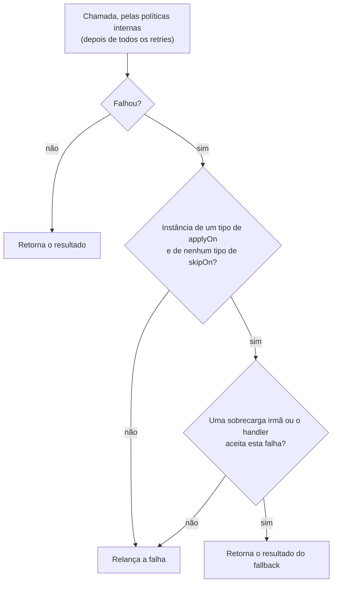

# Fallback

`@Fallback` responde com um resultado alternativo quando a chamada falha ou é rejeitada por outra política.

<div class="r4c-facts">

| Anotação | Posição | Tipos de retorno | Padrões |
|---|---|---|---|
| `@Fallback` | camada 1 de 7, a mais externa | sync, `CompletionStage`, `Mono`, `Flux` | vale para todo `Throwable` |

</div>

**Use quando** existe uma resposta degradada com sentido: um valor em cache, um padrão, uma lista vazia, "pendente" em vez de um erro.

**Não use quando** a única "alternativa" é esconder o erro: um fallback que retorna `null` ou um sucesso falso torna as falhas invisíveis para quem chama e para o seu monitoramento. Se não há nada melhor para retornar, deixe a exceção passar.

## Exemplo mínimo :id=minimal-example

<!-- compare:start -->
<!-- snippet: fallback-minimal -->
```java
import dev.resilience4cata.annotation.Fallback;

public interface PriceApi {

    @Fallback(method = "unknownPrice")
    long price(String sku);

    default long unknownPrice(String sku, Exception failure) {
        return -1;
    }
}
```
<!-- not-compiled: código gerado, resumido -->
```java
public final class PriceApi$Resilient implements PriceApi {
    // …
    public PriceApi$Resilient(PriceApi delegate, dev.resilience4cata.ResilienceRegistry registry) {
        // …
        this.fallback0 = dev.resilience4cata.generated.Policies.fallback(registry, "dev.resilience4cata.examples.docs.fallback.PriceApi#price(java.lang.String)", java.util.List.of(java.lang.Throwable.class), java.util.List.of(), null);
    }

    @Override
    public long price(java.lang.String p0) {
        try {
            return this.delegate.price(p0);
        } catch (java.lang.Throwable r4c$e) {
            if (!this.fallback0.handles(r4c$e)) {
                throw r4c$e;
            }
            if (r4c$e instanceof java.lang.Exception r4c$f0) {
                return this.delegate.unknownPrice(p0, r4c$f0);
            }
            throw r4c$e;
        }
    }
    // …
}
```
<!-- compare:end -->

Resumido: o arquivo real usa nomes totalmente qualificados.

Um fallback é um **método irmão** (`method = "…"`) na mesma interface ou classe, ou uma **classe handler** (`value = SomeHandler.class`). Defina exatamente um ([`R4C-FB-001`](../errors.md#r4c-fb-001)). Os dois são verificados quando você compila: um nome, assinatura ou tipo de retorno errado é um erro de compilação, não uma surpresa em tempo de execução.

## Como se comporta :id=how-it-behaves



- **Quais falhas.** As que são instância de um tipo de `applyOn` (padrão: `Throwable`, então `Error`s também) e de nenhum tipo de `skipOn`. `skipOn` vence.
- **Rejeições incluídas.** O fallback é a camada mais externa, então também vê `CallNotPermittedException`, `RateLimitExceededException`, `CallTimeoutException`, `BulkheadFullException` e, com um classifier, `ResultRejectedException`.
- **Depois dos retries.** Com `@Retry` no mesmo método, o fallback roda uma vez, quando os retries desistem, nunca entre tentativas.
- **O que ele lança.** Se o próprio fallback lança, essa exceção vai para quem chama. Uma exceção checked que o método anotado não declara é encapsulada em `java.lang.reflect.UndeclaredThrowableException`.
- O fallback não custa nada enquanto as chamadas têm sucesso: o código gerado é um `try`/`catch` em volta da chamada.

### Métodos irmãos :id=sibling-methods

Um método irmão recebe os parâmetros do método anotado, opcionalmente seguidos de um parâmetro de exceção, e retorna um tipo atribuível ao tipo de retorno do método. Em uma interface ele é um método `default` ou `static`; em uma [classe anotada](../guides/annotated-classes.md) ele não pode ser `private`.

- **O parâmetro de exceção seleciona as falhas que ele trata.** `unknownPrice(String sku, Exception failure)` trata só `Exception`s: um `Error` não corresponde e é relançado, mesmo com `applyOn` sendo `Throwable`, e nenhum `FallbackEvent.Applied` é publicado para ele. Receba `Throwable` (ou nenhum parâmetro de exceção) para tratar tudo.
- **Várias sobrecargas** com tipos de exceção diferentes são permitidas; a mais específica que corresponder é chamada:

<!-- snippet: fallback-overloads -->
```java
@Fallback(method = "describeFallback")
@CircuitBreaker(name = "catalog")
String describe(String sku) throws IOException;

default String describeFallback(String sku, FileNotFoundException e) {
    return "no such product: " + sku;               // most specific type first
}

default String describeFallback(String sku, IOException e) {
    return "description unavailable";
}

static String describeFallback(String sku, CallNotPermittedException e) {
    return "catalog is resting";                    // the breaker is open
}
```

Uma `FileNotFoundException` cai na primeira, qualquer outra `IOException` na segunda, e `CallNotPermittedException` (o breaker está aberto) na terceira. Uma falha que nenhuma sobrecarga aceita, como uma `IllegalStateException` aqui, é relançada, sem `FallbackEvent.Applied`.

- As sobrecargas são tentadas do tipo de exceção mais específico para o menos, seja qual for a ordem em que você as declara. Uma sobrecarga que captura tudo (uma que recebe `Throwable`, ou uma sem parâmetro de exceção) encerra a lista: as sobrecargas depois dela nunca poderiam ser alcançadas, então não são usadas.
- Um irmão não pode lançar uma exceção checked que o método anotado não declara.
- No estilo de interface o wrapper gerado chama o irmão na sua implementação (`delegate.unknownPrice(…)`), então uma implementação pode sobrescrever um fallback `default`.
- **Métodos genéricos** são suportados. O irmão declara os mesmos parâmetros de tipo, casados por posição, com os mesmos limites (os nomes podem diferir), e o código gerado o chama com argumentos de tipo explícitos:

<!-- snippet: fallback-generic -->
```java
@Fallback(method = "nothingFound")
<T> List<T> findAll(Class<T> type, String query);

default <E> List<E> nothingFound(Class<E> type, String query, Exception failure) {
    return List.of();                               // same type parameters, by position
}
```

### Classes handler :id=handler-classes

Um handler implementa `dev.resilience4cata.FallbackHandler<T>` e recebe um `FallbackContext`:

<!-- snippet: fallback-handler -->
```java
import dev.resilience4cata.FallbackContext;
import dev.resilience4cata.FallbackHandler;
import dev.resilience4cata.annotation.Fallback;
import dev.resilience4cata.annotation.Retry;

public interface QuoteApi {

    @Fallback(ListPrice.class)
    @Retry(maxAttempts = 3, delay = "100ms")
    long quote(String sku, int quantity);

    final class ListPrice implements FallbackHandler<Long> {
        @Override
        public Long apply(FallbackContext context) {
            int quantity = context.argument(1, int.class);   // the call's arguments, by position
            return 100L * quantity;                          // context.failure(), attempts(), id()
        }
    }
}
```

| Método de `FallbackContext` | Retorna |
|---|---|
| `failure()` | A falha que disparou o fallback, rejeições incluídas |
| `attempts()` | Tentativas feitas, a primeira incluída (1 sem `@Retry`) |
| `argumentCount()` | Número de argumentos da chamada |
| `argument(int index, Class<A> type)` | Um argumento, por posição a partir de zero (primitivos pela classe wrapper ou pela classe primitiva) |
| `id()` | O id do método, `<type>#<method>(<parameter types>)` |

A classe handler precisa ser concreta, não genérica, de nível superior ou aninhada `static`, acessível a partir da classe gerada, com um construtor sem argumentos; `T` precisa ser atribuível ao tipo de retorno do método. Uma instância de handler é criada por método. Um handler não pode ser usado em um método genérico cujo tipo de retorno usa os parâmetros de tipo do método, como `<T> T load(Class<T> type)`, porque um `FallbackHandler<X>` não serve para todo `T` sem um cast unchecked ([`R4C-FB-014`](../errors.md#r4c-fb-014)): use ali um método irmão genérico. Um handler funciona bem em `<T> String describe(T value)`, cujo tipo de resultado não usa `T`.

## Atributos :id=attributes

| Atributo | Tipo | Padrão | Chave de config | Significado |
|---|---|---|---|---|
| `value` | `Class<?>` | nenhum | só na anotação | A classe handler, um `FallbackHandler<T>`. |
| `method` | `String` | nenhum | só na anotação | O nome do método irmão. |
| `applyOn` | `Class<? extends Throwable>[]` | `{Throwable.class}` | só na anotação | Falhas que disparam o fallback. |
| `skipOn` | `Class<? extends Throwable>[]` | `{}` | só na anotação | Falhas que nunca o disparam; vence `applyOn`. |

`@Fallback` não tem `name`, `config` nem `enabled`, e nenhuma configuração externa: um fallback é código, não ajuste. Também não há handle.

Os filtros funcionam com os dois estilos:

<!-- snippet: fallback-filters -->
```java
@Fallback(method = "emptyResults", applyOn = IOException.class, skipOn = FileNotFoundException.class)
String search(String query) throws IOException;

default String emptyResults(String query) {
    return "[]";
}
```

`search` responde `"[]"` para uma `IOException`, mas uma `FileNotFoundException` (um índice faltando é um bug, não uma indisponibilidade) e qualquer coisa que não seja uma `IOException` vão para quem chama.

## Com outras políticas :id=with-other-policies

O fallback é a camada mais externa, então vê o resultado final de tudo o que está dentro: a falha da última tentativa do retry, ou uma rejeição do breaker, do rate limiter, do timeout ou do bulkhead. Com `@Retry`, o fallback é fundido no ramo de desistência do retry, e é assim que `FallbackContext.attempts()` é exato sem nenhuma alocação por chamada. Com um [classifier](../guides/classifiers.md) e o padrão `onExhaustedResult = RETURN`, um *resultado* rejeitado é retornado como está e o fallback não roda (nada foi lançado); com `THROW`, a `ResultRejectedException` vai para o fallback como qualquer falha.

## Async

Para um método que retorna `CompletionStage<T>` ou `CompletableFuture<T>`, um stage com falha (ou uma exceção lançada antes de existir qualquer stage) dispara o fallback. Um irmão pode retornar `T`, `CompletionStage<T>` ou `CompletionStage<? extends T>`; um handler é um `FallbackHandler<CompletionStage<T>>` ou `FallbackHandler<T>`:

<!-- snippet: fallback-async -->
```java
@Fallback(method = "cachedDescription")
CompletableFuture<String> describeAsync(String sku);

default CompletionStage<String> cachedDescription(String sku, Throwable failure) {
    return CompletableFuture.completedFuture("cached description of " + sku);
}
```

As falhas são desembrulhadas de `CompletionException` antes da correspondência, então um irmão que recebe `IOException` recebe a `IOException`. Uma chamada cujo future quem chama cancela não recebe fallback, e cancelar enquanto o próprio stage do fallback roda cancela esse stage ([cancelamento](../guides/async.md#cancellation)). Veja [Métodos async](../guides/async.md).

## O mesmo com `Pipeline` :id=same-thing-with-pipeline

<!-- snippet: fallback-pipeline -->
```java
Pipeline<Long> quote = Pipeline.builder(registry, "quotes", Long.class)
        .retry(r -> r.maxAttempts(3))
        .fallbackHandler(context -> 100L * context.attempts())
        .build();

long price = quote.execute(() -> backend.quote("sku-1", 3));
```

`fallback(failure -> …)` recebe uma `Function<Throwable, T>`, `fallbackHandler(context -> …)` um `FallbackHandler<T>` (o contexto dele não tem argumentos: `argumentCount()` é 0). `fallbackApplyOn(List)` e `fallbackSkipOn(List)` são os filtros; `fallbackAsync(…)` e `fallbackAsyncHandler(…)` retornam um stage para `executeAsync`. Veja [API Pipeline](../guides/pipeline.md).

## Eventos :id=events

| Evento | Quando | Campos |
|---|---|---|
| `FallbackEvent.Applied` | Um fallback está prestes a rodar: a falha passou por `applyOn`/`skipOn` e, com métodos irmãos, um deles a aceita. Publicado uma vez por chamada, também quando o fallback depois lança; nunca para uma falha que é relançada | `id`, `nanoTime`, `failure` |

Veja [Observabilidade](../guides/observability.md).

## Testando com `ManualClock` :id=testing-it-with-manualclock

<!-- snippet: fallback-testing -->
```java
AtomicInteger calls = new AtomicInteger();
QuoteApi backend = (sku, quantity) -> {
    calls.incrementAndGet();
    throw new IllegalStateException("pricing down");
};
QuoteApi quotes = Resilient.of(QuoteApi.class, backend, registry);

assertThat(quotes.quote("sku-1", 3)).isEqualTo(300L);   // ListPrice, once the retries gave up
assertThat(calls).hasValue(3);
```

Em um [`ManualClock`](../guides/testing.md) os delays dos retries passam na hora, então um teste de "repete e depois cai no fallback" leva milissegundos.

## Letras miúdas :id=small-print

- O padrão `applyOn = Throwable` inclui `Error`s (`OutOfMemoryError`, `StackOverflowError`, `AssertionError`). Se o seu fallback não deve escondê-los, receba `Exception` como parâmetro, ou defina `skipOn = Error.class`.
- Um método `void` também pode ter fallback: o irmão retorna `void`, o handler é um `FallbackHandler<Void>` e retorna `null`.
- Erros relacionados: [`R4C-FB-001`](../errors.md#r4c-fb-001) a [`R4C-FB-003`](../errors.md#r4c-fb-003) (métodos irmãos: nenhum ou ambos definidos, nome desconhecido, nenhum candidato utilizável), [`R4C-FB-004`](../errors.md#r4c-fb-004) a [`R4C-FB-013`](../errors.md#r4c-fb-013) (classes handler), [`R4C-FB-014`](../errors.md#r4c-fb-014) (handler em um método genérico), [`R4C-RT-013`](../errors.md#r4c-rt-013) (filtros de pipeline sem fallback).

## Quanto custa :id=what-it-costs

> [!MEASURED]
> `@Fallback` não tem benchmark próprio: em caso de sucesso ele só adiciona um `try`/`catch`, e só roda depois de uma falha. Ele faz parte da pilha "as seis políticas" no benchmark de `Pipeline`, que custa 76.3 ns por chamada bem-sucedida no AWS Graviton3 (`c7g.xlarge`, 1 thread) com código gerado. [Benchmarks: conclusão do MVP](../benchmarks.md#mvp-completion-classifier-pipeline-events-testkit-2026-10-24-aws-graviton3)
