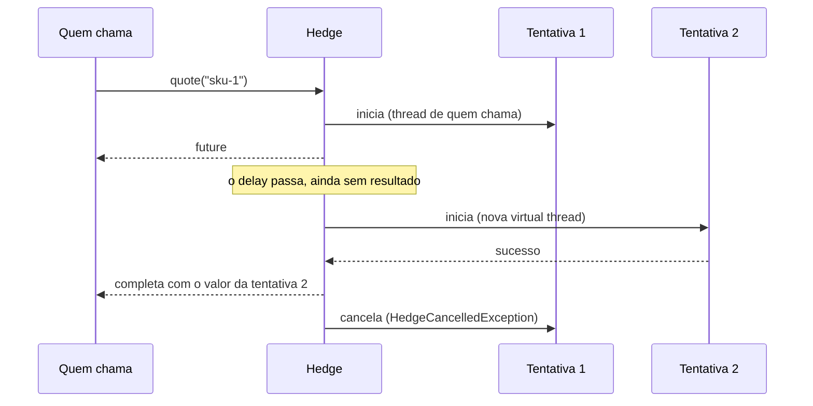

# Hedge

`@Hedge` inicia a mesma chamada de novo, ao lado da primeira, quando ela está lenta ou falha, e fica com o primeiro sucesso: hedged requests, contra a latência de cauda.

<div class="r4c-facts">

| Anotação | Posição | Tipos de retorno | Padrões |
|---|---|---|---|
| `@Hedge` | camada 2 de 7, no lugar do Retry (não os dois em um método) | `CompletionStage` e `Mono` (não `Flux`) | 2 tentativas, delay de 1 s, hedge em `Exception`, budget de 10 % + 1/s em 10 s |

</div>

> [!WARNING]
> **Só para chamadas idempotentes.** Um método com hedge é chamado várias vezes de propósito, mesmo quando nada falha, com os mesmos argumentos, e as tentativas que perdem podem continuar rodando até perceberem o cancelamento. Use-o em leituras e outras operações que podem ser repetidas com segurança. Nunca em pagamentos, inserções, envios ou qualquer coisa que deva acontecer uma única vez. Colocar `@Hedge` em um método *é* a declaração de que ele é idempotente: não existe um interruptor extra `idempotent = true`.

**Use quando** uma chamada idempotente, só de leitura, a um backend replicado (várias réplicas, um cluster de cache, um índice de busca) costuma ser rápida mas as chamadas mais lentas (p99, p99.9) são muito mais lentas que a mediana, e um pouco de carga extra é um preço justo para cortar essa cauda. *The Tail at Scale* (Dean e Barroso, 2013) reduziu um p99.9 de 1,800 ms para 74 ms com cerca de 2 % mais requisições, fazendo hedge após 10 ms.

**Não use quando** a operação não é idempotente, quando a dependência está lenta porque está saturada (mais requisições a deixam mais lenta, para todos; o [budget](#the-hedge-budget) limita o estrago, não o desfaz; [uma simulação](../blog/hedging-under-contention.md) mostra quanto), quando todas as réplicas compartilham o mesmo caminho lento (um hedge então espera duas vezes), ou quando o método é síncrono (ainda não suportado: retorne um `CompletableFuture`).

## Exemplo mínimo :id=minimal-example

<!-- compare:start -->
<!-- snippet: hedge-minimal -->
```java
import dev.resilience4cata.annotation.Hedge;
import java.util.concurrent.CompletableFuture;

public interface QuoteApi {

    @Hedge(delay = "50ms")
    CompletableFuture<String> quote(String sku);
}
```
<!-- not-compiled: código gerado, resumido -->
```java
public final class QuoteApi$Resilient implements QuoteApi {
    // …
    public QuoteApi$Resilient(QuoteApi delegate, dev.resilience4cata.ResilienceRegistry registry) {
        // …
        this.hedge0 = dev.resilience4cata.generated.Policies.hedge(registry, "dev.resilience4cata.examples.docs.hedge.QuoteApi#quote(java.lang.String)", "", "", r4c$b -> {
            r4c$b.delay(java.time.Duration.ofNanos(50000000L));
        }, false);
    }

    @Override
    public java.util.concurrent.CompletableFuture<java.lang.String> quote(java.lang.String p0) {
        return this.hedge0.executeAsync(() -> this.delegate.quote(p0));
    }
}
```
<!-- compare:end -->

Resumido: o arquivo real usa nomes totalmente qualificados. O lambda é a *tentativa*: o hedge o chama uma vez por tentativa, então cada tentativa passa sozinha pelas políticas dentro do hedge.

## Como se comporta :id=how-it-behaves



- **Quando as tentativas começam.** A tentativa 1 começa na hora, na thread de quem chama. A próxima tentativa começa quando a mais recente rodou por `delay` sem resultado em lugar nenhum, ou **na hora** quando uma tentativa falha com uma falha listada em `hedgeOn` (padrão: `Exception`); essa tentativa começa em uma nova virtual thread, nunca na thread que completou a tentativa que falhou (que pode ser a thread de I/O do seu cliente HTTP). `maxAttempts` conta toda tentativa iniciada, a primeira incluída: o padrão, 2, é um hedge. `delay = "0"` inicia todas as tentativas na hora, todas na thread de quem chama (`maxAttempts` × a carga, sempre).
- **Quem vence.** O primeiro **sucesso** completa a chamada. Uma falha nunca vence: ela inicia a próxima tentativa se ainda restar uma, e senão a chamada espera as tentativas ainda em voo.
- **Quando falha.** Quando toda tentativa iniciada falhou e nenhuma outra pode começar, a chamada falha com a **última** falha. Uma falha listada em `abortOn`, ou **não** listada em `hedgeOn`, encerra a chamada na hora (um `Error`, por padrão), e as outras tentativas são canceladas.
- **Rejeições.** Uma rejeição de uma política dentro do hedge (`CallNotPermittedException` de um breaker aberto, `BulkheadFullException`, `RateLimitExceededException`) significa que a dependência não tem capacidade: nenhuma tentativa nova começa, mas as tentativas em voo continuam rodando e ainda podem ter sucesso. Se não houver mais nada em voo, a chamada falha com a rejeição.
- **Perdedoras.** Assim que a chamada tem o seu resultado, o stage de todas as outras tentativas é completado com `HedgeCancelledException`, uma `CancellationException` (então informa `isCancelled()`), uma instância nova para cada tentativa perdedora, sem stack trace (`handle`/`whenComplete` no stage a veem como está; a partir do JDK 23, `join()` lança uma nova `CancellationException` com ela como causa). As políticas dentro da tentativa a tratam como um cancelamento: um circuit breaker não registra nada (uma permissão de semiaberto é devolvida), um bulkhead libera o slot, um timeout cancela o seu prazo, e um `CompletableFuture` retornado pelo seu método é cancelado. Um resultado tardio de uma perdedora é descartado: não completa nada e não publica nada.
- **Cancelar** o future que você recebeu cancela todas as tentativas em voo e o delay pendente ([cancelamento](../guides/async.md#cancellation)).
- **Caminho rápido.** Uma primeira tentativa cujo stage já está completo e com sucesso quando o seu método retorna (um acerto de cache) não precisa de timer nem de hedge.
- **Desativado** (`enabled = false`): uma tentativa, como se não houvesse anotação (o fallback continua rodando em caso de falha).

### O budget de hedge :id=the-hedge-budget

Hedges adicionam carga justamente quando uma dependência está lenta, que é quando ela menos aguenta. O budget de hedge os limita para uma instância, compartilhado por todos os chamadores dessa instância: os hedges no último `budgetWindow` não podem passar de

> `budgetMinHedgesPerSecond × budgetWindow em segundos + budgetPercent % das chamadas em budgetWindow`

Ele vem **ligado por padrão** (10 % das chamadas mais 1 hedge por segundo, em 10 s), ao contrário do [retry budget](retry.md#retry-budget), porque o hedge adiciona carga também no caminho de sucesso. `budgetPercent = 0` o desliga. Um hedge é cobrado quando começa. Quando o budget acaba, nenhum hedge começa, `HedgeEvent.Skipped` é publicado com o motivo `BUDGET_EXHAUSTED`, e a chamada espera as suas tentativas em voo. É a mesma janela do retry budget (chamadas contadas, nenhuma leitura de relógio em caso de sucesso; veja [retry budget](retry.md#retry-budget)). `registry.snapshot().hedges()` o mostra como `HedgeSnapshot.Budget(calls, hedges, allowedHedges)`.

## Atributos :id=attributes

| Atributo | Tipo | Padrão | Chave de config | Significado |
|---|---|---|---|---|
| `maxAttempts` | `int` | `2` | `defaults.hedge.maxAttempts` | Tentativas em voo no máximo, a primeira incluída. De 2 a 10. |
| `delay` | duração | `1s` | `defaults.hedge.delay` | Quanto tempo a tentativa mais recente roda sem resultado antes de a próxima começar. Defina-o perto da latência p95 da dependência. `"0"` inicia todas as tentativas na hora. |
| `hedgeOn` | `Class<? extends Throwable>[]` | `{Exception.class}` | `defaults.hedge.hedgeOn` | Falhas depois das quais a próxima tentativa começa na hora. Uma falha não listada encerra a chamada. |
| `abortOn` | `Class<? extends Throwable>[]` | `{}` | `defaults.hedge.abortOn` | Falhas que encerram a chamada na hora e cancelam as outras tentativas; vencem `hedgeOn`. |
| `budgetPercent` | `double` | `10` | `defaults.hedge.budgetPercent` | [Budget de hedge](#the-hedge-budget): hedges permitidos, em porcentagem das chamadas da instância no último `budgetWindow`. Finito, pelo menos 0; 0 desliga o budget. |
| `budgetMinHedgesPerSecond` | `int` | `1` | `defaults.hedge.budgetMinHedgesPerSecond` | Budget de hedge: hedges permitidos por segundo de `budgetWindow`, seja qual for o tráfego. Pelo menos 0. |
| `budgetWindow` | duração | `10s` | `defaults.hedge.budgetWindow` | Budget de hedge: até quando no passado chamadas e hedges são contados. De `1s` a `1h`. |
| `name` | `String` | uma instância por método | só na anotação | Id da instância; métodos com o mesmo `name` compartilham um hedge, e portanto o seu budget. |
| `config` | `String` | `default` | só na anotação | Configuração nomeada da qual partir. |
| `locked` | `boolean` | `false` | só na anotação | Mantém os valores definidos na anotação: as chaves `instances.<id>.*` não podem mudá-los. Veja [Travando uma instância](../guides/configuration.md#locking-an-instance). |
| `enabled` | `boolean` | `true` | `defaults.hedge.enabled` | `false` deixa toda chamada passar; não definido herda. |

Todas as chaves também existem em `configs.<name>.hedge.…` e `instances.<id>.hedge.…`; veja [Configuração](../guides/configuration.md). Ainda não há classifier nem `maxDuration`: o `@Timeout` por tentativa e `maxAttempts × delay` limitam uma chamada.

**Não há handle**: o `registry` não tem `hedge(id)`. `registry.snapshot().hedges()` lista um `HedgeSnapshot(id, config, budget)` por instância (`budget` é `null` quando `budgetPercent = 0`).

## Com outras políticas :id=with-other-policies

O hedge ocupa o lugar do Retry, a segunda camada: dentro do Fallback, em volta de todo o resto.

<!-- snippet: hedge-combined -->
```java
@Hedge(name = "prices", delay = "30ms", maxAttempts = 3, abortOn = IllegalArgumentException.class)
@CircuitBreaker(name = "prices")
@Timeout("200ms")
@Fallback(method = "cachedPrice")
CompletableFuture<Long> price(String sku);

default CompletableFuture<Long> cachedPrice(String sku, Throwable failure) {
    return CompletableFuture.completedFuture(-1L);
}
```

- **Retry**: `@Hedge` e `@Retry` em um método é um erro de compilação ([`R4C-HDG-002`](../errors.md#r4c-hdg-002)). Um hedge já inicia uma nova tentativa quando uma falha.
- **Circuit breaker** (dentro): cada tentativa pega a própria permissão e é registrada por si só, com o seu resultado real; uma perdedora cancelada não é registrada. Um breaker aberto rejeita a próxima tentativa, o que interrompe novos hedges.
- **Rate limiter** (dentro): cada tentativa pega uma permissão; dimensione o limite pensando em `maxAttempts` e no budget. Uma tentativa rejeitada interrompe novos hedges.
- **Timeout** (dentro): **por tentativa**. Uma tentativa que deu timeout é uma falha em `hedgeOn` (`CallTimeoutException` é uma `Exception`), então inicia a próxima tentativa na hora. Com `delay` igual ou acima do timeout, o delay nunca dispara e o hedge vira um retry em caso de timeout: válido, mas quase sempre um erro.
- **Bulkhead** (dentro): cada tentativa ocupa um slot só enquanto roda; o slot de uma perdedora é liberado quando ela é cancelada.
- **Fallback** (fora): roda uma vez, depois que a chamada falhou, e `FallbackContext.attempts()` é o número de tentativas iniciadas.

## O mesmo com `Pipeline` :id=same-thing-with-pipeline

<!-- snippet: hedge-pipeline -->
```java
Pipeline<String> quote = Pipeline.builder(registry, "quotes", String.class)
        .hedge(h -> h.delay(Duration.ofMillis(50)))
        .build();

CompletableFuture<String> price = quote.executeAsync(() -> backend.quote("sku-1"));
```

Um pipeline com hedge só funciona com `executeAsync`: `execute` lança [`R4C-RT-018`](../errors.md#r4c-rt-018), e um pipeline com `.retry(…)` e `.hedge(…)` falha ao ser construído com [`R4C-RT-019`](../errors.md#r4c-rt-019). O id do pipeline (`"quotes"`) é o id da instância. Veja [API Pipeline](../guides/pipeline.md).

## Eventos e snapshot :id=events-and-snapshot

| Evento | Quando | Campos |
|---|---|---|
| `HedgeEvent.Hedged` | A tentativa 2 ou posterior começou | `id`, `nanoTime`, `attempt`, `reason` (`DELAY` ou `FAILURE`) |
| `HedgeEvent.Won` | A tentativa 2 ou posterior teve sucesso primeiro | `id`, `nanoTime`, `attempt` |
| `HedgeEvent.Skipped` | Um hedge que poderia ter começado não começou | `id`, `nanoTime`, `attempt`, `reason` (`BUDGET_EXHAUSTED`, `REJECTED` ou `ABORTED`) |
| `HedgeEvent.Failed` | A chamada falhou | `id`, `nanoTime`, `attempts`, `failure` |

Uma chamada cuja primeira tentativa vence não publica nada, e não há contadores por chamada: com que frequência hedges começam e vencem só é visível por esses eventos. Veja [Observabilidade](../guides/observability.md).

## Testando com `ManualClock` :id=testing-it-with-manualclock

<!-- snippet: hedge-testing -->
```java
QuoteApi quotes = Resilient.of(QuoteApi.class, backend, registry);   // backend: one pending stage per call

CompletableFuture<String> quote = quotes.quote("sku-1");
clock.advance(Duration.ofMillis(49));
assertThat(attempts).hasSize(1);                  // no hedge before the delay
clock.advance(Duration.ofMillis(1));
assertThat(attempts).hasSize(2);                  // the hedge started, on this thread

attempts.get(1).complete("quote from attempt 2");
assertThat(quote).isCompletedWithValue("quote from attempt 2");
assertThat(attempts.get(0)).isCancelled();        // the loser is cancelled
```

Em um [`ManualClock`](../guides/testing.md), o delay é exato (sem tick de folga) e um hedge começa na thread que avança o relógio, então os testes são determinísticos. Um hedge iniciado por uma falha é agendado no relógio sem delay: ele começa no próximo `advance`, `advance(Duration.ZERO)` incluído. Uma chamada que termina antes do seu delay tira o delay do relógio, então `pendingTasks()` continua exato.

## Letras miúdas :id=small-print

- **Precisão do timer.** Em produção os delays rodam no timer lock-free da biblioteca para timeouts async. O delay de um hedge conta a partir do início da chamada (uma leitura de relógio) e o timer acorda no prazo dele, então um hedge nunca é adiantado e começa após `delay` mais o atraso de despertar do sistema operacional. Ele pode atrasar até um tick (um dezesseis avos do menor delay ou timeout async em uso, entre 1 ms e 50 ms) quando o delay está abaixo de 1 ms, ou quando chamadas em outras threads começaram depois e foram pegas pelo timer primeiro. Um delay de hedge curto encurta o tick também para todo timeout async, nunca abaixo de 1 ms.
- **O contexto não é propagado.** A tentativa 1 roda na thread de quem chama; os hedges começam em uma nova virtual thread, sem os `ThreadLocal`s nem o MDC de quem chama, como nos retries async ([Métodos async](../guides/async.md)).
- **As perdedoras podem continuar rodando.** Cancelar um stage não pode parar código que o ignora: um delegate que retorna um stage não ligado ao seu trabalho (ou um stage mínimo, que não pode ser cancelado) continua trabalhando, e o resultado dele é descartado.
- **O budget é aproximado**, sempre para baixo (menos hedges, nunca mais), como o retry budget. Com `name`, os métodos compartilham um budget; dê a eles os mesmos atributos.
- Métodos síncronos ainda não são suportados: `@Hedge` em um deles é um erro de compilação ([`R4C-HDG-001`](../errors.md#r4c-hdg-001)), também quando vem do tipo ou de um [bundle](../guides/bundles.md).
- Erros relacionados: [`R4C-HDG-001`](../errors.md#r4c-hdg-001) (método sync), [`R4C-HDG-002`](../errors.md#r4c-hdg-002) (com `@Retry`), [`R4C-ATR-001`](../errors.md#r4c-atr-001) (sintaxe de duração), [`R4C-ATR-006`](../errors.md#r4c-atr-006) (`enabled`), [`R4C-ATR-007`](../errors.md#r4c-atr-007) (valores do budget), [`R4C-ATR-008`](../errors.md#r4c-atr-008) (`maxAttempts` fora de 2–10), [`R4C-RT-018`](../errors.md#r4c-rt-018)/[`R4C-RT-019`](../errors.md#r4c-rt-019) (`Pipeline`), [`R4C-REG-004`](../errors.md#r4c-reg-004) (`config` desconhecida), [`R4C-REG-008`](../errors.md#r4c-reg-008) (`name` compartilhado, config diferente).

## Quanto custa :id=what-it-costs

> [!MEASURED]
> AWS `c7g.xlarge` (Graviton3), 1 thread: quando a primeira tentativa vence antes do delay, uma chamada custa 179 ns e 224 B, contra 3668 ns e 1546 B do `resilience4j-hedge` do Resilience4j 2.4.0; uma primeira tentativa que já está completa custa 9.5 ns. Com um delay de 1 ms, um hedge que dispara e vence leva 1060 µs, contra 1067 µs. De [Delays de hedge no tempo](../benchmarks.md#hedge-precision).

**Precisão do timer.** Os delays rodam no timer compartilhado da biblioteca: armar um é um compare-and-set em uma caixa de entrada por thread mais uma leitura de relógio para o seu início, cancelá-lo é mais um compare-and-set, que é o que quase toda chamada faz. O timer acorda no prazo de hedge mais próximo, então um hedge começa em `delay` mais o atraso de despertar do sistema operacional, como uma tarefa de um `ScheduledThreadPoolExecutor`.

Quando a primeira tentativa vence antes do delay, uma chamada aloca o future retornado, um objeto para o estado do hedge, e o nó de callback e o future dependente que o `whenComplete` do JDK cria (quatro objetos além do seu próprio stage e do lambda por chamada que toda camada async tem), agenda o seu delay com um compare-and-set em uma caixa de entrada por thread e o cancela com mais um, adiciona uma escrita ao stripe desta thread no budget, e lê o relógio uma vez. Um hedge que dispara adiciona uma virtual thread, as camadas da própria tentativa e, após uma falha ou com o budget ligado, uma leitura de relógio.
