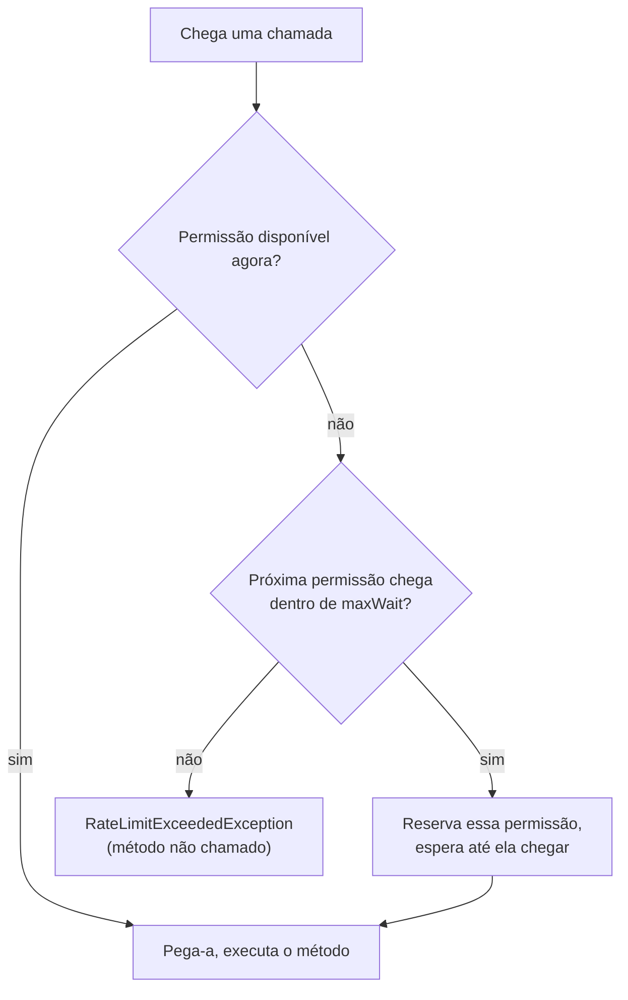

# Rate limiter

`@RateLimiter` deixa passar no máximo um número dado de chamadas por período e rejeita (ou atrasa) as demais.

<div class="r4c-facts">

| Anotação | Posição | Tipos de retorno | Padrões |
|---|---|---|---|
| `@RateLimiter` | camada 4 de 7, dentro do CircuitBreaker | sync, `CompletionStage`, `Mono`, `Flux` | 50 permissões por 1 s, sem espera |

</div>

**Use quando** uma dependência tem uma cota (uma API que permite 10 requisições por segundo), ou quando você quer evitar que um cliente inunde um serviço compartilhado.

**Não use quando** o que você precisa limitar é quantas chamadas rodam *ao mesmo tempo*, seja qual for a taxa delas: isso é um [bulkhead](bulkhead.md). E um rate limiter em uma JVM limita só essa JVM: com várias instâncias do seu serviço, cada uma tem o próprio limite.

## Exemplo mínimo :id=minimal-example

<!-- compare:start -->
<!-- snippet: rate-limiter-minimal -->
```java
import dev.resilience4cata.annotation.RateLimiter;

public interface SearchApi {

    @RateLimiter(permits = 10, period = "1s")
    String search(String query);
}
```
<!-- not-compiled: código gerado, resumido -->
```java
public final class SearchApi$Resilient implements SearchApi {
    // …
    public SearchApi$Resilient(SearchApi delegate, dev.resilience4cata.ResilienceRegistry registry) {
        // …
        this.rateLimiter0 = dev.resilience4cata.generated.Policies.rateLimiter(registry, "dev.resilience4cata.examples.docs.ratelimiter.SearchApi#search(java.lang.String)", "", "", r4c$b -> {
            r4c$b.permits(10);
            r4c$b.period(java.time.Duration.ofNanos(1000000000L));
        }, false);
    }

    @Override
    public java.lang.String search(java.lang.String p0) {
        final dev.resilience4cata.generated.RateLimiterPolicy r4c$rateLimiter = this.rateLimiter0;
        if (!r4c$rateLimiter.tryAcquire()) {
            throw r4c$rateLimiter.rejection();
        }
        return this.delegate.search(p0);
    }
}
```
<!-- compare:end -->

Resumido: o arquivo real usa nomes totalmente qualificados.

## Como se comporta :id=how-it-behaves

Pense nas permissões como espaçadas igualmente: com `permits = 10` e `period = "1s"`, uma permissão fica disponível a cada 100 ms. As permissões que você não usa são guardadas, até `permits` delas, então depois de um momento tranquilo uma rajada de até 10 chamadas passa de uma vez; depois as chamadas passam na taxa constante, uma a cada 100 ms.



- **Rejeição.** Com `maxWait = "0"` (o padrão), uma chamada sem permissão disponível falha na hora com `dev.resilience4cata.RateLimitExceededException` (uma `RuntimeException` com `id()`; uma por limiter, sem stack trace). O método não é chamado.
- **Espera.** Com `maxWait` > 0, uma chamada cuja permissão chega dentro de `maxWait` a reserva e espera até ela chegar; uma chamada que teria de esperar mais é rejeitada na hora, sem esperar nada. Quem espera conhece a sua vez, então não há disputa quando ela chega.
- **Esperas sync** dormem na thread de quem chama. Se a thread é interrompida durante a espera, a permissão é devolvida, a flag de interrupção é marcada de novo e a chamada é rejeitada.
- **Rajadas.** Como as permissões não usadas se acumulam até uma rajada completa, uma janela de um `period` pode ver até o dobro de `permits` chamadas: uma rajada completa e depois a taxa constante. É o mesmo que os ciclos fixos do Resilience4j.
- Não há thread em segundo plano repondo permissões: cada chamada calcula a sua a partir do relógio.
- **Desativado** (`enabled = false`): toda chamada passa.

Por baixo dos panos isto é GCRA, a forma de medidor de um token bucket: todo o estado é um número, o instante em que a próxima permissão chega, avançado em `period / permits` a cada chamada.

## Atributos :id=attributes

| Atributo | Tipo | Padrão | Chave de config | Significado |
|---|---|---|---|---|
| `permits` | `int` | `50` | `defaults.rateLimiter.permits` | Chamadas permitidas por `period`, e a maior rajada. Pelo menos 1. |
| `period` | duração | `1s` | `defaults.rateLimiter.period` | Comprimento do período. Maior que 0, e pelo menos 1 ns por permissão. |
| `maxWait` | duração | `0` (rejeita na hora) | `defaults.rateLimiter.maxWait` | Quanto tempo uma chamada pode esperar pela sua permissão. |
| `name` | `String` | um limiter por método | só na anotação | Id da instância; métodos com o mesmo `name` compartilham um limiter e as suas permissões. |
| `config` | `String` | `default` | só na anotação | Configuração nomeada da qual partir. |
| `locked` | `boolean` | `false` | só na anotação | Mantém os valores definidos na anotação: as chaves `instances.<id>.*` não podem mudá-los. Veja [Travando uma instância](../guides/configuration.md#locking-an-instance). |
| `enabled` | `boolean` | `true` | `defaults.rateLimiter.enabled` | `false` deixa toda chamada passar; não definido herda. |

Os padrões diferem dos do Resilience4j (50 permissões a cada 500 ns, espera de 5 s): aqui a espera é opcional, como no bulkhead. As chaves também existem em `configs.<name>.` e `instances.<id>.`; veja [Configuração](../guides/configuration.md).

## Compartilhamento e ids de instância :id=sharing-and-instance-ids

Uma cota normalmente cobre uma API inteira, não um método. Dê aos métodos o mesmo `name` e eles compartilham um limiter:

<!-- snippet: rate-limiter-wait -->
```java
@RateLimiter(name = "geocoding", permits = 5, period = "1s", maxWait = "500ms")
String geocode(String address);

@RateLimiter(name = "geocoding", permits = 5, period = "1s", maxWait = "500ms")
String reverse(double latitude, double longitude);
```

Aqui `geocode` e `reverse` compartilham 5 permissões por segundo. Quando a rajada acaba, a próxima chamada espera 200 ms pela sua permissão (1 s / 5), dentro dos 500 ms permitidos; uma chamada que teria de esperar mais de 500 ms é rejeitada na hora. Métodos que compartilham um `name` precisam resolver para a mesma configuração, ou o wrapping falha com [`R4C-REG-008`](../errors.md#r4c-reg-008). Sem `name`, o id é `<type>#<method>(<parameter types>)`.

### Handle

`registry.rateLimiter(id)` retorna um `RateLimiterHandle`:

<!-- snippet: rate-limiter-handle -->
```java
RateLimiterHandle limiter = registry.rateLimiter("geocoding");
int now = limiter.availablePermits();            // calls that would pass right now without waiting
RateLimiterSnapshot snapshot = limiter.snapshot(); // instance, availablePermits, permits
```

| Método | O que faz |
|---|---|
| `id()` | O `name`, ou o id derivado |
| `config()` | O `RateLimiterConfig` resolvido |
| `availablePermits()` | Chamadas que passariam agora mesmo sem esperar, entre 0 e `permits`; uma foto que chamadas concorrentes mudam na hora |
| `snapshot()` | Um `RateLimiterSnapshot(id, availablePermits, permits)` |

O limiter existe assim que a sua interface foi envolvida ou o seu pipeline construído; um id desconhecido lança [`R4C-REG-009`](../errors.md#r4c-reg-009). Não existe `registry.rateLimiters()`: liste-os com `registry.snapshot().rateLimiters()`.

## Com outras políticas :id=with-other-policies

O rate limiter é a quarta camada: dentro do CircuitBreaker, em volta do Timeout e do Bulkhead.

- Chamadas rejeitadas por um breaker aberto nunca chegam aqui, então não gastam permissões.
- Um `@CircuitBreaker` externo nunca registra as rejeições dele (o seu próprio limiter não é uma dependência falhando, então não pode abrir o seu breaker). Elas são `Exception`s, então um `@Retry` externo as repete após o delay do seu backoff (adicione `RateLimitExceededException` a `abortOn` para falhar rápido).
- Cada tentativa do retry pega uma permissão própria.
- O tempo gasto esperando uma permissão não faz parte do `@Timeout`, que fica dentro.

## Async

Para um método que retorna `CompletionStage<T>` ou `CompletableFuture<T>`, uma rejeição é um future com falha, e uma chamada que espera pela permissão é agendada para começar quando ela chegar, sem bloquear nenhuma thread:

<!-- snippet: rate-limiter-async -->
```java
@RateLimiter(name = "geocoding-async", permits = 5, period = "1s", maxWait = "500ms")
CompletableFuture<String> geocodeAsync(String address);
```

Cancelar o future de uma chamada que ainda espera pela permissão devolve a permissão, e a chamada nunca começa; uma chamada que já começou mantém a sua permissão ([cancelamento](../guides/async.md#cancellation)). Veja [Métodos async](../guides/async.md).

## O mesmo com `Pipeline` :id=same-thing-with-pipeline

<!-- snippet: rate-limiter-pipeline -->
```java
Pipeline<String> search = Pipeline.builder(registry, "search", String.class)
        .rateLimiter(rl -> rl.permits(10).period(Duration.ofSeconds(1)))
        .build();

String results = search.execute(() -> backend.search("resilience"));
```

O id `"search"` é o id da instância: `registry.rateLimiter("search")` retorna o limiter. Veja [API Pipeline](../guides/pipeline.md).

## Eventos e snapshot :id=events-and-snapshot

| Evento | Quando | Campos |
|---|---|---|
| `RateLimiterEvent.Rejected` | Uma chamada foi rejeitada (sem permissão dentro de `maxWait`, ou uma espera interrompida) | `id`, `nanoTime` |

Chamadas admitidas não publicam nada. `registry.snapshot().rateLimiters()` lista um `RateLimiterSnapshot` por limiter. Veja [Observabilidade](../guides/observability.md).

## Testando com `ManualClock` :id=testing-it-with-manualclock

<!-- snippet: rate-limiter-testing -->
```java
SearchApi search = Resilient.of(SearchApi.class, query -> "results for " + query, registry);

for (int i = 0; i < 10; i++) {
    search.search("q" + i);                      // a full burst of 10 is available at once
}
assertThatThrownBy(() -> search.search("one too many"))
        .isInstanceOf(RateLimitExceededException.class);

clock.advance(Duration.ofMillis(100));           // permits come back one every 1s / 10
assertThat(search.search("next")).isEqualTo("results for next");
assertThatThrownBy(() -> search.search("again")).isInstanceOf(RateLimitExceededException.class);
```

Em um [`ManualClock`](../guides/testing.md), as permissões só voltam quando o relógio anda, e uma chamada que espera pela permissão avança o relógio em vez de dormir.

## Letras miúdas :id=small-print

- `period` precisa ser de pelo menos 1 ns por permissão (`permits = 1_000_000_000` precisa de `period` ≥ 1 s), senão a configuração é inválida ([`R4C-REG-001`](../errors.md#r4c-reg-001)/[`R4C-REG-003`](../errors.md#r4c-reg-003)).
- O limite é por JVM e por registry: dois registries, ou duas instâncias do seu serviço, têm cada um o seu.
- Toda chamada lê `System.nanoTime()` uma vez. No notebook Apple M1 usado nos primeiros benchmarks, essa leitura era a maior parte do custo do limiter ([Benchmarks do rate limiter](../benchmarks.md#rate-limiter-1-and-4-threads-2026-10-24)).
- Quando chamadas admitidas chegam mais rápido do que o único valor compartilhado do limiter consegue se mover entre núcleos de CPU, um chamador que perde a disputa faz park pelo menor tempo possível antes de tentar de novo; no Linux, o park mais curto de uma platform thread é de cerca de 50 µs. Isso só acontece muito acima de qualquer taxa para a qual um limiter é normalmente configurado.
- Erros relacionados: [`R4C-ATR-001`](../errors.md#r4c-atr-001) (sintaxe de duração), [`R4C-ATR-002`](../errors.md#r4c-atr-002) (`period = "0"`), [`R4C-ATR-003`](../errors.md#r4c-atr-003) (`permits` abaixo de 1), [`R4C-ATR-006`](../errors.md#r4c-atr-006) (`enabled`), [`R4C-REG-004`](../errors.md#r4c-reg-004) (`config` desconhecida), [`R4C-REG-008`](../errors.md#r4c-reg-008) (`name` compartilhado, config diferente), [`R4C-REG-009`](../errors.md#r4c-reg-009) (id desconhecido).

## Quanto custa :id=what-it-costs

> [!MEASURED]
> No AWS Graviton3 (`c7g.xlarge`, JDK 21), com 4 threads compartilhando um limiter, uma chamada admitida custa 187 ns e não aloca nada, contra 275 ns e 40 B do Resilience4j 2.4.0; uma chamada rejeitada custa 34.7 ns, 0 B, contra 1599 ns e 505 B. Em 1 thread, uma chamada admitida custa 41.8 ns. [Benchmarks: conclusão do MVP](../benchmarks.md#mvp-completion-classifier-pipeline-events-testkit-2026-10-24-aws-graviton3)
