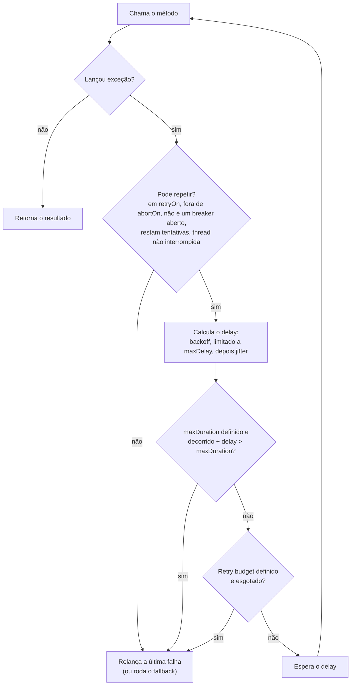

# Retry

`@Retry` chama o método de novo quando ele falha, esperando um pouco mais antes de cada nova tentativa.

<div class="r4c-facts">

| Anotação | Posição | Tipos de retorno | Padrões |
|---|---|---|---|
| `@Retry` | camada 2 de 7, dentro do Fallback | sync, `CompletionStage`, `Mono`, `Flux` | 3 tentativas, backoff exponencial de 200 ms ×2 até 10 s, full jitter, repete `Exception` |

</div>

**Use quando** as falhas são transitórias e a operação pode ser repetida com segurança: uma conexão que caiu, um `503`, uma disputa perdida por um lock, uma leitura ou escrita idempotente.

**Não use quando** a operação não é idempotente (cobrar um cartão duas vezes é pior do que falhar uma vez), quando a falha é permanente (um erro de validação, um `404`), ou quando quem chama não pode arcar com a latência extra. Repetir chamadas a uma dependência sobrecarregada piora a situação: coloque um [circuit breaker](circuit-breaker.md) dentro do retry para que um breaker aberto interrompa os retries.

## Exemplo mínimo :id=minimal-example

<!-- compare:start -->
<!-- snippet: retry-minimal -->
```java
import dev.resilience4cata.annotation.Retry;

public interface InventoryApi {

    @Retry(maxAttempts = 3, delay = "100ms")
    int stock(String sku);
}
```
<!-- not-compiled: código gerado, resumido -->
```java
public final class InventoryApi$Resilient implements InventoryApi {
    // …
    public InventoryApi$Resilient(InventoryApi delegate, dev.resilience4cata.ResilienceRegistry registry) {
        // …
        this.retry0 = dev.resilience4cata.generated.Policies.retry(registry, "dev.resilience4cata.examples.docs.retry.InventoryApi#stock(java.lang.String)", "", "", r4c$b -> {
            r4c$b.maxAttempts(3);
            r4c$b.delay(java.time.Duration.ofNanos(100000000L));
        }, false);
    }

    @Override
    public int stock(java.lang.String p0) {
        final dev.resilience4cata.generated.RetryPolicy r4c$retry = this.retry0;
        final long r4c$start = r4c$retry.start();
        int r4c$attempts = 0;
        while (true) {
            try {
                return this.delegate.stock(p0);
            } catch (java.lang.Throwable r4c$e) {
                final long r4c$delay = r4c$retry.onFailure(++r4c$attempts, r4c$e, r4c$start);
                if (r4c$delay < 0 || !r4c$retry.pause(r4c$delay)) {
                    throw r4c$e;
                }
            }
        }
    }
}
```
<!-- compare:end -->

Resumido: o arquivo real usa nomes totalmente qualificados. O seu fica em `build/generated/sources/annotationProcessor/java/main` (Gradle) ou `target/generated-sources/annotations` (Maven).

Envolva uma implementação uma vez, na inicialização, e use o wrapper em todo lugar:

<!-- snippet: retry-wrap -->
```java
ResilienceRegistry registry = ResilienceRegistry.builder().build();
InventoryApi inventory = Resilient.of(InventoryApi.class, backend, registry);

int units = inventory.stock("sku-1");   // up to 3 attempts
```

O método gerado é um loop simples em volta da sua chamada. Nada é alocado e nenhum relógio é lido enquanto as chamadas têm sucesso; a política só é consultada após uma falha.

## Como se comporta :id=how-it-behaves



- **O que é repetido.** Uma exceção que é instância de um tipo de `retryOn` (padrão: `Exception`) e de nenhum tipo de `abortOn` (padrão: nenhum). `abortOn` vence `retryOn`. Uma `CallNotPermittedException` (um circuit breaker aberto) nunca é repetida, digam o que disserem as listas. Qualquer outra coisa é relançada na hora, então `Error`s (`OutOfMemoryError`, `AssertionError`, …) nunca são repetidos por padrão. Um método que retorna normalmente nunca é repetido, a menos que um [classifier](../guides/classifiers.md) diga que o resultado dele é uma falha.
- **Contagem.** `maxAttempts` conta toda chamada, a primeira incluída: `maxAttempts = 3` significa no máximo dois retries.
- **Delays.** Antes do retry *n* (após *n* tentativas com falha), o delay base é `delay` com backoff `FIXED`, ou `delay × multiplier^(n−1)` limitado a `maxDelay` com `EXPONENTIAL`. O jitter então o torna aleatório: `FULL` escolhe um delay entre 0 e o delay base, `EQUAL` escolhe entre metade dele e ele inteiro, `NONE` o mantém. Com os padrões, os delays base são 200 ms, 400 ms, 800 ms… até 10 s.
- **Orçamento de tempo.** Com `maxDuration`, o retry desiste em vez de esperar quando a próxima tentativa começaria depois do orçamento (tempo desde a primeira tentativa + o próximo delay > `maxDuration`). Ele nunca corta uma tentativa no meio: para isso, adicione [`@Timeout`](timeout.md), que vale por tentativa.
- **Quando desiste**, a última falha é relançada como está: exceções checked mantêm o tipo, e o stack trace é o da última tentativa. Com `@Fallback` no mesmo método, o fallback roda no lugar, uma vez, com o número de tentativas feitas.
- **Interrupções.** Um retry sync dorme na thread de quem chama. Se essa thread é interrompida, o retry para na hora e relança a última falha, com a flag de interrupção marcada de novo. Uma falha que é uma `InterruptedException` também não é repetida.
- **Desativado** (`enabled = false`, ou `defaults.retry.enabled=false`): uma tentativa, como se não houvesse anotação.

## Atributos :id=attributes

| Atributo | Tipo | Padrão | Chave de config | Significado |
|---|---|---|---|---|
| `maxAttempts` | `int` | `3` | `defaults.retry.maxAttempts` | Total de tentativas, a primeira incluída. Pelo menos 1. |
| `delay` | duração | `200ms` | `defaults.retry.delay` | Delay base antes do primeiro retry. `"0"` repete na hora. |
| `backoff` | `Backoff` | `EXPONENTIAL` | `defaults.retry.backoff` | `FIXED`: o mesmo delay toda vez. `EXPONENTIAL`: multiplicado por `multiplier` após cada tentativa. |
| `multiplier` | `double` | `2.0` | `defaults.retry.multiplier` | Fator de crescimento para `EXPONENTIAL`. Finito, pelo menos 1. |
| `maxDelay` | duração | `10s` | `defaults.retry.maxDelay` | Teto de um delay exponencial. Não pode ser menor que `delay`, também com `FIXED`. |
| `jitter` | `Jitter` | `FULL` | `defaults.retry.jitter` | `NONE`, `FULL` (de 0 até o delay) ou `EQUAL` (metade do delay mais uma metade aleatória). |
| `maxDuration` | duração | `0` (sem orçamento) | `defaults.retry.maxDuration` | Orçamento de tempo para a operação inteira, somando tentativas e delays. |
| `retryOn` | `Class<? extends Throwable>[]` | `{Exception.class}` | `defaults.retry.retryOn` | Exceções que são repetidas, subclasses incluídas. |
| `abortOn` | `Class<? extends Throwable>[]` | `{}` | `defaults.retry.abortOn` | Exceções que interrompem os retries; vencem `retryOn` e o classifier. Um breaker aberto os interrompe esteja listado ou não. |
| `budgetPercent` | `double` | `0` (sem budget) | `defaults.retry.budgetPercent` | [Retry budget](#retry-budget): retries permitidos, em porcentagem das chamadas da instância no último `budgetWindow`. Finito, pelo menos 0; acima de 0 liga o budget. |
| `budgetMinRetriesPerSecond` | `int` | `10` | `defaults.retry.budgetMinRetriesPerSecond` | Retry budget: retries permitidos por segundo de `budgetWindow`, seja qual for o tráfego, uma vez que `budgetPercent` liga o budget. Pelo menos 0. |
| `budgetWindow` | duração | `10s` | `defaults.retry.budgetWindow` | Retry budget: até quando no passado chamadas e retries são contados. De `1s` a `1h`. |
| `classifier` | `Class<?>` | nenhum | só na anotação | Um `Classifier<T>` que decide o que é repetido, resultados incluídos. Substitui `retryOn`. Veja [Classifiers](../guides/classifiers.md). |
| `onExhaustedResult` | `ExhaustedResult` | `RETURN` | só na anotação | Com um classifier: retorna o último resultado rejeitado, ou `THROW` lança uma `ResultRejectedException`. |
| `name` | `String` | uma instância por método | só na anotação | Id da instância; métodos com o mesmo `name` compartilham uma política de retry. |
| `config` | `String` | `default` | só na anotação | Configuração nomeada da qual partir. |
| `locked` | `boolean` | `false` | só na anotação | Mantém os valores definidos na anotação: as chaves `instances.<id>.*` não podem mudá-los. Veja [Travando uma instância](../guides/configuration.md#locking-an-instance). |
| `enabled` | `boolean` | `true` | `defaults.retry.enabled` | `false` deixa toda chamada passar; não definido herda. |

- Durações são strings: `"250ms"`, `"2s"`, `"1m"`, `"PT2S"`, ou `"0"`. Elas são verificadas quando você compila.
- Um atributo que você não define mantém o valor da config nomeada, depois o dos padrões. Todas as chaves também existem em `configs.<name>.retry.…` e `instances.<id>.retry.…`; veja [Configuração](../guides/configuration.md).
- Em arquivos properties, os enums não diferenciam maiúsculas de minúsculas (`backoff=fixed`) e as listas de exceções são nomes de classe separados por vírgula.

O mesmo retry com listas de exceções e um orçamento de tempo:

<!-- snippet: retry-exceptions -->
```java
@Retry(maxAttempts = 5, delay = "500ms", maxDelay = "2s", maxDuration = "4s",
        retryOn = IOException.class, abortOn = FileNotFoundException.class)
byte[] download(String path) throws IOException;
```

Com `jitter = NONE`, um `download` que continua lançando `IOException` é chamado em 0 s, 0.5 s, 1.5 s e 3.5 s e então desiste: mais uma tentativa após um delay de 2 s começaria depois do orçamento de 4 s. Uma `FileNotFoundException` também é uma `IOException`, mas `abortOn` vence, então ela falha após uma chamada. Uma `IllegalStateException` não está em `retryOn`, então também falha após uma chamada.

Uma lista que você escreve na anotação **substitui** a lista padrão, não se soma a ela.

Uma chamada rejeitada por um circuit breaker nunca é repetida, digam o que disserem `abortOn`, `retryOn` ou um classifier: esse aborto é embutido, não uma entrada de `abortOn`, então uma lista que você escreve não pode removê-lo. Aqui `abortOn` lista só `IllegalArgumentException`:

<!-- snippet: retry-open-breaker -->
```java
@Retry(maxAttempts = 5, delay = "1s", abortOn = IllegalArgumentException.class)
@CircuitBreaker(windowSize = 2, minimumCalls = 2, waitInOpen = "1m")
String report(String id);
```

Se `report` continua falhando, as duas primeiras tentativas abrem o breaker, a terceira recebe `CallNotPermittedException`, e o retry desiste ali (`GaveUp` com `NOT_RETRYABLE`, após 3 tentativas) em vez de esperar mais dois delays. Enquanto o breaker continua aberto, cada chamada faz uma tentativa e não espera nada.

## Compartilhamento e ids de instância :id=sharing-and-instance-ids

Sem `name`, cada método recebe a própria política de retry, com o id `<type>#<method>(<parameter types>)`, por exemplo `dev.resilience4cata.examples.docs.retry.InventoryApi#stock(java.lang.String)`. Esse id é o que você usa nos overrides `instances.<id>.retry.…` e o que eventos e snapshots informam.

Sem um [retry budget](#retry-budget), um retry não guarda estado entre chamadas (a contagem de tentativas vive em uma variável local do método gerado), então compartilhar um por `name` só compartilha a configuração. Com um budget, compartilha também o budget. Métodos que compartilham um `name` precisam resolver para a mesma configuração, ou o wrapping falha com [`R4C-REG-008`](../errors.md#r4c-reg-008).

Não há handle para um retry: o `registry` não tem um método `retry(id)`. `registry.snapshot().retries()` lista cada um como um `RetrySnapshot(id, config, budget)`, com a configuração resolvida e, se tiver um retry budget, a janela atual do budget (`null` caso contrário).

## Retry budget

`maxAttempts` limita os retries de uma chamada. Um **retry budget** limita os retries de todas as chamadas de uma instância juntas, em relação ao tráfego dela: os retries no último `budgetWindow` não podem passar de

> `budgetMinRetriesPerSecond × budgetWindow em segundos + budgetPercent % das chamadas em budgetWindow`

**Use quando** muitos chamadores compartilham uma dependência que pode cair. Sem budget, todo chamador repete toda falha: com `maxAttempts = 3`, uma indisponibilidade triplica a carga em uma dependência que já está falhando (uma tempestade de retries). Com `budgetPercent = 20`, ela adiciona no máximo 20%. Enquanto a dependência está saudável, as falhas são raras e o budget nunca é atingido. O design segue o [`RetryBudget` do Finagle](https://twitter.github.io/finagle/guide/Clients.html#retries) (uma porcentagem das requisições mais uma reserva por segundo ao longo de uma janela); o [gRPC](https://github.com/grpc/proposal/blob/master/A6-client-retries.md) e o [Envoy](https://www.envoyproxy.io/docs/envoy/latest/api-v3/config/cluster/v3/circuit_breaker.proto) têm limites parecidos.

<!-- snippet: retry-budget -->
```java
@Retry(name = "catalog", maxAttempts = 3, delay = "100ms",
        budgetPercent = 20, budgetMinRetriesPerSecond = 1)
String product(String id);
```

Aqui, em quaisquer 10 s (o `budgetWindow` padrão), o retry `catalog` permite 10 retries mais um a cada cinco chamadas, compartilhados por todo método com `name = "catalog"`. Depois que acabam, uma falha não é repetida: a última falha é relançada (ou o fallback roda) e `GaveUp` é publicado com o motivo `BUDGET_EXHAUSTED`. Todas as outras regras continuam valendo antes, então uma falha que não seria repetida de qualquer jeito não tira nada do budget.

- **Desligado por padrão**: `budgetPercent` acima de 0 liga o budget. Ele vem então com uma reserva de 10 retries por segundo (`budgetMinRetriesPerSecond`, o padrão do retry budget do Finagle), para que um método chamado raramente ainda possa repetir. Definir a reserva como 0 deixa só a porcentagem: com `budgetPercent = 20` e sem reserva, um método chamado quatro vezes na janela não consegue repetir nada.
- **O que conta**: chamadas, não tentativas. Uma chamada é contada quando começa, tenha sucesso ou não; um retry é contado quando é concedido.
- **Compartilhamento**: um budget por instância, então dê aos métodos que chamam a mesma dependência o mesmo `name` (e os mesmos atributos, como em qualquer instância compartilhada). Sem `name`, cada método tem o próprio budget.
- **Igual em todo lugar**: métodos sync e async, métodos com um classifier (um resultado rejeitado que seria repetido também tira do budget) e [`Pipeline`](../guides/pipeline.md) (`.retry(r -> r.budgetPercent(20).budgetMinRetriesPerSecond(1))`).
- **A janela** avança um décimo de `budgetWindow` por vez, e só as falhas a movem, então os sucessos não leem relógio. O momento de uma chamada feita enquanto nada falhava, portanto, não é conhecido: ela é datada na última falha antes dela. Depois de um período tranquilo mais longo que a janela, essas chamadas já expiraram todas, e o budget recomeça da sua reserva mais as chamadas seguintes, errando para o lado de menos retries.
- **Snapshot**: `RetrySnapshot.budget()` é um `Budget(calls, retries, allowedRetries)` da janela atual.

Em um [`ManualClock`](../guides/testing.md), uma dependência fora do ar mostra o limite exatamente:

<!-- snippet: retry-budget-testing -->
```java
ManualClock clock = new ManualClock();
List<RetryEvent.GaveUp> gaveUp = new CopyOnWriteArrayList<>();
ResilienceRegistry registry = ResilienceTesting.registry(clock)
        .listen(RetryEvent.GaveUp.class, gaveUp::add)
        .build();
AtomicInteger attempts = new AtomicInteger();
CatalogApi catalog = Resilient.of(CatalogApi.class, id -> {
    attempts.incrementAndGet();
    throw new IllegalStateException("catalog down");
}, registry);

for (int i = 0; i < 100; i++) {
    assertThatThrownBy(() -> catalog.product("p-1")).isInstanceOf(IllegalStateException.class);
}

assertThat(attempts).hasValue(130);   // 100 calls + 10 (1/s over 10 s) + 20 (20% of 100), not 300
assertThat(gaveUp).filteredOn(e -> e.reason() == RetryEvent.Reason.BUDGET_EXHAUSTED).hasSize(95);
assertThat(registry.snapshot().retries().getFirst().budget())
        .isEqualTo(new RetrySnapshot.Budget(100, 30, 30));   // calls, retries, allowed retries
```

As cinco primeiras chamadas recebem os seus dois retries; da sexta em diante, o budget permite um retry a cada cinco chamadas.

**Quanto custa.** Sem budget, nada muda: o código gerado é o mesmo e `start()` lê um campo, como antes. Com budget, cada chamada adiciona uma leitura-e-escrita simples em um contador particionado por um hash do id da thread, cada stripe na sua própria linha de cache, para que chamadores concorrentes não escrevam em uma linha compartilhada; nenhum relógio é lido e nada é alocado. A contagem é aproximada de propósito: duas threads que compartilham um stripe e disputam podem perder uma chamada, o que só torna o budget mais rígido. Uma falha que seria repetida lê o relógio e soma os stripes, e um retry concedido adiciona um compare-and-set na contagem compartilhada de retries.

> [!MEASURED]
> AWS `c7g.xlarge` (Graviton3), 1 / 4 threads: uma chamada bem-sucedida custa 3.5 / 3.6 ns com budget contra 1.3 / 1.3 ns sem; uma chamada repetida uma vez, 62 / 301 ns contra 6.9 / 7.1 ns. De [Retry budget, 0.3.0](../benchmarks.md#retry-budget-030-2026-10-25-aws-graviton3).

## Com outras políticas :id=with-other-policies

O retry é a segunda camada, dentro do Fallback e em volta de todo o resto (veja a [visão geral](README.md)):

- Cada tentativa passa de novo pelo circuit breaker, pelo rate limiter, pelo timeout e pelo bulkhead. Cada tentativa é registrada pelo breaker e tem o próprio timeout.
- Um breaker aberto lança `CallNotPermittedException`, que nunca é repetida, diga o que disser `abortOn`: o retry para na hora em vez de esperar por nada (veja [acima](#attributes)).
- As rejeições das políticas internas (`RateLimitExceededException`, `CallTimeoutException`, `BulkheadFullException`) são `Exception`s, então são repetidas por padrão, após o delay do backoff. Adicione-as a `abortOn` se uma rejeição deve falhar rápido.
- O slot do bulkhead fica ocupado só enquanto uma tentativa roda, não durante o delay entre tentativas.
- Com `@Fallback`, o fallback roda uma vez, após a última tentativa, e o `FallbackContext.attempts()` dele diz quantas foram feitas.

## Async

Um método que retorna `CompletionStage<T>` ou `CompletableFuture<T>` recebe a forma não bloqueante:

<!-- snippet: retry-async -->
```java
@Retry(maxAttempts = 3, delay = "100ms")
CompletableFuture<Integer> stock(String sku);
```

A primeira tentativa roda na thread de quem chama. Um stage com falha é repetido após o delay sem bloquear nenhuma thread: a próxima tentativa começa em uma nova virtual thread. O future retornado completa com o primeiro resultado bem-sucedido ou falha com a última falha, desembrulhada de `CompletionException`. Cancelar o future retornado cancela a tentativa em voo ou o backoff pendente, e não inicia mais nenhuma tentativa ([cancelamento](../guides/async.md#cancellation)). Veja [Métodos async](../guides/async.md).

## O mesmo com `Pipeline` :id=same-thing-with-pipeline

Para código que você não pode anotar, a [API programática](../guides/pipeline.md) constrói o mesmo retry a partir do registry:

<!-- snippet: retry-pipeline -->
```java
Pipeline<Integer> stock = Pipeline.builder(registry, "inventory", Integer.class)
        .retry(r -> r.maxAttempts(3).delay(Duration.ofMillis(100)))
        .build();

int units = stock.execute(() -> backend.stock("sku-1"));
```

O id do pipeline (`"inventory"`) é o id da instância. `retry()` usa os padrões, `retry("name")` uma config nomeada, e `retry(r -> …)` aplica overrides por cima deles.

## Eventos e snapshot :id=events-and-snapshot

| Evento | Quando | Campos |
|---|---|---|
| `RetryEvent.Retrying` | Uma tentativa com falha será repetida | `id`, `nanoTime`, `attempt`, `delay`, `failure` (`null` para um resultado rejeitado) |
| `RetryEvent.GaveUp` | Não há mais tentativas | `id`, `nanoTime`, `attempts`, `reason`, `failure` |

`GaveUp.reason()` é `MAX_ATTEMPTS`, `MAX_DURATION`, `NOT_RETRYABLE` (fora de `retryOn`, em `abortOn`, ou um breaker aberto), `INTERRUPTED`, `CLASSIFIER_FAILED` ou `BUDGET_EXHAUSTED` (o [retry budget](#retry-budget) acabou). Chamadas bem-sucedidas não publicam nada. Os listeners são registrados no builder do registry; veja [Observabilidade](../guides/observability.md).

## Testando com `ManualClock` :id=testing-it-with-manualclock

O [testkit](../guides/testing.md) substitui o relógio e os sleeps, então um retry com delays reais roda na hora e de forma determinística:

<!-- snippet: retry-testing -->
```java
ManualClock clock = new ManualClock();
ResilienceRegistry registry = ResilienceTesting.registry(clock)
        .retryDefaults(r -> r.jitter(RetryConfig.Jitter.NONE))   // exact delays in this test
        .build();
AtomicInteger calls = new AtomicInteger();
InventoryApi backend = sku -> {
    if (calls.incrementAndGet() <= 2) {
        throw new IllegalStateException("inventory down");
    }
    return 7;
};
InventoryApi inventory = Resilient.of(InventoryApi.class, backend, registry);

assertThat(inventory.stock("sku-1")).isEqualTo(7);   // returns at once, in real time
assertThat(calls).hasValue(3);
assertThat(clock.elapsed()).isEqualTo(Duration.ofMillis(300));   // 100 ms, then 200 ms
```

`ResilienceTesting.registry(clock)` também define a semente do gerador aleatório do jitter, então mesmo com jitter ligado os delays são os mesmos em toda execução. Desligar o jitter nos padrões do teste, como aqui, os torna exatos.

## Letras miúdas :id=small-print

- `maxDelay` não pode ser menor que `delay`, também com backoff `FIXED`, em que ele não é usado de outra forma. `@Retry(delay = "20s", backoff = Backoff.FIXED)` sozinho falha quando você envolve a interface ([`R4C-REG-003`](../errors.md#r4c-reg-003)), porque o `maxDelay` padrão é 10 s: defina também `maxDelay = "20s"`.
- `multiplier` é ignorado com backoff `FIXED`.
- `maxDuration` decide antes de cada delay; não interrompe uma tentativa em andamento. Combine-o com `@Timeout`.
- Com `Resilient.of` só contam as anotações da interface, e as chamadas que a implementação faz a si mesma (`this.stock(…)`) não são repetidas. Com [classes anotadas](../guides/annotated-classes.md) elas são.
- A forma sync bloqueia a thread de quem chama durante os delays (barato em uma virtual thread). Use a forma async para liberá-la.
- Erros relacionados: [`R4C-ATR-001`](../errors.md#r4c-atr-001) (sintaxe de duração), [`R4C-ATR-003`](../errors.md#r4c-atr-003) (`maxAttempts` abaixo de 1), [`R4C-ATR-004`](../errors.md#r4c-atr-004) (`multiplier`), [`R4C-ATR-007`](../errors.md#r4c-atr-007) (valores do retry budget), [`R4C-CLS-011`](../errors.md#r4c-cls-011) (`classifier` com `retryOn`), [`R4C-CLS-012`](../errors.md#r4c-cls-012) (`onExhaustedResult` sem classifier), [`R4C-REG-001`](../errors.md#r4c-reg-001)/[`R4C-REG-003`](../errors.md#r4c-reg-003) (combinação inválida), [`R4C-REG-004`](../errors.md#r4c-reg-004) (`config` desconhecida), [`R4C-REG-008`](../errors.md#r4c-reg-008) (`name` compartilhado, config diferente).

## Quanto custa :id=what-it-costs

> [!MEASURED]
> No AWS Graviton3 (`c7g.xlarge`, JDK 21), uma chamada bem-sucedida por `@Retry` custa 1.2 ns e não aloca nada, contra 22.9 ns do Resilience4j 2.4.0; uma chamada que falha uma vez e tem sucesso no retry custa 6.5 ns, 0 B, contra 61.6 ns, 16 B (Resilience4j medido sem o seu `Thread.sleep(0)` incondicional). [Benchmarks: conclusão do MVP](../benchmarks.md#mvp-completion-classifier-pipeline-events-testkit-2026-10-24-aws-graviton3)
