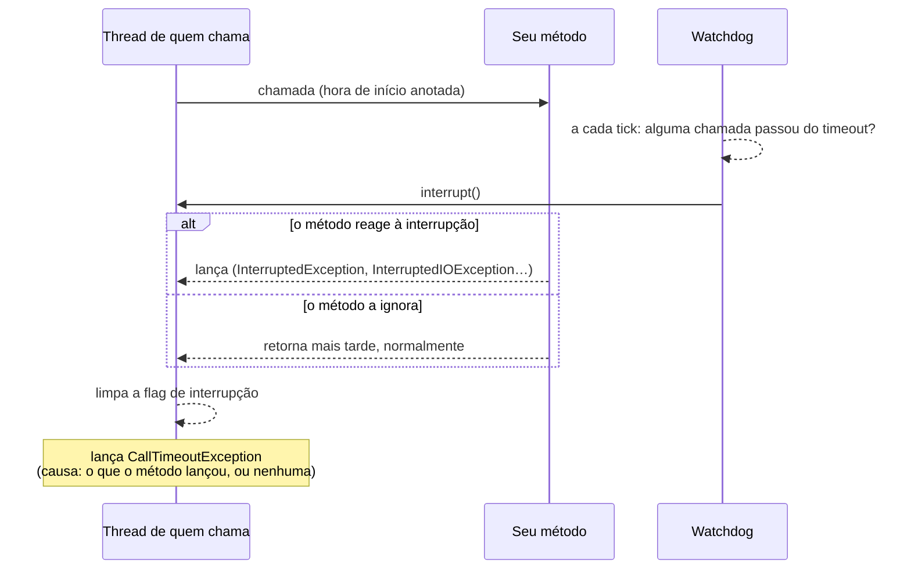

# Timeout

`@Timeout` limita quanto tempo uma chamada pode levar: uma chamada síncrona é interrompida, uma assíncrona faz o seu future falhar.

<div class="r4c-facts">

| Anotação | Posição | Tipos de retorno | Padrões |
|---|---|---|---|
| `@Timeout` | camada 6 de 7, dentro do AdaptiveLimit | sync, `CompletionStage`, `Mono`, `Flux` | 1 s por tentativa |

</div>

**Use quando** uma dependência pode travar, e um chamador esperando para sempre (segurando uma thread, uma conexão, um slot de bulkhead) é pior do que um erro.

**Não use quando** o código que você chama não pode ser interrompido e você precisa que ele pare: um timeout síncrono *pede* para a chamada parar interrompendo a thread dela, não consegue matá-la (veja [abaixo](#sync-the-call-is-interrupted)). Prefira os timeouts do próprio cliente (timeouts de conexão e de leitura do seu cliente HTTP ou driver JDBC) onde existirem, e mantenha `@Timeout` como limite superior.

## Exemplo mínimo :id=minimal-example

<!-- compare:start -->
<!-- snippet: timeout-minimal -->
```java
import dev.resilience4cata.annotation.Timeout;

public interface ReportApi {

    @Timeout("2s")
    String build(String reportId);
}
```
<!-- not-compiled: código gerado, resumido -->
```java
public final class ReportApi$Resilient implements ReportApi {
    // …
    public ReportApi$Resilient(ReportApi delegate, dev.resilience4cata.ResilienceRegistry registry) {
        // …
        this.timeout0 = dev.resilience4cata.generated.Policies.timeout(registry, "dev.resilience4cata.examples.docs.timeout.ReportApi#build(java.lang.String)", "", "", r4c$b -> {
            r4c$b.timeout(java.time.Duration.ofNanos(2000000000L));
        }, false);
    }

    @Override
    public java.lang.String build(java.lang.String p0) {
        final dev.resilience4cata.generated.TimeoutPolicy r4c$timeout = this.timeout0;
        final dev.resilience4cata.generated.TimeoutPolicy.Scope r4c$scope = r4c$timeout.enter();
        final java.lang.String r4c$result;
        try {
            r4c$result = this.delegate.build(p0);
        } catch (java.lang.Throwable r4c$e) {
            r4c$timeout.failed(r4c$scope, r4c$e);
            throw r4c$e;
        }
        r4c$timeout.succeeded(r4c$scope);
        return r4c$result;
    }
}
```
<!-- compare:end -->

Resumido: o arquivo real usa nomes totalmente qualificados.

## Como se comporta :id=how-it-behaves

### Sync: a chamada é interrompida :id=sync-the-call-is-interrupted

A chamada roda na thread de quem chama, como se não houvesse timeout; não há thread extra nem executor. Uma única thread daemon compartilhada, o watchdog, verifica as chamadas em andamento e **interrompe** a thread de quem chama quando a chamada passa do timeout.



- O que acontece em seguida depende do seu código. Chamadas bloqueantes que respondem a interrupções (`Thread.sleep`, `Object.wait`, `BlockingQueue.take`, `java.net.http.HttpClient.send`, a maior parte do I/O em virtual threads, canais NIO interrompíveis) param e lançam; o timeout então lança `CallTimeoutException` com essa exceção como causa.
- **Código que ignora interrupções roda até o fim primeiro**: um loop ocupado, I/O bloqueante clássico de `java.net.Socket` em uma platform thread, uma biblioteca que engole `InterruptedException`. A chamada continua até retornar; só então quem chama recebe `CallTimeoutException` (sem causa), e o resultado é descartado.
- A interrupção do watchdog é limpa antes de `CallTimeoutException` ser lançada, então ela nunca vaza para trabalho posterior nessa thread. Uma interrupção que a thread já tinha antes de o timeout passar é de quem chama, então é mantida.
- **Interromper I/O pode custar uma conexão.** Uma thread bloqueada em um canal interrompível (`InterruptibleChannel`, ou I/O de socket em uma virtual thread) tem esse canal fechado pela interrupção, então uma conexão de pool que ela usava é perdida e o pool precisa abrir uma nova. Defina os timeouts do próprio cliente mais curtos que `@Timeout` quando isso importar.
- **Precisão.** Uma chamada nunca é interrompida antes da hora, e no máximo cerca de dois ticks do watchdog depois. Um tick é um dezesseis avos do menor timeout em uso, entre 1 ms e 50 ms: com `@Timeout("2s")` sozinho, no máximo cerca de 100 ms de atraso. Numa máquina cujas esperas duram mais que um tick (cerca de 2 ms nos runners Windows do GitHub e 4 ms nas suas máquinas virtuais macOS, para 0,75 ms pedidos), um tick conta como essa espera, então um timeout atrasa algumas dessas esperas. Isso exige que o processo tenha CPU: sob um limite de CPU de container (uma cota de cgroup, que é o que um `limits.cpu` do Kubernetes define), uma JVM estrangulada congela o watchdog e quem chama juntos, e a interrupção vem quando o processo volta a rodar.
- Uma chamada que termina a tempo não é tocada. Chamadas cronometradas não leem relógio: o watchdog mantém um relógio grosseiro para elas.

> [!MEASURED]
> AWS Graviton3, JDK 25, serviços com 1500 chamadas por segundo e um `@Timeout` de 200 ms: sem limite, a interrupção mais tardia veio em 221.6–225.1 ms. Limitado a meio núcleo, as interrupções vieram com até 4.8 s de atraso, todas no primeiro minuto, enquanto o JIT compilava e o serviço era estrangulado na maioria dos períodos; nenhuma depois de 250 ms a partir daí. Nenhuma veio antes da hora. [Benchmarks: serviços sob um limite de CPU](../benchmarks.md#cpu-limit)

### Async: o future falha :id=async-the-future-fails

Para um método que retorna `CompletionStage<T>` ou `CompletableFuture<T>`, nada é interrompido. Se o stage não completou quando o timeout passa, o future que você recebeu falha com `CallTimeoutException`, e o stage do método é cancelado se for um `Future` (um `CompletableFuture` é). O prazo é mantido por um timer compartilhado e lock-free, nunca adiantado e no máximo cerca de dois ticks atrasado; o timeout é completado em uma nova virtual thread, nunca na do timer. Um stage que já está completo quando o método retorna não precisa de timer nenhum.

<!-- snippet: timeout-async -->
```java
@Timeout("2s")
CompletableFuture<String> build(String reportId);
```

O timeout cobre o stage, não a chamada ao método que o retorna: um método que bloqueia por 5 s *antes* de retornar o stage não leva timeout. O cancelamento passa pelas políticas dentro do timeout, então um bulkhead dentro libera o slot na hora. Cancelar o future que você recebeu cancela o prazo e o stage, sem `CallTimeoutException` e sem evento ([cancelamento](../guides/async.md#cancellation)). Veja [Métodos async](../guides/async.md).

### A exceção :id=the-exception

`dev.resilience4cata.CallTimeoutException` é uma `RuntimeException` com `id()` e `timeout()` (a `Duration` que foi excedida). Não tem stack trace; a mensagem dá o nome da instância e o timeout.

## Atributos :id=attributes

| Atributo | Tipo | Padrão | Chave de config | Significado |
|---|---|---|---|---|
| `value` | duração | `1s` | `defaults.timeout.value` | Tempo máximo que uma tentativa pode levar. Maior que 0. |
| `config` | `String` | `default` | só na anotação | Configuração nomeada da qual partir. |
| `locked` | `boolean` | `false` | só na anotação | Mantém os valores definidos na anotação: as chaves `instances.<id>.*` não podem mudá-los. Veja [Travando uma instância](../guides/configuration.md#locking-an-instance). |
| `enabled` | `boolean` | `true` | `defaults.timeout.enabled` | `false` deixa toda chamada passar; não definido herda. |

`@Timeout` **não tem `name`**: um timeout não guarda estado que valha a pena compartilhar, então todo método anotado recebe a própria política, com o id `<type>#<method>(<parameter types>)`. Na configuração externa o atributo é `value` (`configs.slow.timeout.value=10s`, `instances."com.acme.ReportApi#build(java.lang.String)".timeout.value=5s`); no código o método do builder é `TimeoutConfig.Builder.timeout(Duration)`. Veja [Configuração](../guides/configuration.md).

Também **não há handle**: o `registry` não tem `timeout(id)`. `registry.snapshot().timeouts()` lista um `TimeoutSnapshot(id, config)` por método.

## Com outras políticas :id=with-other-policies

O timeout é a quinta camada: dentro do RateLimiter, em volta do Bulkhead.

- **Por tentativa.** Dentro de `@Retry`, cada tentativa recebe o timeout inteiro. Para limitar a operação inteira, tentativas e delays incluídos, defina `@Retry(maxDuration = …)`.
- `CallTimeoutException` é uma `Exception`: por padrão, um `@Retry` externo a repete e um `@CircuitBreaker` externo a registra como falha.
- O tempo gasto esperando uma permissão do rate limiter não é contado (o limiter fica fora); o tempo gasto esperando um slot do bulkhead é (o bulkhead fica dentro). Uma espera de bulkhead interrompida vira `CallTimeoutException`.
- `@Fallback` vê `CallTimeoutException` como qualquer outra falha.

## O mesmo com `Pipeline` :id=same-thing-with-pipeline

<!-- snippet: timeout-pipeline -->
```java
Pipeline<String> build = Pipeline.builder(registry, "reports", String.class)
        .timeout(t -> t.timeout(Duration.ofSeconds(2)))
        .build();

String report = build.execute(() -> backend.build("r-1"));
```

Aqui o id do timeout é o id do pipeline, `"reports"`. Veja [API Pipeline](../guides/pipeline.md).

## Eventos e snapshot :id=events-and-snapshot

| Evento | Quando | Campos |
|---|---|---|
| `TimeoutEvent.TimedOut` | Uma chamada passou do timeout | `id`, `nanoTime`, `timeout` |

Chamadas que terminam a tempo não publicam nada. Veja [Observabilidade](../guides/observability.md).

## Testando com `ManualClock` :id=testing-it-with-manualclock

<!-- snippet: timeout-testing -->
```java
ReportApi slow = id -> {
    try {
        clock.sleep(Duration.ofSeconds(5));          // a slow dependency, on the test's clock
    } catch (InterruptedException e) {
        throw new IllegalStateException("interrupted", e);   // how the timeout reaches the call
    }
    return "report " + id;
};
ReportApi reports = Resilient.of(ReportApi.class, slow, registry);

assertThatThrownBy(() -> reports.build("r-1"))
        .isInstanceOf(CallTimeoutException.class)
        .hasCauseInstanceOf(IllegalStateException.class);   // what the call threw once interrupted
assertThat(Thread.currentThread().isInterrupted()).isFalse(); // the interrupt is cleared
```

Em um [`ManualClock`](../guides/testing.md), timeouts sync disparam exatamente quando o relógio passa do prazo, sem tick de folga, e timeouts async disparam na thread que avança o relógio. Um stub que simula uma dependência lenta com `clock.sleep(…)` é interrompido como código bloqueante real; um stub que chama `clock.advance(…)` em vez disso se comporta como código que ignora a interrupção.

## Letras miúdas :id=small-print

- Um timeout sync é cooperativo: depende de interrupções. Não consegue parar código que as ignora, e não deve ser usado para limitar trabalho preso em CPU que nunca verifica `Thread.interrupted()`.
- Se o seu código captura `InterruptedException` e segue em frente, a chamada não é cortada; restaure a flag (`Thread.currentThread().interrupt()`) ou relance.
- Uma chamada que termina bem no prazo, enquanto o watchdog a está interrompendo, ainda recebe `CallTimeoutException`: o resultado é decidido uma vez, e a interrupção é então limpa.
- Em uma platform thread, uma chamada bloqueada em I/O clássico de socket segura a thread até o timeout do próprio socket. Virtual threads tornam a maior parte do I/O bloqueante interrompível.
- Erros relacionados: [`R4C-ATR-001`](../errors.md#r4c-atr-001) (sintaxe de duração), [`R4C-ATR-002`](../errors.md#r4c-atr-002) (`@Timeout("0")`), [`R4C-ATR-006`](../errors.md#r4c-atr-006) (`enabled`), [`R4C-REG-004`](../errors.md#r4c-reg-004) (`config` desconhecida).

## Quanto custa :id=what-it-costs

> [!MEASURED]
> No AWS Graviton3 (`c7g.xlarge`, JDK 21), uma chamada sync por `@Timeout` que termina a tempo custa 22.2 ns em 1 thread e não aloca nada (uma execução posterior mediu 23.7 ns, uma questão em aberto); o Resilience4j 2.4.0 não tem timeout na thread de quem chama, e o seu `TimeLimiter` com um executor leva 8842 ns e 176 B. Uma chamada async cujo stage ainda está pendente custa 152 ns e 192 B, contra 598 ns e 240 B. [Benchmarks: conclusão do MVP](../benchmarks.md#mvp-completion-classifier-pipeline-events-testkit-2026-10-24-aws-graviton3), [execução posterior](../benchmarks.md#annotated-classes-generics-config-overrides-ticker-bulkhead-2026-10-24-aws-graviton3)

> [!MEASURED]
> Com uma nova virtual thread por requisição, toda chamada cronometrada é a primeira da sua thread e registra a thread no watchdog: cerca de 270 B a mais por thread, e com quatro threads começando ao mesmo tempo cerca de 0.8 µs além dos 9.3 µs que uma virtual thread leva para iniciar e terminar (join). Chamadas cronometradas posteriores na mesma thread não pagam isso. [Benchmarks: um timeout por nova virtual thread](../benchmarks.md#review-fixes)
