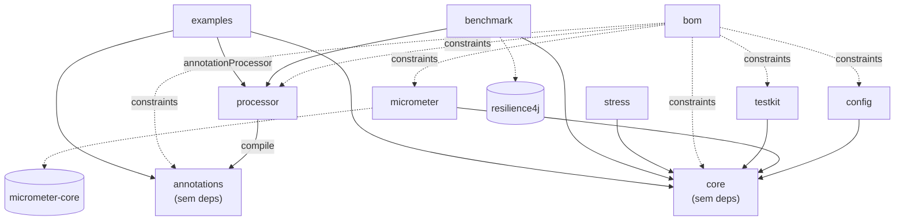

# 05 — Arquitetura do projeto, build e práticas de engenharia

> **Histórico.** Esta pesquisa é anterior à implementação e é mantida como foi escrita; para o que a biblioteca faz hoje, veja [recursos](../policies/README.md), [arquitetura](../architecture.md) e [benchmarks](../benchmarks.md).

> Pesquisa da fase 1. Status: **proposta**, nada aqui está implementado ainda.
> Versão em espanhol: [../../es/research/05-project-architecture.md](../../es/research/05-project-architecture.md)

Este documento trata da *forma* do repositório: quais módulos Gradle existem e o que cada um faz, como o build é organizado, como o JPMS se encaixa, as ferramentas de qualidade, como a documentação bilíngue é produzida e como versionamos e protegemos a API pública. Temas como o mecanismo de processamento de anotações, os detalhes internos de concorrência e a própria API de anotações são tratados por documentos de pesquisa irmãos. Este documento só aponta onde eles afetam a organização dos módulos.

---

## TL;DR

| Decisão | Recomendação |
|---|---|
| Nomes dos módulos | Diretórios de uma única palavra: `core`, `annotations`, `processor`, `config`, `micrometer`, `testkit`, `stress`, `benchmark`, `examples`, `bom`. Os artifactIds publicados ganham um prefixo: `resilience4cata-core`, … |
| Granularidade | **Um** motor de runtime (`core`) contendo todas as policies. *Não* dividir por padrão como o Resilience4j. O usuário precisa de no máximo 3 coordenadas (+ o BOM). |
| Dependências externas no `core` | **Zero** é viável no Java 21 (`System.Logger`, `VarHandle`, `InstantSource`, JFR). A única exceção que vale discutir é o JSpecify (só anotações, cerca de 4 KB). |
| Build | Gradle 9.x, Kotlin DSL, included build `build-logic` com convention plugins pré-compilados, `gradle/libs.versions.toml`, toolchain 21 + `--release 21`, configuration cache e build cache ligados. |
| Publicação | `com.vanniktech.maven.publish` para o **Central Portal** (o OSSRH foi desligado em 2025-06-30), assinatura GPG em memória a partir do CI e um BOM `java-platform`. |
| JPMS | Um `module-info.java` de verdade em todo módulo publicado. Os pacotes internos não são exportados. O processor faz `provides javax.annotation.processing.Processor`. |
| Qualidade | JUnit Jupiter, AssertJ, jqwik (atenção: modo de manutenção), jcstress, ArchUnit, Error Prone + NullAway (modo JSpecify), Spotless, JaCoCo, matriz do GitHub Actions com JDK 21 e 25. |
| Documentação | **Não** é um módulo Gradle. Markdown simples em `docs/en` e `docs/es`, renderizado pelo site Docsify que já está no repositório (GitHub Pages). O Javadoc é gerado pelo Gradle e linkado. |
| Estabilidade da API | SemVer com incubação `0.x`, os nossos próprios marcadores `@Experimental` / `@Internal`, e japicmp no CI a partir da `1.0`. |

---

## 1. Organização dos módulos :id=_1-module-layout

### 1.1 O que o Resilience4j faz, e o que os usuários não gostam :id=_11-what-resilience4j-does-and-what-users-dislike

O Resilience4j 2.x publica um artefato por padrão: `resilience4j-circuitbreaker`, `-ratelimiter`, `-bulkhead`, `-retry`, `-timelimiter`, `-cache`. Também publica `resilience4j-core`, o agregador `resilience4j-all` (que contém o builder `Decorators`), um `resilience4j-bom` e uma longa cauda de integrações (`-micrometer`, `-reactor`, `-rxjava3`, `-kotlin`, `-spring-boot3`, `-spring6`, `-vertx`, `-feign`, `-retrofit`, …) ([README](https://github.com/resilience4j/resilience4j), [BOM no Central](https://central.sonatype.com/artifact/io.github.resilience4j/resilience4j-bom)).

Pontos de dor que importam para o nosso design:

1. **Coordenadas demais para um caso de uso simples.** Um serviço típico acaba declarando de 4 a 6 artefatos, ou puxa o `-all`, o que anula a modularidade. Todo artefato de padrão depende de `resilience4j-core` de qualquer forma, então a divisão economiza muito pouco bytecode.
2. **As anotações estão amarradas ao Spring AOP.** `@CircuitBreaker`, `@Retry` e as demais vivem em `resilience4j-annotations`, mas só *fazem* algo por meio dos módulos de aspects do Spring (ou do Micronaut). Usuários de Java puro não têm suporte a anotações. É exatamente essa a lacuna que este projeto mira.
3. **A composição vive em um artefato diferente** (`Decorators` no `-all`) dos padrões que ela compõe.
4. **O alinhamento de versões entre muitos artefatos** obriga os usuários a usar o BOM.

Lição: dividir por **fronteira de dependência** (este código puxa uma biblioteca de terceiros, ou roda em outro momento, como tempo de compilação vs. runtime?), nunca por *recurso*.

### 1.2 Módulos propostos :id=_12-proposed-modules

Todos os nomes de diretório são de uma única palavra. Os artifactIds publicados usam o prefixo `resilience4cata-` para não serem ambíguos no Maven Central (`resilience4cata-core`). Em `settings.gradle.kts` o projeto Gradle continua `:core`, e o prefixo é aplicado no convention plugin de publicação.

| Módulo | Publicado | Responsabilidade | Dependências |
|---|---|---|---|
| `annotations` | ✅ | Só os tipos de anotação (`@CircuitBreaker`, `@Retry`, `@RateLimiter`, `@Bulkhead`, `@Timeout`, `@Fallback`, contêineres repetíveis para múltiplas configurações, mais `@Experimental` / `@Internal`). Nenhuma lógica. | nenhuma |
| `core` | ✅ | Todas as implementações de policies, o registry, os objetos do *modelo* de configuração, o pipeline de composição, a SPI de eventos/métricas, eventos JFR e o suporte de runtime que o código gerado chama. | nenhuma (só JDK) |
| `processor` | ✅ | O annotation processor: valida as anotações em tempo de compilação e gera código. Os usuários o adicionam só a `annotationProcessor`. | `annotations` (compile) |
| `config` | ✅ | Carrega a configuração das policies de fontes externas: `java.util.Properties`, propriedades do sistema, variáveis de ambiente e uma SPI `ConfigSource` para outras. Liga isso ao modelo de configuração do `core`. | `core` |
| `micrometer` | ✅ | Faz a ponte entre os eventos/métricas do `core` e o `MeterRegistry` do Micrometer. | `core`, `io.micrometer:micrometer-core` |
| `testkit` | ✅ | Utilitários de teste para os **usuários**: um relógio controlável, schedulers determinísticos, stubs de injeção de falhas, asserções no estilo AssertJ sobre o estado das policies. | `core`; JUnit/AssertJ como `compileOnly` |
| `bom` | ✅ | Um BOM `java-platform` que alinha todos os módulos publicados. | só restrições |
| `stress` | ❌ | Testes jcstress para as máquinas de estado lock-free do `core`. | `core`, jcstress |
| `benchmark` | ❌ | Benchmarks JMH que nos comparam com o Resilience4j (e com uma linha de base sem operação). | `core`, `processor`, Resilience4j, JMH |
| `examples` | ❌ | Pequenos programas executáveis, compilados com o processor. Servem também como testes de ponta a ponta do código gerado. | `annotations`, `core`, `processor` |
| `docs` | ❌ | Fontes da documentação. **Não é um projeto Gradle** (veja §5). | — |

Notas sobre os nomes:

- **Evite `test` como nome de projeto.** `gradle test` e `:test` já se referem à *task* `test`, então um projeto chamado `test` vira `:test:test` e torna a seleção de tasks confusa. `testkit` não é ambíguo. O JUnit, o Micrometer e o próprio Gradle usam o mesmo nome para esse fim.
- Dê aos módulos de integração o nome **do que integram** (`micrometer`, depois `opentelemetry`), não o de um conceito genérico (`metrics`). Isso mantém a regra de uma palavra conforme as integrações crescem.
- Possíveis módulos futuros, todos de uma palavra: `opentelemetry`, `reactor`, `kotlin`, `spring`, `quarkus` (fora do escopo por enquanto).

### 1.3 `annotations` deve ser separado do `core`? :id=_13-should-annotations-be-separate-from-core

As duas opções são viáveis. É uma decisão barata de rever antes da `1.0`.

- **Separado (recomendado).** O `core` continua uma biblioteca puramente programática, utilizável sem nenhuma anotação, do mesmo jeito que o Failsafe é usado. O processor depende só do pequeno jar `annotations`. Se a pesquisa de design da API optar pela retenção `CLASS` para uso só com geração de código, os usuários podem colocar `annotations` em `compileOnly`. O custo é mais uma coordenada, que o BOM esconde.
- **Unificado.** O usuário precisa só de `core` + `processor`. O custo é que o processor path do processor arrasta o `core` inteiro, e o pacote de anotações passa a fazer parte da superfície de API do módulo de runtime.

De qualquer forma, **os pacotes não podem ser divididos** entre jars (o JPMS proíbe). As anotações vão em `…​.annotation`, o motor em `…​.core` e subpacotes.

### 1.4 Grafo de dependências :id=_14-dependency-graph



Regras, impostas pelo ArchUnit e pelo build (veja §4):

- `core` e `annotations` **não** têm dependências de projeto nem externas.
- Nenhum módulo depende de `processor` em runtime. Ele só fica em uma configuração `annotationProcessor`.
- O código gerado pelo `processor` depende **só da API exportada do `core`**, mais `annotations` quando a retenção é `RUNTIME`. Esse é o contrato entre o processor e o runtime. Ele deve viver em um pacote exportado dedicado (por exemplo `…​.core.spi.generated`) para poder evoluir de forma deliberada.
- As integrações (`config`, `micrometer`, …) dependem do `core`, nunca umas das outras.

O que um usuário escreve:

```kotlin
dependencies {
    implementation(platform("io.github.<ns>:resilience4cata-bom:0.1.0"))
    implementation("io.github.<ns>:resilience4cata-core")
    implementation("io.github.<ns>:resilience4cata-annotations")
    annotationProcessor("io.github.<ns>:resilience4cata-processor")
}
```

### 1.5 "Zero dependências externas no core" é viável? :id=_15-is-zero-external-dependencies-in-core-feasible

Sim. Tudo o que um runtime de resiliência precisa está na plataforma do JDK 21:

| Necessidade | Resposta do JDK 21 |
|---|---|
| Logging | `System.Logger` (JEP 264), que encaminha para SLF4J/Log4j/JUL pelas suas pontes `System.LoggerFinder`. O Resilience4j depende de `slf4j-api` para isso; nós não precisamos. |
| Atômicos, estado lock-free | `java.util.concurrent.atomic`, `VarHandle`, `LongAdder`, `StampedLock` |
| Tempo | `System.nanoTime()`, `java.time.InstantSource` (Java 17) para relógios testáveis |
| Agendamento / async | `ScheduledExecutorService`, `CompletableFuture`, virtual threads (JEP 444, final no 21) |
| Observabilidade | Eventos customizados `jdk.jfr`, com custo quase zero quando desligados. Use `requires static jdk.jfr` para que imagens jlink sem JFR continuem funcionando. |
| Tipos funcionais | `java.util.function` mais as nossas próprias interfaces no estilo `CheckedSupplier`. O Resilience4j 2.0 abandonou o Vavr pelo mesmo motivo. |
| Leitura de configuração | `java.util.Properties`. YAML/HOCON ficam em módulos opcionais, se um dia existirem. |

A **única** dependência que vale considerar é o **JSpecify** (`org.jspecify:jspecify`). Ele contém só anotações, não tem dependências transitivas, tem cerca de 4 KB e hoje é usado pelo Spring Framework 7 e pelo Guava ([jspecify.dev](https://jspecify.dev/)). Duas opções:

- `compileOnly` + `requires static org.jspecify`. Estritamente zero dependências em runtime, mas consumidores Kotlin e IDEs perdem a informação de nulidade, a menos que adicionem o jar por conta própria.
- `api` + `requires transitive org.jspecify`. Um jar minúsculo, informação de nulidade completa para os consumidores.

Recomendação: `api`, documentado como "zero dependências exceto as anotações do JSpecify". Foi nisso que o ecossistema Java convergiu em 2025. Mantenha o `processor` também sem dependências: evite o JavaPoet, ou faça shading dele. Vários processors populares (Dagger, AutoValue) trazem versões diferentes do JavaPoet no mesmo processor path, e os conflitos ali são dolorosos.

---

## 2. Gradle (Kotlin DSL) para uma biblioteca multimódulo, 2025–2026 :id=_2-gradle-kotlin-dsl-for-a-multi-module-library-20252026

### 2.1 Organização do repositório :id=_21-repository-layout

```
resilience4cata/
├── settings.gradle.kts
├── gradle.properties
├── gradle/
│   ├── libs.versions.toml
│   └── wrapper/
├── build-logic/                 # included build, NOT a subproject
│   ├── settings.gradle.kts
│   ├── build.gradle.kts         # `kotlin-dsl` plugin
│   └── src/main/kotlin/
│       ├── r4c.java-library.gradle.kts
│       ├── r4c.published.gradle.kts
│       ├── r4c.quality.gradle.kts
│       └── r4c.benchmark.gradle.kts
├── annotations/ core/ processor/ config/ micrometer/ testkit/ bom/
├── stress/ benchmark/ examples/
└── docs/                        # not part of the Gradle build
```

`build-logic` é o nome convencional para o included build. Ele não é um subprojeto e nunca é publicado, mas contém um hífen. Se a regra de uma palavra também deve valer ali, `conventions` é uma alternativa limpa. A documentação do Gradle usa `build-logic` nos seus exemplos ([sharing build logic](https://docs.gradle.org/current/userguide/sharing_build_logic_between_subprojects.html)).

### 2.2 Settings

```kotlin
// settings.gradle.kts
pluginManagement {
    includeBuild("build-logic")
}
plugins {
    id("org.gradle.toolchains.foojay-resolver-convention") version "<latest>"
}
dependencyResolutionManagement {
    repositoriesMode = RepositoriesMode.FAIL_ON_PROJECT_REPOS
    repositories { mavenCentral() }
}
enableFeaturePreview("TYPESAFE_PROJECT_ACCESSORS")
rootProject.name = "resilience4cata"
include("annotations", "core", "processor", "config", "micrometer",
        "testkit", "bom", "stress", "benchmark", "examples")
```

### 2.3 Convention plugins (sem `allprojects {}` / `subprojects {}`) :id=_23-convention-plugins-no-allprojects---subprojects-

O Gradle desaconselha a configuração entre projetos porque ela quebra o isolamento de projetos e o configuration cache. Em vez disso, cada módulo aplica as convenções de que precisa ([Gradle best practices](https://docs.gradle.org/current/userguide/best_practices.html), [structuring builds](https://docs.gradle.org/current/userguide/multi_project_builds.html)):

```kotlin
// build-logic/src/main/kotlin/r4c.java-library.gradle.kts
plugins { `java-library` }

java {
    toolchain { languageVersion = JavaLanguageVersion.of(21) }
    withSourcesJar(); withJavadocJar()
}
tasks.withType<JavaCompile>().configureEach {
    options.release = 21
    options.compilerArgs.addAll(listOf("-Xlint:all", "-Werror", "-parameters"))
}
tasks.withType<Test>().configureEach { useJUnitPlatform() }
```

```kotlin
// core/build.gradle.kts
plugins {
    id("r4c.java-library")
    id("r4c.published")
    id("r4c.quality")
}
// no dependencies block: that's the point
```

Dentro de um precompiled script plugin, leia o version catalog com `the<VersionCatalogsExtension>().named("libs")`, ou use o contorno comum que expõe os acessores tipados de `libs` ao `build-logic`.

### 2.4 Version catalog

`gradle/libs.versions.toml` é a fonte única de versões para bibliotecas **e** plugins ([docs](https://docs.gradle.org/current/userguide/version_catalogs.html)). Esboço:

```toml
[versions]
junit = "6.0.+"          # pin exact in reality
assertj = "3.27.+"
jmh = "1.37"
errorprone = "2.+"
nullaway = "0.12.+"
jspecify = "1.0.0"
resilience4j = "2.3.0"

[libraries]
jspecify = { module = "org.jspecify:jspecify", version.ref = "jspecify" }
junit-bom = { module = "org.junit:junit-bom", version.ref = "junit" }
assertj = { module = "org.assertj:assertj-core", version.ref = "assertj" }
resilience4j-bom = { module = "io.github.resilience4j:resilience4j-bom", version.ref = "resilience4j" }

[plugins]
jmh = { id = "me.champeau.jmh", version = "0.7.2" }
maven-publish = { id = "com.vanniktech.maven.publish", version = "0.34.0" }
spotless = { id = "com.diffplug.spotless", version = "<latest>" }
errorprone = { id = "net.ltgt.errorprone", version = "<latest>" }
japicmp = { id = "me.champeau.gradle.japicmp", version = "<latest>" }
```

(As versões são ilustrativas. Fixe versões exatas quando o build for escrito, e deixe o Renovate ou o Dependabot mantê-las atualizadas.)

### 2.5 Toolchains e testes em vários JDKs :id=_25-toolchains-and-multi-jdk-testing

- Compile com **toolchain 21** e `options.release = 21`. O `release` garante que nunca chamamos uma API mais nova que a 21, mesmo que o toolchain seja mais novo. Os toolchains são provisionados automaticamente pelo foojay resolver ([toolchains](https://docs.gradle.org/current/userguide/toolchains.html)).
- Teste contra outros JDKs **sem recompilar**, sobrescrevendo o test launcher:

```kotlin
val testJdk = providers.gradleProperty("testJdk").map(String::toInt)
tasks.withType<Test>().configureEach {
    javaLauncher = testJdk.flatMap { v ->
        javaToolchains.launcherFor { languageVersion = JavaLanguageVersion.of(v) }
    }.orElse(javaToolchains.launcherFor(java.toolchain))
}
```

O CI então roda `./gradlew check -PtestJdk=25`. Isso pega diferenças reais de runtime, como a mudança de pinning de virtual threads do JDK 24 ([JEP 491](https://openjdk.org/jeps/491)) e o comportamento mais novo do JIT.

### 2.6 Configuration cache, build cache, paralelismo :id=_26-configuration-cache-build-cache-parallelism

O Gradle 9 tornou o configuration cache o modo de execução **preferido**, e ele está planejado como padrão no Gradle 10 ([notas da 9.0](https://docs.gradle.org/9.0.0/release-notes.html)). O Gradle 9.1 adicionou um modo somente leitura para CI ([notas da 9.1](https://docs.gradle.org/9.1.0/release-notes.html)). Comece com ele ligado desde o primeiro dia. Adaptá-lo depois é muito mais difícil.

```properties
# gradle.properties
org.gradle.configuration-cache=true
org.gradle.configuration-cache.problems=fail
org.gradle.caching=true
org.gradle.parallel=true
```

Todos os plugins escolhidos aqui suportam o configuration cache. O vanniktech adicionou suporte na publicação na 0.34.0.

### 2.7 Testando o annotation processor :id=_27-testing-the-annotation-processor

Três camadas:

1. **Testes de compilação em nível unitário.** Use o [Google compile-testing](https://github.com/google/compile-testing) (`Compiler.javac().withProcessors(new Processor()).compile(source)`, depois `assertThat(compilation).succeeded()` / `.hadErrorContaining(...)` / `.generatedSourceFile(...)`). Ele é agnóstico de framework e funciona com o JUnit Jupiter. Só a sua `CompilationRule` é específica do JUnit 4. A alternativa é um harness próprio de 50 linhas sobre `javax.tools.JavaCompiler` + um `JavaFileManager` em memória, que evita a dependência de Guava/Truth (só em escopo de teste, então isso importa pouco).
   Teste os **diagnósticos** com o mesmo cuidado que o caminho feliz: uma configuração inválida deve falhar em tempo de compilação com uma mensagem precisa no elemento culpado. Esse é um diferencial em relação à validação só em runtime.
2. **Ponta a ponta.** O módulo `examples` (e o próprio `src/integrationTest` do processor) é compilado com o processor real no processor path. Os seus testes executam o código gerado.
3. **Integração com o Gradle.** O [Gradle TestKit](https://docs.gradle.org/current/userguide/test_kit.html) serve para testar *plugins do Gradle*. Só precisamos dele se um dia publicarmos um plugin do Gradle. Para o processor, use-o de forma pontual para verificar o **processamento incremental de anotações**: o processor deve se declarar em `META-INF/gradle/incremental.annotation.processors` (`isolating` se cada arquivo gerado vem de exatamente um tipo anotado, `aggregating` caso contrário). Senão, todo build de usuário perde a compilação incremental ([docs](https://docs.gradle.org/current/userguide/java_plugin.html#sec:incremental_annotation_processing)). Um pequeno teste com TestKit pode verificar que mexer em um arquivo-fonte não dispara uma recompilação completa.

### 2.8 JMH

Use o [`me.champeau.jmh`](https://github.com/melix/jmh-gradle-plugin) (0.7.2 no Plugin Portal no momento em que isto foi escrito) em `benchmark`. Práticas:

- Os benchmarks ficam em `src/jmh/java`. Mantenha-os fora do `check` porque são lentos. Rode-os sob demanda e em um job agendado de CI em um runner dedicado, não nos runners compartilhados do GitHub, cujo ruído torna os números pouco confiáveis.
- Compare igual com igual: as mesmas configurações de policies em nós e no Resilience4j, mais uma linha de base sem policy. Reporte `thrpt` e `avgt` com `-prof gc` (a taxa de alocação por operação é uma métrica principal), com 1, 4 e N threads (`@Threads`, `@Group` para contenção mista de leitura/escrita).
- Publique os resultados brutos em JSON (`resultFormat = "JSON"`) e renderize-os na documentação.

### 2.9 Publicando no Maven Central :id=_29-publishing-to-maven-central

- A Sonatype **desligou o OSSRH em 30 de junho de 2025**. A nova publicação passa pelo **Central Portal** (`central.sonatype.com`) ([aviso da Sonatype](https://central.sonatype.org/news/20250326_ossrh_sunset/)).
- Use o [`com.vanniktech.maven.publish`](https://github.com/vanniktech/gradle-maven-publish-plugin) (0.34.0 ou posterior). Ele mira o Central Portal, gera os metadados de POM que o Central exige (nome, descrição, URL, licença, desenvolvedores, SCM), adiciona os jars de sources/javadoc, assina e suporta o configuration cache ([releases](https://github.com/vanniktech/gradle-maven-publish-plugin/releases)).

```kotlin
// build-logic/src/main/kotlin/r4c.published.gradle.kts
plugins { id("com.vanniktech.maven.publish") }
mavenPublishing {
    publishToMavenCentral(automaticRelease = false)
    signAllPublications()
    coordinates("io.github.<ns>", "resilience4cata-${project.name}", version.toString())
    pom { /* name, description, url, licenses, developers, scm */ }
}
```

- **Namespace:** verifique `io.github.<github-user>` (instantâneo via GitHub) ou um domínio próprio por registro DNS TXT. Escolha antes do primeiro release, porque é permanente.
- **Assinatura no CI:** passe `ORG_GRADLE_PROJECT_signingInMemoryKey`, `…KeyPassword`, `ORG_GRADLE_PROJECT_mavenCentralUsername` e `…Password` (um *user token* do Portal) como secrets do GitHub. Nada de arquivos de keyring.
- **BOM:** o módulo `bom` aplica `java-platform` e declara `api(project(":core"))` e os outros módulos publicados como restrições. Os metadados de módulo do Gradle (`.module`) são publicados junto com o POM.
- Fluxo de release: tag `vX.Y.Z`, depois o CI publica, depois um clique manual em "Publish" no Portal no começo (`automaticRelease = false`). Passe para automático quando o pipeline for confiável.

---

## 3. JPMS

### 3.1 Um `module-info.java` por módulo publicado :id=_31-one-module-infojava-per-published-module

```java
// core/src/main/java/module-info.java
module io.github.ns.resilience4cata.core {
    requires static jdk.jfr;
    requires transitive org.jspecify;           // if JSpecify is `api`
    exports io.github.ns.resilience4cata.core;
    exports io.github.ns.resilience4cata.core.spi;
    exports io.github.ns.resilience4cata.core.spi.generated; // contract for generated code
    // ...core.internal is NOT exported
    uses io.github.ns.resilience4cata.core.spi.EventListenerProvider;
}
```

```java
// processor/src/main/java/module-info.java
module io.github.ns.resilience4cata.processor {
    requires java.compiler;
    requires io.github.ns.resilience4cata.annotations;
    provides javax.annotation.processing.Processor
        with io.github.ns.resilience4cata.processor.ResilienceProcessor;
}
```

Também inclua `META-INF/services/javax.annotation.processing.Processor` em `processor`. A maioria dos builds (Gradle, Maven, IDEs) coloca os processors em um processor path **no estilo classpath**, em que `provides` é ignorado e o que vale é o arquivo de serviço.

Benefícios: encapsulamento real dos pacotes `internal` (mais forte que convenções de nomes), compatibilidade com jlink e uma garantia do tipo ArchUnit verificada pelo próprio `javac`. O Gradle infere o module path automaticamente quando há um `module-info.java` ([Java modules in Gradle](https://docs.gradle.org/current/userguide/java_library_plugin.html#sec:java_library_modular)).

### 3.2 Como os annotation processors interagem com o JPMS :id=_32-how-annotation-processors-interact-with-jpms

- **O processor roda em tempo de compilação no compilador do usuário**, a partir do processor path (`-processorpath`) ou do processor module path (`--processor-module-path`). Ele nunca está no module path de runtime do usuário. No Gradle ele vai na configuração `annotationProcessor`.
- **O código gerado vive no módulo e nos pacotes do usuário.** `Filer.createSourceFile` escreve no módulo que está sendo compilado. Então o `module-info.java` do usuário precisa de `requires io.github.ns.resilience4cata.core` (e de `…annotations` quando a retenção é `RUNTIME`). Documente isso, e faça o processor emitir um erro claro quando um módulo está sendo compilado (`Elements.getModuleOf(...)` não é o módulo sem nome) e o módulo necessário falta no seu `module-info`.
- **A geração de código não precisa de `opens`.** As classes geradas ficam no mesmo pacote que a classe anotada e a chamam diretamente, sem reflection profunda. Abordagens baseadas em reflection ou bytecode *exigem* que o usuário faça `opens` de pacotes ou entregue um `MethodHandles.Lookup`. Esse é mais um argumento a favor do APT, que a pesquisa sobre mecanismos cobre a fundo.
- **Pacotes divididos são proibidos.** É por isso que as anotações, o core e o código gerado precisam de pacotes distintos. O código gerado compartilha um pacote com o código *do usuário*, e isso é ok porque ambos estão no módulo do usuário.
- **Testes:** os testes unitários whitebox rodam com patch dentro do módulo (o Gradle cuida do `--patch-module`). Os testes blackbox podem ficar em um source set separado com o seu próprio `module-info.java` para testar exatamente o que os consumidores veem.

---

## 4. Ferramentas de qualidade :id=_4-quality-tooling

| Ferramenta | Papel | Notas |
|---|---|---|
| **JUnit Jupiter** (JUnit 6) | Motor de testes | O JUnit 6.0 ficou GA em 2025-09-30 com base no Java 17 ([InfoQ](https://www.infoq.com/news/2025/10/junit6-java17-kotlin)). Use-o via `junit-bom`. |
| **AssertJ** | Asserções | O `testkit` pode trazer asserções AssertJ customizadas (`assertThat(circuitBreaker).isOpen()`). |
| **jqwik** | Testes baseados em propriedades e **com estado/baseados em modelo** de máquinas de estado (transições do circuit breaker, invariantes do token bucket) | ⚠️ O jqwik está em **modo de pura manutenção**: só atualizações de dependências e correções críticas ([jqwik](https://jqwik.net/), [notas de release](https://jqwik.net/release-notes.html)). Ainda é utilizável como dependência só de teste. Verifique a compatibilidade com a JUnit Platform 6 antes de adotá-lo, e mantenha as propriedades simples o bastante para portá-las para um harness simples de JUnit `@RepeatedTest` + `Random` com seed se necessário. |
| **jcstress** | Correção de concorrência de código lock-free sob o JMM | Fica no módulo `stress`. Rode-o pelo plugin `io.github.reyerizo.gradle.jcstress` ou com um `JavaExec` simples. Rode à noite ou sob demanda, porque é lento. Esta é a ferramenta para provar que as transições de estado e a contagem de permissões não perdem atualizações ([jcstress](https://github.com/openjdk/jcstress)). |
| **ArchUnit** | Fronteiras de módulos e pacotes | Regras: o `core` só depende de `java..`/`jdk.jfr..`/`org.jspecify..`. Nada fora de `internal` expõe tipos `internal`. O contrato `spi.generated` só é usado pelo código gerado ([ArchUnit](https://www.archunit.org/)). |
| **Error Prone + NullAway** | Detecção estática de bugs e segurança contra nulos | Plugin `net.ltgt.errorprone`. O Error Prone recente precisa de um JDK recente para *rodar* o javac, o que é ok no 21. O NullAway em **modo JSpecify** no JDK 21 precisa de `-XDaddTypeAnnotationsToSymbol=true` (OpenJDK) para as verificações completas de genéricos/type-use, e é totalmente nativo no JDK 22+ ([NullAway JSpecify support](https://github.com/uber/NullAway/wiki/JSpecify-Support)). Marque os pacotes com `@NullMarked`. |
| **JSpecify** | Anotações de nulidade | Veja §1.5. |
| **Spotless** | Formatação | `palantir-java-format` ou `google-java-format`, mais cabeçalhos de licença e formatação do Kotlin DSL (ktlint) para os scripts de build. `spotlessCheck` roda no `check`. |
| **JaCoCo** | Cobertura | Agregue com o plugin `jacoco-report-aggregation`. Trate a cobertura como um sinal, não um portão. Considere testes de mutação com **PIT** para o `core` mais adiante. |
| **GitHub Actions** | CI | Veja abaixo. |

### Esboço de CI :id=ci-sketch

```yaml
# .github/workflows/ci.yml (illustrative)
jobs:
  build:
    strategy:
      matrix:
        test-jdk: [21, 25]
        os: [ubuntu-latest]
        include:
          - { test-jdk: 25, os: windows-latest }
          - { test-jdk: 25, os: macos-latest }
    runs-on: ${{ matrix.os }}
    steps:
      - uses: actions/checkout@v4
      - uses: actions/setup-java@v4
        with: { distribution: temurin, java-version: "21\n${{ matrix.test-jdk }}" }
      - uses: gradle/actions/setup-gradle@v4    # caching + wrapper validation
      - run: ./gradlew check -PtestJdk=${{ matrix.test-jdk }}
```

Outros jobs: `japicmp` (em PRs, a partir da 1.0), `stress` + `benchmark` noturnos (runner dedicado), `release` nas tags e a action de dependency submission do Gradle para os alertas do Dependabot. Considere também builds early-access do JDK (26-ea) como `continue-on-error`.

Versões suportadas: **21 e 25 são ambas LTS**. A 21 é a base. A 25 é o alvo de compatibilidade futura.

---

## 5. Módulo de documentação :id=_5-documentation-module

### 5.1 Estado atual :id=_51-current-state

O repositório já contém `docs/` com uma casca **Docsify v4** (`index.html`, `README.md`, `.nojekyll`). Está pronta para o GitHub Pages e não tem etapa de build. O Docsify renderiza o Markdown no navegador no momento da visualização.

### 5.2 Opções comparadas :id=_52-options-compared

| Opção | Prós | Contras |
|---|---|---|
| **Markdown simples no GitHub** | Zero ferramentas. Legível no repositório e na IDE. | Sem busca, sem seletor de idioma, navegação fraca. |
| **Docsify** (atual) | Sem build. O Markdown continua simples. Pastas por idioma com o seu próprio `_sidebar.md`, um seletor de idioma via `_navbar.md` e plugins como o [docsify-namespaced](https://github.com/palkan/docsify-namespaced) ([multi-language with Docsify](https://evilmartians.com/chronicles/easy-multi-language-multi-version-documentation-with-docsify-git-and-github-actions)). | Renderização no cliente, então o SEO é mais fraco. A v4 é antiga e a v5 está demorando a chegar. Sem documentação versionada de fábrica. |
| **MkDocs Material** (plugin i18n) | Saída e busca excelentes. | ⚠️ Em **modo de manutenção desde 2025-11-05**, com correções críticas prometidas só até cerca de novembro de 2026. A equipe passou para o **Zensical** ([cobertura do anúncio](https://duerrenberger.dev/blog/2025/11/06/material-for-mkdocs-is-no-more-long-live-zensical), [issue](https://github.com/squidfunk/mkdocs-material/issues/8523)). Não comece um site novo nele agora. |
| **Zensical** | Sucessor do MkDocs Material. Lê `mkdocs.yml`. | Jovem, e a paridade de plugins (i18n, blog, …) ainda está sendo alcançada. Toolchain Python em um repositório Java. |
| **Docusaurus** | i18n de primeira classe (`i18n/es/...`), documentação versionada, maduro. | Toolchain Node/React. Mais pesado do que precisamos agora. |
| **Astro Starlight** | Bom i18n, saída estática rápida. | Toolchain Node. |

### 5.3 Recomendação :id=_53-recommendation

1. **docs não é um módulo Gradle.** Não tem fontes Java nem nada para o Gradle compilar ou publicar. Torná-lo um projeto Gradle só aumentaria o tempo de configuração. Mantenha `docs/` como um diretório simples. Ele ainda é um "módulo" no sentido do IntelliJ (`docs.iml`), o que é ok. Os únicos pontos de contato com o Gradle são tasks *em outros módulos* que alimentam o site: um `javadoc` agregado copiado para `docs/api/` no momento do release, e os resultados JSON dos benchmarks.
2. **Organização das fontes:** idioma primeiro, estrutura idêntica em cada locale.

```
docs/
├── index.html            # Docsify shell
├── README.md             # landing page / language chooser
├── _navbar.md            # EN | ES switcher
├── en/
│   ├── README.md
│   ├── _sidebar.md
│   ├── guide/ …
│   └── research/05-project-architecture.md
└── es/
    ├── README.md
    ├── _sidebar.md
    ├── guide/ …
    └── research/05-project-architecture.md
```

3. **Mantenha o Docsify na fase 1**, já que ele existe e não precisa de build. Mantenha o Markdown **neutro em relação à ferramenta**: CommonMark/GFM padrão mais blocos Mermaid, sem sintaxe exclusiva do Docsify. Assim, uma migração posterior para Zensical, Docusaurus ou Starlight é uma mudança de configuração, não uma reescrita. Reavalie na `1.0`, quando a documentação versionada se tornar necessária.
4. **Disciplina de tradução:** o inglês é a fonte da verdade. Todo PR que mexe em `docs/en/**` deve mexer em `docs/es/**`, ou levar o label `translation-pending`. Um pequeno script de CI pode verificar que as duas árvores contêm o mesmo conjunto de arquivos. Código e identificadores ficam em inglês nos dois idiomas.

---

## 6. Versionamento, estabilidade da API e verificações de compatibilidade :id=_6-versioning-api-stability-and-compatibility-checks

### 6.1 Versionamento :id=_61-versioning

- **SemVer.** `0.y.z` durante a incubação, em que mudanças incompatíveis são permitidas em versões minor e listadas no changelog. A `1.0.0` vem quando a API de anotações e o contrato do código gerado estiverem estáveis.
- Uma única versão para todos os módulos (o BOM implica isso). Mantenha-a em `gradle.properties` (`version=0.1.0-SNAPSHOT`).
- Escreva o `CHANGELOG.md` no estilo "Keep a Changelog". As notas de release são bilíngues no site de documentação; só inglês basta no changelog.

### 6.2 Marcadores de estabilidade :id=_62-stability-markers

Defina os nossos próprios marcadores em `annotations`, para não precisar de dependência do API Guardian (o JUnit usa `@API(status = EXPERIMENTAL)` do apiguardian, o que seria uma dependência extra):

```java
@Documented
@Retention(RetentionPolicy.CLASS)
@Target({TYPE, METHOD, CONSTRUCTOR, FIELD, PACKAGE, ANNOTATION_TYPE})
public @interface Experimental { String since() default ""; }

@Documented
@Retention(RetentionPolicy.CLASS)
@Target({TYPE, METHOD, CONSTRUCTOR, FIELD, PACKAGE})
public @interface Internal { }
```

- `@Experimental`: público, mas pode mudar em qualquer versão minor, e excluído das verificações de compatibilidade.
- `@Internal` + pacotes `…internal` (não exportados pelo JPMS): nunca fazem parte da API. Existem só para necessidades entre pacotes dentro dos nossos módulos.
- O **contrato do código gerado** (`core.spi.generated`) é especial. O código compilado pelo processor da versão N precisa continuar funcionando no `core` N. Documente a regra "as versões do processor e do core devem coincidir" e imponha-a: o código gerado pode embutir a versão do processor, e o `core` pode verificá-la uma vez na inicialização da classe e falhar na hora com uma mensagem clara. O BOM facilita fazer as versões coincidirem.

### 6.3 Verificações de compatibilidade :id=_63-compatibility-checks

| Ferramenta | Notas |
|---|---|
| **japicmp** ([site](https://siom79.github.io/japicmp/), plugin Gradle `me.champeau.gradle.japicmp`) | Diff de compatibilidade binária e de código-fonte do jar contra a última versão publicada no Central. Suporta exclusão por anotação (`@Experimental`, `@Internal`) e por pacote (`*.internal`). Simples, rápido, bem mantido. **Recomendado.** |
| **Revapi** ([site](https://revapi.org/)) | Mais poderoso (ciente de semver, filtragem rica), mas o suporte a Gradle é mais fraco. O plugin `gradle-revapi` da Palantir não é mais mantido ativamente. Mais adequado ao Maven. |

Plano: ligar o japicmp no convention `r4c.published` como parte do `check`. Mantê-lo *informativo* na `0.x`, e **falhando** a partir da `1.0` para todo módulo publicado exceto o `processor`. Para o processor, a "API" são as anotações mais o código gerado, que os testes de `examples` cobrem.

---

## 7. Questões em aberto para as outras linhas de pesquisa :id=_7-open-questions-for-the-other-research-tracks

1. A **retenção** das anotações (`CLASS` vs. `RUNTIME`) determina se `annotations` pode ser `compileOnly`, e se precisa ser unificado com o `core` (§1.3).
2. Se a pesquisa sobre mecanismos escolher um fallback em runtime (proxies ou bytecode), ele precisa de um módulo separado (por exemplo `proxy` ou `agent`), para que o `core` continue sem dependências e os usuários que só usam geração de código não paguem por ele.
3. Formato da configuração externa: `Properties` + env vão bastar para o `config`, ou os usuários vão esperar YAML? Qualquer coisa além de `Properties` significa uma dependência opcional, portanto um módulo separado ou uma SPI.
4. Group id / namespace no Central (`io.github.<user>` vs. um domínio) e o pacote Java raiz / nome do módulo JPMS.

---

## Fontes :id=sources

- Repositório e README do Resilience4j: <https://github.com/resilience4j/resilience4j>
- BOM do Resilience4j no Central: <https://central.sonatype.com/artifact/io.github.resilience4j/resilience4j-bom>
- Notas de release do Gradle 9.0 (configuration cache preferido): <https://docs.gradle.org/9.0.0/release-notes.html>
- Notas de release do Gradle 9.1 (configuration cache somente leitura): <https://docs.gradle.org/9.1.0/release-notes.html>
- Gradle: compartilhando lógica de build / convention plugins: <https://docs.gradle.org/current/userguide/sharing_build_logic_between_subprojects.html>
- Boas práticas do Gradle: <https://docs.gradle.org/current/userguide/best_practices.html>
- Version catalogs do Gradle: <https://docs.gradle.org/current/userguide/version_catalogs.html>
- Toolchains do Gradle: <https://docs.gradle.org/current/userguide/toolchains.html>
- Processamento incremental de anotações no Gradle: <https://docs.gradle.org/current/userguide/java_plugin.html#sec:incremental_annotation_processing>
- Módulos Java no Gradle: <https://docs.gradle.org/current/userguide/java_library_plugin.html#sec:java_library_modular>
- Gradle TestKit: <https://docs.gradle.org/current/userguide/test_kit.html>
- Google compile-testing: <https://github.com/google/compile-testing>
- Plugin JMH para Gradle: <https://github.com/melix/jmh-gradle-plugin>, <https://plugins.gradle.org/plugin/me.champeau.jmh>
- vanniktech gradle-maven-publish-plugin: <https://github.com/vanniktech/gradle-maven-publish-plugin>
- Fim do OSSRH da Sonatype: <https://central.sonatype.org/news/20250326_ossrh_sunset/>
- JSpecify: <https://jspecify.dev/>
- Suporte a JSpecify no NullAway: <https://github.com/uber/NullAway/wiki/JSpecify-Support>
- Anúncio do JUnit 6 (InfoQ): <https://www.infoq.com/news/2025/10/junit6-java17-kotlin>
- jqwik e notas de release: <https://jqwik.net/>, <https://jqwik.net/release-notes.html>
- jcstress: <https://github.com/openjdk/jcstress>
- ArchUnit: <https://www.archunit.org/>
- JEP 491 (virtual threads sem pinning): <https://openjdk.org/jeps/491>
- Modo de manutenção do Material for MkDocs: <https://duerrenberger.dev/blog/2025/11/06/material-for-mkdocs-is-no-more-long-live-zensical>, <https://github.com/squidfunk/mkdocs-material/issues/8523>
- Documentação multilíngue com Docsify: <https://evilmartians.com/chronicles/easy-multi-language-multi-version-documentation-with-docsify-git-and-github-actions>, <https://github.com/palkan/docsify-namespaced>
- japicmp: <https://siom79.github.io/japicmp/>
- Revapi: <https://revapi.org/>
