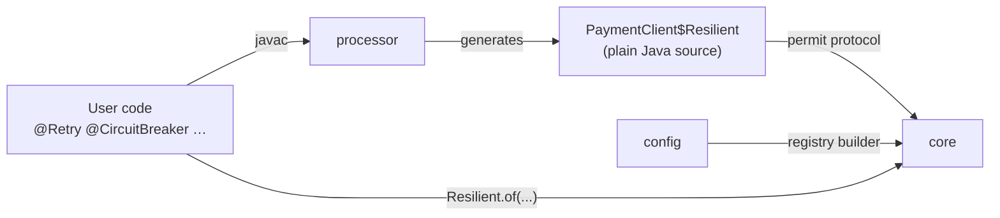
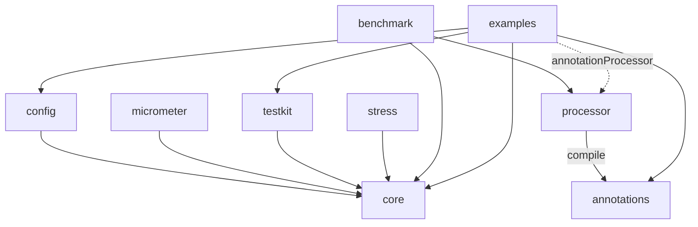

# 架构

> 综合自 [02 注解机制](research/02-annotation-mechanisms.md)、[03 性能内部机制](research/03-performance-internals.md) 和 [05 项目架构](research/05-project-architecture.md)。本文描述 0.6.0 中实现的设计；研究文档记录了它是如何被选定的。

## 概览 :id=overview



1. 用户给接口或非 final 类加注解。
2. 在编译期，`processor` 校验注解（降级签名、时长、冲突的 bundle），并 **生成普通 Java 源码**：为接口生成一个委托包装器，为非 final 类生成一个子类。
3. 在启动时，用户构建一个 `ResilienceRegistry`（以编程方式和/或从外部配置），对于接口用 `Resilient.of(PaymentClient.class, impl, registry)` 获取实例，对于类则用 `Resilient.create(InventoryService.class, registry, constructorArgs...)`（或生成的构造函数 `new InventoryService$Resilient(registry, ...)`）。
4. 注解处理器是 **必需的**。如果缺少生成的类（没有配置注解处理器），`Resilient.of` 会在启动时失败，并给出一条消息，显示需要添加的 `annotationProcessor` 行。没有反射或代理作为后备。
5. 配置只在创建实例时解析 **一次**，变成保存在生成类 `final` 字段中的不可变策略对象。调用时从不查找任何东西。

## 注解机制 :id=annotation-mechanism

决策：**在编译期进行注解处理（APT）并生成源码**（[02 §5](research/02-annotation-mechanisms.md)）。

在我们自己的 JMH 测试中测得的分派开销（JDK 25，Apple M1，简单的保护逻辑；直接调用耗时 1.2 ns）（[02 §3](research/02-annotation-mechanisms.md)）：

| 机制 | 1 种服务类型 | 4 种服务类型 | 内存分配 | 首个实例 |
|---|---:|---:|---:|---:|
| APT，策略协议内联 | 2.4–2.6 ns | 6.9–7.3 ns | 0 B | 0.37 ms |
| APT，通过共享的 `execute(Supplier)` | 2.5 ns | 14.2 ns | 0 B | — |
| 运行时 ByteBuddy | 2.0 ns | ~6.0 ns | 0 B | ~200 ms |
| `Proxy` + `Method.invoke` | 16 ns | 37 ns | 16–64 B | 2.4 ms |

为什么选择 APT：

- 每次调用的开销与手写代码相近，无反射，调用点是单态的。
- 启动即时，无需配置即可在 GraalVM 原生镜像（native image）中工作，堆栈信息可读。
- 诸如降级签名错误或时长无效这类错误会变成编译错误。
- 除了添加一个 `annotationProcessor` 依赖之外，用户无需任何额外步骤。没有 JVM 参数，没有 agent，没有特殊编译器。

被否决或推迟的方案：

- **运行时 ByteBuddy：** 首个实例约需 200 ms，一个 9 MB 的依赖，以及额外的原生镜像配置。
- **AspectJ 和 Java agent：** 需要 JVM 参数，有 JEP 451 动态 attach 警告，而且织入器总是落后于每个 JDK 版本。
- **Class-File API：** 自 JDK 24 起才正式定稿，无法在 Java 21 基线下使用。
- **`Proxy` 后备：** 目前被否决。注解处理器是必需的，注解使用 `CLASS` 保留策略。如果将来增加 `dynamic` 模块，改为 `RUNTIME` 保留策略是兼容的变更。

### 生成代码的形态 :id=shape-of-the-generated-code

JMH 测试表明，生成代码的 **形态** 与机制本身同样重要。一旦存在多个服务，通过共享 lambda 调用策略会让开销翻倍。因此 `core` 暴露两套 API：

- 一套 **面向人的函数式 API**（`Pipeline`、构建器），用于无法加注解的代码。
- 一套底层、无内存分配的 **面向生成代码的许可协议**，位于包 `dev.resilience4cata.generated` 中（已导出，但只供生成的代码使用）：熔断器的 `acquire()` / `onSuccess(token, started)` / `onFailure(token, started, error)`，重试的 `start()` / `onFailure(attempts, error, start)` / `pause(delay)`，超时的 `enter()` / `succeeded(scope)` / `failed(scope, error)`，等等。

每个策略是一层：public 方法持有最外层，每个内层都是一个签名相同的 private 方法，最后调用实现。下面是注解处理器为 `String track(String)` 上的 `@Retry` + `@CircuitBreaker` + `@Timeout` 生成的代码（取自入门指南；此处缩短了全限定名）：

```java
@Override
public String track(String p0) throws IOException {
    final RetryPolicy r4c$retry = this.retry0;
    final long r4c$start = r4c$retry.start();
    int r4c$attempts = 0;
    while (true) {
        try {
            return this.r4c$circuitBreaker0(p0);
        } catch (Throwable r4c$e) {
            final long r4c$delay = r4c$retry.onFailure(++r4c$attempts, r4c$e, r4c$start);
            if (r4c$delay < 0 || !r4c$retry.pause(r4c$delay)) {
                throw r4c$e;
            }
        }
    }
}

private String r4c$circuitBreaker0(String p0) throws IOException {
    final CircuitBreakerPolicy r4c$cb = this.circuitBreaker0;
    final long r4c$token = r4c$cb.acquire();
    if (r4c$token < 0) {
        throw r4c$cb.rejection();                          // preallocated, stackless
    }
    final long r4c$started = r4c$cb.startTimer();          // reads the clock only if slowCallDuration is set
    try {
        final String r4c$result = this.r4c$timeout0(p0);
        r4c$cb.onSuccess(r4c$token, r4c$started);
        return r4c$result;
    } catch (Throwable r4c$e) {
        r4c$cb.onFailure(r4c$token, r4c$started, r4c$e);
        throw r4c$e;
    }
}

private String r4c$timeout0(String p0) throws IOException {
    final TimeoutPolicy r4c$timeout = this.timeout0;
    final TimeoutPolicy.Scope r4c$scope = r4c$timeout.enter();
    final String r4c$result;
    try {
        r4c$result = this.delegate.track(p0);              // monomorphic call
    } catch (Throwable r4c$e) {
        r4c$timeout.failed(r4c$scope, r4c$e);
        throw r4c$e;
    }
    r4c$timeout.succeeded(r4c$scope);
    return r4c$result;
}
```

异步方法（返回 `CompletionStage` 或 `CompletableFuture`）是例外：它们被生成为嵌套的 `policy.executeAsync(() -> next)` 调用，因为 future 本身就会分配内存并经过多态回调，所以每层一个 lambda 在那里的开销很小。

`processor`/`core` 版本不匹配会在创建实例时被检测到：如果生成的类缺少当前 `core` 所期望的构造函数，`Resilient.of` / `Resilient.create` 会以 [`R4C-RT-004`](errors.md#r4c-rt-004) 失败。请使用 BOM 让两者保持相同版本。

### 接口注解与实现注解 :id=interface-vs-implementation-annotations

| 风格 | 生效的注解 | 优先级，由低到高 |
|---|---|---|
| 包装器：`Resilient.of(PaymentClient.class, impl, registry)` | 仅接口。实现在编译期是未知的；给实现加注解会让该类改用子类风格 | 声明接口 < 被包装接口 < 接口方法 |
| 子类：`Resilient.create(HttpPaymentClient.class, registry)` | 接口和实现 | 接口 < 接口方法 < 类 < 类方法 |

在子类风格中，实现 **优先**，按属性逐个合并：只设置了 `maxAttempts` 的类方法会保留接口上声明的 `delay`。

### 自调用 :id=self-invocation

决策：只要机制允许，同一对象内一个方法对另一个方法的调用 **会被拦截**。

| 风格 | 用户代码中的 `this.other()` | 原因 |
|---|---|---|
| 子类（带注解的非 final 类，`Resilient.create(InventoryService.class, registry)`） | **被拦截** | 生成的子类覆盖了 `other()`，因此虚调用会经过它 |
| 包装器（带注解的接口，`Resilient.of(PaymentClient.class, impl, registry)`） | 不被拦截 | 用户的实现直接调用自身；包装器永远看不到 |

这一差异已写入[入门指南](start/how-it-works.md)。在包装器风格中需要自调用的用户应改为给实现类加注解。递归调用自身的方法每次调用都会经过其策略，这一点也已写入文档。

## 策略内部机制 :id=policy-internals

按实际实现描述，以 [03](research/03-performance-internals.md) 中的提案为起点；无锁部分用 jcstress 检查，每一次热路径修改都用 JMH 检查（[基准测试](benchmarks.md)）。

| 策略 | 设计 |
|---|---|
| 熔断器 | 状态是一个不可变的阶段对象（关闭、打开、半开、强制打开、禁用），通过 `VarHandle` 以 CAS 替换，因此只在状态转换时分配对象；许可携带阶段的代数（generation），过期的结果会被丢弃；计数窗口是一个用 `getAndSet` 更新的槽位数组加计数器，时间窗口是以 `LongAdder` 计数的一秒桶；在关闭且只有快速成功时，一次调用只需读取一个 `quiet` 字段；计数窗口在竞争下是近似的（与结束 quiet 状态的那次失败相竞争的一次成功可能未被记录；相隔整整一个窗口的两次调用在同一槽位上竞争时，保留后写入的值） |
| 限流器 | 在一个填充（padded）的 `long`（理论到达时间）上用普通 CAS 实现 GCRA；拒绝路径只做读取；CAS 失败的调用方先 park 1 ns 再重试；没有后台线程 |
| 舱壁隔离 | `maxWait = 0` 时，在一个填充的计数器上做 CAS 循环（用 acquire 语义的 compare-and-set 占用槽位，用 volatile 加法归还）；`maxWait > 0` 时，使用自己的非公平信号量（`BulkheadSemaphore`：空闲槽位使用相同的计数器和原子操作，只有等待的线程才使用 `AbstractQueuedSynchronizer` 队列）；异步等待者以非阻塞方式排队，并直接获得释放出的槽位 |
| 自适应限流 | 舱壁隔离的快速失败计数器，对照以 opaque 方式读取的限额；每次完成的调用把它的延迟加到所在线程的累计计数器条带上（有损的普通写入，128 字节条带）；在窗口截止时间之后完成调用的线程获取一个单次 CAS 的窗口锁，并根据窗口的平均延迟、最大在途调用数和丢弃情况运行 Gradient2 或 AIMD（Netflix concurrency-limits）；没有后台线程 |
| 重试 | 尝试状态保存在局部变量中；成功路径不分配任何内存；完全抖动、均等抖动或无抖动。重试预算通过对所在线程条带的有损读写来计数调用：在读和写之间被暂停的线程会写回一个较旧的计数，抹掉其他线程在此期间对该条带的增加。这种丢失没有固定大小，但只会降低预算（重试更少，绝不会更多），而且只有当调用的线程多于条带数（2 × CPU 数，最多 64）时条带才会共享 |
| 超时 | 调用留在调用方线程上；一个共享的看门狗线程对照一个粗粒度时钟检查每个线程可复用的 scope，并中断超时的调用，使用带 stamp 的 CAS 协议，确保中断绝不会落到下一次调用上；异步超时使用一个独立的无锁定时器（条带化收件箱），从不提前触发 |
| 横切关注点 | 有类型的事件 record，只在有人监听时分配；按需生成快照（拉取）；对写热点字段做填充；预分配的无栈拒绝异常；除非特性需要，否则不读取时钟 |

在 Java 21 基线下不可用：`StructuredTaskScope`（在 JDK 25 中仍是预览 API）。`synchronized` 的 pinning 问题直到 JDK 24（JEP 491）才修复，因此热路径上禁止使用 `synchronized`。

## 模块 :id=modules

单词命名的目录。以 groupId `dev.resilience4cata` 发布（项目拥有 `resilience4cata.dev`）；artifactId 带有前缀：`resilience4cata-core`，以此类推。根 Java 包和 JPMS 模块前缀：`dev.resilience4cata`（[05 §1](research/05-project-architecture.md)）。

| 模块 | 是否发布 | 职责 | 依赖 |
|---|---|---|---|
| `annotations` | 是 | 注解类型，以及 `@Experimental` / `@Internal` | — |
| `core` | 是 | 所有策略、注册表、配置模型、`Pipeline`、生成代码协议、事件和快照 | —（仅 JDK，外加 JSpecify） |
| `processor` | 是 | 注解处理器：校验和代码生成 | `annotations` |
| `config` | 是 | 把 properties 文件、classpath 资源、环境变量和系统属性加载到注册表构建器中 | `core` |
| `micrometer` | 是 | Micrometer 指标：来自事件的计数器，来自熔断器、舱壁隔离、限流器和自适应限流 handle 的 gauge（[指南](guides/micrometer.md)） | `core`、`micrometer-core` |
| `opentelemetry` | 是 | OpenTelemetry 指标，与 Micrometer 模块的相同（[指南](guides/opentelemetry.md)） | `core`、`opentelemetry-api` |
| `testkit` | 是 | 面向用户的测试辅助工具：`ManualClock`（时钟、睡眠和定时器）、带种子的抖动、`elapseWaitInOpen` | `core` |
| `junit` | 是 | JUnit Jupiter 扩展：每个测试一个新的 `ManualClock` 和注册表（[测试指南](guides/testing.md#junit)） | `testkit`、`junit-jupiter-api` |
| `bom` | 是 | 版本对齐（`resilience4cata-bom`） | — |
| `benchmark` | 否 | 与 Resilience4j 对比的 JMH | `core`、`processor`、Resilience4j |
| `stress` | 否 | 针对无锁结构的 jcstress | `core` |
| `mutation` | 否 | 针对 `core` 单元测试的 PIT 变异测试，每周一次 | `core` |
| `examples` | 否 | 可运行的示例，同时也是生成代码的端到端测试 | `annotations`、`core`、`config`、`testkit`、`junit`、`micrometer`、`opentelemetry`、`processor` |
| `docs` | 否 | 文档。不是 Gradle 项目 | — |



规则，由模块描述符（`module-info.java`）和 Gradle 依赖强制保证（尚未使用 ArchUnit）：

- 注解所引用的接口（`FallbackHandler<T>`、`Classifier<T>`）位于 `core` 而不是 `annotations` 中，这样 `annotations` 可以保持为 `compileOnly`。注解属性的类型是 `Class<?>`，由注解处理器在编译期检查该类是否实现了正确的接口。

- `core` 和 `annotations` 没有依赖，只有 `core` 中的 JSpecify（`api`，仅注解）除外。
- `processor` 从不是运行时依赖；它只出现在 `annotationProcessor` 上。
- 生成的代码只使用 `core` 导出的 API。
- 集成模块依赖 `core`，从不相互依赖。
- 按依赖边界拆分，而不是按模式拆分。Resilience4j 每种模式一个构件的拆分方式是一个常见的抱怨点。
- 没有名为 `test` 的模块：它会与 Gradle 的 `test` 任务冲突，因此该模块叫 `testkit`。

用户需要声明的内容（详情、Maven 和 JPMS 见[入门](start/installation.md)）：

```groovy
dependencies {
    implementation platform('dev.resilience4cata:resilience4cata-bom:1.0.0-RC4')
    annotationProcessor platform('dev.resilience4cata:resilience4cata-bom:1.0.0-RC4')   // the processor path does not inherit it
    implementation 'dev.resilience4cata:resilience4cata-core'
    compileOnly 'dev.resilience4cata:resilience4cata-annotations'   // CLASS retention: not needed at runtime
    annotationProcessor 'dev.resilience4cata:resilience4cata-processor'
}
```

## 构建与工具 :id=build-and-tooling

基于 [05 §2–§4](research/05-project-architecture.md)，当前的配置如下：

- **任何地方都不使用 Kotlin。** Gradle 9（wrapper 9.6），使用 Groovy DSL，保持精简和声明式（`settings.gradle`，每个模块一个简短的 `build.gradle`）。所有构建逻辑都放在 **用 Java 编写** 的约定插件中，位于 `conventions` included build。版本在 `gradle/libs.versions.toml` 中。
- Java 工具链 21，使用 `--release 21`、`-Xlint:all -Werror`；CI 矩阵为 JDK 21 和 25（GitHub Actions，尚未在 GitHub 上运行）。开启配置缓存和构建缓存。
- 每个发布的模块都有 `module-info.java`；内部包不导出。
- 测试：JUnit、AssertJ、jcstress、JMH（带内存分配门禁）和 PIT（对 `core` 的变异测试，每周一份报告）。注解处理器测试使用一个基于纯 `javax.tools` 的小型 `Compilation` 辅助类在内存中编译源码，而不是 compile-testing 库。ArchUnit 和 jqwik（处于维护模式）只是想法，未被使用。
- 静态分析：`javac -Xlint:all -Werror` 和 JSpecify 空值注解。Error Prone + NullAway、Spotless 和 JaCoCo 只是想法，尚未配置。
- 发布：发布到 Maven Central Portal（OSSRH 已于 2025 年 6 月关闭），使用 Gradle 自带的 `maven-publish` 和 `signing` 插件，没有第三方插件。`r4c.publish` 约定插件编写 POM 并签名；位于根目录的 `r4c.central` 构建一个经过检查的 bundle zip，并通过 Publisher API 将其作为一个部署上传，然后在门户中手动发布。`dev.resilience4cata` 命名空间通过 `resilience4cata.dev` 上的 DNS TXT 记录在 Central Portal 上完成了验证。步骤：[发布](releasing.md)。
- 版本管理：SemVer，孵化期间为 `0.x`。`apiCompatibility`（japicmp，在 `check` 和 CI 中）将每个发布的模块与上一次发布比较：`1.0` 之前是警告，从 `1.0` 开始除非主版本号变化否则构建失败（[发布](releasing.md)）。对用户而言，一个主版本保持哪些兼容性：[兼容性](reference/compatibility.md)。

## 文档 :id=documentation

- `docs/` 是纯 Markdown，不是 Gradle 模块，由 Docsify（`docs/index.html`）提供服务。
- `docs/en` 和 `docs/es` 的文件树相同。英文为准；对 `docs/en` 的每一处修改都必须同步更新 `docs/es`。
- Markdown 保持与工具无关（CommonMark/GFM 加 Mermaid），因此将来换用其他站点生成器无需重写。
