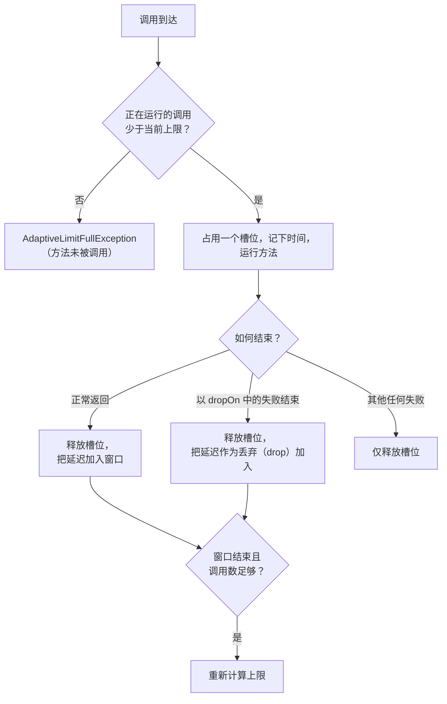

# 自适应限流

`@AdaptiveLimit` 像舱壁隔离（bulkhead）一样限制同时运行的调用数，但它会自己找出这个上限：依赖的延迟保持稳定时提高上限，延迟上升或调用超时时降低上限。

<div class="r4c-facts">

| 注解 | 位置 | 返回类型 | 默认值 |
|---|---|---|---|
| `@AdaptiveLimit` | 第 5 层（共 7 层），在 RateLimiter 内部 | 同步、`CompletionStage`、`Mono`、`Flux` | Gradient2，从 20 开始，保持在 1 到 200 之间，窗口至少 1 s 且至少 10 次调用 |

</div>

**适用场景**：依赖的容量未知或会变化（它是共享的、会自动扩缩容、负载取决于其他客户端），因此任何固定的 `@Bulkhead(maxConcurrent = …)` 要么在状况好时太低，要么在状况差时太高。上限会稳定在依赖无需排队就能处理的并发量附近，并在它开始排队时下降：多余的调用会被立即拒绝，而不是堆积在慢调用后面。

**不适用场景**：你知道合适的数值（大小为 10 的连接池、4 个会话的许可）：[舱壁隔离](bulkhead.md)更简单，也更可预测。如果你需要的是每秒调用数，请使用[限流器](rate-limiter.md)。

## 最小示例 :id=minimal-example

<!-- compare:start -->
<!-- snippet: adaptive-limit-minimal -->
```java
import dev.resilience4cata.annotation.AdaptiveLimit;

public interface SearchClient {

    @AdaptiveLimit
    String search(String query);
}
```
<!-- not-compiled: 生成的代码，有删节 -->
```java
public final class SearchClient$Resilient implements SearchClient {
    // …
    public SearchClient$Resilient(SearchClient delegate, dev.resilience4cata.ResilienceRegistry registry) {
        // …
        this.adaptiveLimit0 = dev.resilience4cata.generated.Policies.adaptiveLimit(registry, "dev.resilience4cata.examples.docs.adaptivelimit.SearchClient#search(java.lang.String)", "", "", null, false);
    }

    @Override
    public java.lang.String search(java.lang.String p0) {
        final dev.resilience4cata.generated.AdaptiveLimitPolicy r4c$adaptiveLimit = this.adaptiveLimit0;
        final long r4c$start = r4c$adaptiveLimit.acquire();
        final java.lang.String r4c$result;
        try {
            r4c$result = this.delegate.search(p0);
        } catch (java.lang.Throwable r4c$e) {
            r4c$adaptiveLimit.onFailure(r4c$start, r4c$e);
            throw r4c$e;
        }
        r4c$adaptiveLimit.onSuccess(r4c$start);
        return r4c$result;
    }
}
```
<!-- compare:end -->

有删节：真实文件使用全限定名。

## 行为方式 :id=how-it-behaves



- **槽位。** 调用在运行前占用一个槽位，返回或抛出异常时归还。同一时刻最多有*当前上限*个调用持有槽位。上限从 `initialLimit` 开始，始终保持在 `minLimit` 与 `maxLimit` 之间。
- **拒绝。** 发现所有槽位都被占用的调用会立即以 `dev.resilience4cata.AdaptiveLimitFullException` 失败（一个带 `id()` 的 `RuntimeException`；每个实例一个，无堆栈跟踪）。方法不会被调用。没有等待：上限已满时总是拒绝。
- **样本。** 每个正常返回的调用都是一个*样本*：它的延迟，从占用槽位到调用结束。列在 `dropOn` 中的失败也是样本，但被标记为*丢弃（drop）*：依赖过载了。其他任何失败（404、校验错误）只释放槽位，不说明负载情况，所以不算样本。
- **窗口。** 样本按窗口分组，每个窗口至少持续 `window`（1 s）且至少包含 `minWindowSamples` 次调用（10）。当某个调用在窗口结束后完成且窗口有足够样本时，该调用的线程会根据窗口的平均延迟、其间观察到的最大在途调用数以及是否有调用被丢弃，重新计算上限。已结束但调用太少的窗口会再延长一个 `window`，并保留其样本：它们在窗口结束时计入。因此流量很少时上限变化缓慢（并且每个窗口只检查一次，而不是每次调用都检查），没有流量时上限不变。
- **上限降低时的在途调用。** 当上限降到低于已在运行的调用数时，不会中断任何调用：新调用会被拒绝，直到足够多的调用结束。
- **禁用**（`enabled = false`）：所有调用都通过，不做任何测量。

## 算法 :id=the-algorithms

两种算法都遵循 Netflix 的 [concurrency-limits](https://github.com/Netflix/concurrency-limits) 库（`Gradient2Limit` 和 `AIMDLimit`，版本 0.5.4），每个窗口应用一次。

**`GRADIENT2`**（默认）把窗口延迟与长期平均延迟进行比较，长期平均是对 `longWindow` 个窗口（600）的指数平均。只要窗口延迟保持在长期平均的 `rttTolerance` 倍以内（1.5×），上限每个窗口就小幅增长，增长 `queueSize`（4）的五分之一（`smoothing`）：每个窗口约 0.8。当延迟高于该值时，上限按比例缩小，每次最多减半。当使用中的槽位少于一半时它不会增长，因为此时延迟无法说明上限的情况。长时间过载之后，一旦延迟恢复正常，长期平均会更快下降，上限随之恢复。它会学习新的常态：在很多窗口中持续偏高的延迟会成为长期平均，上限会从那里再次增长。

**`AIMD`**（加性增、乘性减）忽略延迟。出现丢弃的窗口之后，上限乘以 `backoffRatio`（0.9）；没有丢弃且至少一半槽位在使用的窗口之后，上限加一。当延迟噪声太大而没有意义，或者你的过载信号是下游的超时或已满的舱壁时，使用它。

<!-- snippet: adaptive-limit-aimd -->
```java
@AdaptiveLimit(name = "orders-aimd", algorithm = LimitAlgorithm.AIMD, initialLimit = 10,
        dropOn = {java.net.SocketTimeoutException.class, dev.resilience4cata.CallTimeoutException.class})
String cancel(String order);
```

## 属性 :id=attributes

| 属性 | 类型 | 默认值 | 配置键 | 含义 |
|---|---|---|---|---|
| `algorithm` | `LimitAlgorithm` | `GRADIENT2` | `defaults.adaptiveLimit.algorithm` | `GRADIENT2` 或 `AIMD`，见上文。`INHERIT` 表示未设置。 |
| `initialLimit` | `int` | `20` | `defaults.adaptiveLimit.initialLimit` | 第一个窗口结束前的上限。 |
| `minLimit` | `int` | `1` | `defaults.adaptiveLimit.minLimit` | 上限能降到的最低值。至少为 1。 |
| `maxLimit` | `int` | `200` | `defaults.adaptiveLimit.maxLimit` | 上限能升到的最高值。 |
| `window` | 时长 | `1s` | `defaults.adaptiveLimit.window` | 窗口至少持续多久，从 `10ms` 到 `1h`。 |
| `dropOn` | 异常类 | `CallTimeoutException`、`BulkheadFullException`、`TimeoutException` | `defaults.adaptiveLimit.dropOn` | 表示依赖过载的失败。 |
| `ignoreOn` | 异常类 | 无 | `defaults.adaptiveLimit.ignoreOn` | 永远不算样本的失败；优先于 `dropOn`。 |
| `name` | `String` | 每个方法一个上限 | 仅限注解 | 实例 id；`name` 相同的方法共享一个上限及其槽位。 |
| `config` | `String` | `default` | 仅限注解 | 作为起点的命名配置。 |
| `locked` | `boolean` | `false` | 仅限注解 | 保留注解中设置的值：`instances.<id>.*` 键无法修改它们。见[锁定实例](../guides/configuration.md#locking-an-instance)。 |
| `enabled` | `boolean` | `true` | `defaults.adaptiveLimit.enabled` | `false` 放行所有调用；不设置则继承。 |

<!-- snippet: adaptive-limit-tuned -->
```java
@AdaptiveLimit(name = "orders", initialLimit = 10, maxLimit = 100, window = "500ms")
@Timeout("2s") // inside the limit: a timeout is a drop, and the limit backs off
String place(String order);
```

为了保持注解精简，算法自身的调优参数没有对应的注解属性：`minWindowSamples`（10）、Gradient2 的 `smoothing`（0.2）、`rttTolerance`（1.5）、`longWindow`（600）和 `queueSize`（4），以及 AIMD 的 `backoffRatio`（0.9）。在命名配置中设置它们：

<!-- snippet: adaptive-limit-registry -->
```java
ResilienceRegistry registry = ResilienceRegistry.builder()
        .adaptiveLimit("backend", a -> a.algorithm(AdaptiveLimitConfig.Algorithm.AIMD)
                .backoffRatio(0.8)
                .minWindowSamples(20))
        .build();
```

或者在外部配置中设置，并在方法上使用 `@AdaptiveLimit(config = "backend")`：

<!-- snippet: adaptive-limit-properties -->
```properties
defaults.adaptiveLimit.maxLimit=100
configs.backend.adaptiveLimit.algorithm=aimd
configs.backend.adaptiveLimit.backoffRatio=0.8
configs.backend.adaptiveLimit.minWindowSamples=20
instances.orders.adaptiveLimit.rttTolerance=2
```

所有键及其有效值见[配置参考](../reference/configuration.md#adaptive-limit)。

## 用在类上 :id=on-a-class

在带注解的类上（类型级别或方法上），由生成的子类应用该上限（[带注解的类](../guides/annotated-classes.md)）：

<!-- snippet: adaptive-limit-class -->
```java
@AdaptiveLimit(maxLimit = 50)
public class InventoryService {

    public int stock(String sku) {
        return 7;
    }
}
```

## 共享与实例 id :id=sharing-and-instance-ids

没有 `name` 时，每个方法有自己的上限，id 为 `<type>#<method>(<parameter types>)`。调用同一依赖的方法通常应该共享一个上限：给它们相同的 `name`。它们必须解析为相同的配置，否则包装会以 [`R4C-REG-008`](../errors.md#r4c-reg-008) 失败。

### 句柄 :id=handle

`registry.adaptiveLimit(id)` 返回一个 `AdaptiveLimitHandle`：

<!-- snippet: adaptive-limit-handle -->
```java
AdaptiveLimitHandle limit = registry.adaptiveLimit("orders");
int current = limit.limit();                   // how many calls may run at once now
int running = limit.concurrentCalls();                // calls inside right now
AdaptiveLimitSnapshot snapshot = limit.snapshot(); // limit, concurrentCalls, bounds, windows, latencies
```

| 方法 | 作用 |
|---|---|
| `id()` | `name`，或派生 id |
| `config()` | 解析后的 `AdaptiveLimitConfig` |
| `limit()` | 当前上限 |
| `concurrentCalls()` | 此刻持有槽位的调用数 |
| `snapshot()` | 一个 `AdaptiveLimitSnapshot(id, algorithm, limit, concurrentCalls, minLimit, maxLimit, windows, windowLatency, longTermLatency)`，外加 `availableSlots()`。`windowLatency` 是上一个窗口的平均值；`longTermLatency` 是 Gradient2 的长期平均（AIMD 为零） |

上限在其接口被包装或其 pipeline 构建之后才存在；未知 id 会抛出 [`R4C-REG-009`](../errors.md#r4c-reg-009)。用 `registry.snapshot().adaptiveLimits()` 列出它们。

## 与其他策略配合 :id=with-other-policies

自适应限流位于限流器内部、超时和舱壁隔离外部：

- **内部的 `@Timeout` 就是过载信号。** 超时的调用以 `CallTimeoutException` 失败，它默认在 `dropOn` 中：该调用的延迟（即超时时长）进入窗口，AIMD 随之回退。内部已满的 `@Bulkhead`（`BulkheadFullException`）也是如此。
- **外层策略看到的是 `AdaptiveLimitFullException`。** 它是一个 `Exception`：默认情况下外层的 `@Retry` 会在其延迟后重试它（把它加入 `abortOn` 即可快速失败），但外层的 `@CircuitBreaker` 永远不会记录它：已满的上限不会打开熔断器。当某次尝试被上限拒绝时，`@Hedge` 会停止发起新的尝试，与熔断器打开或舱壁已满时一样。
- **每次尝试单独测量**：重试的延迟在上限之外，不占用槽位。
- **被拒绝的调用已经消耗了一个限流器许可**，因为限流器在外层。

## 异步 :id=async

对于返回 `CompletionStage<T>` 或 `CompletableFuture<T>` 的方法，调用会一直持有槽位直到其 stage 完成，延迟也测量到完成时为止：

<!-- snippet: adaptive-limit-async -->
```java
@AdaptiveLimit(name = "orders-async", initialLimit = 2)
CompletableFuture<String> placeAsync(String order);
```

上限已满时会立即返回一个失败的 future。取消返回的 future 会取消该 stage 并释放槽位，不产生样本：被取消的调用无法说明依赖的情况（[取消](../guides/async.md#cancellation)）。见[异步方法](../guides/async.md)。

## 用 `Pipeline` 实现同样的效果 :id=same-thing-with-pipeline

<!-- snippet: adaptive-limit-pipeline -->
```java
Pipeline<String> search = Pipeline.builder(registry, "search", String.class)
        .adaptiveLimit(a -> a.maxLimit(100))
        .timeout(t -> t.timeout(Duration.ofSeconds(2)))
        .build();

String results = search.execute(() -> backend.search("java"));
```

id `"search"` 就是实例 id：`registry.adaptiveLimit("search")` 返回它。见 [Pipeline API](../guides/pipeline.md)。

## 事件、快照与指标 :id=events-snapshot-and-metrics

| 事件 | 时机 | 字段 |
|---|---|---|
| `AdaptiveLimitEvent.Rejected` | 调用被拒绝：上限已满 | `id`、`nanoTime`、`limit` |
| `AdaptiveLimitEvent.LimitChanged` | 窗口结束且上限发生变化 | `id`、`nanoTime`、`from`、`to`、`windowLatency` |

被放行的调用不发布任何事件，上限保持不变的窗口也不发布任何事件。指标模块在 `r4c.calls.rejected`（`kind = adaptivelimit`）中报告拒绝，在 `r4c.adaptivelimit.limit.changes` 中报告变化，并提供仪表 `r4c.adaptivelimit.limit` 和 `r4c.adaptivelimit.concurrent.calls`。见[可观测性](../guides/observability.md#metric-names)。

## 用 `ManualClock` 测试 :id=testing-it-with-manualclock

在 [`ManualClock`](../guides/testing.md) 上，延迟就是时钟给出的值，窗口在时钟越过它们时结束，所以上限每次运行都以相同方式变化。挂起的 stage 会占住槽位，因此很容易填满一个异步上限：

<!-- snippet: adaptive-limit-testing -->
```java
ManualClock clock = new ManualClock();
ResilienceRegistry registry = ResilienceTesting.registry(clock)
        .adaptiveLimitDefaults(a -> a.minWindowSamples(1))   // end a window after a single call
        .build();
OrderClient orders = Resilient.of(OrderClient.class, backend, registry);
AdaptiveLimitHandle limit = registry.adaptiveLimit("orders-async");

CompletableFuture<String> a = orders.placeAsync("a");          // pending: holds a slot
CompletableFuture<String> b = orders.placeAsync("b");          // pending: holds the other
assertThat(orders.placeAsync("c")).failsWithin(Duration.ZERO)  // full: rejected at once
        .withThrowableThat().withCauseInstanceOf(AdaptiveLimitFullException.class);

clock.advance(Duration.ofSeconds(1));                          // the calls took 1 s; the window is over
pending.get("a").complete("placed a");                         // ends the window
pending.get("b").complete("placed b");
assertThat(limit.snapshot().windows()).isEqualTo(1);
assertThat(limit.snapshot().windowLatency()).isEqualTo(Duration.ofSeconds(1));
```

自适应限流不调度任何任务，所以永远不会在时钟上留下挂起的任务。

## 细节说明 :id=small-print

- **只有快速失败。** 上限已满时立即拒绝；目前还没有 `maxWait`。如果调用方应该稍后再试，在外层加一个 `@Retry`。
- **竞争下窗口的平均延迟是近似值。** 样本以有损写入的方式记入每线程分片，所以一次竞争可能丢掉某个调用的延迟却保留其计数（或相反），使该窗口的平均值略有偏差；上限的平滑会抑制这种偏差。如果竞争让某个分片回退到低于已使用的值，该窗口会被丢弃，而不是被当作 1 ns 读取。
- **还没有 `VEGAS`。** Netflix 的第三种算法尚未实现；`LimitAlgorithm` 为它留了位置。
- **每次调用读取两次时钟**，在调用占用槽位时和结束时，通过注册表的 ticker 读取。这是测量延迟的代价；带 `slowCallDuration` 的 `@CircuitBreaker` 会为自己的测量另行读取时钟。
- **仅凭延迟，Gradient2 不会降到远低于 `queueSize` 的两倍**（默认 8）：其梯度处于下限一半时，每个窗口会把上限变为 0.9 × 上限 + 0.2 × `queueSize`。对于较小的上限，请设置更小的 `queueSize` 或使用 `AIMD`。
- **样本可能丢失**，但绝不会凭空产生：调用在不使用原子指令的情况下把延迟记入每线程分片，所以共享同一分片并发生竞争的两个线程可能丢失一个样本。此时窗口少一个样本。
- **与 Netflix 库的差异**：`minLimit` 默认为 1（那里是 20），这样 `AIMD` 可以按依赖的需要降得足够低（Gradient2 的实际下限来自 `queueSize`，见上文）；调用太少的窗口会被延长并保留样本，而不是被丢弃；快于 100 µs 的调用也算样本；AIMD 没有把某个延迟阈值算作丢弃的设定（请在内部使用 `@Timeout`，其 `CallTimeoutException` 在 `dropOn` 中）。
- 上限是按 JVM 和按注册表划分的。
- 相关错误：[`R4C-ATR-001`](../errors.md#r4c-atr-001)（时长语法）、[`R4C-ATR-003`](../errors.md#r4c-atr-003)（边界小于 1）、[`R4C-ATR-009`](../errors.md#r4c-atr-009)（边界顺序错误、`window` 超出范围）、[`R4C-REG-001`](../errors.md#r4c-reg-001)（代码中的调优参数无效）、[`R4C-REG-004`](../errors.md#r4c-reg-004)（未知 `config`）、[`R4C-REG-008`](../errors.md#r4c-reg-008)（共享 `name` 但配置不同）、[`R4C-REG-009`](../errors.md#r4c-reg-009)（未知 id）。

## 开销 :id=what-it-costs

> [!MEASURED]
> AWS `c7g.xlarge`（Graviton3）：一次调用在单线程下耗时 86 ns，四线程下 380 ns，且不做任何内存分配；一次拒绝耗时 2.1 ns。Netflix 的 `SimpleLimiter` 加窗口化的 `Gradient2Limit` 耗时 118 ns 和 1087 ns，每次调用分配 40–95 B。固定的 `@Bulkhead` 单线程耗时 20.5 ns：差别在于为每次调用计时所需的两次 `System.nanoTime()` 读取（在那台机器上每次约 33 ns）。数据来自[自适应限流，0.6.0](../benchmarks.md#adaptive-limit-060-2026-10-26-aws-graviton3)。
