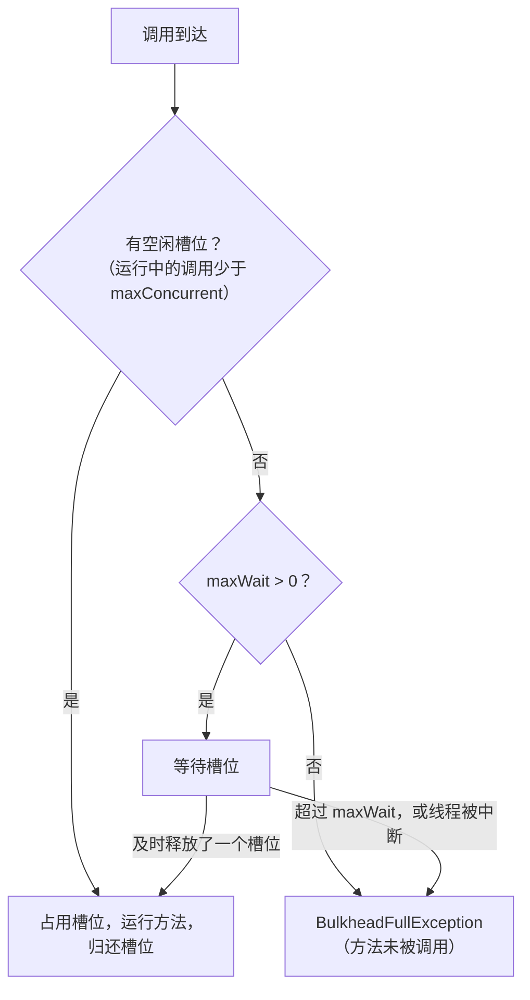

# 舱壁隔离

`@Bulkhead` 限制同时运行的调用数，使一个慢依赖无法占用服务的所有线程、连接或槽位。

<div class="r4c-facts">

| 注解 | 位置 | 返回类型 | 默认值 |
|---|---|---|---|
| `@Bulkhead` | 第 7 层（共 7 层），最内层，包住方法 | 同步、`CompletionStage`、`Mono`、`Flux` | 25 个并发调用，不等待 |

</div>

**适用场景**：依赖的容量有限（连接池、许可证、CPU 密集的渲染器），或者你希望把某个依赖的缓慢控制在局部，而不是耗尽所有资源。

**不适用场景**：你需要的上限是*速率*（每秒调用数）：那是[限流器](rate-limiter.md)。舱壁统计的是进行中的调用，而不是每个周期的调用数。

## 最小示例 :id=minimal-example

<!-- compare:start -->
<!-- snippet: bulkhead-minimal -->
```java
import dev.resilience4cata.annotation.Bulkhead;

public interface ReportRenderer {

    @Bulkhead(maxConcurrent = 10)
    String render(String reportId);
}
```
<!-- not-compiled: 生成的代码，有删节 -->
```java
public final class ReportRenderer$Resilient implements ReportRenderer {
    // …
    public ReportRenderer$Resilient(ReportRenderer delegate, dev.resilience4cata.ResilienceRegistry registry) {
        // …
        this.bulkhead0 = dev.resilience4cata.generated.Policies.bulkhead(registry, "dev.resilience4cata.examples.docs.bulkhead.ReportRenderer#render(java.lang.String)", "", "", r4c$b -> {
            r4c$b.maxConcurrent(10);
        }, false);
    }

    @Override
    public java.lang.String render(java.lang.String p0) {
        final dev.resilience4cata.generated.BulkheadPolicy r4c$bulkhead = this.bulkhead0;
        if (!r4c$bulkhead.tryEnter()) {
            throw r4c$bulkhead.rejection();
        }
        try {
            return this.delegate.render(p0);
        } finally {
            r4c$bulkhead.exit();
        }
    }
}
```
<!-- compare:end -->

有删节：真实文件使用全限定名。

## 行为方式 :id=how-it-behaves



- **槽位。** 调用在运行前占用一个槽位，返回或抛出异常时归还。同一时刻最多有 `maxConcurrent` 个调用持有槽位。
- **拒绝。** 当 `maxWait = "0"`（默认）时，发现舱壁已满的调用会立即以 `dev.resilience4cata.BulkheadFullException` 失败（一个带 `id()` 的 `RuntimeException`；每个舱壁一个，无堆栈跟踪）。方法不会被调用。
- **同步等待。** 当 `maxWait` > 0 时，调用线程会阻塞，直到有空闲槽位或超过 `maxWait`。在虚拟线程上，阻塞的开销很小，也不会固定（pin）载体线程。如果等待中的线程被中断，调用会被拒绝，并重新设置中断标志。等待不是先到先得：新的调用方可能抢在等待者之前拿到释放的槽位。
- **这是信号量舱壁**：调用在调用方的线程上运行。没有线程池舱壁；有了虚拟线程，你很少需要它。
- **禁用**（`enabled = false`）：所有调用都通过。

## 属性 :id=attributes

| 属性 | 类型 | 默认值 | 配置键 | 含义 |
|---|---|---|---|---|
| `maxConcurrent` | `int` | `25` | `defaults.bulkhead.maxConcurrent` | 允许同时运行的调用数。至少为 1。 |
| `maxWait` | 时长 | `0`（立即拒绝） | `defaults.bulkhead.maxWait` | 调用最多可以等待空闲槽位多久。 |
| `name` | `String` | 每个方法一个舱壁 | 仅限注解 | 实例 id；`name` 相同的方法共享一个舱壁及其槽位。 |
| `config` | `String` | `default` | 仅限注解 | 作为起点的命名配置。 |
| `locked` | `boolean` | `false` | 仅限注解 | 保留注解中设置的值：`instances.<id>.*` 键无法修改它们。见[锁定实例](../guides/configuration.md#locking-an-instance)。 |
| `enabled` | `boolean` | `true` | `defaults.bulkhead.enabled` | `false` 放行所有调用；不设置则继承。 |

默认值与 Resilience4j 相同。`configs.<name>.` 和 `instances.<id>.` 下也有相应的键；见[配置](../guides/configuration.md)。

可以为槽位稍作等待的调用方：

<!-- snippet: bulkhead-wait -->
```java
@Bulkhead(name = "thumbnails", maxConcurrent = 4, maxWait = "250ms")
byte[] thumbnail(String imageId);
```

## 共享与实例 id :id=sharing-and-instance-ids

没有 `name` 时，每个方法有自己的舱壁，id 为 `<type>#<method>(<parameter types>)`。要保护被多个方法使用的同一资源（整个客户端背后的一个连接池），给它们相同的 `name`：它们就会共享同样的 `maxConcurrent` 个槽位。它们必须解析为相同的配置，否则包装会以 [`R4C-REG-008`](../errors.md#r4c-reg-008) 失败。

### 句柄 :id=handle

`registry.bulkhead(id)` 返回一个 `BulkheadHandle`：

<!-- snippet: bulkhead-handle -->
```java
BulkheadHandle bulkhead = registry.bulkhead("thumbnails");
int running = bulkhead.concurrentCalls();        // calls inside right now
int waiting = bulkhead.waitingCalls();           // calls waiting for a slot (0 when maxWait = 0)
BulkheadSnapshot snapshot = bulkhead.snapshot(); // instance, concurrentCalls, waitingCalls, maxConcurrent
```

| 方法 | 作用 |
|---|---|
| `id()` | `name`，或派生 id |
| `config()` | 解析后的 `BulkheadConfig` |
| `concurrentCalls()` | 此刻持有槽位的调用数 |
| `waitingCalls()` | 此刻正在等待槽位的调用数：排队等待释放槽位的异步调用，加上阻塞在舱壁上的同步线程。`maxWait` 为 0 时始终为 0。这是用于监控的快照；读到时可能已经过时 |
| `snapshot()` | 一个 `BulkheadSnapshot(id, concurrentCalls, waitingCalls, maxConcurrent)`，外加 `availableSlots()` |

舱壁在其接口被包装或其 pipeline 构建之后才存在；未知 id 会抛出 [`R4C-REG-009`](../errors.md#r4c-reg-009)。没有 `registry.bulkheads()`：用 `registry.snapshot().bulkheads()` 列出它们。

## 与其他策略配合 :id=with-other-policies

舱壁是最内层，紧紧包住你的方法：

- 只有方法运行时才占用槽位。在 `@Retry` 的延迟期间，槽位可供其他调用方使用。
- `BulkheadFullException` 是一个 `Exception`：默认情况下外层的 `@Retry` 会在其延迟后重试它（把它加入 `abortOn` 即可快速失败），但外层的 `@CircuitBreaker` 永远不会记录它：舱壁已满是本应用自身的负载，而不是依赖的故障，所以它不会打开熔断器。
- 等待槽位的时间计入外层的 `@Timeout`：被超时中断的同步等待以 `CallTimeoutException` 结束。
- 被拒绝的调用已经消耗了一个限流器许可，因为限流器在外层。

## 异步 :id=async

对于返回 `CompletionStage<T>` 或 `CompletableFuture<T>` 的方法，调用会一直持有槽位直到其 stage 完成，而不仅仅是到方法返回为止：

<!-- snippet: bulkhead-async -->
```java
@Bulkhead(name = "thumbnails-async", maxConcurrent = 2, maxWait = "1s")
CompletableFuture<byte[]> thumbnailAsync(String imageId);
```

异步调用在等待时从不阻塞线程：`maxWait` > 0 的已满舱壁会把调用排队，最早的等待者直接获得下一个释放的槽位，然后在一个新的虚拟线程上启动。如果先超过了 `maxWait`，它的 future 以 `BulkheadFullException` 失败。没有 `maxWait` 时，已满的舱壁立即返回一个失败的 future。共享舱壁的同步和异步调用方使用相同的槽位。取消返回的 future 会取消该 stage 并立即释放槽位（当 stage 是 `Future` 时）；仍在排队的调用会离开队列且永不启动（[取消](../guides/async.md#cancellation)）。见[异步方法](../guides/async.md)。

## 用 `Pipeline` 实现同样的效果 :id=same-thing-with-pipeline

<!-- snippet: bulkhead-pipeline -->
```java
Pipeline<String> render = Pipeline.builder(registry, "renderer", String.class)
        .bulkhead(b -> b.maxConcurrent(10))
        .build();

String report = render.execute(() -> backend.render("r-1"));
```

id `"renderer"` 就是实例 id：`registry.bulkhead("renderer")` 返回它。见 [Pipeline API](../guides/pipeline.md)。

## 事件与快照 :id=events-and-snapshot

| 事件 | 时机 | 字段 |
|---|---|---|
| `BulkheadEvent.Rejected` | 调用被拒绝（已满且不等待、超过 `maxWait`，或等待被中断） | `id`、`nanoTime`、`maxConcurrent` |

被放行的调用不发布任何事件。见[可观测性](../guides/observability.md)。

## 用 `ManualClock` 测试 :id=testing-it-with-manualclock

挂起的 stage 会占住槽位，因此在测试中很容易填满一个异步舱壁：

<!-- snippet: bulkhead-testing -->
```java
ThumbnailService thumbnails = Resilient.of(ThumbnailService.class, backend, registry);
BulkheadHandle bulkhead = registry.bulkhead("thumbnails-async");

CompletableFuture<byte[]> a = thumbnails.thumbnailAsync("a");   // pending: holds a slot
CompletableFuture<byte[]> b = thumbnails.thumbnailAsync("b");   // pending: holds the other
CompletableFuture<byte[]> c = thumbnails.thumbnailAsync("c");   // full: waits up to 1 s
assertThat(bulkhead.concurrentCalls()).isEqualTo(2);
assertThat(bulkhead.waitingCalls()).isEqualTo(1);

clock.advance(Duration.ofSeconds(1));                          // nothing was released in time
assertThat(c).failsWithin(Duration.ofSeconds(5))
        .withThrowableThat().withCauseInstanceOf(BulkheadFullException.class);
```

在 [`ManualClock`](../guides/testing.md) 上，无论异步还是同步等待，`maxWait` 都按该时钟计量：阻塞的同步调用方一旦有槽位释放就会得到它，并在时钟越过 `maxWait` 时被拒绝，无论这在真实时间中需要多久。只要时钟不动，它就一直等待。

## 细节说明 :id=small-print

- 上限是按 JVM 和按注册表划分的。
- `waitingCalls()` 仅用于监控；不要在调用路径上根据它做决策。
- 当同步和异步调用方在同一个舱壁上等待时，释放的槽位大致在最早的异步等待者和阻塞的线程之间交替分配。
- 相关错误：[`R4C-ATR-001`](../errors.md#r4c-atr-001)（时长语法）、[`R4C-ATR-003`](../errors.md#r4c-atr-003)（`maxConcurrent` 小于 1）、[`R4C-ATR-006`](../errors.md#r4c-atr-006)（`enabled`）、[`R4C-REG-004`](../errors.md#r4c-reg-004)（未知 `config`）、[`R4C-REG-008`](../errors.md#r4c-reg-008)（共享 `name` 但配置不同）、[`R4C-REG-009`](../errors.md#r4c-reg-009)（未知 id）。

## 开销 :id=what-it-costs

> [!MEASURED]
> 在 AWS Graviton3（`c7g.xlarge`，JDK 21）上，经过一个有空闲槽位的舱壁，一次调用在单线程下耗时 20.5 ns，与 Resilience4j 2.4.0 持平（20.4 ns）；4 个线程共享它时为 264 ns，对比 432 ns；两者都不做内存分配。一次被拒绝的调用耗时 2.3 ns、0 B，对比 139 ns、416 B。[基准测试：MVP 完成](../benchmarks.md#mvp-completion-classifier-pipeline-events-testkit-2026-10-24-aws-graviton3)
