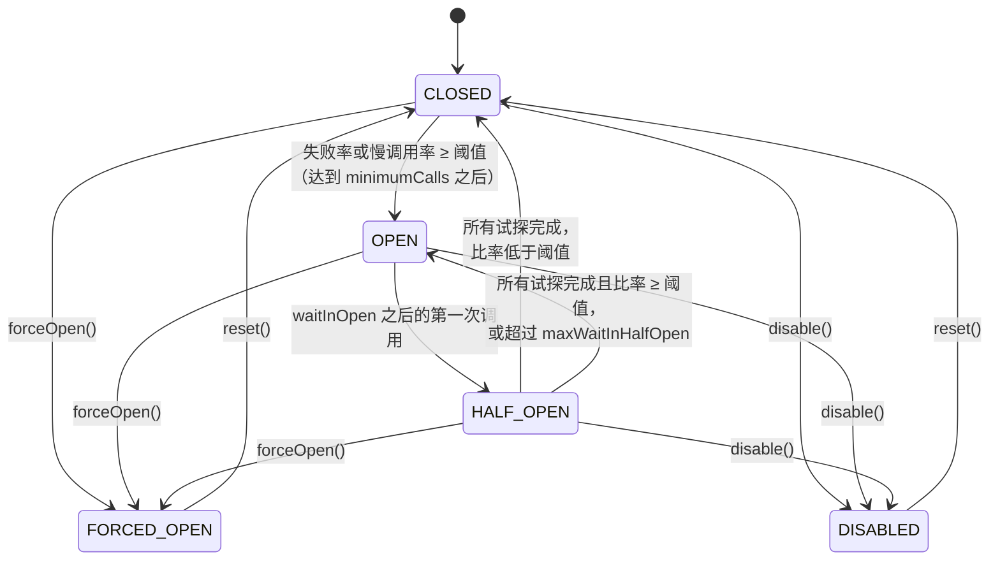

# 熔断器

`@CircuitBreaker` 停止调用持续失败的依赖，并在之后放行少量试探调用，看它是否已经恢复。

<div class="r4c-facts">

| 注解 | 位置 | 返回类型 | 默认值 |
|---|---|---|---|
| `@CircuitBreaker` | 第 3 层（共 7 层），在 Retry 内部 | 同步、`CompletionStage`、`Mono`、`Flux` | 100 次调用的窗口，100 次调用后失败率达 50% 时打开，打开 60 s，10 次试探，慢调用检测关闭 |

</div>

**适用场景**：依赖可能会宕机或过载一段时间，快速失败要好过在它上面堆积等待的调用、线程和重试。

**不适用场景**：失败之间相互独立（一个错误输入并不预示下一次调用的结果），或者熔断器打开时没有什么有用的事可做。用在很少发生的调用上（每小时几次）的熔断器永远看不到足够的调用来做决定；请降低 `minimumCalls` 或使用[时间窗口](#attributes)。

## 最小示例 :id=minimal-example

<!-- compare:start -->
<!-- snippet: circuit-breaker-minimal -->
```java
import dev.resilience4cata.annotation.CircuitBreaker;

public interface PaymentGateway {

    @CircuitBreaker(name = "payments", windowSize = 10, minimumCalls = 10, failureRateThreshold = 50,
            waitInOpen = "30s", halfOpenCalls = 2)
    String charge(String orderId);
}
```
<!-- not-compiled: 生成的代码，有删节 -->
```java
public final class PaymentGateway$Resilient implements PaymentGateway {
    // …
    public PaymentGateway$Resilient(PaymentGateway delegate, dev.resilience4cata.ResilienceRegistry registry) {
        // …
        this.circuitBreaker0 = dev.resilience4cata.generated.Policies.circuitBreaker(registry, "dev.resilience4cata.examples.docs.circuitbreaker.PaymentGateway#charge(java.lang.String)", "payments", "", r4c$b -> {
            r4c$b.windowSize(10);
            r4c$b.minimumCalls(10);
            r4c$b.failureRateThreshold(50.0);
            r4c$b.waitInOpen(java.time.Duration.ofNanos(30000000000L));
            r4c$b.halfOpenCalls(2);
        }, false);
    }

    @Override
    public java.lang.String charge(java.lang.String p0) {
        final dev.resilience4cata.generated.CircuitBreakerPolicy r4c$cb = this.circuitBreaker0;
        final long r4c$token = r4c$cb.acquire();
        if (r4c$token < 0) {
            throw r4c$cb.rejection();
        }
        final long r4c$started = r4c$cb.startTimer();
        try {
            final java.lang.String r4c$result = this.delegate.charge(p0);
            r4c$cb.onSuccess(r4c$token, r4c$started);
            return r4c$result;
        } catch (java.lang.Throwable r4c$e) {
            r4c$cb.onFailure(r4c$token, r4c$started, r4c$e);
            throw r4c$e;
        }
    }
}
```
<!-- compare:end -->

有删节：真实文件使用全限定名。

这个熔断器观察最近 10 次调用。看到 10 次之后，若其中 50% 或以上失败，它就打开，在 30 s 内拒绝所有调用，然后放行 2 次试探调用：若其中失败少于 50%，它就关闭，否则再次打开。

## 行为方式 :id=how-it-behaves



- **关闭（Closed）。** 调用通过，其结果进入滑动窗口。使用 `COUNT`（默认）时，窗口保存最近 `windowSize` 次调用；使用 `TIME` 时，窗口以一秒为桶，保存最近 `windowDuration` 内的调用。
- **什么算失败。** 是 `recordOn` 中某个类型的实例（默认：`Throwable`，因此包括 `Error`，与 Resilience4j 相同），且不是任何 `ignoreOn` 类型实例的 throwable。`ignoreOn` 优先：这些调用不计入任何一方。其他任何 throwable 都算作**成功**：当 `recordOn = IOException.class` 时，`IllegalArgumentException` 不会打开熔断器。本地限制的拒绝（`BulkheadFullException`、`RateLimitExceededException`、`AdaptiveLimitFullException`）永远不会被记录，无论 `recordOn`、`ignoreOn` 或分类器怎么说（见[与其他策略配合](#with-other-policies)）。开启慢调用检测时（`slowCallDuration` > 0），耗时达到或超过 `slowCallDuration` 的调用也算作慢调用，无论成功还是失败。
- **打开。** 窗口中有了 `minimumCalls` 次调用后才评估比率（对于计数窗口，`minimumCalls` 上限为 `windowSize`）。当失败率达到或超过 `failureRateThreshold`，或者慢调用率达到或超过 `slowCallRateThreshold` 时，熔断器打开。
- **打开（Open）。** 每次调用都立即以 `CallNotPermittedException` 被拒绝，不会到达方法。熔断器不会自行转换状态：`waitInOpen` 之后到达的第一次调用把它转为半开，并成为一次试探。
- **半开（Half-open）。** 放行 `halfOpenCalls` 次试探调用；其他调用被拒绝，直到试探结束。最后一次试探完成时，对试探应用同样的阈值：低于阈值则熔断器以空窗口关闭，否则再次打开。如果设置了 `maxWaitInHalfOpen` 而试探没有在该时间内全部完成，下一次调用会让它再次打开。被忽略的试探（`ignoreOn` 异常，或分类器返回 `IGNORE`）会归还其许可。
- **强制打开和禁用**通过[句柄](#handle)手动设置：`forceOpen()` 拒绝一切，`disable()` 放行一切且不记录任何结果，两者都持续到 `reset()`。`enabled = false` 让熔断器以 `DISABLED` 启动，之后 `reset()` 也回到 `DISABLED`。
- 如果调用运行期间熔断器改变了状态，该调用的结果会被丢弃，这样在关闭状态下开始的慢调用就不能决定半开状态的试探。

拒绝异常 `dev.resilience4cata.CallNotPermittedException` 是一个带 `id()` 的 `RuntimeException`。它每个熔断器只创建一次，且没有堆栈跟踪，所以拒绝没有开销；它的消息会指明是哪个熔断器。

## 属性 :id=attributes

| 属性 | 类型 | 默认值 | 配置键 | 含义 |
|---|---|---|---|---|
| `windowType` | `WindowType` | `COUNT` | `defaults.circuitBreaker.windowType` | `COUNT`：最近 `windowSize` 次调用。`TIME`：最近 `windowDuration` 内的调用。 |
| `windowSize` | `int` | `100` | `defaults.circuitBreaker.windowSize` | `COUNT` 窗口中的调用数。至少为 1。 |
| `windowDuration` | 时长 | `60s` | `defaults.circuitBreaker.windowDuration` | `TIME` 窗口的长度，整数秒（至少 `1s`）。 |
| `minimumCalls` | `int` | `100` | `defaults.circuitBreaker.minimumCalls` | 评估比率前所需的调用数。至少为 1。 |
| `failureRateThreshold` | `double` | `50` | `defaults.circuitBreaker.failureRateThreshold` | 打开熔断器的失败率，百分比（0 < x ≤ 100）。 |
| `slowCallRateThreshold` | `double` | `100` | `defaults.circuitBreaker.slowCallRateThreshold` | 打开熔断器的慢调用率，百分比（0 < x ≤ 100）。 |
| `slowCallDuration` | 时长 | `0`（关闭） | `defaults.circuitBreaker.slowCallDuration` | 调用被视为慢调用的时长。`0` 关闭慢调用检测：调用完全不计时。 |
| `waitInOpen` | 时长 | `60s` | `defaults.circuitBreaker.waitInOpen` | 熔断器保持打开多久，之后下一次调用才可以试探。 |
| `halfOpenCalls` | `int` | `10` | `defaults.circuitBreaker.halfOpenCalls` | 半开状态允许的试探调用数。至少为 1。 |
| `maxWaitInHalfOpen` | 时长 | `0`（无限制） | `defaults.circuitBreaker.maxWaitInHalfOpen` | 半开状态的最长时间，超过后若试探未完成则再次打开。 |
| `recordOn` | `Class<? extends Throwable>[]` | `{Throwable.class}` | `defaults.circuitBreaker.recordOn` | 记录为失败的异常。其他 throwable 算作成功。本地拒绝永远不会被记录。 |
| `ignoreOn` | `Class<? extends Throwable>[]` | `{}` | `defaults.circuitBreaker.ignoreOn` | 不计入任何一方的异常；优先于 `recordOn` 和分类器。 |
| `classifier` | `Class<?>` | 无 | 仅限注解 | 一个 `Classifier<T>`，按它的判断记录结果和异常。取代 `recordOn`。见[分类器](../guides/classifiers.md)。 |
| `name` | `String` | 每个方法一个熔断器 | 仅限注解 | 实例 id；`name` 相同的方法共享一个熔断器。 |
| `config` | `String` | `default` | 仅限注解 | 作为起点的命名配置。 |
| `locked` | `boolean` | `false` | 仅限注解 | 保留注解中设置的值：`instances.<id>.*` 键无法修改它们。见[锁定实例](../guides/configuration.md#locking-an-instance)。 |
| `enabled` | `boolean` | `true` | `defaults.circuitBreaker.enabled` | `false` 放行所有调用（以 `DISABLED` 启动）；不设置则继承。 |

默认值与 Resilience4j 相同，只是慢调用检测默认关闭。配置键也接受 kebab-case（`circuit-breaker.wait-in-open`），并且在 `configs.<name>.` 和 `instances.<id>.` 下也存在；见[配置](../guides/configuration.md)。

一个观察最近一分钟、把 2 s 及以上的调用视为慢调用、并忽略错误输入的熔断器：

<!-- snippet: circuit-breaker-tuned -->
```java
@CircuitBreaker(windowType = WindowType.TIME, windowDuration = "60s", minimumCalls = 5,
        slowCallDuration = "2s", slowCallRateThreshold = 80,
        ignoreOn = IllegalArgumentException.class)
long balance(String account);
```

当它在最近 60 s 内看到了 5 次调用，且其中 80% 或以上是慢调用（或 50% 或以上失败）时，就会打开。`IllegalArgumentException` 是调用方的错，不是依赖的错，所以完全不会被记录。

## 共享与实例 id :id=sharing-and-instance-ids

熔断器有状态，所以共享很重要。没有 `name` 时，每个方法有自己的熔断器，id 为 `<type>#<method>(<parameter types>)`。多个方法（或用同一注册表包装的多个接口）使用相同的 `name` 时，它们共享一个熔断器：一个方法的失败会为所有方法打开它。它们必须解析为相同的配置，否则包装会以 [`R4C-REG-008`](../errors.md#r4c-reg-008) 失败。id 等于该 `name` 的 [`Pipeline`](#same-thing-with-pipeline) 也会共享它。

### 句柄 :id=handle

`registry.circuitBreaker(id)` 返回一个 `CircuitBreakerHandle`，用于检查熔断器并强制设置其状态，供运维和测试使用：

<!-- snippet: circuit-breaker-handle -->
```java
CircuitBreakerHandle breaker = registry.circuitBreaker("payments");
CircuitBreakerSnapshot snapshot = breaker.snapshot();
System.out.printf("%s is %s, %d calls, failure rate %.0f%%%n",
        snapshot.id(), snapshot.state(), snapshot.bufferedCalls(), snapshot.failureRate());

breaker.forceOpen();   // maintenance window: every call is rejected
breaker.disable();     // or let every call through, recording nothing
breaker.reset();       // back to CLOSED with an empty window
```

| 方法 | 作用 |
|---|---|
| `id()` | `name`，或派生 id |
| `state()` | `CLOSED`、`OPEN`、`HALF_OPEN`、`FORCED_OPEN` 或 `DISABLED` |
| `config()` | 解析后的 `CircuitBreakerConfig` |
| `snapshot()` | 一个 `CircuitBreakerSnapshot`：当前窗口的状态、比率和计数 |
| `forceOpen()` | 拒绝所有调用直到 `reset()`，无论结果如何 |
| `disable()` | 放行所有调用且不记录任何结果，直到 `reset()` |
| `reset()` | 回到初始状态（`CLOSED`，若 `enabled = false` 则为 `DISABLED`），窗口清空 |

`registry.circuitBreakers()` 按 id 排序列出到目前为止创建的所有熔断器。熔断器在其接口被包装（`Resilient.of`/`create`）或其 pipeline 构建之后才存在；未知 id 会抛出 `IllegalArgumentException` [`R4C-REG-009`](../errors.md#r4c-reg-009)，并附带"did you mean"建议。

## 与其他策略配合 :id=with-other-policies

熔断器是第三层：在 Retry 内部，包住 RateLimiter、Timeout 和 Bulkhead。

- **它会停止重试。** `@Retry` 的每次尝试都经过熔断器并被记录。熔断器一旦打开，下一次尝试就会得到 `CallNotPermittedException`，重试永远不会重试它，无论其 `abortOn`、`retryOn` 或分类器怎么说，所以重试会立即停止而不等待（见[重试](retry.md#attributes)和[概览](README.md#an-open-breaker-stops-the-retries)）。
- **它永远不记录本地限制的拒绝。** `BulkheadFullException`、`RateLimitExceededException` 和 `AdaptiveLimitFullException` 说明的是本应用忙，而不是依赖出故障，所以熔断器不把它们计入任何一方（半开试探会归还其许可），无论 `recordOn`、`ignoreOn` 或分类器怎么说。如果没有这条规则，一次填满你自己舱壁的突发流量，即使依赖没有任何失败，也会打开熔断器并把每个调用都送到降级。慢依赖仍然会打开它：通过其超时和慢调用。
- **它会记录超时。** `CallTimeoutException` 是依赖的故障，默认算作一次失败；如果不应如此，把它列入 `ignoreOn`。来自更内层另一个熔断器的 `CallNotPermittedException` 也是如此。超时无法区分慢依赖和慢进程：当服务本身没有 CPU 时（典型情况是容器 CPU 限制很紧、JIT 正在编译时的冷启动），调用确实会超时，并可能打开熔断器，直到 `waitInOpen` 过去。请在启动时给服务留出 CPU 余量，或者在接收流量之前预热它（[故障排查](../guides/troubleshooting.md#breaker-opens-at-startup)）。
- 被拒绝的调用永远不会到达限流器，所以不会消耗它的许可。
- 方法上的 `@Fallback` 会像对待其他失败一样看到 `CallNotPermittedException`；同级方法可以把它作为参数，在熔断器打开时给出不同的结果。

## 异步 :id=async

对于返回 `CompletionStage<T>` 或 `CompletableFuture<T>` 的方法，熔断器在调用前申请许可，在 stage 完成时记录结果，并把拒绝转为一个失败的 future（调用本身不抛出异常）：

<!-- snippet: circuit-breaker-async -->
```java
@CircuitBreaker(name = "ledger-async", windowSize = 4, minimumCalls = 4)
CompletableFuture<Long> balanceAsync(String account);
```

慢调用一直计时到 stage 完成。调用方取消了其 future 的调用不会被记录，与被忽略的调用一样：半开许可会被归还（[取消](../guides/async.md#cancellation)）。例外是在第一个元素之后被取消的 `Flux`，它算作成功（[Flux 方法](../guides/reactor.md#flux)）。见[异步方法](../guides/async.md)。

## 用 `Pipeline` 实现同样的效果 :id=same-thing-with-pipeline

<!-- snippet: circuit-breaker-pipeline -->
```java
Pipeline<String> charge = Pipeline.builder(registry, "payments", String.class)
        .circuitBreaker(cb -> cb.windowSize(10).minimumCalls(10).waitInOpen(Duration.ofSeconds(30)))
        .build();

String receipt = charge.execute(() -> backend.charge("order-1"));
```

id `"payments"` 就是熔断器的实例 id：`registry.circuitBreaker("payments")` 返回它，`name = "payments"` 且配置相同的带注解方法会共享它。见 [Pipeline API](../guides/pipeline.md)。

## 事件与快照 :id=events-and-snapshot

| 事件 | 时机 | 字段 |
|---|---|---|
| `CircuitBreakerEvent.StateTransition` | 每次状态变化，由完成变化的线程发布一次 | `id`、`nanoTime`、`from`、`to` |
| `CircuitBreakerEvent.Rejected` | 调用被拒绝（打开、强制打开，或没有剩余试探） | `id`、`nanoTime`、`state` |

`CircuitBreakerSnapshot(id, state, failureRate, slowCallRate, bufferedCalls, failedCalls, slowCalls)`：比率为百分比，在窗口达到 `minimumCalls` 次调用之前为 `-1`（检测关闭时慢调用率也为 `-1`）。在半开状态下，计数是试探的计数。见[可观测性](../guides/observability.md)。

## 用 `ManualClock` 测试 :id=testing-it-with-manualclock

<!-- snippet: circuit-breaker-testing -->
```java
PaymentGateway payments = Resilient.of(PaymentGateway.class, backend, registry);
CircuitBreakerHandle breaker = registry.circuitBreaker("payments");

for (int i = 0; i < 5; i++) {
    payments.charge("ok-" + i);                       // 5 successes
}
down.set(true);
for (int i = 0; i < 5; i++) {
    assertThatThrownBy(() -> payments.charge("ko")).isInstanceOf(IllegalStateException.class);
}
assertThat(breaker.state()).isEqualTo(CircuitBreakerState.OPEN);   // 10 calls, 50% failed

assertThatThrownBy(() -> payments.charge("rejected")).isInstanceOf(CallNotPermittedException.class);

down.set(false);
ResilienceTesting.elapseWaitInOpen(breaker, clock);  // 30 s later, on the test's clock
payments.charge("probe-1");                          // half-open: 2 probes
payments.charge("probe-2");
assertThat(breaker.state()).isEqualTo(CircuitBreakerState.CLOSED);
```

在 [`ManualClock`](../guides/testing.md) 上，`waitInOpen`、慢调用和时间窗口都按该时钟计量。`ResilienceTesting.elapseWaitInOpen(breaker, clock)` 把时钟推进熔断器的 `waitInOpen`；在下一次调用到达之前，熔断器仍然报告 `OPEN`。要直接把熔断器置于某个状态，请使用其句柄上的 `forceOpen()`、`disable()` 和 `reset()`。

## 细节说明 :id=small-print

- 大于计数窗口 `windowSize` 的 `minimumCalls` 会被限制为 `windowSize`。时间窗口没有这种限制。
- `windowSize` 用于计数窗口，`windowDuration` 用于时间窗口；每种窗口忽略另一个属性，所以默认值和命名配置可以同时设置两者。在单个注解上（它只为一个方法做决定），`windowType = TIME` 配合大小、`windowType = COUNT` 配合时长，或两者同时设置，都是编译错误（[`R4C-ATR-010`](../errors.md#r4c-atr-010)）。
- 时间窗口每次调用都读取时钟。计数窗口只在开启慢调用检测时才读取。
- 使用默认值时，熔断器需要 100 次调用才能打开。对于低流量的依赖，请降低 `minimumCalls`（和 `windowSize`），或使用时间窗口。
- 阈值是包含性的：10 次中 5 次失败会打开 `failureRateThreshold = 50` 的熔断器。
- 在并发下，计数窗口接近精确而非完全精确，换来的是不用锁：恰好在另一个线程的失败被计入时结束的成功可能不会被记录；当相隔整整一个窗口的两次调用在同一个槽位上竞争时，槽位保留最后写入的那个。每次竞争最多使比率偏差一次调用。
- `CallNotPermittedException` 按设计没有堆栈跟踪。请记录消息或 `id()`。
- 相关错误：[`R4C-ATR-001`](../errors.md#r4c-atr-001)（时长语法）、[`R4C-ATR-003`](../errors.md#r4c-atr-003)（`windowSize`、`minimumCalls`、`halfOpenCalls` 小于 1）、[`R4C-ATR-005`](../errors.md#r4c-atr-005)（比率超出 (0, 100]）、[`R4C-ATR-010`](../errors.md#r4c-atr-010)（为另一种窗口类型设置了窗口大小或时长）、[`R4C-ATR-006`](../errors.md#r4c-atr-006)（`enabled`）、[`R4C-CLS-011`](../errors.md#r4c-cls-011)（`classifier` 与 `recordOn` 同时使用）、[`R4C-REG-004`](../errors.md#r4c-reg-004)（未知 `config`）、[`R4C-REG-008`](../errors.md#r4c-reg-008)（共享 `name` 但配置不同）、[`R4C-REG-009`](../errors.md#r4c-reg-009)（`registry.circuitBreaker` 的未知 id）。

## 开销 :id=what-it-costs

> [!MEASURED]
> 在 AWS Graviton3（`c7g.xlarge`，JDK 21）上，经过 `@CircuitBreaker` 的一次成功调用耗时 1.9 ns 且不做内存分配，单线程和 4 线程都是如此；Resilience4j 2.4.0（计数窗口，默认 `SYNCHRONIZED` 策略）单线程耗时 89.2 ns，4 线程 832 ns。每十次调用有一次失败时，4 线程下：274 ns 对比 910 ns。[基准测试：MVP 完成](../benchmarks.md#mvp-completion-classifier-pipeline-events-testkit-2026-10-24-aws-graviton3)
