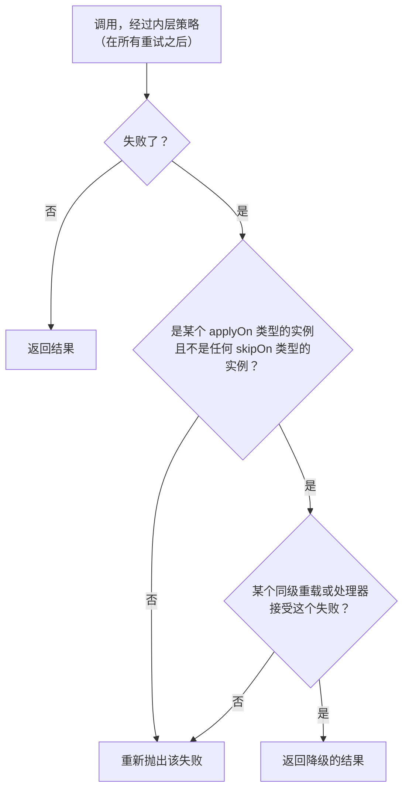

# 降级

`@Fallback` 在调用失败或被其他策略拒绝时，返回一个替代结果。

<div class="r4c-facts">

| 注解 | 位置 | 返回类型 | 默认值 |
|---|---|---|---|
| `@Fallback` | 第 1 层（共 7 层），最外层 | 同步、`CompletionStage`、`Mono`、`Flux` | 适用于所有 `Throwable` |

</div>

**适用场景**：存在有意义的降级结果：缓存值、默认值、空列表、用"处理中"代替错误。

**不适用场景**：唯一的"替代"就是掩盖错误：返回 `null` 或假成功的降级会让调用方和你的监控都看不到失败。如果没有更好的东西可以返回，就让异常抛出去。

## 最小示例 :id=minimal-example

<!-- compare:start -->
<!-- snippet: fallback-minimal -->
```java
import dev.resilience4cata.annotation.Fallback;

public interface PriceApi {

    @Fallback(method = "unknownPrice")
    long price(String sku);

    default long unknownPrice(String sku, Exception failure) {
        return -1;
    }
}
```
<!-- not-compiled: 生成的代码，有删节 -->
```java
public final class PriceApi$Resilient implements PriceApi {
    // …
    public PriceApi$Resilient(PriceApi delegate, dev.resilience4cata.ResilienceRegistry registry) {
        // …
        this.fallback0 = dev.resilience4cata.generated.Policies.fallback(registry, "dev.resilience4cata.examples.docs.fallback.PriceApi#price(java.lang.String)", java.util.List.of(java.lang.Throwable.class), java.util.List.of(), null);
    }

    @Override
    public long price(java.lang.String p0) {
        try {
            return this.delegate.price(p0);
        } catch (java.lang.Throwable r4c$e) {
            if (!this.fallback0.handles(r4c$e)) {
                throw r4c$e;
            }
            if (r4c$e instanceof java.lang.Exception r4c$f0) {
                return this.delegate.unknownPrice(p0, r4c$f0);
            }
            throw r4c$e;
        }
    }
    // …
}
```
<!-- compare:end -->

有删节：真实文件使用全限定名。

降级要么是同一接口或类中的**同级方法**（`method = "…"`），要么是**处理器类**（`value = SomeHandler.class`）。两者必须且只能设置一个（[`R4C-FB-001`](../errors.md#r4c-fb-001)）。两者都在编译时检查：错误的名称、签名或返回类型是编译错误，而不是运行时的意外。

## 行为方式 :id=how-it-behaves



- **哪些失败。** 是某个 `applyOn` 类型的实例（默认：`Throwable`，因此也包括 `Error`）且不是任何 `skipOn` 类型实例的失败。`skipOn` 优先。
- **包括拒绝。** 降级是最外层，所以它也能看到 `CallNotPermittedException`、`RateLimitExceededException`、`CallTimeoutException`、`BulkheadFullException`，以及使用分类器时的 `ResultRejectedException`。
- **在重试之后。** 同一方法上有 `@Retry` 时，降级只在重试放弃时运行一次，绝不会在两次尝试之间运行。
- **它抛出什么。** 如果降级本身抛出异常，该异常会传给调用方。被注解方法未声明的受检异常会被包装为 `java.lang.reflect.UndeclaredThrowableException`。
- 调用成功时降级没有任何开销：生成的代码只是围绕调用的一个 `try`/`catch`。

### 同级方法 :id=sibling-methods

同级方法接受被注解方法的参数，后面可选地跟一个异常参数，并返回一个可赋值给该方法返回类型的类型。在接口中它是 `default` 或 `static` 方法；在[带注解的类](../guides/annotated-classes.md)中它不能是 `private`。

- **异常参数决定它处理哪些失败。** `unknownPrice(String sku, Exception failure)` 只处理 `Exception`：`Error` 不匹配，会被重新抛出，即使 `applyOn` 是 `Throwable`，并且不会为它发布 `FallbackEvent.Applied`。接受 `Throwable`（或者完全没有异常参数）即可处理一切。
- **允许多个重载**，使用不同的异常类型；会调用匹配的最具体的那个：

<!-- snippet: fallback-overloads -->
```java
@Fallback(method = "describeFallback")
@CircuitBreaker(name = "catalog")
String describe(String sku) throws IOException;

default String describeFallback(String sku, FileNotFoundException e) {
    return "no such product: " + sku;               // most specific type first
}

default String describeFallback(String sku, IOException e) {
    return "description unavailable";
}

static String describeFallback(String sku, CallNotPermittedException e) {
    return "catalog is resting";                    // the breaker is open
}
```

`FileNotFoundException` 交给第一个，其他任何 `IOException` 交给第二个，`CallNotPermittedException`（熔断器打开）交给第三个。没有任何重载接受的失败（例如这里的 `IllegalStateException`）会被重新抛出，且没有 `FallbackEvent.Applied`。

- 无论声明顺序如何，重载都按异常类型从最具体到最不具体的顺序尝试。捕获一切的重载（接受 `Throwable` 的，或没有异常参数的）结束这个列表：其后的重载永远无法到达，因此不会被使用。
- 同级方法不能抛出被注解方法未声明的受检异常。
- 在接口风格中，生成的包装器在你的实现上调用同级方法（`delegate.unknownPrice(…)`），所以实现可以覆盖 `default` 降级方法。
- **支持泛型方法。** 同级方法声明相同的类型参数（按位置匹配，边界相同，名称可以不同），生成的代码用显式类型实参调用它：

<!-- snippet: fallback-generic -->
```java
@Fallback(method = "nothingFound")
<T> List<T> findAll(Class<T> type, String query);

default <E> List<E> nothingFound(Class<E> type, String query, Exception failure) {
    return List.of();                               // same type parameters, by position
}
```

### 处理器类 :id=handler-classes

处理器实现 `dev.resilience4cata.FallbackHandler<T>`，并接收一个 `FallbackContext`：

<!-- snippet: fallback-handler -->
```java
import dev.resilience4cata.FallbackContext;
import dev.resilience4cata.FallbackHandler;
import dev.resilience4cata.annotation.Fallback;
import dev.resilience4cata.annotation.Retry;

public interface QuoteApi {

    @Fallback(ListPrice.class)
    @Retry(maxAttempts = 3, delay = "100ms")
    long quote(String sku, int quantity);

    final class ListPrice implements FallbackHandler<Long> {
        @Override
        public Long apply(FallbackContext context) {
            int quantity = context.argument(1, int.class);   // the call's arguments, by position
            return 100L * quantity;                          // context.failure(), attempts(), id()
        }
    }
}
```

| `FallbackContext` 方法 | 返回 |
|---|---|
| `failure()` | 触发降级的失败，包括拒绝 |
| `attempts()` | 已进行的尝试次数，包括第一次（没有 `@Retry` 时为 1） |
| `argumentCount()` | 调用的参数个数 |
| `argument(int index, Class<A> type)` | 按从零开始的位置取一个参数（基本类型可用其包装类或基本类型类） |
| `id()` | 方法的 id，`<type>#<method>(<parameter types>)` |

处理器类必须是具体的、非泛型的、顶层或 `static` 嵌套类，可从生成的类访问，并有无参构造函数；`T` 必须可赋值给方法的返回类型。每个方法创建一个处理器实例。处理器不能用在返回类型使用了方法类型参数的泛型方法上，例如 `<T> T load(Class<T> type)`，因为一个 `FallbackHandler<X>` 无法在没有非受检转换的情况下适配每一个 `T`（[`R4C-FB-014`](../errors.md#r4c-fb-014)）：这种情况请使用泛型同级方法。处理器用在 `<T> String describe(T value)` 上没有问题，因为其结果类型没有使用 `T`。

## 属性 :id=attributes

| 属性 | 类型 | 默认值 | 配置键 | 含义 |
|---|---|---|---|---|
| `value` | `Class<?>` | 无 | 仅限注解 | 处理器类，一个 `FallbackHandler<T>`。 |
| `method` | `String` | 无 | 仅限注解 | 同级方法的名称。 |
| `applyOn` | `Class<? extends Throwable>[]` | `{Throwable.class}` | 仅限注解 | 触发降级的失败。 |
| `skipOn` | `Class<? extends Throwable>[]` | `{}` | 仅限注解 | 永远不触发降级的失败；优先于 `applyOn`。 |

`@Fallback` 没有 `name`、`config` 或 `enabled`，也没有外部配置：降级是代码，不是调优参数。它也没有句柄。

过滤器对两种风格都有效：

<!-- snippet: fallback-filters -->
```java
@Fallback(method = "emptyResults", applyOn = IOException.class, skipOn = FileNotFoundException.class)
String search(String query) throws IOException;

default String emptyResults(String query) {
    return "[]";
}
```

`search` 对 `IOException` 返回 `"[]"`，但 `FileNotFoundException`（缺少索引是 bug，不是故障）以及任何不是 `IOException` 的东西都会传给调用方。

## 与其他策略配合 :id=with-other-policies

降级是最外层，所以它看到内部所有东西的最终结果：最后一次重试尝试的失败，或者熔断器、限流器、超时或舱壁隔离的拒绝。与 `@Retry` 一起使用时，降级被融合进重试的放弃分支，这就是 `FallbackContext.attempts()` 能够精确且无需每次调用分配内存的原因。使用[分类器](../guides/classifiers.md)且 `onExhaustedResult = RETURN`（默认）时，被拒绝的*结果*会原样返回，降级不会运行（没有抛出任何东西）；使用 `THROW` 时，`ResultRejectedException` 会像其他失败一样交给降级。

## 异步 :id=async

对于返回 `CompletionStage<T>` 或 `CompletableFuture<T>` 的方法，失败的 stage（或在任何 stage 存在之前抛出的异常）会触发降级。同级方法可以返回 `T`、`CompletionStage<T>` 或 `CompletionStage<? extends T>`；处理器是 `FallbackHandler<CompletionStage<T>>` 或 `FallbackHandler<T>`：

<!-- snippet: fallback-async -->
```java
@Fallback(method = "cachedDescription")
CompletableFuture<String> describeAsync(String sku);

default CompletionStage<String> cachedDescription(String sku, Throwable failure) {
    return CompletableFuture.completedFuture("cached description of " + sku);
}
```

匹配之前会先从 `CompletionException` 中解包失败，所以接受 `IOException` 的同级方法得到的就是 `IOException`。调用方取消了其 future 的调用不会得到降级，在降级自身的 stage 运行时取消会取消该 stage（[取消](../guides/async.md#cancellation)）。见[异步方法](../guides/async.md)。

## 用 `Pipeline` 实现同样的效果 :id=same-thing-with-pipeline

<!-- snippet: fallback-pipeline -->
```java
Pipeline<Long> quote = Pipeline.builder(registry, "quotes", Long.class)
        .retry(r -> r.maxAttempts(3))
        .fallbackHandler(context -> 100L * context.attempts())
        .build();

long price = quote.execute(() -> backend.quote("sku-1", 3));
```

`fallback(failure -> …)` 接受一个 `Function<Throwable, T>`，`fallbackHandler(context -> …)` 接受一个 `FallbackHandler<T>`（其上下文没有参数：`argumentCount()` 为 0）。`fallbackApplyOn(List)` 和 `fallbackSkipOn(List)` 是过滤器；`fallbackAsync(…)` 和 `fallbackAsyncHandler(…)` 为 `executeAsync` 返回一个 stage。见 [Pipeline API](../guides/pipeline.md)。

## 事件 :id=events

| 事件 | 时机 | 字段 |
|---|---|---|
| `FallbackEvent.Applied` | 降级即将运行：失败通过了 `applyOn`/`skipOn`，并且（使用同级方法时）其中一个接受了它。每次调用发布一次，降级随后抛出异常时也会发布；被重新抛出的失败永远不会发布 | `id`、`nanoTime`、`failure` |

见[可观测性](../guides/observability.md)。

## 用 `ManualClock` 测试 :id=testing-it-with-manualclock

<!-- snippet: fallback-testing -->
```java
AtomicInteger calls = new AtomicInteger();
QuoteApi backend = (sku, quantity) -> {
    calls.incrementAndGet();
    throw new IllegalStateException("pricing down");
};
QuoteApi quotes = Resilient.of(QuoteApi.class, backend, registry);

assertThat(quotes.quote("sku-1", 3)).isEqualTo(300L);   // ListPrice, once the retries gave up
assertThat(calls).hasValue(3);
```

在 [`ManualClock`](../guides/testing.md) 上，重试的延迟会立即过去，所以"先重试、再降级"的测试只需几毫秒。

## 细节说明 :id=small-print

- 默认的 `applyOn = Throwable` 包括 `Error`（`OutOfMemoryError`、`StackOverflowError`、`AssertionError`）。如果你的降级不应掩盖它们，请让其参数类型为 `Exception`，或设置 `skipOn = Error.class`。
- `void` 方法也可以有降级：同级方法返回 `void`，处理器是 `FallbackHandler<Void>` 并返回 `null`。
- 相关错误：[`R4C-FB-001`](../errors.md#r4c-fb-001) 到 [`R4C-FB-003`](../errors.md#r4c-fb-003)（同级方法：都未设置或都设置、未知名称、没有可用的候选）、[`R4C-FB-004`](../errors.md#r4c-fb-004) 到 [`R4C-FB-013`](../errors.md#r4c-fb-013)（处理器类）、[`R4C-FB-014`](../errors.md#r4c-fb-014)（泛型方法上的处理器）、[`R4C-RT-013`](../errors.md#r4c-rt-013)（pipeline 设置了过滤器却没有降级）。

## 开销 :id=what-it-costs

> [!MEASURED]
> `@Fallback` 没有单独的基准测试：成功时它只增加一个 `try`/`catch`，并且只在失败之后运行。它是 `Pipeline` 基准测试中"全部六种策略"组合的一部分，在 AWS Graviton3（`c7g.xlarge`，单线程）上，使用生成的代码时每次成功调用耗时 76.3 ns。[基准测试：MVP 完成](../benchmarks.md#mvp-completion-classifier-pipeline-events-testkit-2026-10-24-aws-graviton3)
