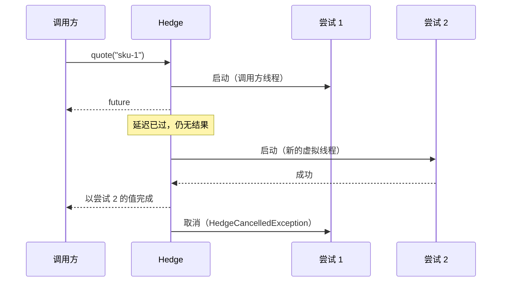

# 对冲请求

`@Hedge` 在调用较慢或失败时，在第一次调用旁边再次发起同样的调用，并保留最先成功的结果：即对冲请求（hedged request），用于对抗尾部延迟。

<div class="r4c-facts">

| 注解 | 位置 | 返回类型 | 默认值 |
|---|---|---|---|
| `@Hedge` | 第 2 层（共 7 层），占据 Retry 的位置（同一方法上不能两者兼有） | `CompletionStage` 和 `Mono`（不支持 `Flux`） | 2 次尝试，1 s 延迟，遇到 `Exception` 时对冲，预算为 10 s 内 10 % + 1/s |

</div>

> [!WARNING]
> **仅适用于幂等调用。** 被对冲的方法会被有意地以相同参数调用多次，即使没有任何失败，而落败的尝试可能会一直运行，直到它们注意到取消。请把它用在读取以及其他可以安全重复的操作上。绝不要用在支付、插入、发送或任何必须只发生一次的操作上。在方法上加 `@Hedge` *本身*就是声明它是幂等的：没有额外的 `idempotent = true` 开关。

**适用场景**：对多副本后端（多个副本、缓存集群、搜索索引）的幂等只读调用通常很快，但最慢的那些调用（p99、p99.9）远慢于中位数，而少量额外负载是削减这段尾部的合理代价。*The Tail at Scale*（Dean 和 Barroso，2013）在 10 ms 后发起对冲，用大约多 2 % 的请求把 p99.9 从 1,800 ms 降到了 74 ms。

**不适用场景**：操作不是幂等的；依赖之所以慢是因为它已经饱和（更多请求会让它对所有人都更慢；[预算](#the-hedge-budget)能限制损害，但不能消除它；[一次模拟](../blog/hedging-under-contention.md)展示了影响有多大）；所有副本共享同一条慢路径（此时对冲会等待两次）；或者方法是同步的（尚不支持：请返回 `CompletableFuture`）。

## 最小示例 :id=minimal-example

<!-- compare:start -->
<!-- snippet: hedge-minimal -->
```java
import dev.resilience4cata.annotation.Hedge;
import java.util.concurrent.CompletableFuture;

public interface QuoteApi {

    @Hedge(delay = "50ms")
    CompletableFuture<String> quote(String sku);
}
```
<!-- not-compiled: 生成的代码，有删节 -->
```java
public final class QuoteApi$Resilient implements QuoteApi {
    // …
    public QuoteApi$Resilient(QuoteApi delegate, dev.resilience4cata.ResilienceRegistry registry) {
        // …
        this.hedge0 = dev.resilience4cata.generated.Policies.hedge(registry, "dev.resilience4cata.examples.docs.hedge.QuoteApi#quote(java.lang.String)", "", "", r4c$b -> {
            r4c$b.delay(java.time.Duration.ofNanos(50000000L));
        }, false);
    }

    @Override
    public java.util.concurrent.CompletableFuture<java.lang.String> quote(java.lang.String p0) {
        return this.hedge0.executeAsync(() -> this.delegate.quote(p0));
    }
}
```
<!-- compare:end -->

有删节：真实文件使用全限定名。lambda 就是*尝试*：对冲每次尝试调用它一次，所以每次尝试都各自经过对冲内部的策略。

## 行为方式 :id=how-it-behaves



- **尝试何时启动。** 尝试 1 立即在调用方线程上启动。当最近一次尝试运行了 `delay` 而任何地方都还没有结果时，下一次尝试启动；或者当某次尝试以 `hedgeOn`（默认：`Exception`）中列出的失败结束时，**立即**启动下一次；该尝试在一个新的虚拟线程上启动，绝不会在完成那次失败尝试的线程上启动（那可能是你的 HTTP 客户端的 I/O 线程）。`maxAttempts` 统计所有已启动的尝试，包括第一次：默认值 2 即一次对冲。`delay = "0"` 会立即启动所有尝试，全部在调用方线程上（始终是 `maxAttempts` 倍的负载）。
- **谁获胜。** 第一个**成功**完成调用。失败永远不会获胜：如果还有剩余尝试，它会启动下一次，否则调用等待仍在进行中的尝试。
- **何时失败。** 当所有已启动的尝试都失败且无法再启动其他尝试时，调用以**最后一次**失败结束。列在 `abortOn` 中的失败，或者**未**列在 `hedgeOn` 中的失败（默认为 `Error`），会立即结束调用，其他尝试被取消。
- **拒绝。** 对冲内部策略的拒绝（打开的熔断器抛出的 `CallNotPermittedException`、`BulkheadFullException`、`RateLimitExceededException`）意味着依赖没有容量：不再启动新的尝试，但进行中的尝试继续运行，仍可能成功。如果没有其他进行中的尝试，调用以该拒绝失败。
- **落败者。** 一旦调用有了结果，其他每个尝试的 stage 都会以 `HedgeCancelledException` 完成，它是一个 `CancellationException`（因此 `isCancelled()` 为真），每个落败尝试一个新实例，不带堆栈跟踪（stage 上的 `handle`/`whenComplete` 会原样看到它；从 JDK 23 起，`join()` 抛出一个以它为原因的新 `CancellationException`）。尝试内部的策略把它当作取消：熔断器不记录任何东西（半开许可被归还），舱壁释放槽位，超时取消其截止时间，你的方法返回的 `CompletableFuture` 被取消。落败者的迟到结果会被丢弃：它不完成任何东西，也不发布任何事件。
- **取消**你拿到的 future 会取消所有进行中的尝试以及挂起的延迟（[取消](../guides/async.md#cancellation)）。
- **快速路径。** 如果你的方法返回时第一次尝试的 stage 已经成功完成（缓存命中），就不需要定时器，也不需要对冲。
- **禁用**（`enabled = false`）：只有一次尝试，就像没有注解一样（失败时降级仍会运行）。

### 对冲预算 :id=the-hedge-budget

对冲恰恰在依赖变慢时增加负载，而这正是它最承受不起的时候。对冲预算为一个实例设定上限，由该实例的所有调用方共享：最近 `budgetWindow` 内的对冲不得超过

> `budgetMinHedgesPerSecond × budgetWindow in seconds + budgetPercent % of the calls in budgetWindow`

（即：`budgetMinHedgesPerSecond` 乘以 `budgetWindow` 的秒数，加上 `budgetWindow` 内调用数的 `budgetPercent` %。）

它**默认开启**（调用数的 10 % 再加每秒 1 次对冲，窗口 10 s），这与[重试预算](retry.md#retry-budget)不同，因为对冲在成功路径上也会增加负载。`budgetPercent = 0` 关闭它。对冲在启动时计费。预算用完时，不会启动对冲，会发布原因为 `BUDGET_EXHAUSTED` 的 `HedgeEvent.Skipped`，调用等待其进行中的尝试。它与重试预算使用相同的窗口（统计调用数，成功时不读取时钟；见[重试预算](retry.md#retry-budget)）。`registry.snapshot().hedges()` 以 `HedgeSnapshot.Budget(calls, hedges, allowedHedges)` 展示它。

## 属性 :id=attributes

| 属性 | 类型 | 默认值 | 配置键 | 含义 |
|---|---|---|---|---|
| `maxAttempts` | `int` | `2` | `defaults.hedge.maxAttempts` | 最多同时进行的尝试数，包括第一次。从 2 到 10。 |
| `delay` | 时长 | `1s` | `defaults.hedge.delay` | 最近一次尝试在没有结果的情况下运行多久后启动下一次。设置为接近依赖的 p95 延迟。`"0"` 立即启动所有尝试。 |
| `hedgeOn` | `Class<? extends Throwable>[]` | `{Exception.class}` | `defaults.hedge.hedgeOn` | 出现这些失败后立即启动下一次尝试。未列出的失败会结束调用。 |
| `abortOn` | `Class<? extends Throwable>[]` | `{}` | `defaults.hedge.abortOn` | 立即结束调用并取消其他尝试的失败；优先于 `hedgeOn`。 |
| `budgetPercent` | `double` | `10` | `defaults.hedge.budgetPercent` | [对冲预算](#the-hedge-budget)：允许的对冲数，为该实例最近 `budgetWindow` 内调用数的百分比。有限值，至少为 0；0 关闭预算。 |
| `budgetMinHedgesPerSecond` | `int` | `1` | `defaults.hedge.budgetMinHedgesPerSecond` | 对冲预算：无论流量多少，`budgetWindow` 内每秒允许的对冲数。至少为 0。 |
| `budgetWindow` | 时长 | `10s` | `defaults.hedge.budgetWindow` | 对冲预算：统计调用和对冲的时间范围。从 `1s` 到 `1h`。 |
| `name` | `String` | 每个方法一个实例 | 仅限注解 | 实例 id；`name` 相同的方法共享一个对冲，因而共享其预算。 |
| `config` | `String` | `default` | 仅限注解 | 作为起点的命名配置。 |
| `locked` | `boolean` | `false` | 仅限注解 | 保留注解中设置的值：`instances.<id>.*` 键无法修改它们。见[锁定实例](../guides/configuration.md#locking-an-instance)。 |
| `enabled` | `boolean` | `true` | `defaults.hedge.enabled` | `false` 放行所有调用；不设置则继承。 |

每个键也存在于 `configs.<name>.hedge.…` 和 `instances.<id>.hedge.…` 下；见[配置](../guides/configuration.md)。目前还没有分类器和 `maxDuration`：每次尝试的 `@Timeout` 和 `maxAttempts × delay` 限制了一次调用。

**没有句柄**：`registry` 没有 `hedge(id)`。`registry.snapshot().hedges()` 为每个实例列出一个 `HedgeSnapshot(id, config, budget)`（`budgetPercent = 0` 时 `budget` 为 `null`）。

## 与其他策略配合 :id=with-other-policies

Hedge 占据 Retry 的位置，即第二层：在 Fallback 内部，包住其他所有策略。

<!-- snippet: hedge-combined -->
```java
@Hedge(name = "prices", delay = "30ms", maxAttempts = 3, abortOn = IllegalArgumentException.class)
@CircuitBreaker(name = "prices")
@Timeout("200ms")
@Fallback(method = "cachedPrice")
CompletableFuture<Long> price(String sku);

default CompletableFuture<Long> cachedPrice(String sku, Throwable failure) {
    return CompletableFuture.completedFuture(-1L);
}
```

- **重试**：同一方法上同时使用 `@Hedge` 和 `@Retry` 是编译错误（[`R4C-HDG-002`](../errors.md#r4c-hdg-002)）。对冲在某次尝试失败时已经会启动新的尝试。
- **熔断器**（内部）：每次尝试各自申请许可，并以其真实结果各自被记录；被取消的落败者不会被记录。打开的熔断器会拒绝下一次尝试，从而停止后续对冲。
- **限流器**（内部）：每次尝试消耗一个许可；设定上限时要考虑 `maxAttempts` 和预算。被拒绝的尝试会停止后续对冲。
- **超时**（内部）：**按每次尝试**生效。超时的尝试是 `hedgeOn` 中的失败（`CallTimeoutException` 是 `Exception`），所以会立即启动下一次尝试。当 `delay` 大于或等于超时时间时，延迟永远不会触发，对冲就变成了超时后的重试：合法，但几乎总是一个错误。
- **舱壁隔离**（内部）：每次尝试只在运行时占用槽位；落败者被取消时释放其槽位。
- **降级**（外部）：在调用失败后运行一次，`FallbackContext.attempts()` 是已启动的尝试数。

## 用 `Pipeline` 实现同样的效果 :id=same-thing-with-pipeline

<!-- snippet: hedge-pipeline -->
```java
Pipeline<String> quote = Pipeline.builder(registry, "quotes", String.class)
        .hedge(h -> h.delay(Duration.ofMillis(50)))
        .build();

CompletableFuture<String> price = quote.executeAsync(() -> backend.quote("sku-1"));
```

带有对冲的 pipeline 只能使用 `executeAsync`：`execute` 会抛出 [`R4C-RT-018`](../errors.md#r4c-rt-018)，同时带有 `.retry(…)` 和 `.hedge(…)` 的 pipeline 会以 [`R4C-RT-019`](../errors.md#r4c-rt-019) 构建失败。pipeline 的 id（`"quotes"`）就是实例 id。见 [Pipeline API](../guides/pipeline.md)。

## 事件与快照 :id=events-and-snapshot

| 事件 | 时机 | 字段 |
|---|---|---|
| `HedgeEvent.Hedged` | 第 2 次或之后的尝试启动 | `id`、`nanoTime`、`attempt`、`reason`（`DELAY` 或 `FAILURE`） |
| `HedgeEvent.Won` | 第 2 次或之后的尝试最先成功 | `id`、`nanoTime`、`attempt` |
| `HedgeEvent.Skipped` | 本可以启动的对冲没有启动 | `id`、`nanoTime`、`attempt`、`reason`（`BUDGET_EXHAUSTED`、`REJECTED` 或 `ABORTED`） |
| `HedgeEvent.Failed` | 调用失败 | `id`、`nanoTime`、`attempts`、`failure` |

第一次尝试获胜的调用不发布任何事件，也没有每次调用的计数器：对冲启动和获胜的频率只能通过这些事件看到。见[可观测性](../guides/observability.md)。

## 用 `ManualClock` 测试 :id=testing-it-with-manualclock

<!-- snippet: hedge-testing -->
```java
QuoteApi quotes = Resilient.of(QuoteApi.class, backend, registry);   // backend: one pending stage per call

CompletableFuture<String> quote = quotes.quote("sku-1");
clock.advance(Duration.ofMillis(49));
assertThat(attempts).hasSize(1);                  // no hedge before the delay
clock.advance(Duration.ofMillis(1));
assertThat(attempts).hasSize(2);                  // the hedge started, on this thread

attempts.get(1).complete("quote from attempt 2");
assertThat(quote).isCompletedWithValue("quote from attempt 2");
assertThat(attempts.get(0)).isCancelled();        // the loser is cancelled
```

在 [`ManualClock`](../guides/testing.md) 上，延迟是精确的（没有一个 tick 的余量），对冲在推进时钟的线程上启动，所以测试是确定性的。由失败引发的对冲以零延迟调度在时钟上：它在下一次 `advance` 时启动，包括 `advance(Duration.ZERO)`。在延迟到期前结束的调用会把该延迟从时钟上移除，所以 `pendingTasks()` 保持精确。

## 细节说明 :id=small-print

- **定时器精度。** 在生产环境中，延迟运行在库用于异步超时的无锁定时器上。对冲的延迟从调用开始时计算（一次时钟读取），定时器在截止时间醒来，所以对冲永远不会提前，会在 `delay` 加上操作系统唤醒延迟之后启动。当延迟低于 1 ms，或者其他线程上更晚开始的调用先被定时器取走时，它最多可能晚一个 tick（正在使用的最短延迟或异步超时的十六分之一，介于 1 ms 和 50 ms 之间）。较短的对冲延迟也会缩短所有异步超时的 tick，但绝不低于 1 ms。
- **上下文不会传递。** 尝试 1 在调用方线程上运行；对冲在新的虚拟线程上启动，不带调用方的 `ThreadLocal` 或 MDC，与异步重试相同（[异步方法](../guides/async.md)）。
- **落败者可能继续运行。** 取消 stage 无法停止忽略取消的代码：返回的 stage 没有与其工作关联的委托（或者是无法取消的最小 stage）会继续工作，其结果被丢弃。
- **预算是近似的**，且总是偏低（对冲更少，绝不会更多），与重试预算一样。使用 `name` 时，方法共享一个预算；请给它们相同的属性。
- 尚不支持同步方法：在同步方法上使用 `@Hedge` 是编译错误（[`R4C-HDG-001`](../errors.md#r4c-hdg-001)），来自类型或[组合注解](../guides/bundles.md)时也是如此。
- 相关错误：[`R4C-HDG-001`](../errors.md#r4c-hdg-001)（同步方法）、[`R4C-HDG-002`](../errors.md#r4c-hdg-002)（与 `@Retry` 同时使用）、[`R4C-ATR-001`](../errors.md#r4c-atr-001)（时长语法）、[`R4C-ATR-006`](../errors.md#r4c-atr-006)（`enabled`）、[`R4C-ATR-007`](../errors.md#r4c-atr-007)（预算值）、[`R4C-ATR-008`](../errors.md#r4c-atr-008)（`maxAttempts` 超出 2–10）、[`R4C-RT-018`](../errors.md#r4c-rt-018)/[`R4C-RT-019`](../errors.md#r4c-rt-019)（`Pipeline`）、[`R4C-REG-004`](../errors.md#r4c-reg-004)（未知 `config`）、[`R4C-REG-008`](../errors.md#r4c-reg-008)（共享 `name` 但配置不同）。

## 开销 :id=what-it-costs

> [!MEASURED]
> AWS `c7g.xlarge`（Graviton3），单线程：当第一次尝试在延迟之前获胜时，一次调用耗时 179 ns、224 B，而 Resilience4j 2.4.0 的 `resilience4j-hedge` 为 3668 ns、1546 B；已经完成的第一次尝试耗时 9.5 ns。延迟为 1 ms 时，触发并获胜的对冲耗时 1060 µs，对比 1067 µs。数据来自[对冲延迟准时触发](../benchmarks.md#hedge-precision)。

**定时器精度。** 延迟运行在库的共享定时器上：设置一个延迟只需在每线程收件箱上做一次 compare-and-set，再加一次读取时钟作为起点；取消它再做一次 compare-and-set，这正是几乎每次调用都会做的事。定时器在最早的对冲截止时间醒来，所以对冲在 `delay` 加上操作系统唤醒延迟之后启动，与 `ScheduledThreadPoolExecutor` 的任务一样。

当第一次尝试在延迟之前获胜时，一次调用会分配返回的 future、一个保存对冲状态的对象，以及 JDK 的 `whenComplete` 创建的回调节点和依赖 future（除了你自己的 stage 和每个异步层都有的每次调用 lambda 之外，共四个对象），用每线程收件箱上的一次 compare-and-set 调度其延迟，再用一次取消它，向本线程的预算分片写入一次，并读取一次时钟。触发的对冲还会增加一个虚拟线程、该尝试自身的各层，以及（在失败之后或开启预算时）一次时钟读取。
