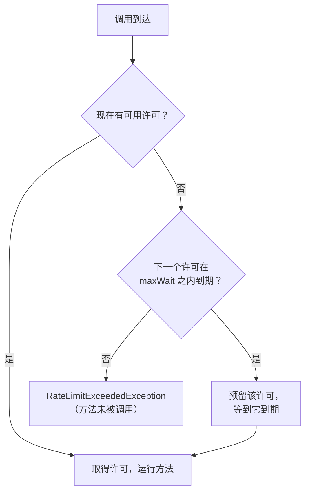

# 限流器

`@RateLimiter` 每个周期最多放行给定数量的调用，拒绝（或延迟）其余调用。

<div class="r4c-facts">

| 注解 | 位置 | 返回类型 | 默认值 |
|---|---|---|---|
| `@RateLimiter` | 第 4 层（共 7 层），在 CircuitBreaker 内部 | 同步、`CompletionStage`、`Mono`、`Flux` | 每 1 s 50 个许可，不等待 |

</div>

**适用场景**：依赖有配额（某个 API 每秒只允许 10 个请求），或者你想防止某个客户端冲垮共享服务。

**不适用场景**：你需要限制的是*同时*运行的调用数，而不管速率如何：那是[舱壁隔离](bulkhead.md)。另外，一个 JVM 中的限流器只限制该 JVM：如果你的服务有多个实例，每个实例都有自己的上限。

## 最小示例 :id=minimal-example

<!-- compare:start -->
<!-- snippet: rate-limiter-minimal -->
```java
import dev.resilience4cata.annotation.RateLimiter;

public interface SearchApi {

    @RateLimiter(permits = 10, period = "1s")
    String search(String query);
}
```
<!-- not-compiled: 生成的代码，有删节 -->
```java
public final class SearchApi$Resilient implements SearchApi {
    // …
    public SearchApi$Resilient(SearchApi delegate, dev.resilience4cata.ResilienceRegistry registry) {
        // …
        this.rateLimiter0 = dev.resilience4cata.generated.Policies.rateLimiter(registry, "dev.resilience4cata.examples.docs.ratelimiter.SearchApi#search(java.lang.String)", "", "", r4c$b -> {
            r4c$b.permits(10);
            r4c$b.period(java.time.Duration.ofNanos(1000000000L));
        }, false);
    }

    @Override
    public java.lang.String search(java.lang.String p0) {
        final dev.resilience4cata.generated.RateLimiterPolicy r4c$rateLimiter = this.rateLimiter0;
        if (!r4c$rateLimiter.tryAcquire()) {
            throw r4c$rateLimiter.rejection();
        }
        return this.delegate.search(p0);
    }
}
```
<!-- compare:end -->

有删节：真实文件使用全限定名。

## 行为方式 :id=how-it-behaves

可以把许可想象成均匀间隔的：当 `permits = 10`、`period = "1s"` 时，每 100 ms 出现一个许可。未使用的许可会被保存，最多保存 `permits` 个，所以一段空闲之后，最多 10 个调用的突发可以一次性通过；之后调用以稳定速率通过，每 100 ms 一个。



- **拒绝。** 当 `maxWait = "0"`（默认）时，没有可用许可的调用会立即以 `dev.resilience4cata.RateLimitExceededException` 失败（一个带 `id()` 的 `RuntimeException`；每个限流器一个，无堆栈跟踪）。方法不会被调用。
- **等待。** 当 `maxWait` > 0 时，许可在 `maxWait` 之内到来的调用会预留该许可并等待其到期；需要等待更久的调用会被立即拒绝，完全不等待。等待者知道自己的时间槽，所以许可到来时它们之间不会竞争。
- **同步等待**在调用方线程上休眠。如果线程在等待时被中断，许可会被归还，中断标志被重新设置，调用被拒绝。
- **突发。** 由于未使用的许可会累积成一次完整的突发，一个 `period` 的窗口内最多可能出现两倍 `permits` 的调用：一次完整的突发，然后是稳定速率。这与 Resilience4j 的固定周期相同。
- 没有后台线程补充许可：每个调用根据时钟自行计算。
- **禁用**（`enabled = false`）：所有调用都通过。

其底层实现是 GCRA，即令牌桶的计量器形式：全部状态就是一个数字，即下一个许可到期的时间，每次调用将其向前推进 `period / permits`。

## 属性 :id=attributes

| 属性 | 类型 | 默认值 | 配置键 | 含义 |
|---|---|---|---|---|
| `permits` | `int` | `50` | `defaults.rateLimiter.permits` | 每个 `period` 允许的调用数，也是最大突发量。至少为 1。 |
| `period` | 时长 | `1s` | `defaults.rateLimiter.period` | 周期长度。大于 0，且每个许可至少 1 ns。 |
| `maxWait` | 时长 | `0`（立即拒绝） | `defaults.rateLimiter.maxWait` | 调用最多可以等待其许可多久。 |
| `name` | `String` | 每个方法一个限流器 | 仅限注解 | 实例 id；`name` 相同的方法共享一个限流器及其许可。 |
| `config` | `String` | `default` | 仅限注解 | 作为起点的命名配置。 |
| `locked` | `boolean` | `false` | 仅限注解 | 保留注解中设置的值：`instances.<id>.*` 键无法修改它们。见[锁定实例](../guides/configuration.md#locking-an-instance)。 |
| `enabled` | `boolean` | `true` | `defaults.rateLimiter.enabled` | `false` 放行所有调用；不设置则继承。 |

默认值与 Resilience4j 的不同（每 500 ns 50 个许可，等待 5 s）：这里的等待需要显式开启，与舱壁隔离一样。`configs.<name>.` 和 `instances.<id>.` 下也有相应的键；见[配置](../guides/configuration.md)。

## 共享与实例 id :id=sharing-and-instance-ids

配额通常覆盖整个 API，而不是一个方法。给这些方法相同的 `name`，它们就会共享一个限流器：

<!-- snippet: rate-limiter-wait -->
```java
@RateLimiter(name = "geocoding", permits = 5, period = "1s", maxWait = "500ms")
String geocode(String address);

@RateLimiter(name = "geocoding", permits = 5, period = "1s", maxWait = "500ms")
String reverse(double latitude, double longitude);
```

这里 `geocode` 和 `reverse` 共享每秒 5 个许可。突发用完后，下一次调用等待 200 ms 获得其许可（1 s / 5），在允许的 500 ms 之内；需要等待超过 500 ms 的调用会被立即拒绝。共享 `name` 的方法必须解析为相同的配置，否则包装会以 [`R4C-REG-008`](../errors.md#r4c-reg-008) 失败。没有 `name` 时，id 为 `<type>#<method>(<parameter types>)`。

### 句柄 :id=handle

`registry.rateLimiter(id)` 返回一个 `RateLimiterHandle`：

<!-- snippet: rate-limiter-handle -->
```java
RateLimiterHandle limiter = registry.rateLimiter("geocoding");
int now = limiter.availablePermits();            // calls that would pass right now without waiting
RateLimiterSnapshot snapshot = limiter.snapshot(); // instance, availablePermits, permits
```

| 方法 | 作用 |
|---|---|
| `id()` | `name`，或派生 id |
| `config()` | 解析后的 `RateLimiterConfig` |
| `availablePermits()` | 此刻无需等待即可通过的调用数，介于 0 和 `permits` 之间；这是一个快照，并发调用会立即改变它 |
| `snapshot()` | 一个 `RateLimiterSnapshot(id, availablePermits, permits)` |

限流器在其接口被包装或其 pipeline 构建之后才存在；未知 id 会抛出 [`R4C-REG-009`](../errors.md#r4c-reg-009)。没有 `registry.rateLimiters()`：用 `registry.snapshot().rateLimiters()` 列出它们。

## 与其他策略配合 :id=with-other-policies

限流器是第四层：在 CircuitBreaker 内部，包住 Timeout 和 Bulkhead。

- 被打开的熔断器拒绝的调用永远不会到达这里，所以不会消耗许可。
- 外层的 `@CircuitBreaker` 永远不会记录它的拒绝（你自己的限流器不是出故障的依赖，所以它不会打开你的熔断器）。它们是 `Exception`，所以外层的 `@Retry` 会在退避延迟后重试它们（把 `RateLimitExceededException` 加入 `abortOn` 即可快速失败）。
- 每次重试尝试都各自消耗一个许可。
- 等待许可的时间不计入内层的 `@Timeout`。

## 异步 :id=async

对于返回 `CompletionStage<T>` 或 `CompletableFuture<T>` 的方法，拒绝是一个失败的 future，等待许可的调用会被调度在许可到期时启动，不阻塞任何线程：

<!-- snippet: rate-limiter-async -->
```java
@RateLimiter(name = "geocoding-async", permits = 5, period = "1s", maxWait = "500ms")
CompletableFuture<String> geocodeAsync(String address);
```

取消仍在等待许可的调用的 future 会归还该许可，调用永远不会启动；已经启动的调用保留其许可（[取消](../guides/async.md#cancellation)）。见[异步方法](../guides/async.md)。

## 用 `Pipeline` 实现同样的效果 :id=same-thing-with-pipeline

<!-- snippet: rate-limiter-pipeline -->
```java
Pipeline<String> search = Pipeline.builder(registry, "search", String.class)
        .rateLimiter(rl -> rl.permits(10).period(Duration.ofSeconds(1)))
        .build();

String results = search.execute(() -> backend.search("resilience"));
```

id `"search"` 就是实例 id：`registry.rateLimiter("search")` 返回该限流器。见 [Pipeline API](../guides/pipeline.md)。

## 事件与快照 :id=events-and-snapshot

| 事件 | 时机 | 字段 |
|---|---|---|
| `RateLimiterEvent.Rejected` | 调用被拒绝（`maxWait` 之内没有许可，或等待被中断） | `id`、`nanoTime` |

被放行的调用不发布任何事件。`registry.snapshot().rateLimiters()` 为每个限流器列出一个 `RateLimiterSnapshot`。见[可观测性](../guides/observability.md)。

## 用 `ManualClock` 测试 :id=testing-it-with-manualclock

<!-- snippet: rate-limiter-testing -->
```java
SearchApi search = Resilient.of(SearchApi.class, query -> "results for " + query, registry);

for (int i = 0; i < 10; i++) {
    search.search("q" + i);                      // a full burst of 10 is available at once
}
assertThatThrownBy(() -> search.search("one too many"))
        .isInstanceOf(RateLimitExceededException.class);

clock.advance(Duration.ofMillis(100));           // permits come back one every 1s / 10
assertThat(search.search("next")).isEqualTo("results for next");
assertThatThrownBy(() -> search.search("again")).isInstanceOf(RateLimitExceededException.class);
```

在 [`ManualClock`](../guides/testing.md) 上，只有时钟推进时许可才会恢复，等待许可的调用会推进时钟而不是休眠。

## 细节说明 :id=small-print

- `period` 必须保证每个许可至少 1 ns（`permits = 1_000_000_000` 需要 `period` ≥ 1 s），否则配置无效（[`R4C-REG-001`](../errors.md#r4c-reg-001)/[`R4C-REG-003`](../errors.md#r4c-reg-003)）。
- 上限是按 JVM 和按注册表划分的：两个注册表，或你的服务的两个实例，各有自己的上限。
- 每次调用读取一次 `System.nanoTime()`。在用于最初基准测试的 Apple M1 笔记本上，这次读取占了限流器开销的大部分（[限流器基准测试](../benchmarks.md#rate-limiter-1-and-4-threads-2026-10-24)）。
- 当被放行的调用到达速度超过限流器那唯一的共享值在 CPU 核心之间移动的速度时，竞争失败的调用方会以尽可能短的时间 park 后再重试；在 Linux 上，平台线程最短的 park 约为 50 µs。这只会在远高于限流器通常配置的任何速率时才会发生。
- 相关错误：[`R4C-ATR-001`](../errors.md#r4c-atr-001)（时长语法）、[`R4C-ATR-002`](../errors.md#r4c-atr-002)（`period = "0"`）、[`R4C-ATR-003`](../errors.md#r4c-atr-003)（`permits` 小于 1）、[`R4C-ATR-006`](../errors.md#r4c-atr-006)（`enabled`）、[`R4C-REG-004`](../errors.md#r4c-reg-004)（未知 `config`）、[`R4C-REG-008`](../errors.md#r4c-reg-008)（共享 `name` 但配置不同）、[`R4C-REG-009`](../errors.md#r4c-reg-009)（未知 id）。

## 开销 :id=what-it-costs

> [!MEASURED]
> 在 AWS Graviton3（`c7g.xlarge`，JDK 21）上，4 个线程共享一个限流器时，一次被放行的调用耗时 187 ns 且不做内存分配，而 Resilience4j 2.4.0 为 275 ns、40 B；一次被拒绝的调用耗时 34.7 ns、0 B，对比 1599 ns、505 B。单线程下，一次被放行的调用耗时 41.8 ns。[基准测试：MVP 完成](../benchmarks.md#mvp-completion-classifier-pipeline-events-testkit-2026-10-24-aws-graviton3)
