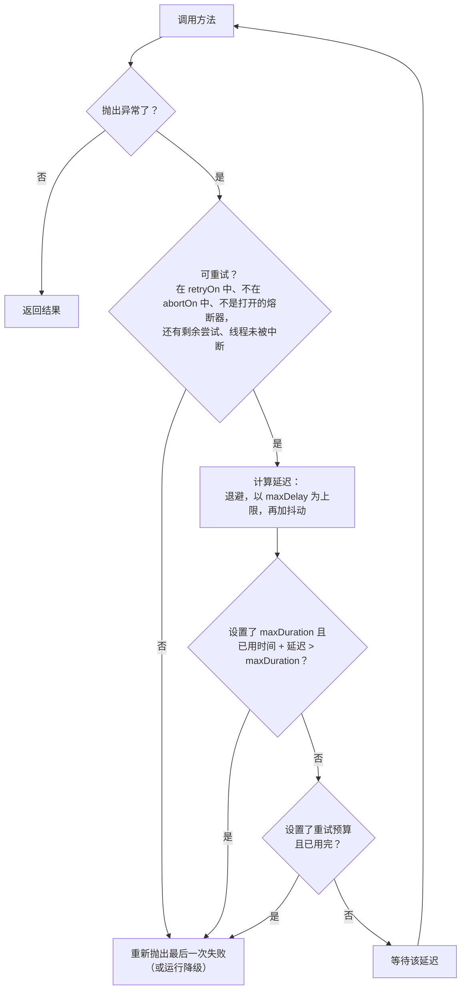

# 重试

`@Retry` 在方法失败时再次调用它，每次新尝试之前等待的时间稍长一些。

<div class="r4c-facts">

| 注解 | 位置 | 返回类型 | 默认值 |
|---|---|---|---|
| `@Retry` | 第 2 层（共 7 层），在 Fallback 内部 | 同步、`CompletionStage`、`Mono`、`Flux` | 3 次尝试，200 ms 指数退避 ×2，最长 10 s，完全抖动，重试 `Exception` |

</div>

**适用场景**：失败是暂时的，且操作可以安全重复：连接断开、`503`、争锁失败、幂等的读或写。

**不适用场景**：操作不是幂等的（重复扣款比失败一次更糟），失败是永久性的（校验错误、`404`），或者调用方承受不起额外的延迟。重试一个已经过载的依赖会让情况更糟：在重试内部放一个[熔断器](circuit-breaker.md)，这样打开的熔断器会停止重试。

## 最小示例 :id=minimal-example

<!-- compare:start -->
<!-- snippet: retry-minimal -->
```java
import dev.resilience4cata.annotation.Retry;

public interface InventoryApi {

    @Retry(maxAttempts = 3, delay = "100ms")
    int stock(String sku);
}
```
<!-- not-compiled: 生成的代码，有删节 -->
```java
public final class InventoryApi$Resilient implements InventoryApi {
    // …
    public InventoryApi$Resilient(InventoryApi delegate, dev.resilience4cata.ResilienceRegistry registry) {
        // …
        this.retry0 = dev.resilience4cata.generated.Policies.retry(registry, "dev.resilience4cata.examples.docs.retry.InventoryApi#stock(java.lang.String)", "", "", r4c$b -> {
            r4c$b.maxAttempts(3);
            r4c$b.delay(java.time.Duration.ofNanos(100000000L));
        }, false);
    }

    @Override
    public int stock(java.lang.String p0) {
        final dev.resilience4cata.generated.RetryPolicy r4c$retry = this.retry0;
        final long r4c$start = r4c$retry.start();
        int r4c$attempts = 0;
        while (true) {
            try {
                return this.delegate.stock(p0);
            } catch (java.lang.Throwable r4c$e) {
                final long r4c$delay = r4c$retry.onFailure(++r4c$attempts, r4c$e, r4c$start);
                if (r4c$delay < 0 || !r4c$retry.pause(r4c$delay)) {
                    throw r4c$e;
                }
            }
        }
    }
}
```
<!-- compare:end -->

有删节：真实文件使用全限定名。你的文件位于 `build/generated/sources/annotationProcessor/java/main`（Gradle）或 `target/generated-sources/annotations`（Maven）。

在启动时包装一次实现，然后到处使用这个包装器：

<!-- snippet: retry-wrap -->
```java
ResilienceRegistry registry = ResilienceRegistry.builder().build();
InventoryApi inventory = Resilient.of(InventoryApi.class, backend, registry);

int units = inventory.stock("sku-1");   // up to 3 attempts
```

生成的方法就是围绕你的调用的一个普通循环。调用成功时不分配任何内存，也不读取时钟；只有在失败之后才会询问策略。

## 行为方式 :id=how-it-behaves



- **重试什么。** 是某个 `retryOn` 类型（默认：`Exception`）的实例、且不是任何 `abortOn` 类型（默认：无）实例的异常。`abortOn` 优先于 `retryOn`。`CallNotPermittedException`（打开的熔断器）无论列表怎么写都永远不会被重试。其他任何异常都会被立即重新抛出，所以默认情况下 `Error`（`OutOfMemoryError`、`AssertionError` 等）永远不会被重试。正常返回的方法永远不会被重试，除非[分类器](../guides/classifiers.md)判定其结果是失败。
- **计数。** `maxAttempts` 统计每一次调用，包括第一次：`maxAttempts = 3` 表示最多重试两次。
- **延迟。** 在第 *n* 次重试之前（即 *n* 次尝试失败之后），基础延迟在 `FIXED` 退避下为 `delay`，在 `EXPONENTIAL` 下为 `delay × multiplier^(n−1)`，以 `maxDelay` 为上限。然后抖动将其随机化：`FULL` 在 0 到基础延迟之间选取，`EQUAL` 在其一半到全部之间选取，`NONE` 保持不变。使用默认值时，基础延迟为 200 ms、400 ms、800 ms……最长 10 s。
- **时间预算。** 设置了 `maxDuration` 时，如果下一次尝试会在预算之后开始（自第一次尝试以来的时间 + 下一次延迟 > `maxDuration`），重试会放弃而不是等待。它永远不会截断一次尝试：要做到这一点，请加上按每次尝试生效的 [`@Timeout`](timeout.md)。
- **放弃时**，最后一次失败被原样重新抛出：受检异常保持其类型，堆栈跟踪是最后一次尝试的。同一方法上有 `@Fallback` 时，改为运行一次降级，并带上已进行的尝试次数。
- **中断。** 同步重试在调用方线程上休眠。如果该线程被中断，重试立即停止并重新抛出最后一次失败，同时重新设置中断标志。本身是 `InterruptedException` 的失败也不会被重试。
- **禁用**（`enabled = false`，或 `defaults.retry.enabled=false`）：只有一次尝试，就像没有注解一样。

## 属性 :id=attributes

| 属性 | 类型 | 默认值 | 配置键 | 含义 |
|---|---|---|---|---|
| `maxAttempts` | `int` | `3` | `defaults.retry.maxAttempts` | 总尝试次数，包括第一次。至少为 1。 |
| `delay` | 时长 | `200ms` | `defaults.retry.delay` | 第一次重试前的基础延迟。`"0"` 表示立即重试。 |
| `backoff` | `Backoff` | `EXPONENTIAL` | `defaults.retry.backoff` | `FIXED`：每次延迟相同。`EXPONENTIAL`：每次尝试后乘以 `multiplier`。 |
| `multiplier` | `double` | `2.0` | `defaults.retry.multiplier` | `EXPONENTIAL` 的增长因子。有限值，至少为 1。 |
| `maxDelay` | 时长 | `10s` | `defaults.retry.maxDelay` | 单次指数延迟的上限。不得短于 `delay`，`FIXED` 下也是如此。 |
| `jitter` | `Jitter` | `FULL` | `defaults.retry.jitter` | `NONE`、`FULL`（0 到延迟之间）或 `EQUAL`（延迟的一半加上随机的另一半）。 |
| `maxDuration` | 时长 | `0`（无预算） | `defaults.retry.maxDuration` | 整个操作的时间预算，跨越所有尝试和延迟。 |
| `retryOn` | `Class<? extends Throwable>[]` | `{Exception.class}` | `defaults.retry.retryOn` | 会被重试的异常，包括子类。 |
| `abortOn` | `Class<? extends Throwable>[]` | `{}` | `defaults.retry.abortOn` | 停止重试的异常；优先于 `retryOn` 和分类器。无论是否列出，打开的熔断器都会停止重试。 |
| `budgetPercent` | `double` | `0`（无预算） | `defaults.retry.budgetPercent` | [重试预算](#retry-budget)：允许的重试数，为该实例最近 `budgetWindow` 内调用数的百分比。有限值，至少为 0；大于 0 即开启预算。 |
| `budgetMinRetriesPerSecond` | `int` | `10` | `defaults.retry.budgetMinRetriesPerSecond` | 重试预算：一旦 `budgetPercent` 开启预算，无论流量多少，`budgetWindow` 内每秒允许的重试数。至少为 0。 |
| `budgetWindow` | 时长 | `10s` | `defaults.retry.budgetWindow` | 重试预算：统计调用和重试的时间范围。从 `1s` 到 `1h`。 |
| `classifier` | `Class<?>` | 无 | 仅限注解 | 一个 `Classifier<T>`，决定重试什么，包括结果。取代 `retryOn`。见[分类器](../guides/classifiers.md)。 |
| `onExhaustedResult` | `ExhaustedResult` | `RETURN` | 仅限注解 | 使用分类器时：返回最后一个被拒绝的结果，或 `THROW` 一个 `ResultRejectedException`。 |
| `name` | `String` | 每个方法一个实例 | 仅限注解 | 实例 id；`name` 相同的方法共享一个重试策略。 |
| `config` | `String` | `default` | 仅限注解 | 作为起点的命名配置。 |
| `locked` | `boolean` | `false` | 仅限注解 | 保留注解中设置的值：`instances.<id>.*` 键无法修改它们。见[锁定实例](../guides/configuration.md#locking-an-instance)。 |
| `enabled` | `boolean` | `true` | `defaults.retry.enabled` | `false` 放行所有调用；不设置则继承。 |

- 时长是字符串：`"250ms"`、`"2s"`、`"1m"`、`"PT2S"` 或 `"0"`。它们在编译时检查。
- 你没有设置的属性保留命名配置的值，其次是默认值。每个键也存在于 `configs.<name>.retry.…` 和 `instances.<id>.retry.…` 下；见[配置](../guides/configuration.md)。
- 在 properties 文件中，枚举不区分大小写（`backoff=fixed`），异常列表是以逗号分隔的类名。

带异常列表和时间预算的同一个重试：

<!-- snippet: retry-exceptions -->
```java
@Retry(maxAttempts = 5, delay = "500ms", maxDelay = "2s", maxDuration = "4s",
        retryOn = IOException.class, abortOn = FileNotFoundException.class)
byte[] download(String path) throws IOException;
```

当 `jitter = NONE` 时，一直抛出 `IOException` 的 `download` 会在 0 s、0.5 s、1.5 s 和 3.5 s 被调用，然后放弃：在 2 s 延迟之后再尝试一次会超出 4 s 的预算。`FileNotFoundException` 也是 `IOException`，但 `abortOn` 优先，所以它在一次调用后就失败。`IllegalStateException` 不在 `retryOn` 中，所以它也在一次调用后失败。

你在注解中写的列表会**替换**默认列表，而不是追加到其中。

被熔断器拒绝的调用永远不会被重试，无论 `abortOn`、`retryOn` 或分类器怎么说：这种中止是内置的，不是 `abortOn` 的一项，所以你写的列表无法去掉它。这里 `abortOn` 只列出了 `IllegalArgumentException`：

<!-- snippet: retry-open-breaker -->
```java
@Retry(maxAttempts = 5, delay = "1s", abortOn = IllegalArgumentException.class)
@CircuitBreaker(windowSize = 2, minimumCalls = 2, waitInOpen = "1m")
String report(String id);
```

如果 `report` 一直失败，前两次尝试会打开熔断器，第三次得到 `CallNotPermittedException`，重试就此放弃（3 次尝试后发布 `GaveUp`，原因为 `NOT_RETRYABLE`），而不是再等两次延迟。只要熔断器保持打开，每次调用只做一次尝试，不做任何等待。

## 共享与实例 id :id=sharing-and-instance-ids

没有 `name` 时，每个方法有自己的重试策略，id 为 `<type>#<method>(<parameter types>)`，例如 `dev.resilience4cata.examples.docs.retry.InventoryApi#stock(java.lang.String)`。这个 id 用于 `instances.<id>.retry.…` 覆盖配置，也是事件和快照报告的 id。

没有[重试预算](#retry-budget)时，重试在调用之间不保留状态（尝试次数保存在生成方法的局部变量中），所以按 `name` 共享只是共享其配置。有预算时，还会共享预算。共享 `name` 的方法必须解析为相同的配置，否则包装会以 [`R4C-REG-008`](../errors.md#r4c-reg-008) 失败。

重试没有句柄：`registry` 没有 `retry(id)` 方法。`registry.snapshot().retries()` 把每个重试列为一个 `RetrySnapshot(id, config, budget)`，包含其解析后的配置，以及（如果有重试预算的话）预算的当前窗口（否则为 `null`）。

## 重试预算 :id=retry-budget

`maxAttempts` 限制一次调用的重试次数。**重试预算**则相对于流量，限制一个实例所有调用加在一起的重试次数：最近 `budgetWindow` 内的重试不得超过

> `budgetMinRetriesPerSecond × budgetWindow in seconds + budgetPercent % of the calls in budgetWindow`

（即：`budgetMinRetriesPerSecond` 乘以 `budgetWindow` 的秒数，加上 `budgetWindow` 内调用数的 `budgetPercent` %。）

**适用场景**：许多调用方共享一个可能宕机的依赖。没有预算时，每个调用方都会重试每一次失败：`maxAttempts = 3` 时，一次故障会让本已失败的依赖负载增加到三倍（重试风暴）。`budgetPercent = 20` 时，最多增加 20%。依赖健康时，失败很少，预算永远不会用到上限。该设计沿用 [Finagle 的 `RetryBudget`](https://twitter.github.io/finagle/guide/Clients.html#retries)（请求数的一个百分比，加上一个窗口内的每秒保留额度）；[gRPC](https://github.com/grpc/proposal/blob/master/A6-client-retries.md) 和 [Envoy](https://www.envoyproxy.io/docs/envoy/latest/api-v3/config/cluster/v3/circuit_breaker.proto) 也有类似的限制。

<!-- snippet: retry-budget -->
```java
@Retry(name = "catalog", maxAttempts = 3, delay = "100ms",
        budgetPercent = 20, budgetMinRetriesPerSecond = 1)
String product(String id);
```

这里，在任意 10 s 内（默认 `budgetWindow`），`catalog` 重试允许 10 次重试，再加每五次调用一次重试，由所有 `name = "catalog"` 的方法共享。用完之后，失败不会被重试：最后一次失败被重新抛出（或运行降级），并发布原因为 `BUDGET_EXHAUSTED` 的 `GaveUp`。其他所有规则仍然先适用，所以本来就不会被重试的失败不会消耗预算。

- **默认关闭**：`budgetPercent` 大于 0 即开启预算。此时它附带每秒 10 次重试的保留额度（`budgetMinRetriesPerSecond`，Finagle 重试预算的默认值），这样很少被调用的方法仍然可以重试。把保留额度设为 0 则只按百分比：`budgetPercent = 20` 且没有保留额度时，在窗口内被调用四次的方法完全无法重试。
- **统计什么**：调用，而不是尝试。调用在开始时计数，无论成功与否；重试在被批准时计数。
- **共享**：每个实例一个预算，所以请给调用同一依赖的方法相同的 `name`（以及相同的属性，与任何共享实例一样）。没有 `name` 时，每个方法有自己的预算。
- **处处一致**：同步和异步方法、带分类器的方法（会被重试的被拒绝结果同样消耗预算）以及 [`Pipeline`](../guides/pipeline.md)（`.retry(r -> r.budgetPercent(20).budgetMinRetriesPerSecond(1))`）。
- **窗口**每次向前移动 `budgetWindow` 的十分之一，并且只有失败会推动它，所以成功不读取时钟。因此，在没有任何失败期间发生的调用，其时间是未知的：它被记为之前最后一次失败的时间。在长于窗口的一段安静期之后，这些调用都已过期，预算从其保留额度加上随后的调用重新开始，宁可少重试。
- **快照**：`RetrySnapshot.budget()` 是当前窗口的 `Budget(calls, retries, allowedRetries)`。

在 [`ManualClock`](../guides/testing.md) 上，一个宕机的依赖能精确展示这个上限：

<!-- snippet: retry-budget-testing -->
```java
ManualClock clock = new ManualClock();
List<RetryEvent.GaveUp> gaveUp = new CopyOnWriteArrayList<>();
ResilienceRegistry registry = ResilienceTesting.registry(clock)
        .listen(RetryEvent.GaveUp.class, gaveUp::add)
        .build();
AtomicInteger attempts = new AtomicInteger();
CatalogApi catalog = Resilient.of(CatalogApi.class, id -> {
    attempts.incrementAndGet();
    throw new IllegalStateException("catalog down");
}, registry);

for (int i = 0; i < 100; i++) {
    assertThatThrownBy(() -> catalog.product("p-1")).isInstanceOf(IllegalStateException.class);
}

assertThat(attempts).hasValue(130);   // 100 calls + 10 (1/s over 10 s) + 20 (20% of 100), not 300
assertThat(gaveUp).filteredOn(e -> e.reason() == RetryEvent.Reason.BUDGET_EXHAUSTED).hasSize(95);
assertThat(registry.snapshot().retries().getFirst().budget())
        .isEqualTo(new RetrySnapshot.Budget(100, 30, 30));   // calls, retries, allowed retries
```

前五次调用都得到了两次重试；从第六次开始，预算每五次调用只允许一次重试。

**开销。** 没有预算时一切不变：生成的代码相同，`start()` 和以前一样只读取一个字段。有预算时，每次调用会在一个按线程 id 哈希分片的计数器上增加一次普通读写，每个分片位于独立的缓存行上，这样并发调用方不会写同一个共享缓存行；不读取时钟，也不分配内存。计数是有意设计为近似的：共享同一分片并发生竞争的两个线程可能丢失一次调用，这只会让预算更严格。会被重试的失败会读取时钟并汇总各分片，被批准的重试会在共享的重试计数上增加一次 compare-and-set。

> [!MEASURED]
> AWS `c7g.xlarge`（Graviton3），1 / 4 线程：一次成功调用在有预算时耗时 3.5 / 3.6 ns，没有预算时为 1.3 / 1.3 ns；重试一次的调用为 62 / 301 ns，对比 6.9 / 7.1 ns。数据来自[重试预算，0.3.0](../benchmarks.md#retry-budget-030-2026-10-25-aws-graviton3)。

## 与其他策略配合 :id=with-other-policies

重试是第二层，在 Fallback 内部，包住其他所有策略（见[概览](README.md)）：

- 每次尝试都会再次经过熔断器、限流器、超时和舱壁隔离。每次尝试都会被熔断器记录，并有自己的超时。
- 打开的熔断器抛出 `CallNotPermittedException`，无论 `abortOn` 怎么说都永远不会被重试：重试立即停止，而不是白白等待（见[上文](#attributes)）。
- 内层策略的拒绝（`RateLimitExceededException`、`CallTimeoutException`、`BulkheadFullException`）是 `Exception`，所以默认会在退避延迟后被重试。如果拒绝应当快速失败，把它们加入 `abortOn`。
- 舱壁槽位只在尝试运行时占用，在两次尝试之间的延迟期间不占用。
- 与 `@Fallback` 一起使用时，降级在最后一次尝试之后运行一次，其 `FallbackContext.attempts()` 告诉你进行了多少次尝试。

## 异步 :id=async

返回 `CompletionStage<T>` 或 `CompletableFuture<T>` 的方法会得到非阻塞形式：

<!-- snippet: retry-async -->
```java
@Retry(maxAttempts = 3, delay = "100ms")
CompletableFuture<Integer> stock(String sku);
```

第一次尝试在调用方线程上运行。失败的 stage 在延迟之后被重试，不阻塞任何线程：下一次尝试在新的虚拟线程上启动。返回的 future 以第一个成功的结果完成，或以最后一次失败（从 `CompletionException` 中解包）失败。取消返回的 future 会取消正在进行的尝试或挂起的退避，并且不再启动新的尝试（[取消](../guides/async.md#cancellation)）。见[异步方法](../guides/async.md)。

## 用 `Pipeline` 实现同样的效果 :id=same-thing-with-pipeline

对于无法加注解的代码，[编程式 API](../guides/pipeline.md) 可以从注册表构建同样的重试：

<!-- snippet: retry-pipeline -->
```java
Pipeline<Integer> stock = Pipeline.builder(registry, "inventory", Integer.class)
        .retry(r -> r.maxAttempts(3).delay(Duration.ofMillis(100)))
        .build();

int units = stock.execute(() -> backend.stock("sku-1"));
```

pipeline 的 id（`"inventory"`）就是实例 id。`retry()` 使用默认值，`retry("name")` 使用命名配置，`retry(r -> …)` 在它们之上进行覆盖。

## 事件与快照 :id=events-and-snapshot

| 事件 | 时机 | 字段 |
|---|---|---|
| `RetryEvent.Retrying` | 失败的尝试将被重试 | `id`、`nanoTime`、`attempt`、`delay`、`failure`（被拒绝的结果为 `null`） |
| `RetryEvent.GaveUp` | 不再有尝试 | `id`、`nanoTime`、`attempts`、`reason`、`failure` |

`GaveUp.reason()` 为 `MAX_ATTEMPTS`、`MAX_DURATION`、`NOT_RETRYABLE`（不在 `retryOn` 中、在 `abortOn` 中，或熔断器打开）、`INTERRUPTED`、`CLASSIFIER_FAILED` 或 `BUDGET_EXHAUSTED`（[重试预算](#retry-budget)已用完）。成功的调用不发布任何事件。监听器在注册表构建器上注册；见[可观测性](../guides/observability.md)。

## 用 `ManualClock` 测试 :id=testing-it-with-manualclock

[testkit](../guides/testing.md) 替换了时钟和休眠，所以带真实延迟的重试也能立即且确定性地运行：

<!-- snippet: retry-testing -->
```java
ManualClock clock = new ManualClock();
ResilienceRegistry registry = ResilienceTesting.registry(clock)
        .retryDefaults(r -> r.jitter(RetryConfig.Jitter.NONE))   // exact delays in this test
        .build();
AtomicInteger calls = new AtomicInteger();
InventoryApi backend = sku -> {
    if (calls.incrementAndGet() <= 2) {
        throw new IllegalStateException("inventory down");
    }
    return 7;
};
InventoryApi inventory = Resilient.of(InventoryApi.class, backend, registry);

assertThat(inventory.stock("sku-1")).isEqualTo(7);   // returns at once, in real time
assertThat(calls).hasValue(3);
assertThat(clock.elapsed()).isEqualTo(Duration.ofMillis(300));   // 100 ms, then 200 ms
```

`ResilienceTesting.registry(clock)` 还会为抖动的随机数生成器设定种子，所以即使开启抖动，每次运行的延迟也相同。像这里一样在测试的默认值中关闭抖动，会让延迟变得精确。

## 细节说明 :id=small-print

- `maxDelay` 不得短于 `delay`，`FIXED` 退避下也是如此，尽管此时它没有其他用途。单独写 `@Retry(delay = "20s", backoff = Backoff.FIXED)` 会在包装接口时失败（[`R4C-REG-003`](../errors.md#r4c-reg-003)），因为默认 `maxDelay` 是 10 s：请同时设置 `maxDelay = "20s"`。
- `FIXED` 退避下会忽略 `multiplier`。
- `maxDuration` 在每次延迟之前做决定；它不会中断正在运行的尝试。请与 `@Timeout` 结合使用。
- 使用 `Resilient.of` 时只有接口上的注解生效，实现对自身的调用（`this.stock(…)`）不会被重试。使用[带注解的类](../guides/annotated-classes.md)时会被重试。
- 同步形式在延迟期间阻塞调用方线程（在虚拟线程上开销很小）。使用异步形式可以释放它。
- 相关错误：[`R4C-ATR-001`](../errors.md#r4c-atr-001)（时长语法）、[`R4C-ATR-003`](../errors.md#r4c-atr-003)（`maxAttempts` 小于 1）、[`R4C-ATR-004`](../errors.md#r4c-atr-004)（`multiplier`）、[`R4C-ATR-007`](../errors.md#r4c-atr-007)（重试预算值）、[`R4C-CLS-011`](../errors.md#r4c-cls-011)（`classifier` 与 `retryOn` 同时使用）、[`R4C-CLS-012`](../errors.md#r4c-cls-012)（没有分类器却设置了 `onExhaustedResult`）、[`R4C-REG-001`](../errors.md#r4c-reg-001)/[`R4C-REG-003`](../errors.md#r4c-reg-003)（无效组合）、[`R4C-REG-004`](../errors.md#r4c-reg-004)（未知 `config`）、[`R4C-REG-008`](../errors.md#r4c-reg-008)（共享 `name` 但配置不同）。

## 开销 :id=what-it-costs

> [!MEASURED]
> 在 AWS Graviton3（`c7g.xlarge`，JDK 21）上，经过 `@Retry` 的一次成功调用耗时 1.2 ns 且不做内存分配，而 Resilience4j 2.4.0 为 22.9 ns；失败一次、重试后成功的调用耗时 6.5 ns、0 B，对比 61.6 ns、16 B（测量 Resilience4j 时去掉了其无条件的 `Thread.sleep(0)`）。[基准测试：MVP 完成](../benchmarks.md#mvp-completion-classifier-pipeline-events-testkit-2026-10-24-aws-graviton3)
