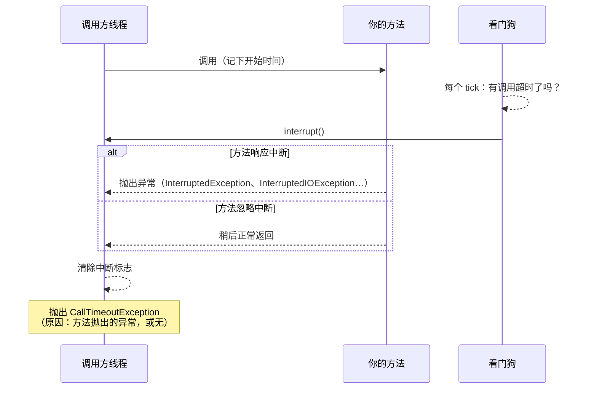

# 超时

`@Timeout` 限制一次调用可以花费的时间：同步调用会被中断，异步调用则让其 future 失败。

<div class="r4c-facts">

| 注解 | 位置 | 返回类型 | 默认值 |
|---|---|---|---|
| `@Timeout` | 第 6 层（共 7 层），在 AdaptiveLimit 内部 | 同步、`CompletionStage`、`Mono`、`Flux` | 每次尝试 1 s |

</div>

**适用场景**：依赖可能卡住，而调用方无限等待（占着线程、连接、舱壁槽位）比报错更糟。

**不适用场景**：你调用的代码无法被中断，而你又需要让它停下：同步超时通过中断其线程来*请求*调用停止，它无法强行终止调用（见[下文](#sync-the-call-is-interrupted)）。只要客户端自己提供超时（HTTP 客户端或 JDBC 驱动的连接超时和读取超时），就优先使用它们，把 `@Timeout` 作为上限。

## 最小示例 :id=minimal-example

<!-- compare:start -->
<!-- snippet: timeout-minimal -->
```java
import dev.resilience4cata.annotation.Timeout;

public interface ReportApi {

    @Timeout("2s")
    String build(String reportId);
}
```
<!-- not-compiled: 生成的代码，有删节 -->
```java
public final class ReportApi$Resilient implements ReportApi {
    // …
    public ReportApi$Resilient(ReportApi delegate, dev.resilience4cata.ResilienceRegistry registry) {
        // …
        this.timeout0 = dev.resilience4cata.generated.Policies.timeout(registry, "dev.resilience4cata.examples.docs.timeout.ReportApi#build(java.lang.String)", "", "", r4c$b -> {
            r4c$b.timeout(java.time.Duration.ofNanos(2000000000L));
        }, false);
    }

    @Override
    public java.lang.String build(java.lang.String p0) {
        final dev.resilience4cata.generated.TimeoutPolicy r4c$timeout = this.timeout0;
        final dev.resilience4cata.generated.TimeoutPolicy.Scope r4c$scope = r4c$timeout.enter();
        final java.lang.String r4c$result;
        try {
            r4c$result = this.delegate.build(p0);
        } catch (java.lang.Throwable r4c$e) {
            r4c$timeout.failed(r4c$scope, r4c$e);
            throw r4c$e;
        }
        r4c$timeout.succeeded(r4c$scope);
        return r4c$result;
    }
}
```
<!-- compare:end -->

有删节：真实文件使用全限定名。

## 行为方式 :id=how-it-behaves

### 同步：调用被中断 :id=sync-the-call-is-interrupted

调用在调用方线程上运行，就像没有超时一样；没有额外的线程，也没有执行器。一个共享的守护线程，即看门狗（watchdog），检查正在运行的调用，并在某个调用超过其超时时间时**中断**调用方线程。



- 接下来发生什么取决于你的代码。响应中断的阻塞调用（`Thread.sleep`、`Object.wait`、`BlockingQueue.take`、`java.net.http.HttpClient.send`、虚拟线程上的大多数 I/O、NIO 可中断通道）会停止并抛出异常；随后超时抛出以该异常为原因的 `CallTimeoutException`。
- **忽略中断的代码会先运行到结束**：忙循环、平台线程上经典的阻塞式 `java.net.Socket` I/O、吞掉 `InterruptedException` 的库。调用会一直进行直到返回；只有到那时调用方才会得到 `CallTimeoutException`（没有原因），结果被丢弃。
- 看门狗的中断会在抛出 `CallTimeoutException` 之前被清除，所以它永远不会泄漏到该线程之后的工作中。超时之前线程已经带有的中断属于调用方，所以会被保留。
- **中断 I/O 可能会损失一个连接。** 阻塞在可中断通道（`InterruptibleChannel`，或虚拟线程上的 socket I/O）上的线程，其通道会被中断关闭，所以它正在使用的池化连接会丢失，连接池必须新开一个。在这很重要时，把客户端自己的超时设置得比 `@Timeout` 短。
- **精度。** 调用永远不会被提前中断，最多晚大约两个看门狗 tick。一个 tick 是正在使用的最短超时的十六分之一，介于 1 ms 和 50 ms 之间：只有 `@Timeout("2s")` 时，最多晚约 100 ms。在休眠时间比一个 tick 更长的机器上（请求 0.75 ms 时，GitHub 的 Windows runner 上约 2 ms，其 macOS 虚拟机上约 4 ms），一个 tick 按该休眠时长计算，因此超时会晚几次这样的休眠。这需要进程能得到 CPU：在容器 CPU 限制（cgroup 配额，即 Kubernetes 的 `limits.cpu` 所设置的）下，被节流的 JVM 会让看门狗和调用方一起冻结，中断会在进程再次运行时到来。
- 按时完成的调用不受任何影响。被计时的调用不读取时钟：看门狗为它们维护一个粗粒度的时钟。

> [!MEASURED]
> AWS Graviton3，JDK 25，服务每秒承受 1500 次调用，`@Timeout` 为 200 ms：没有限制时，最晚的中断发生在 221.6–225.1 ms。限制为半个核心时，中断最多晚了 4.8 s，全部发生在第一分钟内，那时 JIT 正在编译，服务在大多数周期都被节流；此后没有一次晚于 250 ms。没有一次提前。[基准测试：CPU 受限的服务](../benchmarks.md#cpu-limit)

### 异步：future 失败 :id=async-the-future-fails

对于返回 `CompletionStage<T>` 或 `CompletableFuture<T>` 的方法，不会中断任何东西。如果超时时间到了 stage 还没有完成，你拿到的 future 会以 `CallTimeoutException` 失败，并且如果方法的 stage 是 `Future`（`CompletableFuture` 就是），它会被取消。截止时间由一个共享的无锁定时器维护，永远不会提前，最多晚大约两个 tick；超时在一个新的虚拟线程上完成，绝不在定时器的线程上。方法返回时就已完成的 stage 完全不需要定时器。

<!-- snippet: timeout-async -->
```java
@Timeout("2s")
CompletableFuture<String> build(String reportId);
```

超时覆盖的是 stage，而不是返回它的方法调用：一个在返回 stage *之前*阻塞了 5 s 的方法不会超时。取消会穿过超时内部的策略，所以内部的舱壁会立即释放其槽位。取消你拿到的 future 会取消截止时间和 stage，不会产生 `CallTimeoutException`，也不会产生事件（[取消](../guides/async.md#cancellation)）。见[异步方法](../guides/async.md)。

### 异常 :id=the-exception

`dev.resilience4cata.CallTimeoutException` 是一个带 `id()` 和 `timeout()`（被超过的 `Duration`）的 `RuntimeException`。它没有堆栈跟踪；消息会指明实例和超时时间。

## 属性 :id=attributes

| 属性 | 类型 | 默认值 | 配置键 | 含义 |
|---|---|---|---|---|
| `value` | 时长 | `1s` | `defaults.timeout.value` | 一次尝试最多可以花费的时间。大于 0。 |
| `config` | `String` | `default` | 仅限注解 | 作为起点的命名配置。 |
| `locked` | `boolean` | `false` | 仅限注解 | 保留注解中设置的值：`instances.<id>.*` 键无法修改它们。见[锁定实例](../guides/configuration.md#locking-an-instance)。 |
| `enabled` | `boolean` | `true` | `defaults.timeout.enabled` | `false` 放行所有调用；不设置则继承。 |

`@Timeout` **没有 `name`**：超时不保存值得共享的状态，所以每个带注解的方法都有自己的策略，id 为 `<type>#<method>(<parameter types>)`。在外部配置中该属性是 `value`（`configs.slow.timeout.value=10s`、`instances."com.acme.ReportApi#build(java.lang.String)".timeout.value=5s`）；在代码中构建器方法是 `TimeoutConfig.Builder.timeout(Duration)`。见[配置](../guides/configuration.md)。

它也**没有句柄**：`registry` 没有 `timeout(id)`。`registry.snapshot().timeouts()` 为每个方法列出一个 `TimeoutSnapshot(id, config)`。

## 与其他策略配合 :id=with-other-policies

超时是第五层：在 RateLimiter 内部，包住 Bulkhead。

- **按每次尝试生效。** 在 `@Retry` 内部，每次尝试都获得完整的超时时间。要限制整个操作（包括所有尝试和延迟），请设置 `@Retry(maxDuration = …)`。
- `CallTimeoutException` 是一个 `Exception`：默认情况下，外层的 `@Retry` 会重试它，外层的 `@CircuitBreaker` 会把它记录为失败。
- 等待限流器许可的时间不计入（限流器在外层）；等待舱壁槽位的时间计入（舱壁在内层）。被中断的舱壁等待会变成 `CallTimeoutException`。
- `@Fallback` 会像对待其他失败一样看到 `CallTimeoutException`。

## 用 `Pipeline` 实现同样的效果 :id=same-thing-with-pipeline

<!-- snippet: timeout-pipeline -->
```java
Pipeline<String> build = Pipeline.builder(registry, "reports", String.class)
        .timeout(t -> t.timeout(Duration.ofSeconds(2)))
        .build();

String report = build.execute(() -> backend.build("r-1"));
```

这里超时的 id 就是 pipeline 的 id，`"reports"`。见 [Pipeline API](../guides/pipeline.md)。

## 事件与快照 :id=events-and-snapshot

| 事件 | 时机 | 字段 |
|---|---|---|
| `TimeoutEvent.TimedOut` | 调用超过了其超时时间 | `id`、`nanoTime`、`timeout` |

按时完成的调用不发布任何事件。见[可观测性](../guides/observability.md)。

## 用 `ManualClock` 测试 :id=testing-it-with-manualclock

<!-- snippet: timeout-testing -->
```java
ReportApi slow = id -> {
    try {
        clock.sleep(Duration.ofSeconds(5));          // a slow dependency, on the test's clock
    } catch (InterruptedException e) {
        throw new IllegalStateException("interrupted", e);   // how the timeout reaches the call
    }
    return "report " + id;
};
ReportApi reports = Resilient.of(ReportApi.class, slow, registry);

assertThatThrownBy(() -> reports.build("r-1"))
        .isInstanceOf(CallTimeoutException.class)
        .hasCauseInstanceOf(IllegalStateException.class);   // what the call threw once interrupted
assertThat(Thread.currentThread().isInterrupted()).isFalse(); // the interrupt is cleared
```

在 [`ManualClock`](../guides/testing.md) 上，同步超时在时钟越过截止时间时准确触发，没有一个 tick 的余量；异步超时在推进时钟的线程上触发。用 `clock.sleep(…)` 模拟慢依赖的桩会像真实的阻塞代码一样被中断；改用 `clock.advance(…)` 的桩则表现得像忽略中断的代码。

## 细节说明 :id=small-print

- 同步超时是协作式的：它依赖中断。它无法停止忽略中断的代码，也不应被用来限制从不检查 `Thread.interrupted()` 的 CPU 密集型工作。
- 如果你的代码捕获 `InterruptedException` 后继续执行，调用就不会被截断；请恢复中断标志（`Thread.currentThread().interrupt()`）或重新抛出。
- 恰好在截止时间结束、而看门狗正在中断它的调用，仍会得到 `CallTimeoutException`：结果只决定一次，然后中断被清除。
- 在平台线程上，阻塞在经典 socket I/O 中的调用会一直占着线程，直到 socket 自己的超时。虚拟线程让大多数阻塞 I/O 变得可中断。
- 相关错误：[`R4C-ATR-001`](../errors.md#r4c-atr-001)（时长语法）、[`R4C-ATR-002`](../errors.md#r4c-atr-002)（`@Timeout("0")`）、[`R4C-ATR-006`](../errors.md#r4c-atr-006)（`enabled`）、[`R4C-REG-004`](../errors.md#r4c-reg-004)（未知 `config`）。

## 开销 :id=what-it-costs

> [!MEASURED]
> 在 AWS Graviton3（`c7g.xlarge`，JDK 21）上，经过 `@Timeout` 并按时完成的同步调用在单线程下耗时 22.2 ns 且不做内存分配（后来的一次运行测得 23.7 ns，原因尚待确认）；Resilience4j 2.4.0 没有调用方线程上的超时，它带执行器的 `TimeLimiter` 耗时 8842 ns、176 B。stage 仍处于挂起状态的异步调用耗时 152 ns、192 B，对比 598 ns、240 B。[基准测试：MVP 完成](../benchmarks.md#mvp-completion-classifier-pipeline-events-testkit-2026-10-24-aws-graviton3)，[后来的运行](../benchmarks.md#annotated-classes-generics-config-overrides-ticker-bulkhead-2026-10-24-aws-graviton3)

> [!MEASURED]
> 每个请求一个新的虚拟线程时，每次计时调用都是其线程的第一次调用，并会把该线程注册到看门狗：每个线程多约 270 B，四个线程同时启动时，在虚拟线程启动并 join 所需的 9.3 µs 之上再多约 0.8 µs。同一线程上之后的计时调用不再付出这个代价。[基准测试：每个新虚拟线程一个超时](../benchmarks.md#review-fixes)
