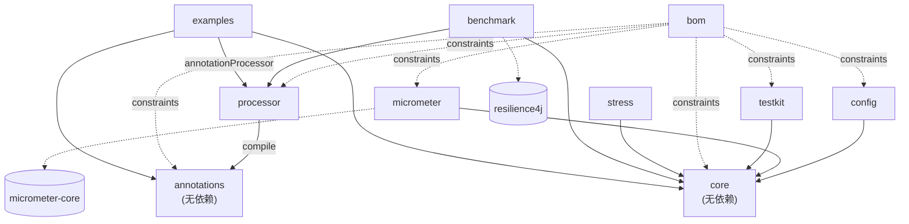

# 05 — 项目架构、构建与工程实践

> **历史文档。** 本研究早于实现，按原样保留；关于库目前的功能，请参阅[功能](../policies/README.md)、[架构](../architecture.md)和[基准测试](../benchmarks.md)。

> 第 1 阶段研究。状态：**提案**，此处内容尚未实现。
> 西班牙语版本：[../../es/research/05-project-architecture.md](../../es/research/05-project-architecture.md)

本文档讨论仓库的*形态*：有哪些 Gradle 模块、各自做什么，构建如何组织，JPMS 如何融入，质量工具，双语文档如何产出，以及我们如何对公共 API 做版本管理和保护。注解处理机制、并发内部实现和注解 API 本身等主题由其他并列的研究文档讨论。本文档只指出它们在哪些地方影响模块布局。

---

## 概要 :id=tldr

| 决策 | 建议 |
|---|---|
| 模块名称 | 单个单词的目录：`core`、`annotations`、`processor`、`config`、`micrometer`、`testkit`、`stress`、`benchmark`、`examples`、`bom`。发布的 artifactId 加前缀：`resilience4cata-core`，… |
| 粒度 | **一个**运行时引擎（`core`）包含所有策略。*不要*像 Resilience4j 那样按模式拆分。用户最多需要 3 个坐标（外加 BOM）。 |
| `core` 中的外部依赖 | 在 Java 21 上做到**零**依赖是可行的（`System.Logger`、`VarHandle`、`InstantSource`、JFR）。唯一值得讨论的例外是 JSpecify（只有注解，约 4 KB）。 |
| 构建 | Gradle 9.x、Kotlin DSL、带预编译约定插件的 `build-logic` 包含构建（included build）、`gradle/libs.versions.toml`、工具链 21 + `--release 21`，开启配置缓存和构建缓存。 |
| 发布 | 使用 `com.vanniktech.maven.publish` 发布到 **Central Portal**（OSSRH 已于 2025-06-30 关闭），在 CI 中进行内存 GPG 签名，以及一个 `java-platform` BOM。 |
| JPMS | 每个发布的模块都有真正的 `module-info.java`。内部包不导出。处理器 `provides javax.annotation.processing.Processor`。 |
| 质量 | JUnit Jupiter、AssertJ、jqwik（注意：处于维护模式）、jcstress、ArchUnit、Error Prone + NullAway（JSpecify 模式）、Spotless、JaCoCo，以及在 JDK 21 和 25 上运行的 GitHub Actions 矩阵。 |
| 文档 | **不是** Gradle 模块。`docs/en` 和 `docs/es` 下的纯 Markdown，由仓库中已有的 Docsify 站点渲染（GitHub Pages）。Javadoc 由 Gradle 生成并链接。 |
| API 稳定性 | SemVer，`0.x` 为孵化期，自定义的 `@Experimental` / `@Internal` 标记，从 `1.0` 起在 CI 中运行 japicmp。 |

---

## 1. 模块布局 :id=_1-module-layout

### 1.1 Resilience4j 的做法，以及用户不喜欢的地方 :id=_11-what-resilience4j-does-and-what-users-dislike

Resilience4j 2.x 为每种模式发布一个构件：`resilience4j-circuitbreaker`、`-ratelimiter`、`-bulkhead`、`-retry`、`-timelimiter`、`-cache`。它还发布 `resilience4j-core`、聚合构件 `resilience4j-all`（包含 `Decorators` 构建器）、`resilience4j-bom`，以及一长串集成模块（`-micrometer`、`-reactor`、`-rxjava3`、`-kotlin`、`-spring-boot3`、`-spring6`、`-vertx`、`-feign`、`-retrofit`，…）（[README](https://github.com/resilience4j/resilience4j)、[Central 上的 BOM](https://central.sonatype.com/artifact/io.github.resilience4j/resilience4j-bom)）。

对我们的设计有影响的痛点：

1. **简单用例也需要太多坐标。** 一个典型服务最终要声明 4–6 个构件，或者引入 `-all`，这就让模块化失去了意义。每个模式构件反正都依赖 `resilience4j-core`，所以拆分节省的字节码很少。
2. **注解与 Spring AOP 绑定。** `@CircuitBreaker`、`@Retry` 等位于 `resilience4j-annotations`，但只有通过 Spring（或 Micronaut）切面模块才能真正*起作用*。纯 Java 用户得不到注解支持。这正是本项目瞄准的空白。
3. **组合功能所在的构件**（`-all` 中的 `Decorators`）与它所组合的模式不在同一个构件中。
4. 多个构件之间的**版本对齐**迫使用户使用 BOM。

教训：按**依赖边界**拆分（这段代码是否引入第三方库，或是否在不同的时间运行，例如编译时与运行时？），绝不按*功能*拆分。

### 1.2 建议的模块 :id=_12-proposed-modules

所有目录名都是单个单词。发布的 artifactId 使用 `resilience4cata-` 前缀，以便在 Maven Central 上不产生歧义（`resilience4cata-core`）。在 `settings.gradle.kts` 中 Gradle 项目仍为 `:core`，前缀在发布约定插件中添加。

| 模块 | 发布 | 职责 | 依赖 |
|---|---|---|---|
| `annotations` | ✅ | 只有注解类型（`@CircuitBreaker`、`@Retry`、`@RateLimiter`、`@Bulkhead`、`@Timeout`、`@Fallback`，用于多个配置的可重复容器，以及 `@Experimental` / `@Internal`）。没有逻辑。 | 无 |
| `core` | ✅ | 所有策略实现、注册表（registry）、配置*模型*对象、组合管道、事件/指标 SPI、JFR 事件，以及生成的代码所调用的运行时支持。 | 无（仅 JDK） |
| `processor` | ✅ | 注解处理器：在编译时校验注解并生成代码。用户只把它加到 `annotationProcessor`。 | `annotations`（编译） |
| `config` | ✅ | 从外部来源加载策略配置：`java.util.Properties`、系统属性、环境变量，以及用于其他来源的 `ConfigSource` SPI。将其绑定到 `core` 的配置模型。 | `core` |
| `micrometer` | ✅ | 将 `core` 的事件/指标桥接到 Micrometer `MeterRegistry`。 | `core`、`io.micrometer:micrometer-core` |
| `testkit` | ✅ | 面向**用户**的测试辅助工具：可控时钟、确定性调度器、故障注入桩、针对策略状态的 AssertJ 风格断言。 | `core`；JUnit/AssertJ 作为 `compileOnly` |
| `bom` | ✅ | 一个对齐所有发布模块的 `java-platform` BOM。 | 仅约束 |
| `stress` | ❌ | 针对 `core` 中无锁状态机的 jcstress 测试。 | `core`、jcstress |
| `benchmark` | ❌ | 将我们与 Resilience4j（以及空操作基线）对比的 JMH 基准测试。 | `core`、`processor`、Resilience4j、JMH |
| `examples` | ❌ | 使用处理器编译的可运行小程序。它们同时也是生成的代码的端到端测试。 | `annotations`、`core`、`processor` |
| `docs` | ❌ | 文档源文件。**不是 Gradle 项目**（见 §5）。 | — |

关于命名的说明：

- **避免使用 `test` 作为项目名。** `gradle test` 和 `:test` 已经指向 `test` *任务*，所以名为 `test` 的项目会写成 `:test:test`，让任务选择变得混乱。`testkit` 没有歧义。JUnit、Micrometer 和 Gradle 本身都用这个名字表达同样的用途。
- 集成模块以**所集成的对象**命名（`micrometer`，以后的 `opentelemetry`），而不是一个泛称（`metrics`）。这样随着集成增多，仍能保持单个单词的规则。
- 以后可能的模块，都是单个单词：`opentelemetry`、`reactor`、`kotlin`、`spring`、`quarkus`（目前不在范围内）。

### 1.3 `annotations` 是否应与 `core` 分开？ :id=_13-should-annotations-be-separate-from-core

两种方案都可行。这是一个在 `1.0` 之前可以低成本重新考虑的决定。

- **分开（推荐）。** `core` 保持为纯编程式库，完全不使用注解也能用，就像 Failsafe 的用法一样。处理器只依赖很小的 `annotations` jar。如果 API 设计研究确定只用于代码生成时采用 `CLASS` 保留策略，用户可以把 `annotations` 放在 `compileOnly` 上。代价是多一个坐标，而 BOM 会把它隐藏起来。
- **合并。** 用户只需要 `core` + `processor`。代价是处理器的处理器路径会拖入整个 `core`，并且注解包会成为运行时模块 API 表面的一部分。

无论哪种方式，**包都不能在 jar 之间拆分**（JPMS 禁止这样做）。注解放在 `…​.annotation`，引擎放在 `…​.core` 及其子包中。

### 1.4 依赖图 :id=_14-dependency-graph



规则，由 ArchUnit 和构建强制执行（见 §4）：

- `core` 和 `annotations` **没有**项目依赖或外部依赖。
- 没有任何模块在运行时依赖 `processor`。它只会出现在 `annotationProcessor` 配置中。
- `processor` 生成的代码**只依赖 `core` 导出的 API**，保留策略为 `RUNTIME` 时再加上 `annotations`。这是处理器与运行时之间的契约。它应该位于一个专门导出的包中（例如 `…​.core.spi.generated`），以便有意识地演进。
- 集成模块（`config`、`micrometer`，…）依赖 `core`，彼此之间从不相互依赖。

用户需要写的内容：

```kotlin
dependencies {
    implementation(platform("io.github.<ns>:resilience4cata-bom:0.1.0"))
    implementation("io.github.<ns>:resilience4cata-core")
    implementation("io.github.<ns>:resilience4cata-annotations")
    annotationProcessor("io.github.<ns>:resilience4cata-processor")
}
```

### 1.5 “core 零外部依赖”是否可行？ :id=_15-is-zero-external-dependencies-in-core-feasible

可行。韧性运行时所需的一切都在 JDK 21 平台中：

| 需求 | JDK 21 的答案 |
|---|---|
| 日志 | `System.Logger`（JEP 264），通过 SLF4J/Log4j/JUL 各自的 `System.LoggerFinder` 桥接进行路由。Resilience4j 为此依赖 `slf4j-api`；我们不需要。 |
| 原子操作、无锁状态 | `java.util.concurrent.atomic`、`VarHandle`、`LongAdder`、`StampedLock` |
| 时间 | `System.nanoTime()`，用于可测试时钟的 `java.time.InstantSource`（Java 17） |
| 调度 / 异步 | `ScheduledExecutorService`、`CompletableFuture`、虚拟线程（JEP 444，在 21 中定稿） |
| 可观测性 | `jdk.jfr` 自定义事件，禁用时几乎零开销。使用 `requires static jdk.jfr`，这样不含 JFR 的 jlink 镜像仍然可用。 |
| 函数式类型 | `java.util.function`，加上我们自己的 `CheckedSupplier` 风格接口。Resilience4j 2.0 出于同样原因去掉了 Vavr。 |
| 配置解析 | `java.util.Properties`。YAML/HOCON 如果需要，应放在可选模块中。 |

**唯一**值得考虑的依赖是 **JSpecify**（`org.jspecify:jspecify`）。它只包含注解，没有传递依赖，约 4 KB，如今已被 Spring Framework 7 和 Guava 使用（[jspecify.dev](https://jspecify.dev/)）。两种方案：

- `compileOnly` + `requires static org.jspecify`。严格的零运行时依赖，但 Kotlin 使用者和 IDE 会丢失可空性信息，除非他们自己添加该 jar。
- `api` + `requires transitive org.jspecify`。一个很小的 jar，使用者获得完整的可空性信息。

建议：`api`，并在文档中写明“除 JSpecify 注解外零依赖”。这是 Java 生态在 2025 年趋于一致的做法。`processor` 也保持无依赖：避免使用 JavaPoet，或者将其 shade。一些流行的处理器（Dagger、AutoValue）在同一处理器路径上携带不同版本的 JavaPoet，在那里发生冲突非常麻烦。

---

## 2. 2025–2026 年多模块库的 Gradle（Kotlin DSL） :id=_2-gradle-kotlin-dsl-for-a-multi-module-library-20252026

### 2.1 仓库布局 :id=_21-repository-layout

```
resilience4cata/
├── settings.gradle.kts
├── gradle.properties
├── gradle/
│   ├── libs.versions.toml
│   └── wrapper/
├── build-logic/                 # included build, NOT a subproject
│   ├── settings.gradle.kts
│   ├── build.gradle.kts         # `kotlin-dsl` plugin
│   └── src/main/kotlin/
│       ├── r4c.java-library.gradle.kts
│       ├── r4c.published.gradle.kts
│       ├── r4c.quality.gradle.kts
│       └── r4c.benchmark.gradle.kts
├── annotations/ core/ processor/ config/ micrometer/ testkit/ bom/
├── stress/ benchmark/ examples/
└── docs/                        # not part of the Gradle build
```

`build-logic` 是包含构建的惯用名称。它不是子项目，也从不发布，但名字中含有连字符。如果单个单词的规则也要适用于它，`conventions` 是一个干净的替代名。Gradle 文档在示例中使用 `build-logic`（[共享构建逻辑](https://docs.gradle.org/current/userguide/sharing_build_logic_between_subprojects.html)）。

### 2.2 Settings

```kotlin
// settings.gradle.kts
pluginManagement {
    includeBuild("build-logic")
}
plugins {
    id("org.gradle.toolchains.foojay-resolver-convention") version "<latest>"
}
dependencyResolutionManagement {
    repositoriesMode = RepositoriesMode.FAIL_ON_PROJECT_REPOS
    repositories { mavenCentral() }
}
enableFeaturePreview("TYPESAFE_PROJECT_ACCESSORS")
rootProject.name = "resilience4cata"
include("annotations", "core", "processor", "config", "micrometer",
        "testkit", "bom", "stress", "benchmark", "examples")
```

### 2.3 约定插件（不用 `allprojects {}` / `subprojects {}`） :id=_23-convention-plugins-no-allprojects---subprojects-

Gradle 不鼓励跨项目配置，因为它破坏项目隔离和配置缓存。取而代之的是，每个模块应用自己需要的约定（[Gradle 最佳实践](https://docs.gradle.org/current/userguide/best_practices.html)、[构建的组织](https://docs.gradle.org/current/userguide/multi_project_builds.html)）：

```kotlin
// build-logic/src/main/kotlin/r4c.java-library.gradle.kts
plugins { `java-library` }

java {
    toolchain { languageVersion = JavaLanguageVersion.of(21) }
    withSourcesJar(); withJavadocJar()
}
tasks.withType<JavaCompile>().configureEach {
    options.release = 21
    options.compilerArgs.addAll(listOf("-Xlint:all", "-Werror", "-parameters"))
}
tasks.withType<Test>().configureEach { useJUnitPlatform() }
```

```kotlin
// core/build.gradle.kts
plugins {
    id("r4c.java-library")
    id("r4c.published")
    id("r4c.quality")
}
// no dependencies block: that's the point
```

在预编译脚本插件中，通过 `the<VersionCatalogsExtension>().named("libs")` 读取版本目录，或者使用常见的变通办法，把 `libs` 类型安全访问器暴露给 `build-logic`。

### 2.4 版本目录 :id=_24-version-catalog

`gradle/libs.versions.toml` 是库**和**插件版本的唯一来源（[文档](https://docs.gradle.org/current/userguide/version_catalogs.html)）。草图：

```toml
[versions]
junit = "6.0.+"          # pin exact in reality
assertj = "3.27.+"
jmh = "1.37"
errorprone = "2.+"
nullaway = "0.12.+"
jspecify = "1.0.0"
resilience4j = "2.3.0"

[libraries]
jspecify = { module = "org.jspecify:jspecify", version.ref = "jspecify" }
junit-bom = { module = "org.junit:junit-bom", version.ref = "junit" }
assertj = { module = "org.assertj:assertj-core", version.ref = "assertj" }
resilience4j-bom = { module = "io.github.resilience4j:resilience4j-bom", version.ref = "resilience4j" }

[plugins]
jmh = { id = "me.champeau.jmh", version = "0.7.2" }
maven-publish = { id = "com.vanniktech.maven.publish", version = "0.34.0" }
spotless = { id = "com.diffplug.spotless", version = "<latest>" }
errorprone = { id = "net.ltgt.errorprone", version = "<latest>" }
japicmp = { id = "me.champeau.gradle.japicmp", version = "<latest>" }
```

（版本仅作示意。编写构建时请固定确切版本，并让 Renovate 或 Dependabot 保持它们最新。）

### 2.5 工具链与多 JDK 测试 :id=_25-toolchains-and-multi-jdk-testing

- 使用**工具链 21** 和 `options.release = 21` 编译。`release` 保证我们绝不会调用比 21 更新的 API，即使工具链更新也是如此。工具链通过 foojay 解析器自动获取（[工具链](https://docs.gradle.org/current/userguide/toolchains.html)）。
- 通过覆盖测试启动器，在其他 JDK 上测试而**无需重新编译**：

```kotlin
val testJdk = providers.gradleProperty("testJdk").map(String::toInt)
tasks.withType<Test>().configureEach {
    javaLauncher = testJdk.flatMap { v ->
        javaToolchains.launcherFor { languageVersion = JavaLanguageVersion.of(v) }
    }.orElse(javaToolchains.launcherFor(java.toolchain))
}
```

然后 CI 运行 `./gradlew check -PtestJdk=25`。这能发现真实的运行时差异，例如 JDK 24 对虚拟线程固定（pinning）的改变（[JEP 491](https://openjdk.org/jeps/491)）以及更新的 JIT 行为。

### 2.6 配置缓存、构建缓存、并行 :id=_26-configuration-cache-build-cache-parallelism

Gradle 9 将配置缓存设为**首选**执行模式，并计划在 Gradle 10 中成为默认（[9.0 发布说明](https://docs.gradle.org/9.0.0/release-notes.html)）。Gradle 9.1 为 CI 增加了只读模式（[9.1 说明](https://docs.gradle.org/9.1.0/release-notes.html)）。从第一天就开启它。事后补上要困难得多。

```properties
# gradle.properties
org.gradle.configuration-cache=true
org.gradle.configuration-cache.problems=fail
org.gradle.caching=true
org.gradle.parallel=true
```

这里选择的所有插件都支持配置缓存。vanniktech 在 0.34.0 中加入了发布方面的支持。

### 2.7 测试注解处理器 :id=_27-testing-the-annotation-processor

三个层次：

1. **单元级编译测试。** 使用 [Google compile-testing](https://github.com/google/compile-testing)（`Compiler.javac().withProcessors(new Processor()).compile(source)`，然后 `assertThat(compilation).succeeded()` / `.hadErrorContaining(...)` / `.generatedSourceFile(...)`）。它与框架无关，可以在 JUnit Jupiter 中使用。只有它的 `CompilationRule` 是 JUnit 4 专用的。替代方案是基于 `javax.tools.JavaCompiler` + 内存中 `JavaFileManager` 的 50 行自研工具，可避免 Guava/Truth 依赖（仅在测试作用域，所以影响不大）。
   对**诊断信息**的测试要和正常路径一样仔细：无效配置必须在编译时失败，并在出错的元素上给出精确的消息。这是相对于仅在运行时校验的一个卖点。
2. **端到端。** `examples` 模块（以及处理器自己的 `src/integrationTest`）在处理器路径上使用真正的处理器编译。它的测试执行生成的代码。
3. **Gradle 集成。** [Gradle TestKit](https://docs.gradle.org/current/userguide/test_kit.html) 用于测试 *Gradle 插件*。只有当我们发布 Gradle 插件时才需要它。对于处理器，只在一个窄范围内用它来验证**增量注解处理**：处理器必须在 `META-INF/gradle/incremental.annotation.processors` 中声明自己（如果每个生成的文件恰好来自一个注解类型则为 `isolating`，否则为 `aggregating`）。否则每个用户的构建都会失去增量编译（[文档](https://docs.gradle.org/current/userguide/java_plugin.html#sec:incremental_annotation_processing)）。一个小的 TestKit 测试可以断言修改一个源文件不会触发完全重新编译。

### 2.8 JMH

在 `benchmark` 中使用 [`me.champeau.jmh`](https://github.com/melix/jmh-gradle-plugin)（撰写时 Plugin Portal 上为 0.7.2）。实践：

- 基准测试放在 `src/jmh/java`。因为很慢，不要放进 `check`。按需运行，并在专用运行器上的定时 CI 作业中运行，而不是在共享的 GitHub 运行器上，后者的噪声让数字不可靠。
- 同类对比：我们和 Resilience4j 使用相同的策略配置，外加一个无策略基线。报告 `thrpt` 和 `avgt`，带 `-prof gc`（每次操作的内存分配率是一个核心指标），分别在 1、4 和 N 个线程下（`@Threads`，用 `@Group` 测混合读写竞争）。
- 发布原始 JSON 结果（`resultFormat = "JSON"`）并在文档中渲染。

### 2.9 发布到 Maven Central :id=_29-publishing-to-maven-central

- Sonatype **已于 2025 年 6 月 30 日关闭 OSSRH**。新的发布通过 **Central Portal**（`central.sonatype.com`）进行（[Sonatype 公告](https://central.sonatype.org/news/20250326_ossrh_sunset/)）。
- 使用 [`com.vanniktech.maven.publish`](https://github.com/vanniktech/gradle-maven-publish-plugin)（0.34.0 或更高）。它以 Central Portal 为目标，生成 Central 要求的 POM 元数据（名称、描述、URL、许可证、开发者、SCM），添加 sources/javadoc jar，进行签名，并支持配置缓存（[发布记录](https://github.com/vanniktech/gradle-maven-publish-plugin/releases)）。

```kotlin
// build-logic/src/main/kotlin/r4c.published.gradle.kts
plugins { id("com.vanniktech.maven.publish") }
mavenPublishing {
    publishToMavenCentral(automaticRelease = false)
    signAllPublications()
    coordinates("io.github.<ns>", "resilience4cata-${project.name}", version.toString())
    pom { /* name, description, url, licenses, developers, scm */ }
}
```

- **命名空间：** 验证 `io.github.<github-user>`（通过 GitHub 即时完成）或通过 DNS TXT 记录验证你拥有的域名。在第一次发布前选定，因为它是永久的。
- **CI 中的签名：** 将 `ORG_GRADLE_PROJECT_signingInMemoryKey`、`…KeyPassword`、`ORG_GRADLE_PROJECT_mavenCentralUsername` 和 `…Password`（Portal 的*用户令牌*）作为 GitHub secrets 传入。不需要 keyring 文件。
- **BOM：** `bom` 模块应用 `java-platform`，并将 `api(project(":core"))` 和其他发布模块声明为约束。Gradle 模块元数据（`.module`）与 POM 一同发布。
- 发布流程：打标签 `vX.Y.Z`，然后 CI 发布，最初再在 Portal 中手动点击“Publish”（`automaticRelease = false`）。一旦信任这条流水线，就切换为自动发布。

---

## 3. JPMS

### 3.1 每个发布模块一个 `module-info.java` :id=_31-one-module-infojava-per-published-module

```java
// core/src/main/java/module-info.java
module io.github.ns.resilience4cata.core {
    requires static jdk.jfr;
    requires transitive org.jspecify;           // if JSpecify is `api`
    exports io.github.ns.resilience4cata.core;
    exports io.github.ns.resilience4cata.core.spi;
    exports io.github.ns.resilience4cata.core.spi.generated; // contract for generated code
    // ...core.internal is NOT exported
    uses io.github.ns.resilience4cata.core.spi.EventListenerProvider;
}
```

```java
// processor/src/main/java/module-info.java
module io.github.ns.resilience4cata.processor {
    requires java.compiler;
    requires io.github.ns.resilience4cata.annotations;
    provides javax.annotation.processing.Processor
        with io.github.ns.resilience4cata.processor.ResilienceProcessor;
}
```

同时在 `processor` 中提供 `META-INF/services/javax.annotation.processing.Processor`。大多数构建工具（Gradle、Maven、IDE）把处理器放在**类路径式**的处理器路径上，此时 `provides` 会被忽略，起作用的是服务文件。

好处：真正封装 `internal` 包（比命名约定更强），兼容 jlink，并且由 `javac` 本身检查的、类似 ArchUnit 的保证。当存在 `module-info.java` 时，Gradle 会自动推断模块路径（[Gradle 中的 Java 模块](https://docs.gradle.org/current/userguide/java_library_plugin.html#sec:java_library_modular)）。

### 3.2 注解处理器如何与 JPMS 交互 :id=_32-how-annotation-processors-interact-with-jpms

- **处理器在编译时运行于用户的编译器中**，来自处理器路径（`-processorpath`）或处理器模块路径（`--processor-module-path`）。它从不出现在用户的运行时模块路径上。在 Gradle 中它位于 `annotationProcessor` 配置。
- **生成的代码位于用户的模块和包中。** `Filer.createSourceFile` 写入正在编译的模块。因此用户的 `module-info.java` 必须 `requires io.github.ns.resilience4cata.core`（保留策略为 `RUNTIME` 时还要 `…annotations`）。要在文档中写明这一点，并且当正在编译一个模块（`Elements.getModuleOf(...)` 不是未命名模块）而其 `module-info` 中缺少所需模块时，让处理器给出清晰的错误。
- **代码生成不需要 `opens`。** 生成的类与被注解的类位于同一个包中并直接调用它，没有深度反射。基于反射或字节码的方案*确实*需要用户 `opens` 包或交出一个 `MethodHandles.Lookup`。这是支持 APT 的又一个论据，机制研究对此有深入讨论。
- **禁止拆分包。** 这就是注解、core 和生成的代码各自需要不同包的原因。生成的代码与*用户*代码共享一个包，这没有问题，因为两者都在用户的模块中。
- **测试：** 白盒单元测试以补丁方式运行在模块内（Gradle 处理 `--patch-module`）。黑盒测试可以放在单独的源集中，带有自己的 `module-info.java`，以准确测试使用者看到的内容。

---

## 4. 质量工具 :id=_4-quality-tooling

| 工具 | 作用 | 说明 |
|---|---|---|
| **JUnit Jupiter**（JUnit 6） | 测试引擎 | JUnit 6.0 于 2025-09-30 正式发布，基线为 Java 17（[InfoQ](https://www.infoq.com/news/2025/10/junit6-java17-kotlin)）。通过 `junit-bom` 使用。 |
| **AssertJ** | 断言 | `testkit` 可以提供自定义 AssertJ 断言（`assertThat(circuitBreaker).isOpen()`）。 |
| **jqwik** | 对状态机（熔断器状态转换、令牌桶不变量）进行基于属性的测试和**有状态/基于模型的**测试 | ⚠️ jqwik 处于**纯维护模式**：只有依赖更新和关键修复（[jqwik](https://jqwik.net/)、[发布说明](https://jqwik.net/release-notes.html)）。作为仅测试依赖仍然可用。采用之前要验证与 JUnit Platform 6 的兼容性，并让属性保持足够简单，以便必要时移植到普通 JUnit `@RepeatedTest` + 带种子的 `Random` 工具上。 |
| **jcstress** | 在 JMM 下验证无锁代码的并发正确性 | 位于 `stress` 模块。通过 `io.github.reyerizo.gradle.jcstress` 插件或普通的 `JavaExec` 运行。因为很慢，每晚或按需运行。它是证明状态转换和许可计数没有丢失更新的工具（[jcstress](https://github.com/openjdk/jcstress)）。 |
| **ArchUnit** | 模块和包的边界 | 规则：`core` 只依赖 `java..`/`jdk.jfr..`/`org.jspecify..`。`internal` 之外的任何东西都不暴露 `internal` 类型。`spi.generated` 契约只被生成的代码使用（[ArchUnit](https://www.archunit.org/)）。 |
| **Error Prone + NullAway** | 静态缺陷查找和空安全 | `net.ltgt.errorprone` 插件。较新的 Error Prone 需要较新的 JDK 来*运行* javac，在 21 上没问题。在 JDK 21 上，**JSpecify 模式**的 NullAway 需要 `-XDaddTypeAnnotationsToSymbol=true`（OpenJDK）才能完整检查泛型/类型使用，在 JDK 22+ 上则原生完全支持（[NullAway JSpecify 支持](https://github.com/uber/NullAway/wiki/JSpecify-Support)）。将包标记为 `@NullMarked`。 |
| **JSpecify** | 可空性注解 | 见 §1.5。 |
| **Spotless** | 格式化 | `palantir-java-format` 或 `google-java-format`，加上许可证头和构建脚本的 Kotlin DSL 格式化（ktlint）。`spotlessCheck` 在 `check` 中运行。 |
| **JaCoCo** | 覆盖率 | 使用 `jacoco-report-aggregation` 插件聚合。把覆盖率当作信号，而不是门槛。以后考虑对 `core` 进行 **PIT** 变异测试。 |
| **GitHub Actions** | CI | 见下文。 |

### CI 草图 :id=ci-sketch

```yaml
# .github/workflows/ci.yml (illustrative)
jobs:
  build:
    strategy:
      matrix:
        test-jdk: [21, 25]
        os: [ubuntu-latest]
        include:
          - { test-jdk: 25, os: windows-latest }
          - { test-jdk: 25, os: macos-latest }
    runs-on: ${{ matrix.os }}
    steps:
      - uses: actions/checkout@v4
      - uses: actions/setup-java@v4
        with: { distribution: temurin, java-version: "21\n${{ matrix.test-jdk }}" }
      - uses: gradle/actions/setup-gradle@v4    # caching + wrapper validation
      - run: ./gradlew check -PtestJdk=${{ matrix.test-jdk }}
```

其他作业：`japicmp`（在 PR 上，从 1.0 起）、每晚的 `stress` + `benchmark`（专用运行器）、在标签上触发的 `release`，以及用于 Dependabot 告警的 Gradle 依赖提交 action。还可以考虑把 JDK 抢先体验构建（26-ea）设为 `continue-on-error`。

支持的版本：**21 和 25 都是 LTS**。21 是基线。25 是向前兼容的目标。

---

## 5. 文档模块 :id=_5-documentation-module

### 5.1 现状 :id=_51-current-state

仓库中已经有 `docs/`，带有一个 **Docsify v4** 外壳（`index.html`、`README.md`、`.nojekyll`）。它已可用于 GitHub Pages，没有构建步骤。Docsify 在浏览时于浏览器中渲染 Markdown。

### 5.2 方案对比 :id=_52-options-compared

| 方案 | 优点 | 缺点 |
|---|---|---|
| **GitHub 上的纯 Markdown** | 零工具。在仓库和 IDE 中都可读。 | 没有搜索，没有语言切换，导航较弱。 |
| **Docsify**（当前） | 无需构建。Markdown 保持纯文本。每种语言一个文件夹，各有自己的 `_sidebar.md`，通过 `_navbar.md` 切换语言，还有 [docsify-namespaced](https://github.com/palkan/docsify-namespaced) 等插件（[用 Docsify 做多语言](https://evilmartians.com/chronicles/easy-multi-language-multi-version-documentation-with-docsify-git-and-github-actions)）。 | 客户端渲染，所以 SEO 较弱。v4 已经老旧，v5 迟迟未到。没有开箱即用的多版本文档。 |
| **MkDocs Material**（i18n 插件） | 输出和搜索都非常出色。 | ⚠️ **自 2025-11-05 起处于维护模式**，关键修复只承诺到大约 2026 年 11 月。团队已转向 **Zensical**（[公告报道](https://duerrenberger.dev/blog/2025/11/06/material-for-mkdocs-is-no-more-long-live-zensical)、[issue](https://github.com/squidfunk/mkdocs-material/issues/8523)）。现在不要在它上面新建站点。 |
| **Zensical** | MkDocs Material 的继任者。读取 `mkdocs.yml`。 | 还很年轻，插件对等（i18n、博客，…）仍在追赶。在 Java 仓库中引入 Python 工具链。 |
| **Docusaurus** | 一流的 i18n（`i18n/es/...`）、多版本文档、成熟。 | Node/React 工具链。比我们目前需要的更重。 |
| **Astro Starlight** | 良好的 i18n，快速的静态输出。 | Node 工具链。 |

### 5.3 建议 :id=_53-recommendation

1. **docs 不是 Gradle 模块。** 它没有 Java 源码，没有需要 Gradle 编译或发布的东西。把它做成 Gradle 项目只会增加配置时间。让 `docs/` 保持为普通目录。在 IntelliJ 的意义上它仍是一个“模块”（`docs.iml`），这没有问题。Gradle 唯一的接触点是*其他模块中*为站点提供内容的任务：发布时复制到 `docs/api/` 的聚合 `javadoc`，以及基准测试的 JSON 结果。
2. **源文件布局：** 语言在最前，每种语言下结构相同。

```
docs/
├── index.html            # Docsify shell
├── README.md             # landing page / language chooser
├── _navbar.md            # EN | ES switcher
├── en/
│   ├── README.md
│   ├── _sidebar.md
│   ├── guide/ …
│   └── research/05-project-architecture.md
└── es/
    ├── README.md
    ├── _sidebar.md
    ├── guide/ …
    └── research/05-project-architecture.md
```

3. **第 1 阶段保留 Docsify**，因为它已经存在且无需构建。让 Markdown 保持**与工具无关**：标准 CommonMark/GFM 加上 Mermaid 代码块，不使用 Docsify 专有语法。这样以后迁移到 Zensical、Docusaurus 或 Starlight 只是改配置，而不是重写。在 `1.0` 时、需要多版本文档时重新评估。
4. **翻译纪律：** 英文是事实来源。每个修改 `docs/en/**` 的 PR 都必须修改 `docs/es/**`，或带上 `translation-pending` 标签。一个很小的 CI 脚本可以检查两棵目录树包含相同的文件集合。代码和标识符在两种语言中都保持英文。

---

## 6. 版本管理、API 稳定性和兼容性检查 :id=_6-versioning-api-stability-and-compatibility-checks

### 6.1 版本管理 :id=_61-versioning

- **SemVer。** 孵化期间为 `0.y.z`，允许在次版本号升级时做破坏性变更，并在变更日志中列出。一旦注解 API 和生成的代码契约稳定，就推出 `1.0.0`。
- 所有模块使用同一个版本（BOM 就意味着这一点）。放在 `gradle.properties` 中（`version=0.1.0-SNAPSHOT`）。
- 以 “Keep a Changelog” 风格编写 `CHANGELOG.md`。发布说明在文档站点上是双语的；变更日志只用英文即可。

### 6.2 稳定性标记 :id=_62-stability-markers

在 `annotations` 中定义我们自己的标记，这样就不需要 API Guardian 依赖（JUnit 使用 apiguardian 的 `@API(status = EXPERIMENTAL)`，这会多一个依赖）：

```java
@Documented
@Retention(RetentionPolicy.CLASS)
@Target({TYPE, METHOD, CONSTRUCTOR, FIELD, PACKAGE, ANNOTATION_TYPE})
public @interface Experimental { String since() default ""; }

@Documented
@Retention(RetentionPolicy.CLASS)
@Target({TYPE, METHOD, CONSTRUCTOR, FIELD, PACKAGE})
public @interface Internal { }
```

- `@Experimental`：公开，但可能在任何次版本中改变，并且排除在兼容性检查之外。
- `@Internal` + `…internal` 包（JPMS 不导出）：从不属于 API。它们只为我们模块内部的跨包需求而存在。
- **生成的代码契约**（`core.spi.generated`）比较特殊。由处理器 N 版本编译的代码必须在 `core` N 上继续工作。要在文档中写明“处理器和 core 的版本必须一致”这一规则并强制执行：生成的代码可以嵌入处理器版本，`core` 可以在类初始化时检查一次，并以清晰的消息快速失败。BOM 让版本一致变得容易。

### 6.3 兼容性检查 :id=_63-compatibility-checks

| 工具 | 说明 |
|---|---|
| **japicmp**（[站点](https://siom79.github.io/japicmp/)，Gradle 插件 `me.champeau.gradle.japicmp`） | 将 jar 与 Central 上最近发布的版本进行二进制和源码兼容性对比。支持按注解（`@Experimental`、`@Internal`）和包（`*.internal`）排除。简单、快速、维护良好。**推荐。** |
| **Revapi**（[站点](https://revapi.org/)） | 更强大（感知 semver、丰富的过滤），但 Gradle 支持较弱。Palantir 的 `gradle-revapi` 插件已不再积极维护。更适合 Maven。 |

计划：在 `r4c.published` 约定中把 japicmp 接入为 `check` 的一部分。在 `0.x` 阶段保持*仅提示*，从 `1.0` 起对除 `processor` 之外的每个发布模块都设为**失败**。对处理器而言，“API”是注解加上生成的代码，由 `examples` 的测试覆盖。

---

## 7. 留给其他研究方向的开放问题 :id=_7-open-questions-for-the-other-research-tracks

1. 注解的**保留策略**（`CLASS` 与 `RUNTIME`）决定 `annotations` 能否作为 `compileOnly`，以及是否必须与 `core` 合并（§1.3）。
2. 如果机制研究选择了运行时后备方案（代理或字节码），它需要一个单独的模块（例如 `proxy` 或 `agent`），以便 `core` 保持无依赖，且只用代码生成的用户不必为它付出代价。
3. 外部配置格式：`Properties` + 环境变量对 `config` 是否足够，还是用户会期望 YAML？超出 `Properties` 的任何东西都意味着一个可选依赖，因此需要单独模块或 SPI。
4. Central 上的 Group id / 命名空间（`io.github.<user>` 还是域名），以及根 Java 包 / JPMS 模块名。

---

## 来源 :id=sources

- Resilience4j 仓库和 README：<https://github.com/resilience4j/resilience4j>
- Central 上的 Resilience4j BOM：<https://central.sonatype.com/artifact/io.github.resilience4j/resilience4j-bom>
- Gradle 9.0 发布说明（首选配置缓存）：<https://docs.gradle.org/9.0.0/release-notes.html>
- Gradle 9.1 发布说明（只读配置缓存）：<https://docs.gradle.org/9.1.0/release-notes.html>
- Gradle：共享构建逻辑 / 约定插件：<https://docs.gradle.org/current/userguide/sharing_build_logic_between_subprojects.html>
- Gradle 最佳实践：<https://docs.gradle.org/current/userguide/best_practices.html>
- Gradle 版本目录：<https://docs.gradle.org/current/userguide/version_catalogs.html>
- Gradle 工具链：<https://docs.gradle.org/current/userguide/toolchains.html>
- Gradle 增量注解处理：<https://docs.gradle.org/current/userguide/java_plugin.html#sec:incremental_annotation_processing>
- Gradle Java 模块：<https://docs.gradle.org/current/userguide/java_library_plugin.html#sec:java_library_modular>
- Gradle TestKit：<https://docs.gradle.org/current/userguide/test_kit.html>
- Google compile-testing：<https://github.com/google/compile-testing>
- JMH Gradle 插件：<https://github.com/melix/jmh-gradle-plugin>、<https://plugins.gradle.org/plugin/me.champeau.jmh>
- vanniktech gradle-maven-publish-plugin：<https://github.com/vanniktech/gradle-maven-publish-plugin>
- Sonatype OSSRH 停用：<https://central.sonatype.org/news/20250326_ossrh_sunset/>
- JSpecify：<https://jspecify.dev/>
- NullAway JSpecify 支持：<https://github.com/uber/NullAway/wiki/JSpecify-Support>
- JUnit 6 公告（InfoQ）：<https://www.infoq.com/news/2025/10/junit6-java17-kotlin>
- jqwik 及其发布说明：<https://jqwik.net/>、<https://jqwik.net/release-notes.html>
- jcstress：<https://github.com/openjdk/jcstress>
- ArchUnit：<https://www.archunit.org/>
- JEP 491（无固定的虚拟线程）：<https://openjdk.org/jeps/491>
- Material for MkDocs 维护模式：<https://duerrenberger.dev/blog/2025/11/06/material-for-mkdocs-is-no-more-long-live-zensical>、<https://github.com/squidfunk/mkdocs-material/issues/8523>
- 用 Docsify 做多语言文档：<https://evilmartians.com/chronicles/easy-multi-language-multi-version-documentation-with-docsify-git-and-github-actions>、<https://github.com/palkan/docsify-namespaced>
- japicmp：<https://siom79.github.io/japicmp/>
- Revapi：<https://revapi.org/>
